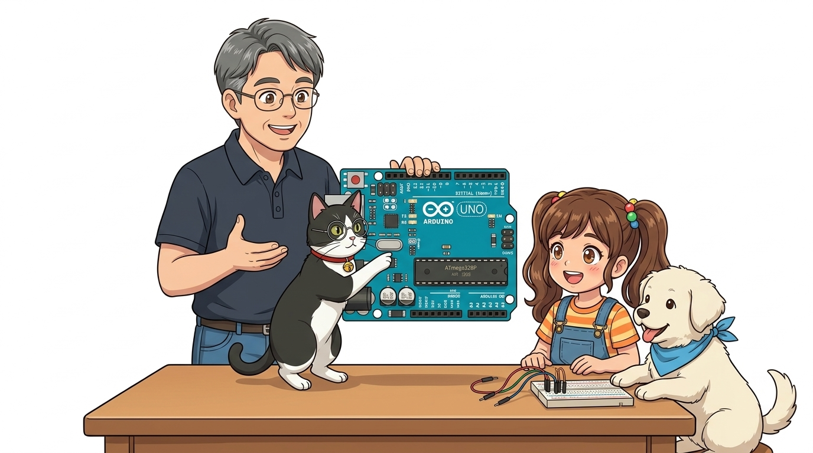
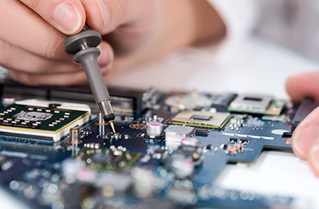
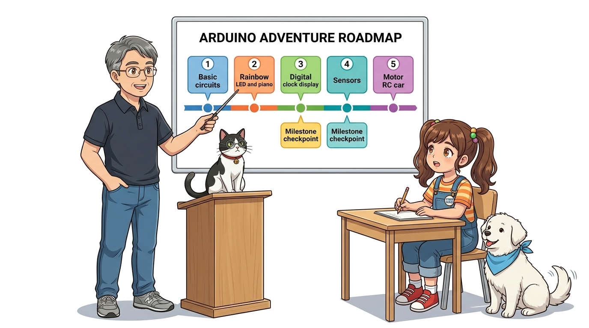

# 000_강의소개_아두이노모험의시작 🧭
### "이호진 교수님과 함께하는 도로시와 토토의 신기한 전자 세상 탐험"



* **강좌 대상**: 초등학생부터 코딩을 처음 접하는 모든 어른이
* **준비물**: 호기심 가득한 눈망울 + 재미있게 따라 해볼 마음가짐!

* 🖥️ **강의 슬라이드**: [slides.md](./slides.md)

---

## 👥 우리 모험을 함께할 주인공들을 소개합니다!


* **👨‍🏫 이호진 교수님 (공학 & 메이커 멘토)**:  
  어려운 전자 회로와 컴퓨터 과학을 누구보다 친절하고 재미있게 설명해 주시는 교수님!
* **🐱 지니 (교수님의 조수 고양이)**:  
  단정한 턱시도 무늬와 둥근 안경, 방울 목걸이를 맨 연구실 수석 조수! 교수님 곁에서 회로와 코드를 꼼꼼히 점검해 줘요.
* **👧 도로시 (수업을 듣는 9세 학생 메이커)**:  
  "이 초록색 판은 뭐야? 어떻게 불이 켜져?" 교수님의 수업을 들으며 반짝이는 눈으로 직접 만들어보는 열정 가득한 학생!
* **🐶 토토 (도로시의 단짝 친구 강아지)**:  
  도로시 옆에서 항상 수업을 함께 듣고, 부품을 챙겨주며 꼬리를 흔들어 응원하는 귀염둥이 친구!

---

## 💡 1단계: 컴퓨터에 USB 선을 꽂아보자!


> **👧 도로시**: "지니야! 노트북에 파란색 USB 케이블을 꽂으니까 아두이노 보드의 작은 불(LED)이 깜빡깜빡 춤을 춰!"  
> **🐱 조수 지니**: "맞아 도로시! 컴퓨터에서 전기를 받자마자, 아두이노 공장에서 미리 넣어둔 **'깜빡이(Blink)' 프로그램**이 스스로 깨어나 작동한 거란다!"

---

## ⚡ 2단계: 전기가 흐르면 스스로 생각해요!


1. **전원 공급**: 컴퓨터의 5V 전기가 USB 선을 타고 아두이노로 흘러 들어갑니다.
2. **초록색 ON 램프**: 전원이 잘 들어오고 있다는 신호등이에요.
3. **주황색 L 램프**: 아두이노의 13번 핀에 연결된 테스트용 전등으로 1초마다 깜빡입니다.
4. **결론**: 아두이노는 전기가 공급되는 순간 저장된 프로그램을 쉬지 않고 실행해요!

---

## 🧠 3단계: 아두이노는 '작은 손바닥 컴퓨터'예요!




* **마이크로컨트롤러 (MCU, 보드의 큰 칩)**:
  * 사람의 뇌처럼 기억하고 생각하는 중앙 두뇌예요.
* **입력 핀 (Input - 눈과 귀)**:
  * 버튼 스위치, 빛 센서, 온도 센서로 바깥세상의 소식들을 느껴요.
* **출력 핀 (Output - 손과 발)**:
  * LED 램프, 모터 바퀴, 삐- 소리 내는 스피커로 일을 직접 행동해요.

---

## 💻 4단계: 컴퓨터로 주문(코드)을 써서 보내요!


```
┌──────────────────────────────────────┐
│       내 컴퓨터 (Arduino IDE)        │  ➔ 코드 작성: digitalWrite(13, HIGH);
└──────────────────┬───────────────────┘
                   │ [ 파란색 USB 케이블 (마법 전송선) ]
                   ▼
┌──────────────────────────────────────┐
│     아두이노 우노 (중앙 두뇌 MCU)      │  ➔ 칩에 저장 후 독립적으로 척척 실행!
└──────────────────────────────────────┘
```

1. **마법 스케치북(IDE)**: 우리가 컴퓨터 키보드로 아두이노에게 시킬 일을 편지(코드)로 씁니다.
2. **업로드(전송)**: 화살표 버튼(➔)을 누르면 USB 케이블을 타고 명령어가 아두이노 머릿속으로 쏙 들어갑니다!
3. **독립 실행**: 코드가 한번 들어가면, 컴퓨터 선을 빼고 건전지만 연결해도 스스로 척척 작동합니다!

---

## 🗺️ 5단계: 이호진 교수님과 함께하는 아두이노 모험 로드맵!



* 🔴 **1장. 기본실습**: 전기 흐름의 비밀과 아두이노 스케치북(IDE) 설치하기
* 🟡 **2장. 출력실습**: 알록달록 무지개 LED와 신나는 노래를 부르는 전자 피아노
* 🟢 **3장. 디스플레이**: 시간과 메시지가 흐르는 디지털 시계와 전광판 만들기
* 🔵 **4장. 센서 탐험**: 어두워지면 자동으로 켜지는 스마트 가로등과 초음파 줄자
* 🟣 **5장. 모터 & 로봇**: 빙글빙글 선풍기와 스마트폰으로 조종하는 무선 로봇 자동차!

---

## 🚀 출발 준비 완료! "다음 모험으로 떠나요!"


> **👧 도로시**: "교수님, 저도 얼른 나만의 멋진 로봇이랑 반짝이는 무지개 램프를 만들어보고 싶어요!"  
> **👨‍🏫 교수님**: "좋아 도로시! 그럼 가장 먼저 컴퓨터에 아두이노와 대화할 수 있는 마법 스케치북 **'Arduino IDE'**를 설치하러 가보자!"  
> **🐱 지니**: "냐옹! 지니 조교가 설치 과정을 꼼꼼히 도와줄게요!"  
> **🐶 토토**: "멍멍! 나도 같이 배울래 멍!"  
> **👉 다음 강의**: **"01.기본실습 1-1. 아두이노 IDE 설치하기"**
