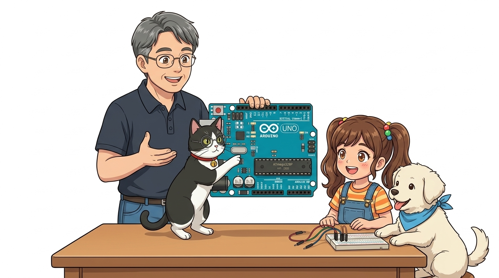
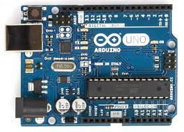
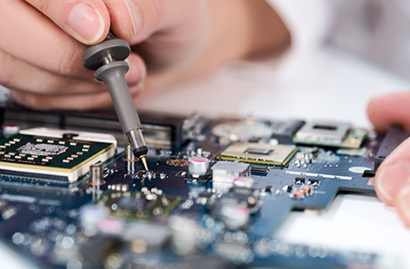
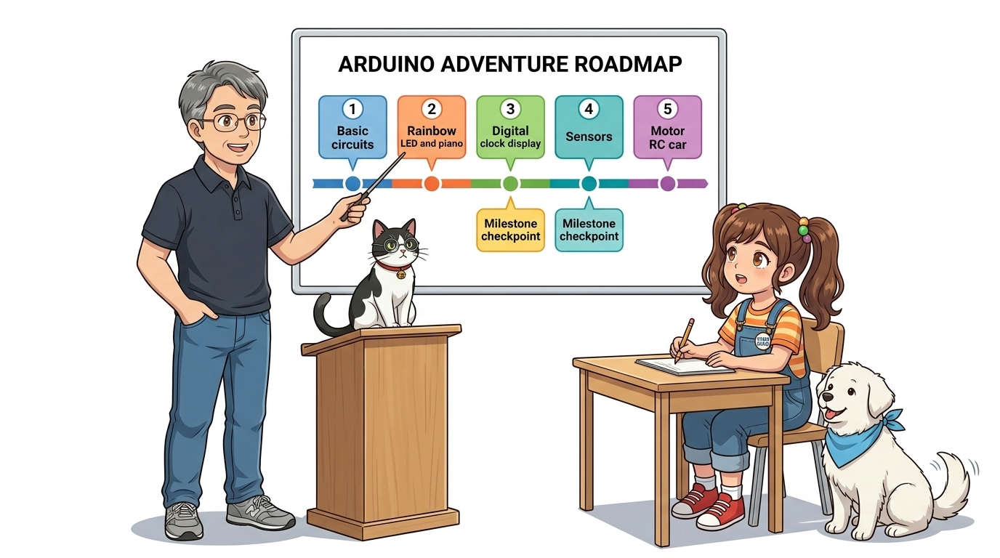

# 000. 강의소개: 아두이노 모험의 시작 🧭
### "이호진 교수님과 함께하는 도로시와 토토의 신기한 전자 세상 탐험"



* **강좌 대상**: 초등학생부터 코딩을 처음 접하는 모든 어른이
* **준비물**: 호기심 가득한 눈망울 + 재미있게 따라 해볼 마음가짐!
* 📖 **상세 강의 교재**: [index.md](./index.md)


> 여러분, 안녕하세요! 오늘부터 친절한 이호진 교수님의 설명과 함께 똑똑한 조수 고양이 지니, 수업을 듣는 호기심 많은 학생 도로시, 그리고 도로시를 돕는 친구 강아지 토토와 함께 신기하고 재미있는 아두이노 전자 세상 탐험을 시작합니다. 코딩이나 전자를 한 번도 배워본 적 없어도 괜찮습니다. 초등학생부터 코딩을 처음 시작하는 어른들까지, 누구나 쉽고 재미있게 나만의 스마트 기기와 로봇을 만들 수 있도록 알기 쉽게 안내해 드리겠습니다. 준비되셨나요? 출발해 봅시다!

---

## 👥 우리 모험을 함께할 주인공들을 소개합니다!


* **👨‍🏫 이호진 교수님 (공학 & 메이커 멘토)**
  * 복잡한 전자 회로와 프로그래밍을 알기 쉽게 설명해 주시는 교수님!
* **🐱 지니 (교수님의 조수 고양이)**
  * 둥근 안경과 빨간 방울 목걸이를 맨 똑똑한 턱시도 고양이!
  * 교수님 곁에서 회로와 코드를 꼼꼼히 점검해 주는 든든한 연구실 조수입니다.
* **👧 도로시 (수업을 듣는 9세 학생 메이커)**
  * "이 초록색 판은 뭐야? 어떻게 불이 켜져?"
  * 끊임없는 호기심으로 교수님 수업을 들으며 무엇이든 직접 만들어보는 주인공 학생!
* **🐶 토토 (도로시의 단짝 친구 강아지)**
  * 도로시 곁에서 항상 함께 수업을 듣고, 부품을 챙겨주며 활기차게 응원하는 귀염둥이 친구!

> 이번 여정을 함께할 주인공들을 소개합니다. 먼저 어려운 전자 회로와 컴퓨터 코딩을 쉽고 친절하게 가르쳐 주시는 이호진 교수님과 교수님의 곁을 든든하게 지키는 조수 고양이 지니, 그리고 반짝이는 눈으로 수업을 들으며 무엇이든 직접 만들어보는 열혈 학생 도로시, 마지막으로 도로시 곁에서 함께 수업을 듣고 부품을 챙겨주며 응원하는 토토입니다. 앞으로 강의를 듣는 동안 여러분도 도로시가 되어 하나씩 멋진 발명품을 완성해 나가게 될 것입니다.

---

## 💡 1단계: 컴퓨터에 USB 선을 꽂아보자!


* **첫 만남의 설렘**: 파란색 USB 케이블로 아두이노와 컴퓨터를 연결합니다.
* **도로시의 발견**: "노트북에 선을 꽂자마자 작은 불빛이 깜빡깜빡 춤을 춰요!"
* **지니의 설명**: 아두이노 공장에서 미리 넣어둔 **'깜빡이(Blink)' 프로그램**이 전기를 받자마자 스스로 깨어나 작동한 것입니다!

> 자, 첫 번째 실습 단계입니다. 컴퓨터에 파란색 USB 케이블을 꽂고 아두이노 보드에 연결해 보세요. 놀랍게도 연결하자마자 보드 위에 작은 LED 불빛이 1초 간격으로 깜빡깜빡 춤을 추기 시작합니다. 아무런 명령도 주지 않았는데 왜 불이 켜질까요? 바로 아두이노를 만든 공장에서 미리 테스트용으로 '깜빡이' 프로그램을 칩 속에 넣어두었기 때문입니다. 전기가 공급되는 순간, 아두이노는 잠에서 깨어나 이 프로그램을 스스로 실행합니다.

---

## ⚡ 2단계: 전기가 흐르면 스스로 생각해요!



1. **전원 공급**: 컴퓨터의 5V 전기가 USB 선을 타고 아두이노로 유입
2. **초록색 ON 램프**: 전원이 정상적으로 공급되고 있음을 알리는 표시등
3. **주황색 L 램프**: 아두이노 13번 디지털 핀에 내장된 테스트용 LED (1초 주기로 점멸)
4. **핵심 요약**: 아두이노는 전원만 연결되면 칩에 저장된 프로그램을 쉬지 않고 실행합니다!

> 슬라이드 사진을 보며 보드 위의 램프들을 확인해 볼까요? USB 케이블을 꽂으면 먼저 초록색으로 'ON'이라고 적힌 불이 켜집니다. 이건 '전기가 정상적으로 들어왔다'는 신호입니다. 그리고 그 옆에 주황색으로 'L'이라고 적힌 작은 램프가 보이시죠? 이 램프는 13번 핀에 연결된 테스트 전등으로, 아두이노가 지금 살아서 명령을 수행하고 있다는 확실한 증거입니다. 아두이노는 전원만 들어가면 24시간 쉬지 않고 스스로 생각하며 일하는 기계입니다.

---

## 🧠 3단계: 아두이노는 '작은 손바닥 컴퓨터'예요!



* **마이크로컨트롤러 (MCU)**
  * 보드 한가운데 자리 잡은 까만 칩
  * 인간의 두뇌처럼 생각하고 기억하는 중앙 제어 센터
* **입력 핀 (Input - 눈과 귀)**
  * 스위치 버튼, 빛 센서, 온도 센서로 바깥세상의 물리적 변화를 감지
* **출력 핀 (Output - 손과 발)**
  * LED 램프, 모터 바퀴, 부저 스피커 등으로 현실 세계에 직접 동작을 수행

> 그렇다면 이 작은 보드가 어떻게 전등을 켜고 모터를 움직일까요? 아두이노는 손바닥 위에 올라가는 작은 컴퓨터이기 때문입니다. 사람의 몸과 비교해 보면 아주 쉽게 이해할 수 있습니다. 보드 한가운데의 네모난 까만 칩은 생각하고 기억하는 '두뇌(MCU)'입니다. 그리고 양옆에 뚫려 있는 구멍들 중 '입력 핀'은 눈과 귀처럼 외부의 빛이나 소리를 감지하고, '출력 핀'은 손과 발처럼 LED를 켜거나 모터를 돌려 실제로 행동합니다.

---

## 💻 4단계: 컴퓨터로 주문(코드)을 써서 보내요!


```
┌──────────────────────────────────────┐
│       내 컴퓨터 (Arduino IDE)        │  ➔ 코드 작성: digitalWrite(13, HIGH);
└──────────────────┬───────────────────┘
                   │ [ 파란색 USB 케이블 (명령 전송선) ]
                   ▼
┌──────────────────────────────────────┐
│     아두이노 우노 (중앙 두뇌 MCU)      │  ➔ 칩에 저장 후 독립적으로 척척 실행!
└──────────────────────────────────────┘
```

1. **마법 스케치북(Arduino IDE)**: 컴퓨터 키보드로 아두이노에게 시킬 일을 편지(코드)로 작성
2. **업로드(전송)**: 화살표 버튼(➔)을 누르면 USB 케이블을 타고 아두이노 머릿속에 기억
3. **독립 실행**: 코드가 한번 저장되면 컴퓨터를 분리하고 배터리만 연결해도 혼자서 완벽 동작!

> 이제 우리가 아두이노에게 일을 시키는 과정을 살펴보겠습니다. 우리는 컴퓨터에서 'Arduino IDE'라는 마법의 프로그램을 열고, 아두이노에게 시킬 일을 코드로 작성합니다. 예를 들어 "13번 불을 켜라!"라고 쓰는 거죠. 그런 다음 업로드 버튼을 콕 누르면, USB 케이블을 타고 명령어가 아두이노의 까만 칩 속으로 쏙 들어갑니다. 이렇게 코드가 한 번 저장되면 컴퓨터를 뽑아버리고 건전지만 연결해도 아두이노 혼자서 언제 어디서든 그 일을 해냅니다.

---

## 🗺️ 5단계: 이호진 교수님과 함께하는 아두이노 모험 로드맵!



* 🔴 **1장. 기본 실습**: 전기의 흐름과 아두이노 스케치북(IDE) 설치
* 🟡 **2장. 출력 실습**: 알록달록 무지개 LED와 멜로디를 연주하는 전자 피아노
* 🟢 **3장. 디스플레이**: 글자와 숫자가 흐르는 디지털 시계와 OLED 전광판
* 🔵 **4장. 센서 탐험**: 어두워지면 켜지는 스마트 가로등과 초음파 거리 측정기
* 🟣 **5장. 모터 & 로봇**: 빙글빙글 회전 모터와 스마트폰으로 조종하는 무선 RC카!

> 앞으로 우리가 함께 떠날 신나는 아두이노 모험 로드맵을 한눈에 보여드립니다. 1장에서는 기초 전기와 코딩 도구를 준비하고, 2장에서는 빛과 소리를 만드는 출력 장치를 다룹니다. 3장에서는 글자를 띄우는 디스플레이를 배우고, 4장에서는 세상의 정보를 읽는 온갖 센서를 탐험합니다. 그리고 마지막 5장에서는 모터를 달아 스마트폰으로 직접 조종하는 자율주행 로봇 자동차까지 완성하게 됩니다.

---

## 🚀 출발 준비 완료! "다음 모험으로 떠나요!"


* **도로시의 다짐**: "교수님, 저도 얼른 멋진 로봇이랑 반짝이는 무지개 램프를 만들어보고 싶어요!"
* **교수님의 응원**: "좋아 도로시! 그럼 가장 먼저 컴퓨터에 아두이노와 대화할 수 있는 마법 스케치북(Arduino IDE)을 설치하러 가보자!"
* **조수 지니 & 토토**: 든든한 조수 고양이 지니와 친구 토토가 활기차게 응원하며 함께 출발합니다!
* **👉 다음 탐험 (001강)**: **"001. 에너지란? 세상을 움직이는 힘"**

> 이제 아두이노 모험을 떠날 모든 준비가 끝났습니다! 교수님의 설명을 들으며 도로시와 토토의 눈빛이 반짝이는 것 보이시나요? 여러분도 나만의 발명품을 만들 수 있다는 설레는 마음만 챙겨오시면 됩니다. 다음 001강에서는 전자 기기를 움직이는 근본적인 힘, '에너지'의 비밀을 파헤치러 떠나보겠습니다. 다음 시간에 만나요!