# 001_에너지란_세상을움직이는힘 ⚡
### 아두이노와 전자제품은 어떤 힘으로 살아 움직일까요?

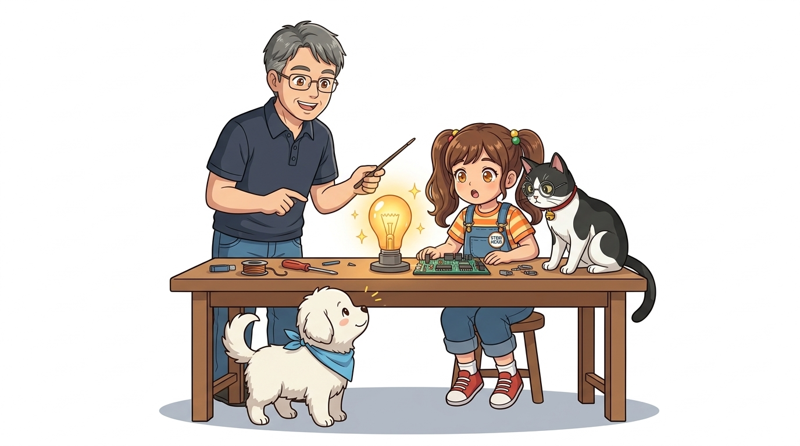

* **오늘의 탐험**: 에너지는 무엇이고, 어떻게 빛과 소리와 움직임으로 변신할까?
* **선생님**: 이호진 교수님 (공학 & 메이커 멘토)
* **조수 & 학생**: 조수 지니(고양이) & 학생 도로시 & 친구 토토

* 🖥️ **강의 슬라이드**: [slides.md](./slides.md)

---

## ❓ 전등이 켜지고 모터가 도는 건 무슨 힘일까?

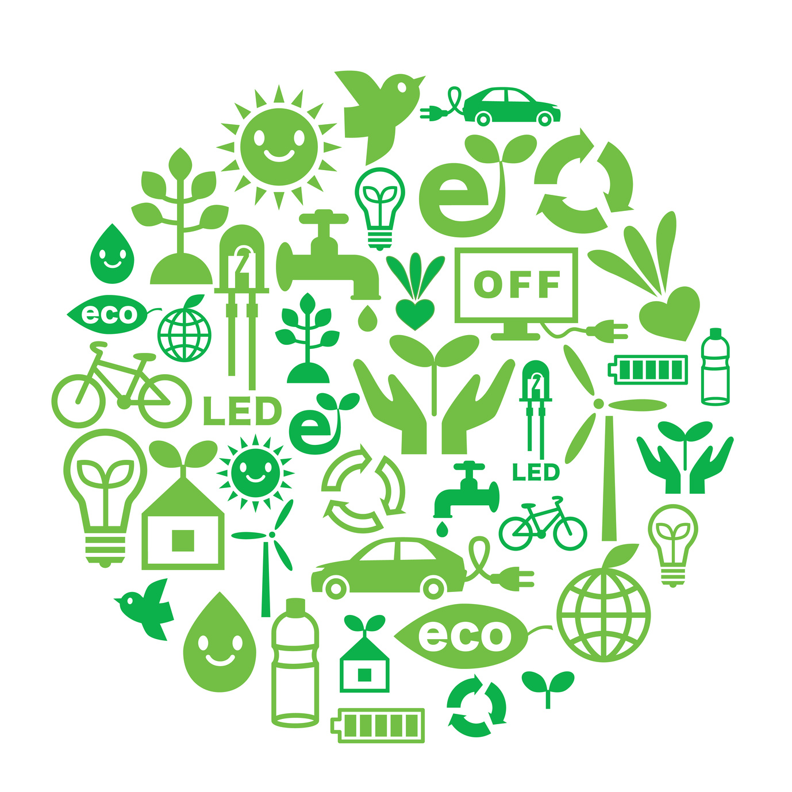

> **👧 도로시**: "교수님! 우리가 밥을 먹어야 힘차게 달릴 수 있는 것처럼, 아두이노도 밥을 먹어야 불을 켜는 거지요? 그 밥의 이름이 바로 '에너지'인가요?"  
> **👨‍🏫 교수님**: "정답이란다 도로시! '에너지(Energy)'는 그리스어로 **'일을 할 수 있는 능력'**을 뜻해. 세상을 움직이고 따뜻하게 밝혀주는 모든 힘의 근원이지!"  
> **🐱 지니**: "냐옹! 아두이노에게 주는 밥은 바로 콘센트나 배터리에서 나오는 '전기 에너지'랍니다!"  
> **🐶 토토**: "멍멍! (나도 간식 먹고 에너지 뿜뿜 충전 완료 멍!)"

---

## 🌈 1단계: 에너지는 모습을 자유자재로 바꿔요!

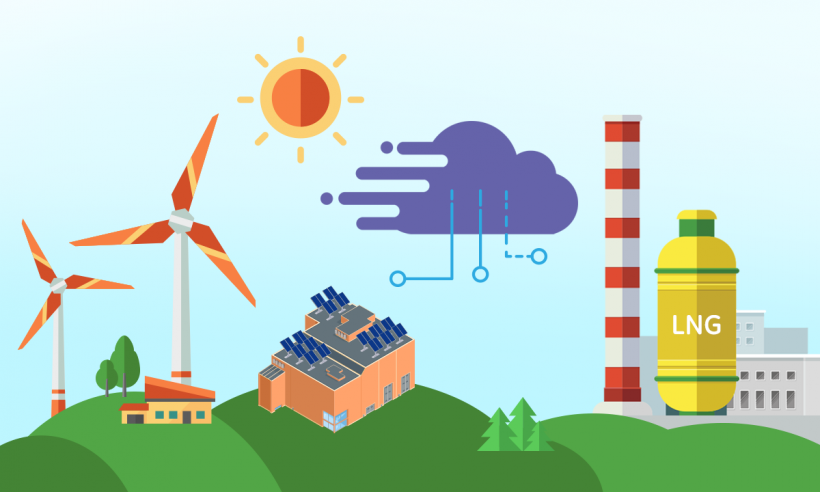

* 에너지는 사라지지 않고 끊임없이 다른 모습으로 변신(Conversion)해요!
  * ☀️ **태양 빛** ➔ 식물의 영양분(화학 에너지)
  * 🔋 **배터리** ➔ 반짝이는 LED 불빛(빛 에너지)
  * ⚡ **전기** ➔ 빙글빙글 선풍기 날개(운동 에너지)
* 아두이노는 바로 이 **'전기 에너지'**를 마음대로 다루는 멋진 지휘자랍니다!

---

## 🏃‍♂️ 2단계: 신나게 달리는 운동에너지 & 높은 곳의 위치에너지

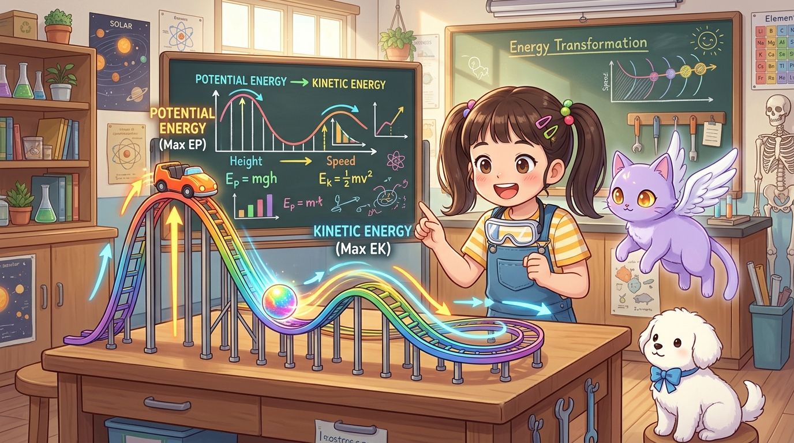

* **운동 에너지(Kinetic Energy)**:
  * 토토가 쏜살같이 달릴 때, 롤러코스터가 빠르게 씽씽 내려올 때 생기는 움직임의 힘!
* **위치 에너지(Potential Energy)**:
  * 미끄럼틀 꼭대기에 가만히 앉아 있을 때 품고 있는 잠재적인 힘!
  * 높은 곳에서 뛰어내리면 위치에너지가 신나는 운동에너지로 변신해요!

---

## 🌡️ 3단계: 따뜻한 물과 공기 속 내부에너지

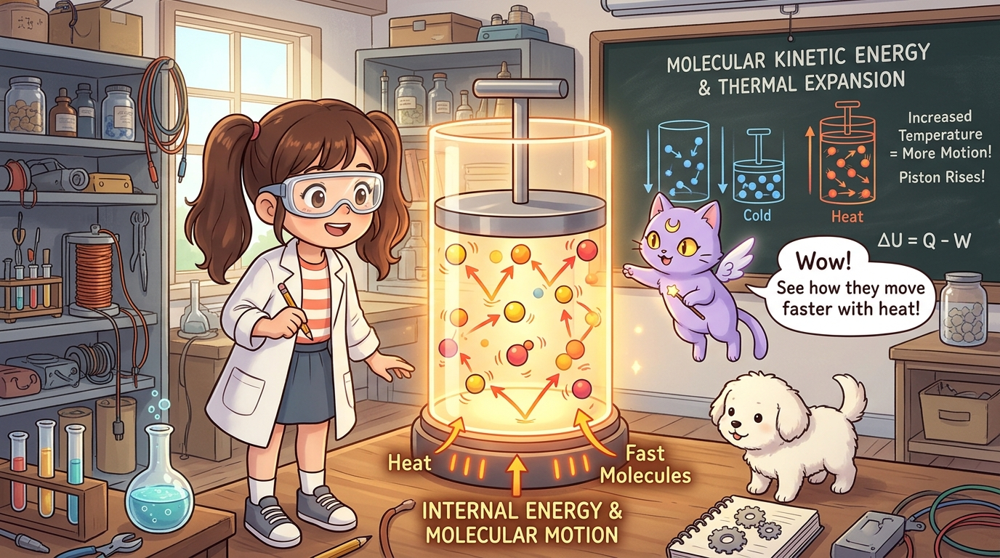

* 물체 속을 아주 작은 현미경으로 들여다보면 눈에 보이지 않는 분자들이 쉬지 않고 춤을 추고 있어요.
* 열을 가해주면 분자들이 더 빠르게 흔들리며 온도가 쑥쑥 올라가요!
* 따뜻한 온수로 방 안을 훈훈하게 데우는 보일러 난방도 내부에너지의 이동이랍니다.

---

## ♨️ 4단계: 뜨거운 열이 바퀴를 굴려요 (열에너지)

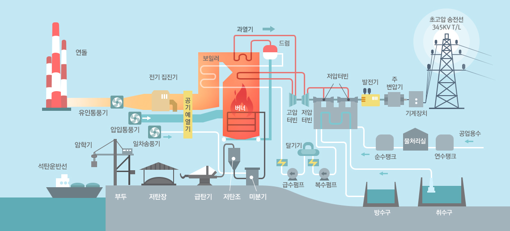
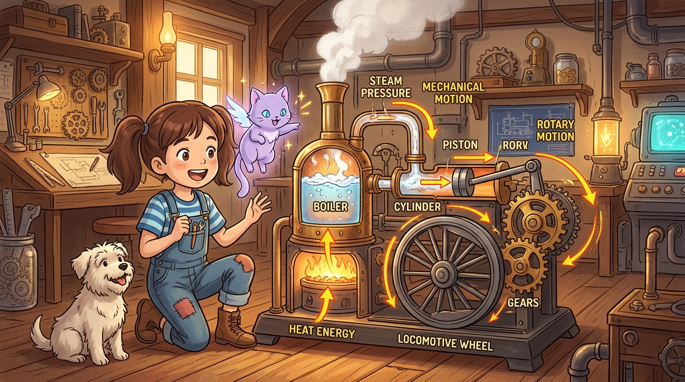

* 주전자 물이 끓으면 수증기가 뚜껑을 들썩들썩 밀어올려요!
* 이 뜨거운 열을 모아 커다란 기차 바퀴를 굴렸던 것이 바로 **증기기관차**예요.
* 열(Heat) 에너지가 기계의 회전 운동으로 변신한 대표적인 예랍니다!

---

## 🔋 5단계: 배터리는 화학에너지를 품은 보물상자!

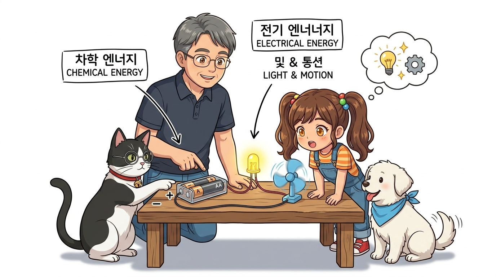

> **👧 도로시**: "교수님! 건전지 속에는 전기가 액체처럼 가득 차 있는 건가요?"  
> **👨‍🏫 교수님**: "하하, 아주 좋은 호기심이야 도로시! 건전지 속에는 여러 물질이 화학적으로 결합해 있는 **'화학 에너지'**가 잠들어 있단다."  
> **🐱 지니**: "맞아요! 도선을 연결하는 순간 화학반응이 일어나며 전자($e^-$)들이 쏟아져 나와 노란 LED 불을 밝히고 모터 팬을 쌩쌩 돌려준답니다, 냐옹!"  
> **🐶 토토**: "멍멍! (선풍기 바람 시원하다 멍!)"

---

## 🚀 6단계: 자동차와 로켓을 날리는 연료

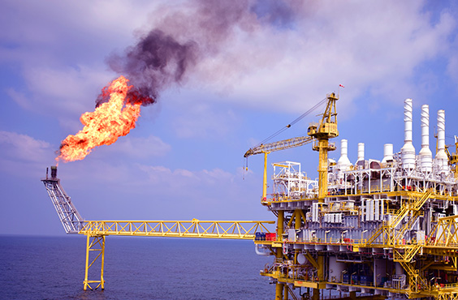

* 우리가 타는 자동차의 가솔린(휘발유), 우주로 날아가는 로켓의 액체 수소!
* 모두 물질 분자 속에 숨겨진 막대한 화학에너지를 불태워(연소) 엄청난 힘을 만들어내요.
* 우리가 먹는 밥과 사과도 몸속에서 소화되어 뛰어놀 수 있는 화학에너지가 된답니다!

---

## ⚛️ 7단계: 우주에서 가장 강력한 핵에너지

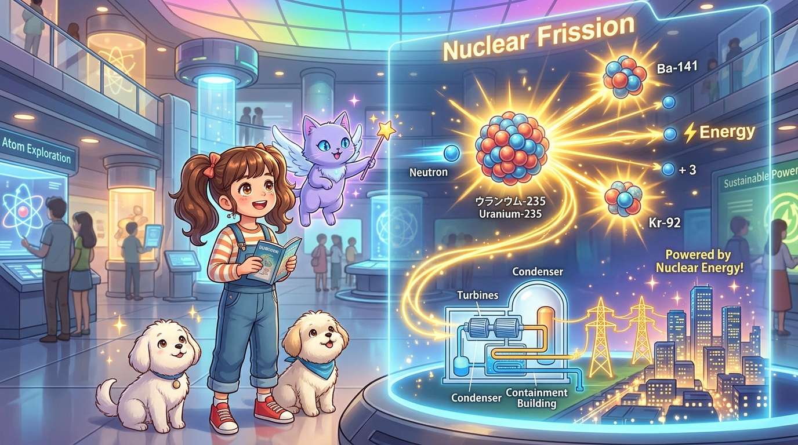

* 눈에 보이지도 않는 가장 작은 알갱이인 **원자의 핵**이 쪼개지거나(핵분열), 합쳐질 때(핵융합) 태양처럼 거대한 열과 빛이 뿜어져 나와요.
* 밤하늘을 환하게 밝히는 우리 집 전기의 많은 부분이 원자력 발전소에서 만들어진답니다.

---

## 💡 8단계: 아두이노가 다루는 최고의 친구, 전기!

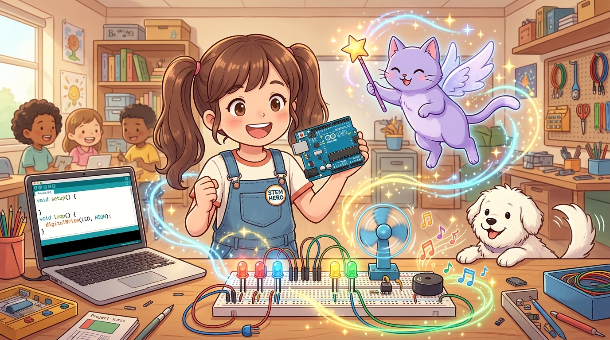

* 수많은 에너지 중에서 사람이 원하는 대로 가장 빠르고 섬세하게 조종할 수 있는 에너지가 바로 **'전기(Electricity)'**예요!
* 버튼을 누르면 즉시 켜지고, 코드를 쓰면 0.001초 단위로 전기를 흘렸다 끊었다 할 수 있어요.
* 이 전기를 제어하는 두뇌가 바로 우리의 친구 **아두이노(Arduino)**랍니다!

---

## 🌟 미션 클리어! "에너지의 비밀을 풀었어요!"

> **👧 도로시**: "교수님! 배터리의 화학에너지가 전선을 타고 흘러서 전등의 빛과 모터의 바람이 되는 원리를 확실히 알게 됐어요!"  
> **👨‍🏫 교수님**: "완벽해 도로시! 그럼 다음 시간에는 이 마법 같은 전기 알갱이들이 어떻게 전선 속을 달리는지 **'002. 전기란? 찌릿찌릿 전자 세상'**으로 신나게 떠나보자!"  
> **🐱 지니**: "냐옹! 지니 조교가 다음 시간에도 재미있는 회로 부품들을 준비해 놓을게요!"  
> **🐶 토토**: "멍멍! 전기 알갱이 만나러 출발하자 멍!"
