# 002_전기란_찌릿찌릿전자세상 💡
### 에디슨과 테슬라의 대결, 그리고 아두이노의 직류(DC) 전기!

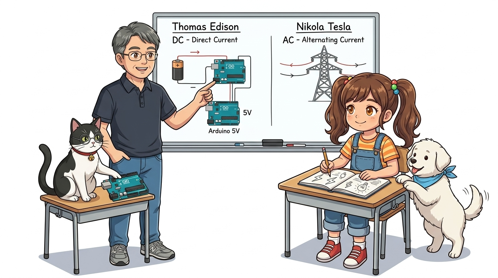

* **오늘의 탐험**: 전기는 어떻게 만들어졌을까? 직류(DC)와 교류(AC)의 차이점!
* **선생님**: 이호진 교수님 (공학 & 메이커 멘토)
* **조수 & 학생**: 조수 지니(고양이) & 학생 도로시 & 친구 토토

* 🖥️ **강의 슬라이드**: [slides.md](./slides.md)

---

## ❓ 전기는 원래 하늘의 번개였나요?

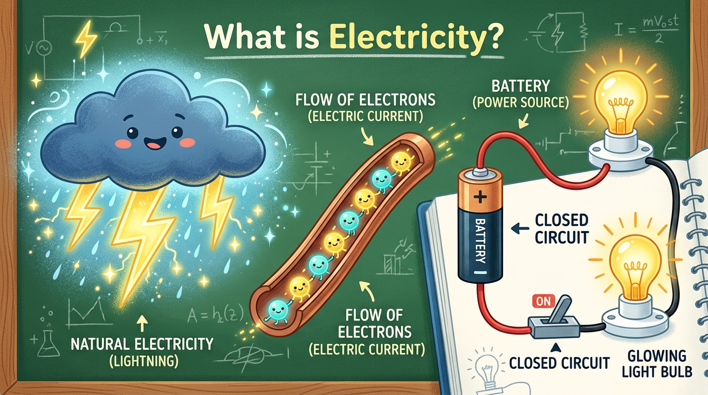

> **👧 도로시**: "교수님! 옛날 사람들은 하늘의 번개가 칠 때만 전기를 봤을 텐데, 어떻게 전등 속에 전기를 가두고 스마트폰에 충전해서 쓸 수 있게 된 건가요?"  
> **👨‍🏫 교수님**: "하하! 바로 멋진 과학자들의 끝없는 발명 덕분이란다! 특히 전기의 두 천재인 **'토머스 에디슨'**과 **'니콜라 테슬라'**의 흥미진진한 라이벌 이야기부터 들어볼까?"  
> **🐱 지니**: "냐옹! 에디슨은 건전지 같은 직류(DC)를, 테슬라는 발전소의 교류(AC)를 주장했어요!"  
> **🐶 토토**: "멍멍! (천재 과학자 이야기 기대된다 멍!)"

---

## ⚔️ 1단계: 직류(DC)의 에디슨 vs 교류(AC)의 테슬라

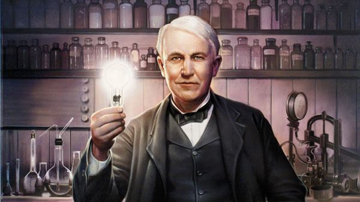
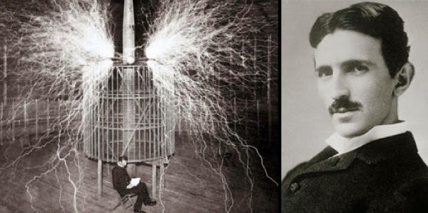

* **토머스 에디슨 (Thomas Edison)**:
  * 백열전구를 발명하고, 한쪽 방향으로 얌전하게 흐르는 **직류(DC)** 전기를 주장했어요!
* **니콜라 테슬라 (Nikola Tesla)**:
  * 먼 도시까지 전기를 손실 없이 쌩쌩 보낼 수 있는 파도 같은 **교류(AC)** 전기를 발명했어요!

---

## 🌊 2단계: 잔잔한 강물(직류) vs 출렁이는 파도(교류)

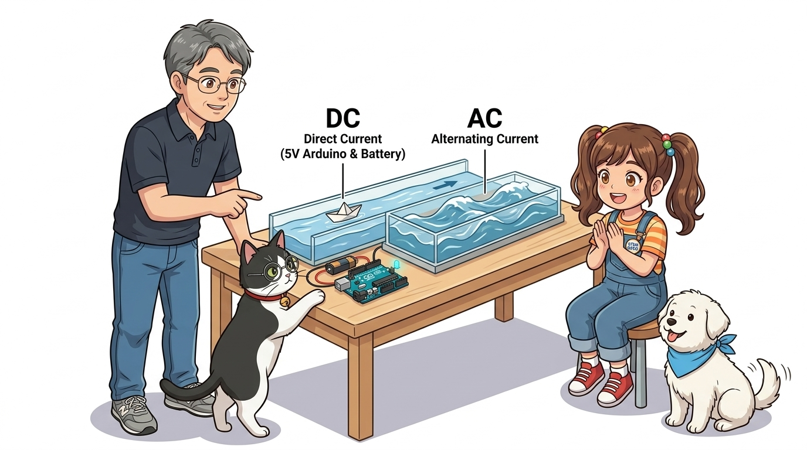

> **👧 도로시**: "아하! 직류(DC)는 배터리처럼 한 방향으로만 일정하게 흐르는 잔잔한 강물이고, 교류(AC)는 집 콘센트처럼 앞뒤로 출렁거리는 파도군요!"  
> **👨‍🏫 교수님**: "정확하단다 도로시! 우리가 앞으로 실습할 **아두이노는 건전지처럼 안전한 5V 직류(DC) 전기**를 쓴단다."  
> **🐱 지니**: "맞아요! 5V 직류 전기는 사람이 만져도 찌릿하지 않고 안전하며, 마이크로컨트롤러 칩이 계산하기에 딱 좋은 깨끗한 전기랍니다, 냐옹!"  
> **🐶 토토**: "멍멍! (직류는 안심 멍멍!)"

---

## 🔄 3단계: 빙글빙글 돌리면 전기가 뿅! (발전기)

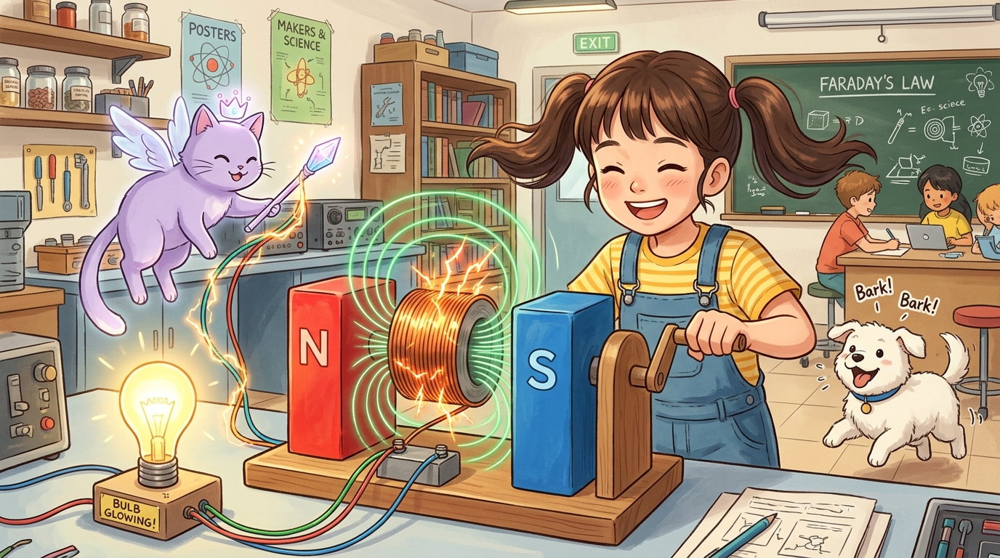

* 자석 주위에서 구리선을 빙글빙글 돌리면 마법처럼 전기가 생겨나요! (패러데이의 전자기 유도 법칙)
* 바람개비가 돌면 **풍력 발전**, 물이 쏟아지며 터빈을 돌리면 **수력 발전**이 돼요.
* 💡 **반대의 마법**: 전기를 넣어서 거꾸로 뱅글뱅글 돌아가게 만든 것이 바로 **'모터(전동기)'**랍니다!

---

## 🏙️ 4단계: 도시에 불을 밝힌 최초의 발전소

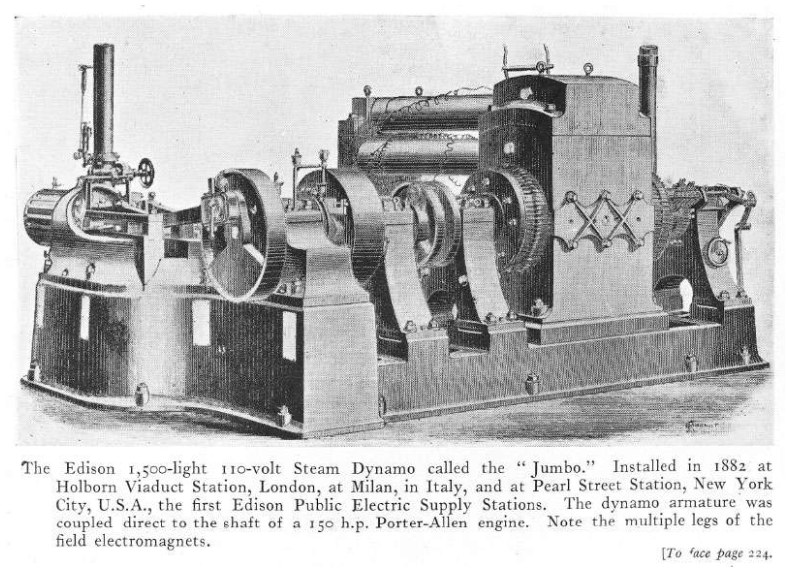

* 1882년, 에디슨은 미국 뉴욕 맨해튼에 세계 최초의 중앙 발전소를 세웠어요.
* 증기기관으로 거대한 발전기를 돌려, 도심 수백 가구의 가스등을 환한 전기 백열전구로 바꿨답니다!

---

## 🏭 5단계: 누구나 전기를 쓰는 세상으로!

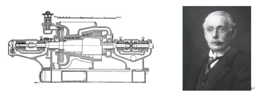

* 찰스 파슨스가 고속으로 회전하는 **증기 터빈 엔진**을 발명하면서 발전 효율이 엄청나게 높아졌어요.
* 덕분에 오늘날 우리는 스위치만 켜면 언제든 값싸고 깨끗한 전기를 마음껏 쓸 수 있게 되었어요!

---

## 🌟 6단계: 전기는 어떤 모습으로든 변신해요!

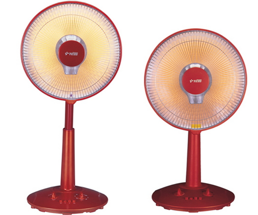
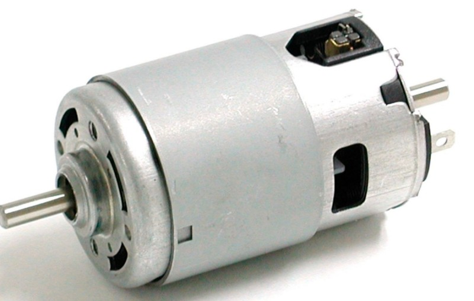

1. 🔥 **열 에너지**: 전기 난로, 토스터기, 헤어드라이어
2. 💡 **빛 에너지**: 스마트폰 화면, LED 전등
3. 🌀 **동력(운동)**: 청소기, 선풍기, 전기자동차, 아두이노 로봇 바퀴!
4. 🎵 **소리 에너지**: 이어폰, 스피커, 아두이노 피에조 부저!

---

## ⚙️ 7단계: 밤에도 일하는 공장, 대량 생산의 시대

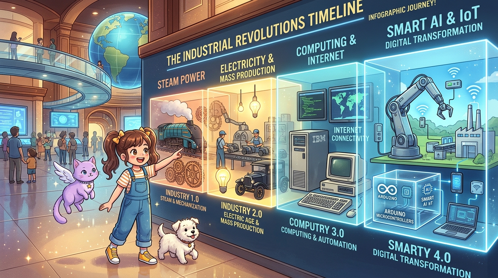

* 전기가 보급되면서 컴컴한 밤에도 공장에서 제품을 빠르게 대량 생산할 수 있게 되었어요.
* 이를 과학 역사에서는 **'제2차 산업혁명 (전기 에너지 혁명)'**이라고 부릅니다!

---

## 🌟 미션 클리어! "나도 이제 전기 박사!"

> **👧 도로시**: "교수님! 에디슨과 테슬라의 대결 이야기 덕분에 아두이노가 안전한 5V 직류(DC) 전기로 동작한다는 비밀을 완벽하게 배웠어요!"  
> **👨‍🏫 교수님**: "아주 대견하구나 도로시! 그럼 다음 시간에는 이 전기가 어떻게 0과 1의 암호로 바뀌어 컴퓨터와 대화하는지 **'003. 디지털 회로와 2진 신호'**로 함께 떠나보자!"  
> **🐱 지니**: "냐옹! 지니 조교가 다음 시간에도 똑똑한 디지털 신호 이야기 준비해 놓을게요!"  
> **🐶 토토**: "멍멍! 다음 시간도 신나게 출바알 멍!"
