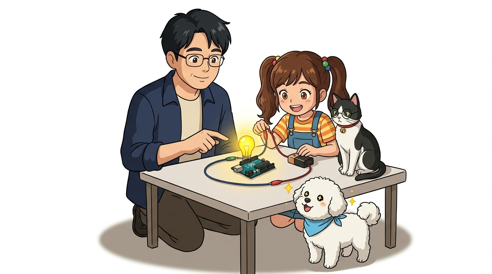
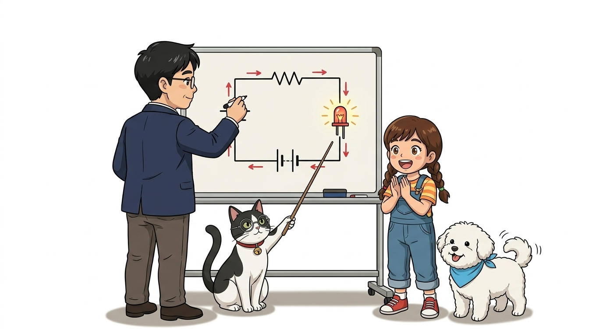
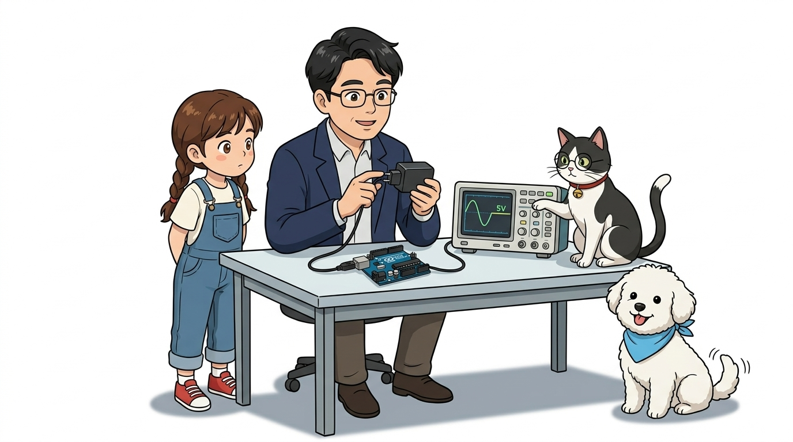
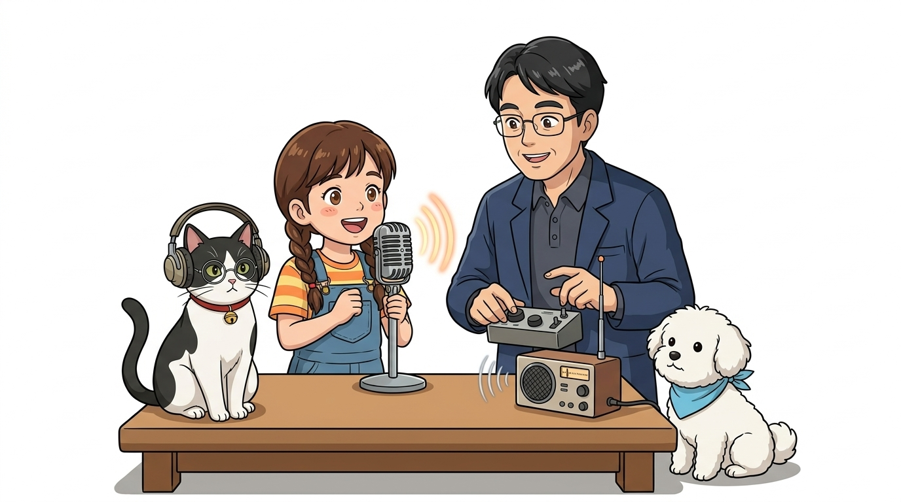
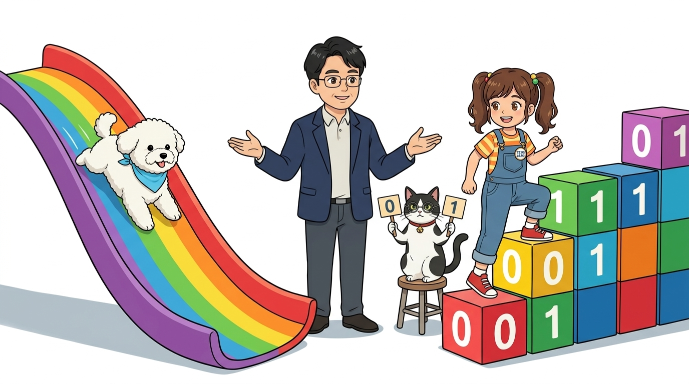
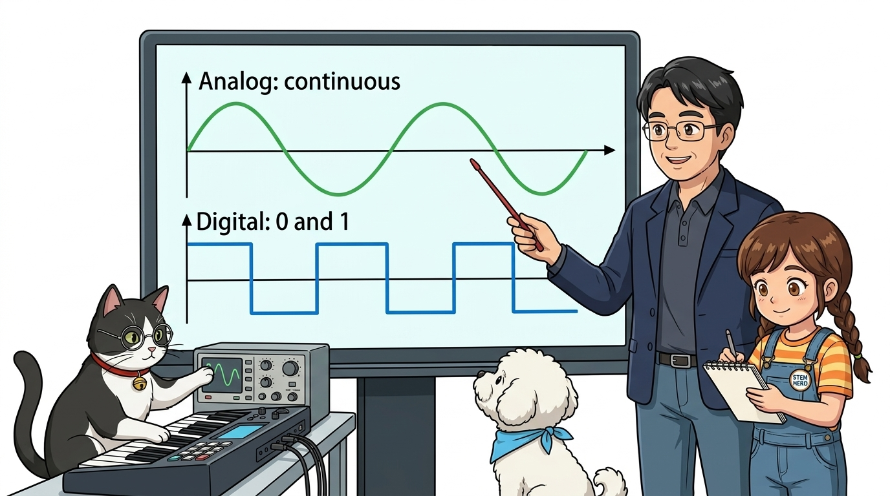
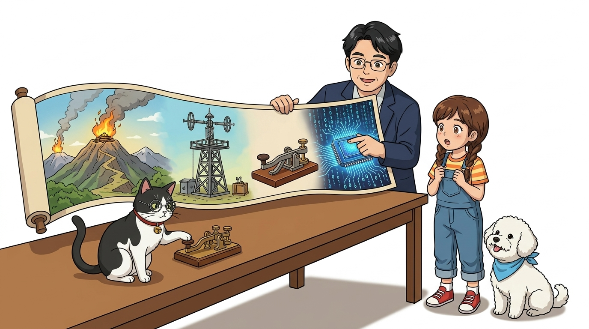

# 003_디지털회로와_2진신호 🔌
### 닫힌 회로의 비밀과 0과 1로 이야기하는 디지털 세상!



* **오늘의 탐험**: 전기 회로는 어떻게 도는 걸까? 아날로그와 디지털의 진짜 차이와 통신의 역사!
* **선생님**: 호진 교수님 (공학 멘토) & 연구실 조수 지니 (고양이) & 학생 도로시 & 토토

* 🖥️ **강의 슬라이드**: [slides.md](./slides.md)

---

## ❓ 전선 한 가닥만 연결해도 불이 켜질까요?

> **👧 도로시**: "교수님! 건전지 (+)극에 전선을 꽂아서 전등에 붙였는데 왜 불이 안 켜져요? 전기가 흘러 들어갔잖아요!"  
> **🐱 조수 지니**: "야옹~ 도로시, 회로 점검 결과 마이너스(-) 극으로 되돌아오는 길이 비어 있어! 전기는 나갔다가 반드시 집으로 돌아와야 해!"  
> **👨‍🏫 호진 교수님**: "지니 말이 맞단다! 전기는 집을 떠나 산책을 나간 토토 같아서, **반드시 (-)극으로 되돌아오는 온전한 둥근 길(닫힌 회로, Closed Loop)**이 완성되어야만 힘차게 달린단다."  
> **🐶 토토**: "멍멍! (산책 끝나면 꼭 집으로 돌아와야지 멍!)"

---

## ⭕ 1단계: 전기 회로는 '동그란 순환 도로(Loop)'예요!



* **회로(Circuit)**의 '회(回)'는 '돌아올 회', 즉 **되돌아오는 길**을 뜻해요.
* 전기는 **높은 곳(+)에서 낮은 곳(-)**으로 흐릅니다. (이를 **전위차/전압**이라고 불러요!)

```
┌────────────────────────────────────────────────────────┐
│               [ 닫힌 회로 (Closed Circuit) ]           │
│                                                        │
│       ┌───────────────[ 저항 R ]───────────────┐       │
│       │                                        │       │
│   [ + 전원 V ]                              [ LED 💡 ] │
│   [  (5V DC) ]                             (불빛 켜짐!)│
│       │                                        │       │
│       └──────────────[ 스위치 (ON) ]───────────┘       │
│                전자가 쉬지 않고 뱅글뱅글 순환!           │
└────────────────────────────────────────────────────────┘
```

* **닫힌 회로 (Closed Circuit)**: 전원(+)에서 출발한 전기가 부품(저항, LED)을 거쳐 전원(-)으로 막힘없이 되돌아오는 상태 ➔ **전류가 흐르고 LED 점등!**
* **열린 회로 (Open Circuit)**: 스위치가 열려 있거나 전선이 끊겨 길이 단절된 상태 ➔ **전류가 0으로 즉시 정지!**

---

## 🔌 2단계: 집 콘센트(교류)를 아두이노 밥(직류)으로! (정류의 마법)



벽 콘센트의 220V 교류(AC) 전기는 아두이노에게 너무 거칠고 위험해요. 스마트폰 충전기나 어댑터는 파도치는 교류를 **얌전하고 일정한 5V 직류(DC)**로 바꾸어 줍니다.

### 📊 교류(AC) vs 직류(DC) 한눈에 비교하기

| 구분 | 교류 (AC, Alternating Current) | 직류 (DC, Direct Current) |
| :--- | :--- | :--- |
| **흐름 방향** | 시간에 따라 (+)와 (-) 방향이 주기적으로 출렁임 (파도) | (+)극에서 (-)극으로 항상 한 방향으로 곧게 흐름 (시냇물) |
| **대표 전원** | 가정용 벽 콘센트 (220V / 60Hz), 발전소 송전선 | 건전지(1.5V), 스마트폰 배터리, **아두이노(5V / 3.3V)** |
| **장점과 특징**| 변압기를 통해 먼 거리까지 전력 손실 없이 송전 유리 | 전자 부품과 마이크로컨트롤러가 정밀하게 동작하기에 안전 |

### 🛠️ 교류를 직류로 바꾸는 3단계 과정
1. **변압 (Step-Down)**: 220V의 높은 전압을 5V~9V의 안전한 전압으로 낮춥니다.
2. **다이오드 브리지 정류 (Bridge Rectifier)**: 4개의 다이오드가 교류의 음(-)의 파형을 모두 양(+)의 방향으로 꺾어 올려 **맥류(Pulsating DC)**로 만듭니다.
3. **평활 커패시터 필터 (Smoothing Capacitor)**: 전기를 잠시 담아두는 콘덴서가 출렁임을 메워주어 **매끄러운 순수 직류(Pure 5V DC)**를 완성합니다!

---

## 📡 3단계: 전기로 편지를 보낸다? (전기 = 신호)



전기는 단순히 불을 켜고 모터를 돌리는 에너지일 뿐만 아니라, **정보를 실어 나르는 메신저(신호, Signal)**가 될 수 있어요!

* **음성 신호 (Audio Input)**: 우리가 마이크에 대고 말하면, 공기의 떨림이 1,000Hz 안팎의 진동하는 전기 파형으로 바뀝니다.
* **반송파 (Carrier Wave)**: 멀리까지 신호를 보내기 위해 높은 주파수(예: 1MHz)의 교류 파형을 발생시킵니다.
* **변조 (Modulation)**:
  * **AM (진폭 변조)**: 원래 소리 모양에 맞춰 전파의 높낮이(진폭)를 변화시키는 방식
  * **FM (주파수 변조)**: 원래 소리 모양에 맞춰 전파의 빽빽한 정도(주파수)를 변화시키는 방식 (잡음에 강함!)
* 아두이노와 컴퓨터도 전선의 전압을 켰다 껐다 빠르게 바꾸며 정보를 빛의 속도로 주고받습니다.

---

## 🌈 4단계: 부드러운 미끄럼틀(아날로그) vs 딱딱 끊어지는 계단(디지털)



> **👧 도로시**: "아날로그는 토토가 타는 무지개 미끄럼틀처럼 부드럽게 이어지는 연속적인 값이고, 디지털은 0과 1 블록 계단처럼 똑똑 끊어지는 상태군요!"  
> **🐱 조수 지니**: "야옹~ 정답이야! 자연계의 온도나 소리는 아날로그지만, 아두이노는 0V(LOW/0)와 5V(HIGH/1)의 명확한 두 가지 디지털 신호로 실수 없이 처리한단다!"  
> **👨‍🏫 호진 교수님**: "그렇단다 도로시. 노이즈가 조금 섞이더라도 디지털은 0과 1을 명확히 구별해 낼 수 있어서 오늘날 컴퓨터와 마이크로컨트롤러의 표준이 되었단다."

---

## 📊 5단계: 자연의 아날로그 vs 컴퓨터의 디지털



### 📈 아날로그와 디지털 신호 특성 비교


| 비교 항목 | 아날로그 신호 (Analog Signal) | 디지털 신호 (Digital Signal) |
| :--- | :--- | :--- |
| **파형 모양** | 부드러운 연속 곡선 (Continuous Wave) | 0과 1로 각진 사각 펄스파 (Square Pulse) |
| **상태 값** | 셀 수 없이 무한히 많은 중간값 (0V ~ 5V 사이 연속) | 오직 2가지 명확한 상태 (`0` 또는 `1`, `LOW` 또는 `HIGH`) |
| **자연계 예시** | 사람의 목소리, 바람 세기, 기온, 햇빛의 밝기 | 스위치 ON/OFF, 컴퓨터 메모리 비트, 아두이노 디지털 핀 |
| **잡음(노이즈)** | 외부 전기 노이즈가 섞이면 원래 소리가 왜곡됨 | 노이즈가 조금 섞여도 0과 1 판별이 쉬워 데이터 오류가 적음 |

---

## 💡 6단계: 아두이노의 두 가지 마법 주문: 1(HIGH)과 0(LOW)


아두이노의 디지털 핀은 오직 두 가지 언어로만 세상과 소통합니다:

1. ⚡ **1 (HIGH, 참, 5V)**:  
   * *"스위치 온(ON)! 디지털 핀으로 5V 전기를 뿜어내어 LED 불을 환하게 밝혀라!"*
2. 🌑 **0 (LOW, 거짓, 0V)**:  
   * *"스위치 오프(OFF)! 전기를 끊어서 0V(GND)로 만들고 LED 불을 깜깜하게 꺼라!"*

이 단순한 0과 1을 1초에 수백 번, 수천 번 번갈아 보내며 LED 깜빡이기, 모터 속도 조절, 멜로디 연주가 가능해집니다!

---

## 💬 7단계: 통신의 역사와 0과 1 디지털 신호의 탄생



인류는 옛날부터 **"한 지점에서 다른 지점까지 의미 있는 정보를 신속·정확하게 전달하기 위해"** 신호 체계를 발전시켜 왔습니다.

### 1. 🏔️ 고대 원거리 통신: 조선시대 봉수대 (Bonghwa)
밤에는 횃불(불빛), 낮에는 연기로 국경의 위급 상황을 한양까지 전달했습니다:


| 봉수 신호 | 상태 | 의미 |
| :---: | :---: | :--- |
| **1홰 (횃불 1개)** | 평상시 | 국경이 평화롭고 이상 없음 |
| **2홰 (횃불 2개)** | 적 출현 | 바다나 국경에 적이 나타남 |
| **3홰 (횃불 3개)** | 경계 접근 | 적이 아군 국경에 가까이 접근함 |
| **4홰 (횃불 4개)** | 국경 침범 | 적이 국경을 넘어 침범함 |
| **5홰 (횃불 5개)** | 전투 중 | 아군과 적군이 격렬히 접전 중임 |

### 2. 🗼 근대 통신: 클로드 샤프의 광학 전신 (1793년)


* 프랑스 혁명기 클로드 샤프가 탑 위에 움직이는 회전 날개(신호기)를 설치해 멀리 떨어진 탑으로 망원경을 보며 신호를 릴레이 전송했습니다.
* **한계**: 비나 안개, 밤에는 보이지 않고 신호수의 실수로 오차가 발생했습니다.

### 3. ⚡ 전기 통신 혁명: 새무얼 모스의 전기 전신 (1844년)
* 전선에 전기를 흘렸다 끊었다 하는 스위치(Telegraph Key)를 발명하여 **거리와 날씨에 구애받지 않고 빛의 속도로 메시지 전송**을 성공시켰습니다.
* **모스 부호 (Morse Code)**: 점(짧은 전기, `·`)과 선(긴 전기, `-`)의 조합으로 알파벳과 숫자를 표현!
  * 대표 신호: `···  ---  ···` ➔ **SOS (긴급 구조 신호!)**

### 4. 🤖 현대 아두이노와 컴퓨터의 2진수 통신


* 전신에서 전기가 흐르는 것(`1`)과 끊어진 것(`0`)으로 글자를 전달했던 원리가 오늘날 컴퓨터와 아두이노의 **2진수(Binary Code) 비트(Bit)** 통신으로 이어졌습니다.
* 사전에 약속된 규칙(**프로토콜, Protocol**)에 따라 0과 1을 주고받음으로써, 컴퓨터와 아두이노는 복잡한 센서 데이터와 제어 명령을 완벽하게 주고받을 수 있답니다!

---

## 🌟 미션 클리어! "디지털 회로의 원리를 터득했어요!"


> **👧 도로시**: "교수님, 지니야! 전기는 둥근 닫힌 길로만 흐르고, 봉수대와 모스 부호처럼 1(HIGH)과 0(LOW)의 디지털 약속으로 대화한다는 걸 완벽히 깨달았어요!"  
> **🐱 조수 지니**: "야옹~ 훌륭해 도로시! 회로 점검 결과 기초 이해도 100점 만점에 100점이야!"  
> **👨‍🏫 호진 교수님**: "아주 잘 배웠구나 도로시. 다음 시간에는 이 소중한 회로의 전압과 전류를 직접 측정해주는 고마운 계측기 **'004. 디지털 멀티미터 전압·전류·저항·도통 테스트'**를 만나보자꾸나!"  
> **🐶 토토**: "멍멍! 다음 모험도 신나게 출발하자 멍!"
