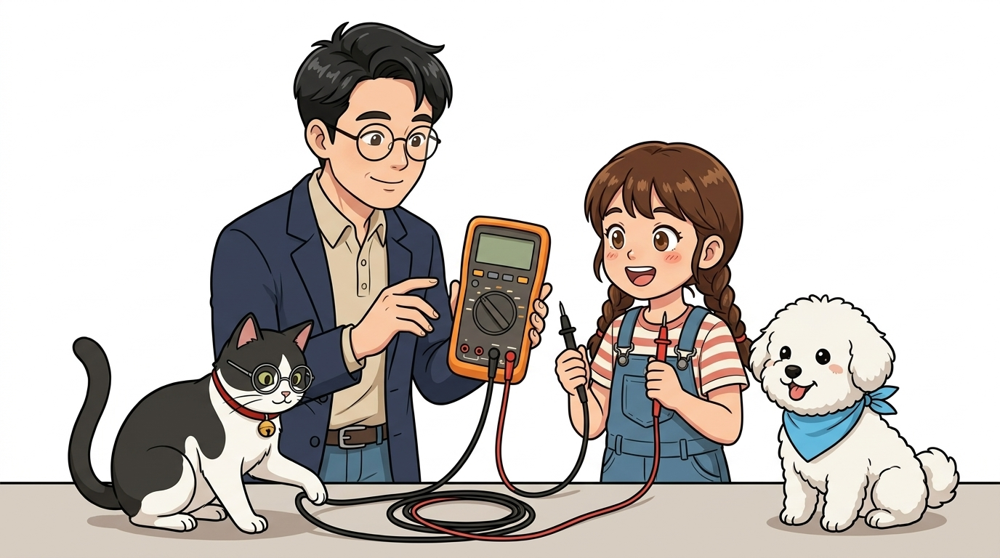
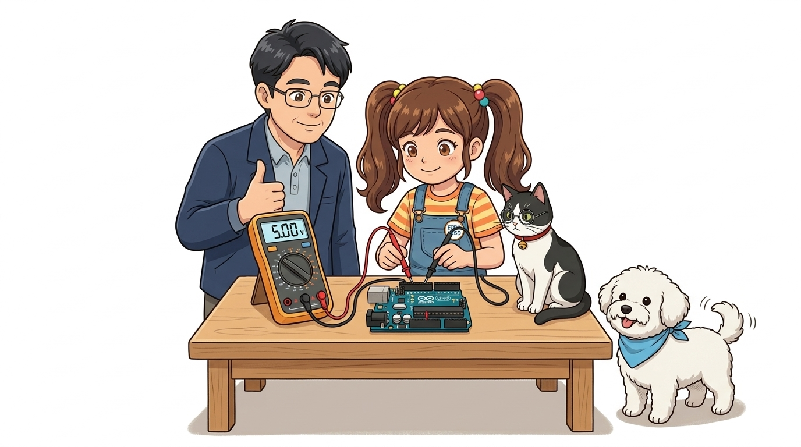
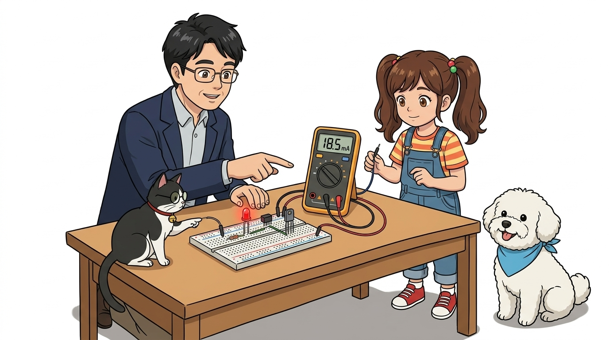

# 004_디지털멀티미터_전압전류저항_도통테스트 📟🩺



**호진 교수님과 조수 지니가 함께하는 전자 회로의 만능 청진기! 디지털 멀티미터(DMM) 완벽 사용법**

* 👧 **도로시**: "교수님! 브레드보드에 LED를 꽂았는데 불이 안 켜져요! 전선이 끊어진 걸까, 아니면 저항값이 틀린 걸까? 눈에 보이지 않으니 답답해요!"
* 🐱 **조수 지니**: "야옹~ 눈에 보이지 않는 전기의 상태를 정확히 진단해주는 의사의 청진기, **디지털 멀티미터(Digital Multimeter: DMM)**를 꺼낼 시간이야! 전압, 전류, 저항부터 전선 단선 검사까지 한 번에 진단할 수 있지!"
* 👨‍🏫 **호진 교수님**: "지니 말이 맞단다. 멀티미터는 회로의 건강 상태를 점검하는 최고의 엔지니어 도구란다. 전압은 병렬로, 전류는 직렬로, 저항과 도통은 전원을 끄고 측정하는 기본 원칙을 차근차근 배워보자꾸나."
* 🐶 **토토**: "멍멍! 선이 잘 이어져 있으면 신나는 '삐---!' 소리가 난다 멍!"

* 🖥️ **강의 슬라이드**: [slides.md](./slides.md)

---

## 1. 디지털 멀티미터(DMM)의 전면부 구조와 단자 연결

디지털 멀티미터는 전압(Voltage), 전류(Current), 저항(Resistance) 등 회로의 핵심 요소들을 한 대의 기기로 측정할 수 있는 전자 계측 장비입니다.

```
                  ┌───────────────────────────────┐
                  │       [ LCD 디지털 화면 ]     │  ➔ 측정값 표시 (예: 5.02 V)
                  ├───────────────────────────────┤
                  │                               │
                  │       (   선택 다이얼   )     │  ➔ DCV, ACV, Ω, 도통, DCA 선택
                  │                               │
                  ├───────────────────────────────┤
                  │    [10A]   [mAuA]  [COM] [VΩ] │  ➔ 프로브 잭 연결 단자
                  └──────┬───────┬───────┬─────┬─┘
                         │       │       │     │
                         │       │       │     └─── 빨간색 리드봉 (전압, 저항, 도통 기본 단자)
                         │       │       └───────── 검정색 리드봉 (언제나 공통 접지 COM!)
                         │       └───────────────── mA 단위 미세 전류 측정 단자
                         └───────────────────────── 대전류(10A) 측정 시에만 옮겨 꽂는 전용 단자
```

### 📌 리드봉(프로브) 연결의 황금률
* **검정색 프로브 (GND / Negative)**: 언제나 예외 없이 **`COM(Common)`** 잭에 고정하여 꽂습니다.
* **빨간색 프로브 (Signal / Positive)**: 평상시 전압, 저항, 도통 테스트 시 **`VΩmA`** (또는 `VΩHz`) 잭에 꽂습니다.

---

## 2. 직류 전압(DCV) 측정: 병렬 연결의 원칙



아두이노 전원 핀이나 건전지의 전압을 잴 때 사용합니다. 전압은 두 지점 사이의 '높이 차이(전위차)'이므로 **부품 양단에 나란히(병렬로)** 프로브를 댑니다.

```
       [ 아두이노 보드 ]
       5V 핀 ─────────────▶ [ 빨간색 프로브 (+) ]
                                                ├───▶ 멀티미터 [ 5.02 V ]
      GND 핀 ─────────────▶ [ 검정색 프로브 (-) ]
```

### 🛠️ 직류 전압 측정 4단계 절차
1. **다이얼 설정**: 다이얼을 **`DCV (직류 전압, V⎓)`** 영역의 **`20V`** 레인지(또는 자동 오토레인지)에 맞춥니다.
2. **단자 접촉**: 검정 프로브를 회로의 **GND(-)**, 빨간 프로브를 측정하고자 하는 **5V 라인(+)**에 접촉합니다.
3. **값 확인**: 화면에 `5.00V ~ 5.05V` 내외가 표시되면 전원 공급이 아주 건강한 상태입니다!
4. **역극성 확인**: 만약 화면에 `-5.02V`처럼 마이너스 부호가 뜬다면, 빨간색과 검정색 프로브가 반대로 연결된 것이므로 극성을 바로잡아 주면 됩니다.

---

## 3. 저항(Ω) 측정: 반드시 전원을 끄고 측정할 것!


저항기의 알록달록한 색띠가 헷갈리거나, 센서의 내부 저항값을 알고 싶을 때 측정합니다.

```
[ 올바른 저항 측정: 회로 전원 차단 상태! ]
  (빨간 프로브) ──── [ 220Ω 저항기 ] ──── (검정 프로브) ➔ [ 220.4 Ω ]
```

### ⚠️ 저항 측정 시 반드시 지켜야 할 안전 수칙
> [!CAUTION]
> **회로에 전기가 흐르는 상태에서 저항 모드로 프로브를 대면 절대 안 됩니다!**  
> 저항 모드는 멀티미터 내부의 작은 배터리가 미세한 전류를 흘려보내 저항값을 계산합니다. 회로 전원이 켜져 있으면 외부 전류가 멀티미터 안으로 밀고 들어와 엉뚱한 측정값이 나오거나 멀티미터 내부 칩이 손상될 수 있습니다. **반드시 USB 케이블을 뽑고 전원을 끈 후 측정하세요!**

---

## 4. 도통 테스트(Continuity Beeper): "삐-" 소리의 마법!


회로 점검에서 엔지니어들이 가장 애용하는 기능입니다. 두 지점이 전선으로 완벽하게 이어져 있으면 멀티미터가 신나는 **"삐---!"** 부저 소리를 울립니다.

### 🔍 도통 테스트는 언제 사용할까요?
1. **점퍼선 단선 검사**: 겉보기엔 멀쩡해 보이지만 피복 속 구리선이 끊어진 불량 점퍼선을 1초 만에 색출!
2. **브레드보드 버스 점검**: 빵판의 5개 구멍이 가로/세로로 서로 정상 연결되어 있는지 확인.
3. **스위치 작동 확인**: 푸시 버튼을 누르면 "삐-", 손을 떼면 "뚝" 멈추는지 점검하여 접점 이상 유무 판별.
4. **납땜 쇼트(Short) 검사**: 인접한 두 핀 사이에 납 찌꺼기가 튀어 의도치 않게 합선되었는지 비프음으로 점검.

---

## 5. 직류 전류(DCA) 측정: 회로를 끊고 직렬로 삽입!



전압 측정과 달리, 전류는 도선을 통과해 흐르는 **전자의 유량(흐름)**입니다. 따라서 전선 한 가닥을 끊고 그 사이에 멀티미터를 **직렬(Series)** 로 끼워 넣어야 합니다.

```
[ ❌ 절대 금지: 전압 재듯 병렬로 전류를 재면 폭발 위험! ]
  전원 (+) ───────── (빨간 프로브) [멀티미터 DCA] (검정 프로브) ───────── 전원 (-)
  ➔ 쇼트(합선) 발생! 멀티미터 내부 퓨즈가 펑 하고 타버립니다!

[ ⭕ 올바른 전류 측정: 회로 사이에 직렬 삽입 ]
  전원 (+) ──▶ (빨간 프로브) [멀티미터] (검정 프로브) ──▶ [저항] ──▶ [LED] ──▶ GND (-)
  ➔ 회로를 통과하는 전류(예: 18.5 mA)가 안전하게 화면에 표시됩니다!
```

---

## 📊 멀티미터 4대 핵심 측정 모드 비교 요약표

| 측정 모드 | 다이얼 기호 | 회로 연결 방식 | 전원 상태 | 주요 용도 |
| :---: | :---: | :---: | :---: | :--- |
| **직류 전압** | `DCV (V⎓)` | **병렬 연결** (부품 양단) | **전원 ON** | 배터리 잔량, 아두이노 5V/3.3V 전원 정상 여부 점검 |
| **저항** | `Ω (Ohm)` | **부품 양단 접촉** | **반드시 전원 OFF** | 저항기 색띠 확인, 가변저항 및 센서 저항 측정 |
| **도통 테스트** | `부저 / 다이오드 기호` | **양 끝단 접촉** | **반드시 전원 OFF** | 점퍼선 단선 확인, 스위치 접점 검사, 납땜 쇼트 점검 |
| **직류 전류** | `DCA (A⎓)` | **직렬 삽입** (회로 사이) | **전원 ON** | LED, 모터, 센서가 소모하는 전류량(mA) 정밀 계측 |

---

## 🌟 도로시와 호진 교수님의 핵심 요약 노트!


* 👧 **도로시**: "교수님, 지니야! 회로가 안 돌아갈 땐 도통 모드로 '삐-' 소리를 확인하고, 전압은 병렬로! 전류는 직렬로 잰다는 규칙만 기억하면 되겠어요!"
* 🐱 **조수 지니**: "야옹~ 완벽해 도로시! 멀티미터 하나만 능숙하게 다뤄도 회로 고장의 99%를 순식간에 찾아낼 수 있지!"
* 👨‍🏫 **호진 교수님**: "훌륭하구나 도로시. 다음 시간에는 브레드보드 위에서 회로를 든든하게 지켜주는 **'005. 전자회로의 핵심 부품 친구들'**을 만나러 가보자꾸나!"
* 🐶 **토토**: "멍멍! 다음 시간도 신나게 출발하자 멍!"
