# 005_전자회로의_핵심부품친구들 🧩
### 저항(R), 커패시터(C), 인덕터(L)부터 반도체까지 완벽 정복!


* **오늘의 탐험**: 전자회로를 구성하는 3대 수동 소자(RLC: 저항, 콘덴서, 코일)와 반도체 소자의 원리, 종류, 판독법 완벽 마스터!
* **선생님**: 호진 교수님 (공학 멘토) & 연구실 조수 지니 (고양이) & 학생 도로시 & 토토

* 🖥️ **강의 슬라이드**: [slides.md](./slides.md)

---

## ❓ 왜 회로에는 여러 가지 부품이 함께 들어갈까요?

> **👧 도로시**: "교수님! 아두이노 보드나 전자 기기를 열어보면 알록달록 줄무늬 원통도 있고, 작은 깡통 모양 캔도 있고, 구리선이 뱅글뱅글 감긴 부품도 있어요! 전선만 있으면 전기가 통할 텐데, 왜 이런 다양한 부품들이 필요한가요?"  
> **🐱 조수 지니**: "야옹~ 도로시, 회로 점검 결과 부품 없이 전선만 연결하면 LED가 1초 만에 타버려! 전기의 양과 흐름을 다스려주는 친구들이 꼭 필요하지!"  
> **👨‍🏫 호진 교수님**: "지니 말이 맞단다. 전기는 성격이 급한 물과 같아서, 전선만 있으면 폭포수처럼 쏟아져 부품이 타버린단다. 회로 부품들은 **전기의 양을 조절(저항)**하고, **넘치는 전기를 담아 완충(커패시터)**하며, **급격한 변화를 막고 전자기 에너지를 저장(인덕터)**하는 댐과 신호등 역할을 한단다."  
> **🐶 토토**: "멍멍! 부품들이 힘을 합쳐 회로를 안전하게 지켜준다 멍!"

```
           ┌────────────────────────────────────────────────────────┐
           │        전자회로 핵심 3대 수동 소자 (R - L - C)         │
           ├──────────────┬───────────────────┬─────────────────────┤
           │  저항기 (R)  │  커패시터 / 콘덴서│   인덕터 / 코일 (L) │
           │   Resistor   │   Capacitor (C)   │       Inductor      │
           ├──────────────┼───────────────────┼─────────────────────┤
           │ 전기를 억제  │   전하를 축적     │  전류 변화를 억제   │
           │ 전압을 강하  │  전압 출렁임 완충 │  자기장 에너지 저장 │
           │ 댐의 방파제  │   완충 물탱크     │    회전 플라이휠    │
           └──────────────┴───────────────────┴─────────────────────┘
```

---

## 🚧 1장: 전기의 속도와 양을 조절하는 방패, 저항기(Resistor, R)

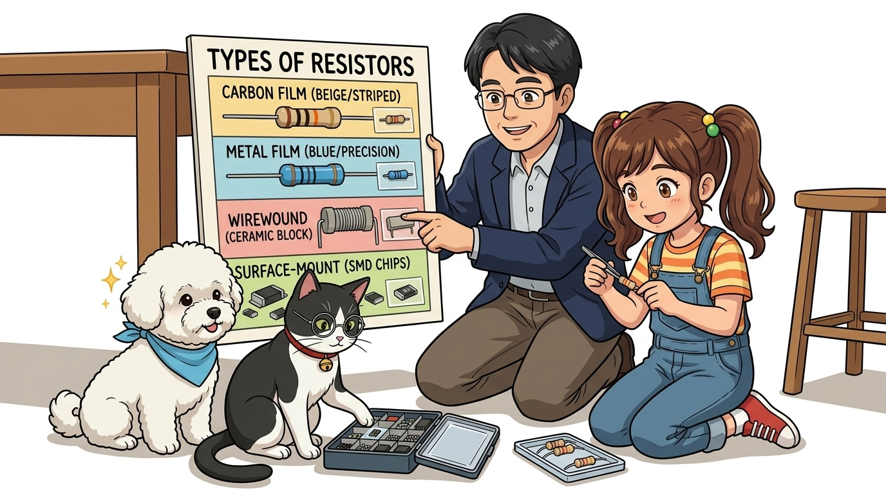

### 1. 저항의 정의와 옴의 법칙 (Ohm's Law)
* **저항(Resistor)**: 전류의 흐름을 방해하여 알맞은 양만 흐르도록 제한하는 부품입니다. (기호: `Ω`, 옴)
* **옴의 법칙 (`V = I × R`)**:
  * **전압(V, Volt)** = **전류(I, Ampere) × 저항(R, Ohm)**  [`V = I × R`]
  * **전류(I)** = **V / R** (저항이 커지면 흐르는 전류가 줄어듭니다)
  * **저항(R)** = **V / I** (전압을 전류로 나눈 값)
* **소비전력 공식 (`P`)**: 저항은 전류를 억제하면서 전기 에너지를 **열(Heat)**로 방출합니다.
  ```
  P = V × I = I² × R = V² / R  [단위: W, 와트]
  ```
  * 저항의 크기(허용 전력)는 주로 **1/8W, 1/4W, 1/2W, 1W, 5W, 10W** 등으로 나뉘며, 정격 전력을 초과하면 과열되어 타버릴 수 있습니다.

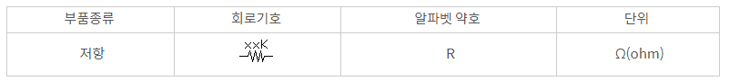
*(좌: 미국/한국 표준 지그재그 기호 | 우: 유럽 표준 직사각형 기호)*

---

### 2. 고정 저항기(Fixed Resistor)의 종류와 특징

회로에 쓰이는 저항기는 재료와 제조 방식에 따라 성능과 용도가 다릅니다.

| 종류 | 외형 사진 | 내부 구조 및 특징 | 주요 용도 |
| :--- | :---: | :--- | :--- |
| **탄소피막 저항기**<br>*(Carbon Film)* | 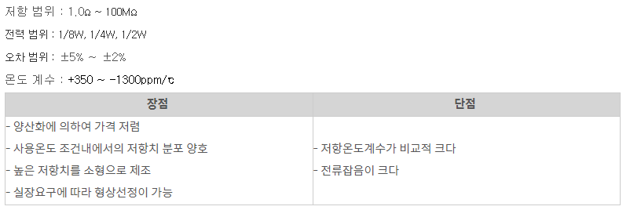 | 세라믹 봉에 탄소 분말을 입히고 나선형 홈을 파서 저항값 조절. 가격이 가장 저렴함 (오차 ±5%, 베이지색) | 범용 전자회로, 아두이노 기본 실습 |
| **금속피막 저항기**<br>*(Metal Film)* | 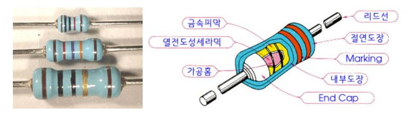 | 금속 합금을 증착하여 제조. 온도 변화에 따른 오차가 매우 적고 잡음이 없음 (오차 ±1%, 하늘색/파란색) | 정밀 계측기, 오디오 회로, 디지털 정밀 회로 |
| **산화금속피막 저항기**<br>*(Metal Oxide)* | 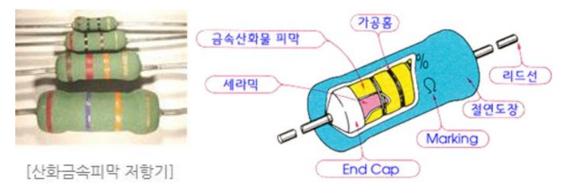 | 사기/유리 몸체에 금속 산화물을 입힘. 고온 및 열에 매우 강하며 불이 붙지 않음 | 전원공급장치(SMPS), 대전류 보호부 |
| **권선형 저항기**<br>*(Wire Wound)* | 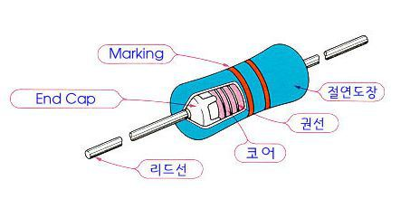 | 세라믹 코어에 니크롬 저항선을 감아 만듦. 대전력(수W~수십W)을 견디며 시멘트 몰딩 처리 | 대전력 모터 제어기, 히터 제어부 |
| **메탈클래드 저항기**<br>*(Metal Clad)* | 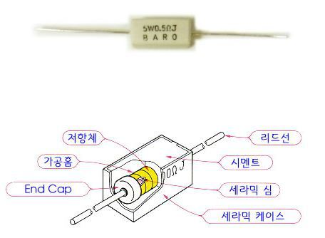 | 알루미늄 방열 케이스에 몰딩. 방열판에 직접 볼트로 체결하여 대용량 열을 방출 | 산업용 인버터, 방전 부하 시험기 |
| **후막 칩 저항기**<br>*(SMD Chip)* | 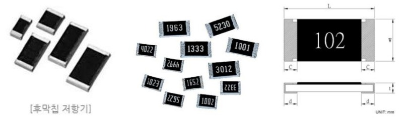 | 세라믹 기판 위에 저항체를 얇게 인쇄한 초소형 표면실장(SMT) 부품 | 스마트폰, 컴퓨터 메인보드, 아두이노 보드 |
| **어레이 저항기**<br>*(Resistor Array)* | 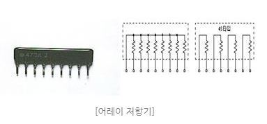 | 동일한 저항 여러 개를 한 패키지(SIP/DIP)에 묶어놓은 집적형 부품 | LED 8개 일괄 구동, 마이크로컨트롤러 풀업 |

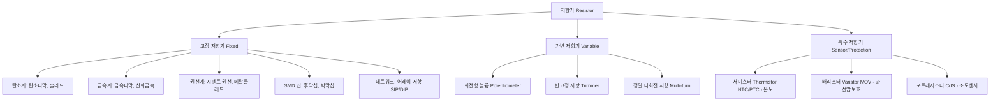

---

## 🎨 2장: 알록달록 저항 색띠(Color Code) & SMD 코드 완벽 해독법

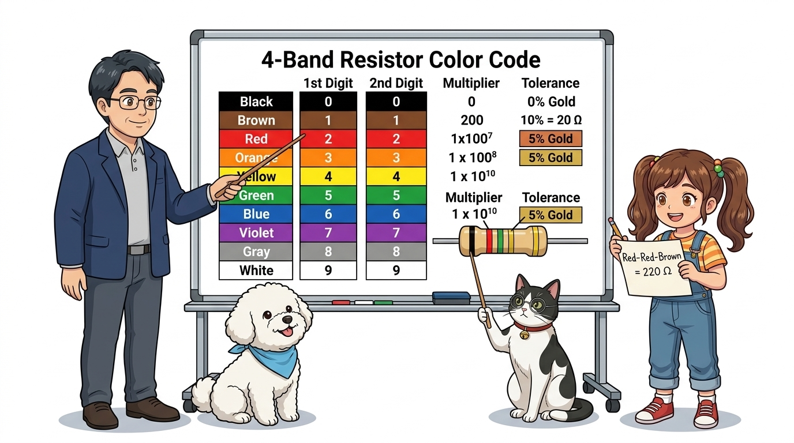

크기가 작은 탄소피막/금속피막 저항기는 숫자를 인쇄하기 어려워 **색깔 띠(Color Band)**로 값을 표기합니다.

### 1. 저항 색띠 표준 표 (4색 띠 & 5색 띠)

| 색상 | 영문 | 1번째 자리 | 2번째 자리 | 3번째 자리(5색) | 승수 (배수) | 허용 오차 (Tolerance) |
| :---: | :---: | :---: | :---: | :---: | :---: | :---: |
| ⬛ **검정** | Black | 0 | 0 | 0 | × 1 (10⁰) | - |
| 🟫 **갈색** | Brown | 1 | 1 | 1 | × 10 (10¹) | ±1% (F) |
| 🟥 **빨강** | Red | 2 | 2 | 2 | × 100 (10²) | ±2% (G) |
| 🟧 **주황** | Orange | 3 | 3 | 3 | × 1,000 (1k, 10³) | - |
| 🟨 **노랑** | Yellow | 4 | 4 | 4 | × 10,000 (10k, 10⁴) | - |
| 🟩 **초록** | Green | 5 | 5 | 5 | × 100,000 (100k, 10⁵) | ±0.5% (D) |
| 🟦 **파랑** | Blue | 6 | 6 | 6 | × 1,000,000 (1M, 10⁶) | ±0.25% (C) |
| 🟪 **보라** | Violet | 7 | 7 | 7 | × 10,000,000 (10M, 10⁷) | ±0.1% (B) |
| ⬜ **회색** | Gray | 8 | 8 | 8 | × 100,000,000 (100M) | ±0.05% |
| ⬜ **흰색** | White | 9 | 9 | 9 | × 1,000,000,000 (1G) | - |
| 🟡 **금색** | Gold | - | - | - | × 0.1 (10⁻¹) | **±5% (J)** |
| ⚪ **은색** | Silver | - | - | - | × 0.01 (10⁻²) | **±10% (K)** |

> **💡 암기 마법 꿀팁**:  
> *"검-갈-빨-주-노-초-파-보-회-흰"*  
> 무지개 색(빨주노초파보) 앞뒤로 검정(0), 갈색(1)과 회색(8), 흰색(9)이 위치합니다!

---

### 2. 아두이노 필수 저항 읽기 실전 연습

* **220Ω 저항** (LED 실습 표준 저항):
  * **빨(2) - 빨(2) - 갈(×10) - 금(±5%)** → `22 × 10 = 220Ω`
* **330Ω 저항** (LED 보호 저항):
  * **주(3) - 주(3) - 갈(×10) - 금(±5%)** → `33 × 10 = 330Ω`
* **1kΩ 저항** (신호 전달용):
  * **갈(1) - 검(0) - 빨(×100) - 금(±5%)** → `10 × 100 = 1,000Ω = 1kΩ`
* **10kΩ 저항** (스위치 풀업/풀다운 표준):
  * **갈(1) - 검(0) - 주(×1,000) - 금(±5%)** → `10 × 1,000 = 10,000Ω = 10kΩ`

---

### 3. SMD 칩 저항 3자리/4자리 코드 읽는 법
스마트폰이나 아두이노 메인보드 표면에 납땜된 작은 사각형 칩 저항에는 3자리 숫자가 적혀 있습니다.
* **102**: `10 × 10² = 1,000Ω = 1kΩ`
* **473**: `47 × 10³ = 47,000Ω = 47kΩ`
* **100**: `10 × 10⁰ = 10Ω`
* **2R2**: 'R'은 소수점 → `2.2Ω`
* **0 또는 000**: `0Ω` 점퍼 칩 (단락선 역할)

---

## 🎛️ 3장: 가변 저항기(Potentiometer)와 특수 센서 저항

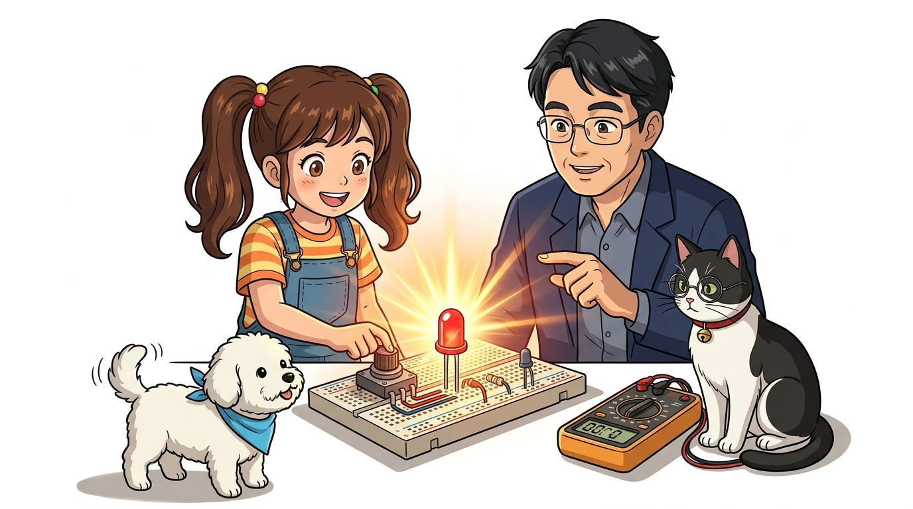

### 1. 가변 저항기의 원리와 3개 단자 구조
손잡이를 돌리거나 밀어서 저항값을 자유롭게 바꿀 수 있는 부품을 **가변 저항기(Potentiometer)**라고 부릅니다.

```
       1번 단자 (5V 입력) ────────┐
                                  ├── 저항체 (Carbon / Cermet Track)
       2번 단자 (와이퍼 출력) ───[◄─── 이동 접점 (Wiper)
                                  ├──
       3번 단자 (GND 접지) ───────┘
```

* **1번과 3번 사이**: 전체 최대 저항값(예: 10kΩ)이 고정으로 측정됩니다.
* **2번(가운데 와이퍼 단자)**: 노브를 돌리면 1번과의 저항은 줄어들고 3번과의 저항은 늘어나며, **0V에서 5V 사이의 전압을 자유롭게 분배(Voltage Divider)**하여 아두이노의 아날로그 핀(`A0`)으로 출력합니다!

| 종류 | 외형 사진 | 특징 및 용도 |
| :---: | :---: | :--- |
| **회전형 볼륨 저항**<br>*(Rotary Potentiometer)* | 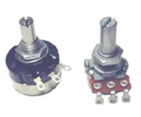 | 오디오 볼륨, 스피커 음량 조절, 조이스틱, 아두이노 모터 각도 제어 입력기 |
| **반고정 저항 (트리머)**<br>*(Trimmer Potentiometer)* | 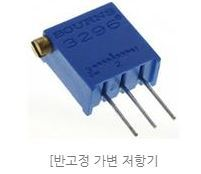 | 드라이버로 미세 조정 후 고정. 회로 기준 전압 설정, LCD 1602 명암(Contrast) 조절 |

---

### 2. 센서 역할을 하는 특수 저항기

| 특수 저항 | 외형 사진 | 동작 원리 및 용도 |
| :---: | :---: | :--- |
| **NTC 서미스터**<br>*(Thermistor)* | 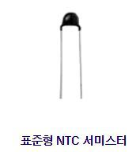 | **온도가 올라가면 저항이 감소**하는 반도체 소자. 에어컨, 3D 프린터 노즐 온도 측정기 |
| **PTC 서미스터** | - | **온도가 올라가면 저항이 급증**하여 전류를 차단하는 자가복구 퓨즈(Polyswitch) |
| **배리스터 (MOV)**<br>*(Metal Oxide Varistor)* | 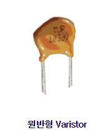 | 평소에는 무한대 저항이지만, **낙뢰/서지 고전압이 들어오면 저항이 0으로 급감**하여 과전압을 땅으로 흘려보내 회로를 보호 |
| **CdS 광도전 셀**<br>*(Photoresistor)* | - | **빛을 받으면 저항이 수백 Ω으로 낮아지고**, 어두우면 수백 kΩ으로 높아지는 조도 센서 |

---

## 💧 4장: 전기를 모아두는 작은 물탱크, 커패시터/콘덴서(Capacitor, C)

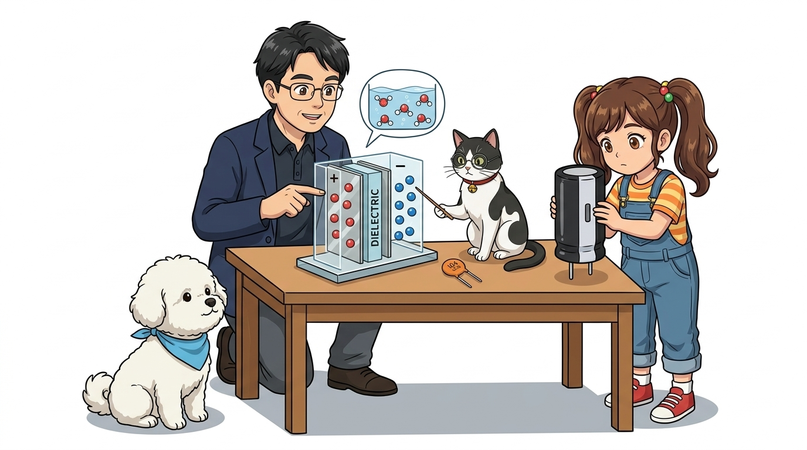

### 1. 커패시터의 구조와 전하 축적 원리
* **구조**: 두 개의 금속 전극판(Plate) 사이에 절연 물질인 **유전체(Dielectric)**를 끼워 넣은 구조입니다.
* **충전 원리**: 직류 전압(V)을 걸어주면 한쪽 판에는 양전하(+Q), 반대쪽 판에는 음전하(-Q)가 끌려와 마주 보며 축적됩니다.
  ```
  Q = C × V  [단위: C, 쿨롱]
  (축적 전하량 Q = 정전용량 C × 전압 V)
  ```
* **단위**: 패럿(F, Farad). 단위가 매우 크므로 보통 **µF(마이크로패럿, 10⁻⁶ F)**, **nF(나노패럿, 10⁻⁹ F)**, **pF(피코패럿, 10⁻¹² F)** 단위를 사용합니다.

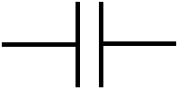
*(좌: 일반 무극성 커패시터 기호 | 우: 전해 콘덴서 극성 기호)*

---

### 2. 커패시터의 4대 핵심 기능

1. **전하 축적 및 순간 방전**: 카메라 플래시, 정전 시 순간 전원 유지(Supercapacitor).
2. **전원 평활화 (Smoothing Filter)**: 교류를 직류로 바꿀 때 울퉁불퉁한 맥류를 평탄한 직류로 정돈.
3. **노이즈 제거 (Bypass / Decoupling)**: 고주파 전원 노이즈를 접지(GND)로 버려 IC 칩의 오동작 방지.
4. **직류 차단 / 교류 통과 (DC Blocking / AC Coupling)**: 직류는 막고 음성/오디오 신호(교류)만 다음 단으로 통과.

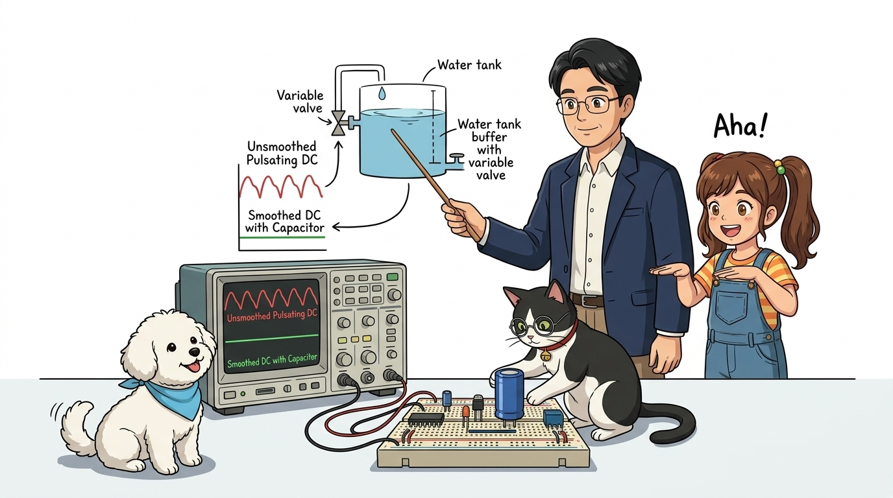

---

### 3. 커패시터 용량 읽기법
1. **직독식 (전해 커패시터)**: 몸체에 `1000uF 16V`와 같이 정전용량과 정격전압(내압)이 직접 인쇄되어 있습니다.
2. **3자리 숫자 코드 (세라믹/필름 커패시터)**:
   * **104**: `10 × 10⁴ pF = 100,000 pF = 0.1 µF = 100 nF` (아두이노 바이패스 표준)
   * **222J**: `22 × 10² pF = 2,200 pF = 2.2 nF` (뒤의 'J'는 허용오차 ±5%)
   * **471K**: `47 × 10¹ pF = 470 pF` (뒤의 'K'는 허용오차 ±10%)

---

### 4. 커패시터 종류별 특성 비교

| 종류 | 사진 | 특징 및 주의점 | 주요 용도 |
| :--- | :---: | :--- | :--- |
| **알루미늄 전해 콘덴서**<br>*(Electrolytic)* | 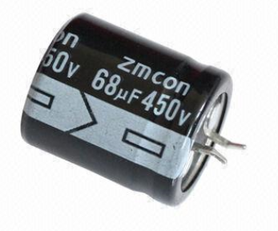 | 소형에 큰 용량(1µF ~ 10,000µF). **반드시 (+)와 (-) 극성을 지켜야 함** (몸체 흰색 띠가 `-`, 짧은 다리가 `-`). 거꾸로 꽂으면 폭발 위험! | 전원 공급 장치, 오디오 평활 회로 |
| **탄탈 콘덴서**<br>*(Tantalum)* | 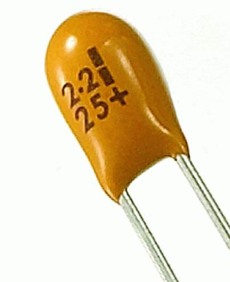 | 탄탈륨 금속 분말 사용. 전해 콘덴서보다 주파수 특성 및 누설전류 특성이 우수하고 수명이 김 | 정밀 아날로그 회로, 통신 장비 |
| **세라믹 콘덴서**<br>*(Ceramic)* | 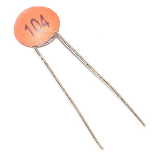 | 원판형 세라믹 유전체. 극성이 없으며 고주파 특성이 매우 우수함. 용량은 수 pF ~ 0.1µF로 작음 | 고주파 노이즈 제거, 무선 RF 회로 |
| **적층 세라믹 (MLCC)**<br>*(Multi-Layer Ceramic)* | 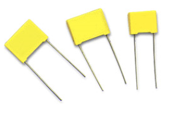 | 세라믹과 내부 전극을 수백 층 겹쳐 초소형 고용량 실현. 현대 전자기기의 쌀 | 스마트폰, 마이크로컨트롤러 바이패스 |
| **슈퍼 커패시터**<br>*(Supercapacitor)* | 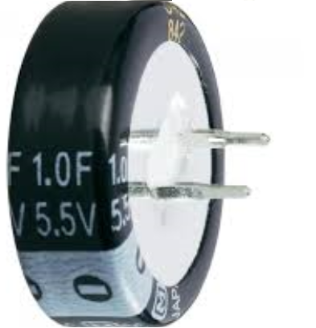 | 전기이중층 원리로 수 F ~ 수천 F의 초대용량 축전. 배터리와 콘덴서의 중간 성질 | 정전 백업 전원, 태양광 에너지 저장 |
| **필름 콘덴서**<br>*(Film Capacitor)* | 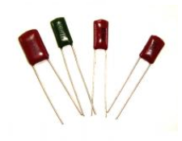 | 마일러, 폴리프로필렌 필름 사용. 내압이 수백V로 높고 왜곡이 없음 | 오디오 앰프 크로스오버, 고압 필터 |
| **트리머 / 바리콘**<br>*(Variable Capacitor)* | 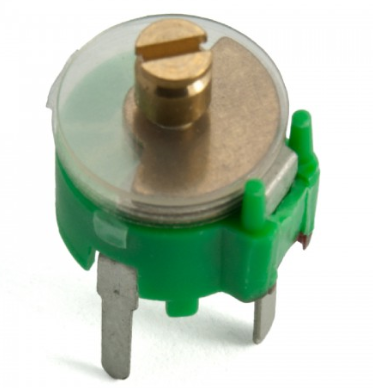 | 전극판의 겹치는 면적을 돌려 용량을 변경 | 라디오 방송국 주파수 튜닝 (LC 공진) |

---

## 🌀 5장: 전류의 변화를 다스리는 전자기 마법, 인덕터/코일(Inductor, L)

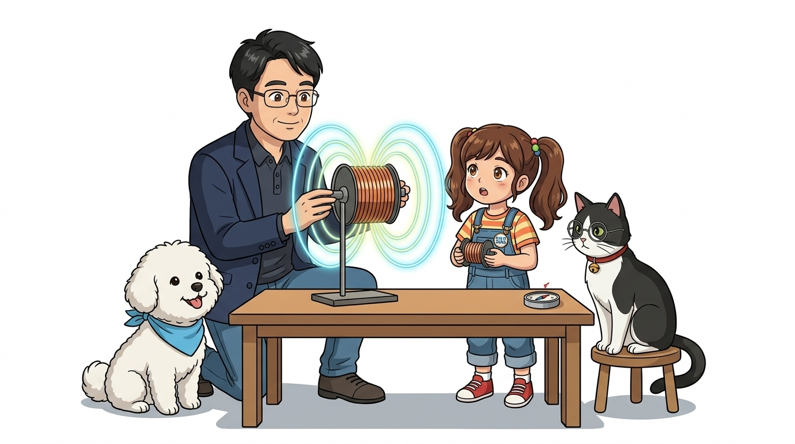

### 1. 인덕터의 구조와 렌츠의 법칙 (Lenz's Law)
* **구조**: 구리 도선을 원통이나 도넛(토로이달) 형태의 철심(페라이트 코어)에 나선형으로 감아 만든 소자입니다.
* **단위**: 헨리(H, Henry), 주로 mH, µH 사용.
* **코일의 5대 핵심 물리 법칙**:
  1. **전류 변화 억제 (렌츠의 법칙 & 역기전력)**: 전류가 급격히 흐르려 하면 방해하는 역기전력(`V = -L × ΔI / Δt`)을 만들고, 전류가 끊어지려 하면 계속 흐르게 밀어줍니다.
  2. **전자석 성질**: 전류가 흐르는 동안 강력한 전자석이 됩니다 → 릴레이, 모터, 스피커의 구동 원리.
  3. **상호 유도 작용 (Mutual Induction)**: 1차 코일에 교류를 흘리면 2차 코일에 전압이 유도됩니다 → **변압기(Transformer)**.
  4. **공진 특성 (LC Resonance)**: 커패시터(C)와 코일(L)을 조합하면 특정 주파수의 전파만 쏙 골라내는 필터가 됩니다 → 라디오 수신 튜너.
  5. **전원 노이즈 차단 (Choke Coil)**: 교류/고주파 잡음은 틀어막고 직류 전원만 깨끗하게 통과시킵니다.

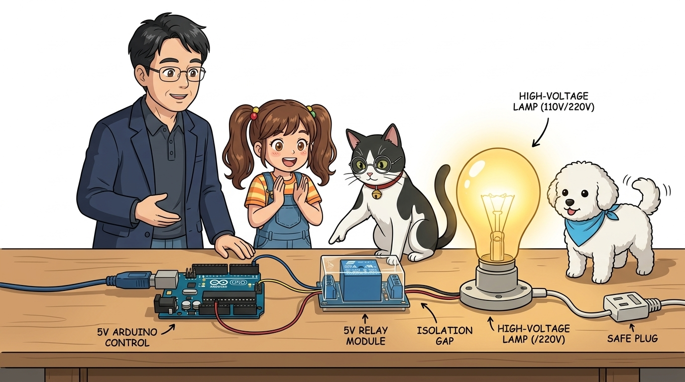

---

### 2. 코일의 종류와 응용 부품

| 종류 | 사진 | 특징 및 회로에서의 역할 |
| :--- | :---: | :--- |
| **초크 코일**<br>*(Choke Coil)* | 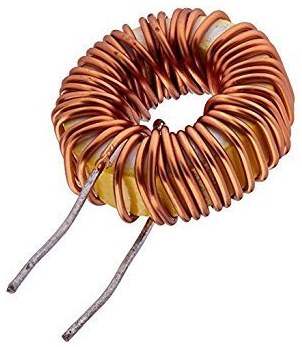 | 전원선에 직렬로 연결하여 전원 스위칭 노이즈 및 서지 펄스를 억제하는 고성능 필터 |
| **변압기 (트랜스)**<br>*(Transformer)* |  | 220V 교류를 5V, 12V 저전압 교류로 안전하게 변환 (`V₁ / V₂ = N₁ / N₂`) |
| **릴레이 (계전기)**<br>*(Electromagnetic Relay)* | 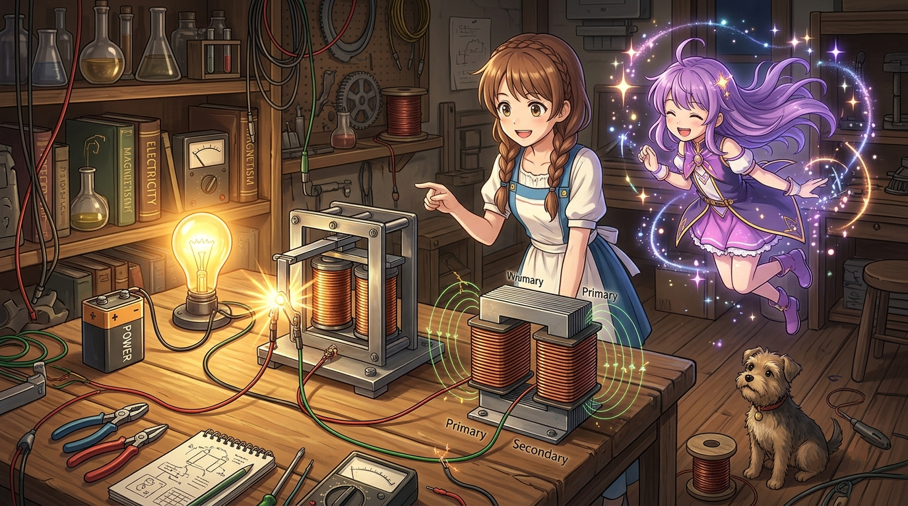 | 아두이노의 5V 작은 신호로 전자석을 켜서, 220V 고전압 가전제품 스위치를 물리적으로 ON/OFF |
| **가변 코일**<br>*(Variable Inductor)* | 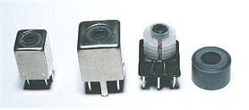 | 코일 중심의 페라이트 코어를 나사처럼 돌려 넣어 인덕턴스를 미세 조정 (라디오 동조부) |

---

## 🚦 6장: 능동 소자(Active Components)와의 첫 만남

회로의 신호를 증폭하거나 연산하는 반도체 소자들을 **능동 소자(Active Components)**라고 부릅니다.

```
       [ 다이오드 Diode ]             [ 트랜지스터 Transistor ]            [ 집적회로 IC ]
         ┌───►|───┐                       C (컬렉터)                         ┌─────┐
     Anode(+)  Cathode(-)                    │                             ──┤1  16├──
     전기 일방통행 밸브                 B ──┤► (스위칭/증폭)                ──┤2  15├──
     역전압 방지, 정류                     │                             ──┤     ├──
     LED: 빛을 발산하는 다이오드           E (이미터)                        └─────┘
```

1. **다이오드 (Diode)**:
   * P형 반도체와 N형 반도체를 접합하여 전기가 (+)에서 (-)로만 흐르도록 만든 **일방통행 밸브**.
   * 모터가 회전하다 멈출 때 발생하는 역기전력 고전압을 흡수하는 **플라이백 다이오드(Flyback Diode)**로 자주 쓰입니다.
   * **LED(발광 다이오드)**: 순방향 전류가 흐를 때 전자와 양공이 결합하며 빛을 방출하는 특수 다이오드.
2. **트랜지스터 (BJT / MOSFET)**:
   * 베이스(게이트)에 아주 작은 전류/전압 신호를 주면 컬렉터-이미터(드레인-소스) 사이에 대용량 전류가 흐르는 **초고속 전자식 스위치**.
   * 아두이노의 작은 핀 출력(최대 40mA)으로 1A 이상의 모터, 릴레이, 밸브를 제어할 때 필수!
3. **집적회로 (IC, Integrated Circuit)**:
   * 수만~수십억 개의 저항, 다이오드, 트랜지스터를 손톱만 한 실리콘 웨이퍼에 집적한 부품.
   * 아두이노 우노의 핵심 두뇌인 **ATmega328P 마이크로컨트롤러**가 대표적인 고성능 IC입니다.

---

## 🌟 수동 소자(RLC) vs 능동 소자 한눈에 정리

| 소자 구분 | 대표 부품 | 에너지 작용 | 핵심 동작 특성 | 기계적 비유 |
| :---: | :---: | :---: | :---: | :---: |
| **저항기 (R)** | 탄소피막, 메탈클래드, 볼륨 | 에너지 소모 (열) | 전류 크기 제한, 전압 분배 (`V = I × R`) | 수도 파이프의 조리개 |
| **커패시터 (C)** | 전해, 세라믹, MLCC | 정전기장 축적 | 전압 급변 방지, 직류 차단, 노이즈 바이패스 | 수압을 일정하게 유지하는 완충 물탱크 |
| **인덕터 (L)** | 초크 코일, 트랜스, 릴레이 | 자기장 축적 | 전류 급변 억제, 전자기 유도, 전자석 스위치 | 회전 관성 플라이휠 |
| **다이오드** | 정류 다이오드, LED | 신호 방향 제어 | 역류 방지, 빛 방출, AC → DC 정류 | 역류 방지 체크 밸브 |
| **트랜지스터** | NPN/PNP BJT, N-ch MOSFET | 신호 증폭/스위칭 | 작은 신호로 큰 전력 고속 ON/OFF 제어 | 손잡이가 달린 수도 밸브 |
| **집적회로 (IC)** | ATmega328P, NE555 | 복합 논리/연산 | 프로그램 실행, 데이터 처리, 타이머 | 자동 제어 컴퓨터 센터 |

---

## 🧠 확인 퀴즈! "나도 이제 전자 부품 감정사!"

1. **Q1. 아두이노에서 빨간색 LED를 5V 전원에 연결하려고 합니다. 저항 색띠가 `빨강-빨강-갈색-금색`인 저항의 저항값은 얼마일까요?**
   * *정답*: 빨(2) 빨(2) 갈(×10) = **220Ω (허용오차 ±5%)**. LED를 태우지 않고 안전하게 켜는 표준 저항입니다!

2. **Q2. 원통형 알루미늄 전해 콘덴서를 브레드보드에 꽂을 때 가장 주의해야 할 점은 무엇일까요?**
   * *정답*: **극성(+ / -)**! 긴 다리가 (+), 몸체에 흰색 띠가 그려진 짧은 다리가 (-)이며, 극성을 반대로 연결하면 과열되어 펑 터질 수 있습니다!

3. **Q3. 직류(DC) 전원은 막고, 노이즈나 음악 소리 같은 교류(AC) 신호만 통과시키는 부품은 RLC 중 무엇일까요?**
   * *정답*: **커패시터 (C, 콘덴서)**! 커패시터는 직류를 차단하고 교류만 통과시키는 DC Blocking 성질을 가집니다.

---

## 🎯 다음 모험 예고


* **👧 도로시**: "교수님, 지니야! 저항 색띠 읽는 법도 완벽히 알았고, 커패시터의 물탱크 역할이랑 코일의 전자기 유도도 정말 신기했어요!"
* **🐱 조수 지니**: "야옹~ 훌륭해 도로시! 부품 감정사 퀴즈도 100점 만점으로 통과했어!"
* **👨‍🏫 호진 교수님**: "참 잘했단다 도로시. 이제 이 든든한 전자 부품 친구들을 납땜 없이 마음껏 꽂고 이어보는 마법의 판, **'006. 브레드보드(빵판)의 마법'**을 만나러 가보자꾸나!"
* **🐶 토토**: "멍멍! 다음 시간엔 빵판 위에 부품들을 직접 꽂아보자 멍!"
* **👉 다음 장**: **[006_브레드보드_빵판의마법](../006_브레드보드_빵판의마법/index.md)**으로 이어집니다!
