# 006_브레드보드_빵판의마법 🍞

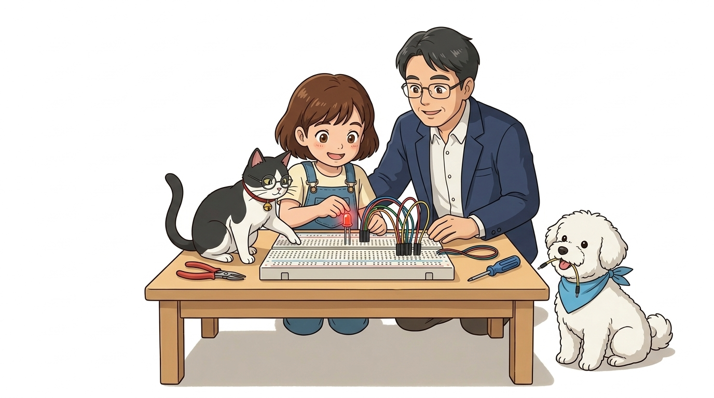

* **오늘의 목표**: 브레드보드의 내부 연결 원리를 배우고 점퍼선으로 부품 연결하기!
* **선생님과 친구들**: 호진 교수님 & 조수 지니(고양이) & 도로시 & 토토

### 납땜 없이 부품을 쏙쏙 꽂는 마법의 회로 도화지!
* 📖 **상세 강의 교재**: [index.md](./index.md)

> 여러분 안녕하세요! 이번 시간에는 '006. 브레드보드 빵판의마법 🍞'을 주제로 흥미진진한 공학 실습 탐험을 시작합니다. 이번 강의에서는 납땜 없이 부품 다리를 쏙쏙 꽂아 전기를 통하게 만드는 브레드보드의 내부 연결 원리와 점퍼선 활용법을 차근차근 배워보겠습니다. 친절한 공학 멘토 이호진 교수님의 설명과 똑똑한 연구실 조수 고양이 지니의 꼼꼼한 어시스트, 그리고 호기심 가득한 도로시와 귀여운 토토와 함께 신나는 회로 실습을 힘차게 시작해 봅시다!

---

## ❓ 왜 이름이 '빵판(Breadboard)'일까요?

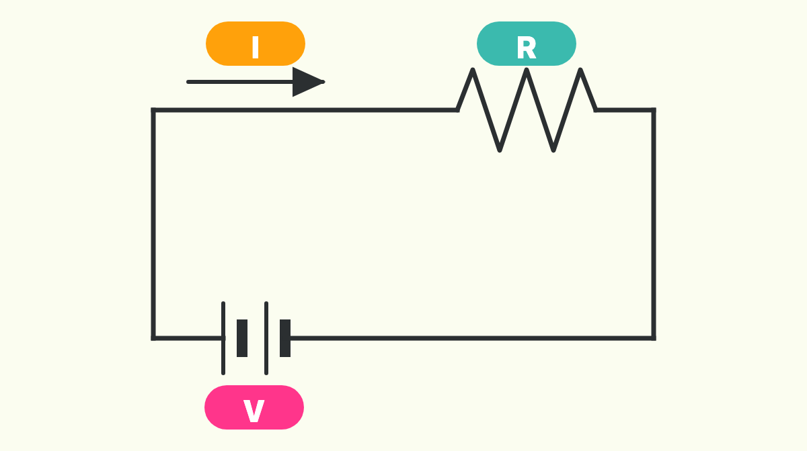

* **👧 도로시**: "교수님! 구멍이 송송 뚫린 이 하얀 네모 판을 왜 '빵판(Breadboard)'이라고 불러요? 먹는 식빵이랑 무슨 상관이에요?"
* **👨‍🏫 호진 교수님**: "하하, 아주 좋은 질문이란다! 1970년대 이전 과학자들은 회로를 시험할 때 실제 나무 빵 도마(Breadboard) 위에 못을 쾅쾅 박고 구리선을 감아 실험했단다. 거기서 유래된 재미있는 역사란다!"
* **🐱 조수 지니**: "냥! 지금은 납땜할 필요 없이 구멍에 쏙쏙 꽂기만 하면 되는 멋진 플라스틱 빵판으로 발전했지옹!"

> 자, 이번 슬라이드의 질문을 함께 보시겠습니다. 바로 '왜 이름이 빵판(Breadboard)일까요?'라는 질문입니다. 도로시의 궁금증에 호진 교수님께서 나무 빵 도마 위에 못을 박아 회로를 시험하던 역사적 배경을 짚어주셨고, 조수 지니가 현재의 재사용 가능한 플라스틱 브레드보드로 발전한 이유를 짚어주었습니다. 이 작은 하얀 판 속에 어떤 기발한 금속 구조가 숨어있는지 하나씩 파헤쳐 보겠습니다.

---

## 🔥 1단계: 뜨거운 인두기와 납땜은 이제 그만!

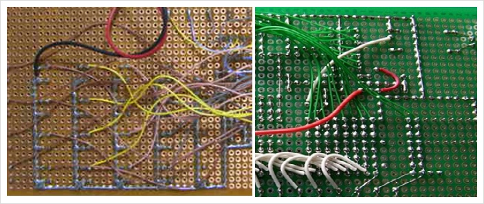
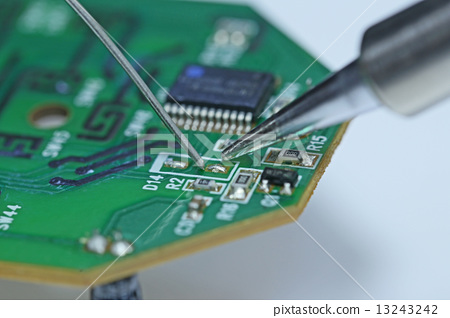

* 전기가 통하는 길(회로)을 만들려면 부품들을 서로 단단히 이어줘야 해요.
* 옛날에는 300도 넘는 뜨거운 인두기로 납을 녹여 붙여야(납땜) 했어요.
* 손을 델 위험도 크고, 잘못 붙이면 떼어내기도 너무 어려웠답니다!

> 이번 슬라이드에서는 '🔥 1단계: 뜨거운 인두기와 납땜은 이제 그만!'에 대해 자세히 살펴보겠습니다. 화면의 다이어그램과 사진을 함께 참고해 주시기 바랍니다. 첫 번째 핵심은 전기가 통하는 길(회로)을 만들려면 부품들을 서로 단단히 이어줘야 해요.이며, 두 번째로는 옛날에는 300도 넘는 뜨거운 인두기로 납을 녹여 붙여야(납땜) 했어요.입니다. 여기에 덧붙여 손을 델 위험도 크고, 잘못 붙이면 떼어내기도 너무 어려웠답니다! 내용까지 함께 이해해 두시면 완벽합니다. 이 원리는 아두이노 시스템 전체를 관통하는 핵심 논리이므로 머릿속에 꼭 정리해 두시기 바랍니다.

---

## 🟩 2단계: 초록색 판(PCB)의 비밀

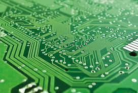

* **PCB (Printed Circuit Board)** = **인쇄 회로 기판**
* 컴퓨터 본체나 아두이노 보드처럼 구리선이 초록색 판 속에 예쁘게 인쇄되어 있어요.
* 완성된 제품을 만들 때는 좋지만, 실험하고 공부할 때는 부품을 바꿀 수 없어 불편해요.

> 이번 슬라이드에서는 '🟩 2단계: 초록색 판(PCB)의 비밀'에 대해 자세히 살펴보겠습니다. 화면의 다이어그램과 사진을 함께 참고해 주시기 바랍니다. 첫 번째 핵심은 PCB (Printed Circuit Board) = 인쇄 회로 기판이며, 두 번째로는 컴퓨터 본체나 아두이노 보드처럼 구리선이 초록색 판 속에 예쁘게 인쇄되어 있어요.입니다. 여기에 덧붙여 완성된 제품을 만들 때는 좋지만, 실험하고 공부할 때는 부품을 바꿀 수 없어 불편해요. 내용까지 함께 이해해 두시면 완벽합니다. 이 원리는 아두이노 시스템 전체를 관통하는 핵심 논리이므로 머릿속에 꼭 정리해 두시기 바랍니다.

---

## ✨ 3단계: 구멍에 쏙! 뽑으면 쏙!

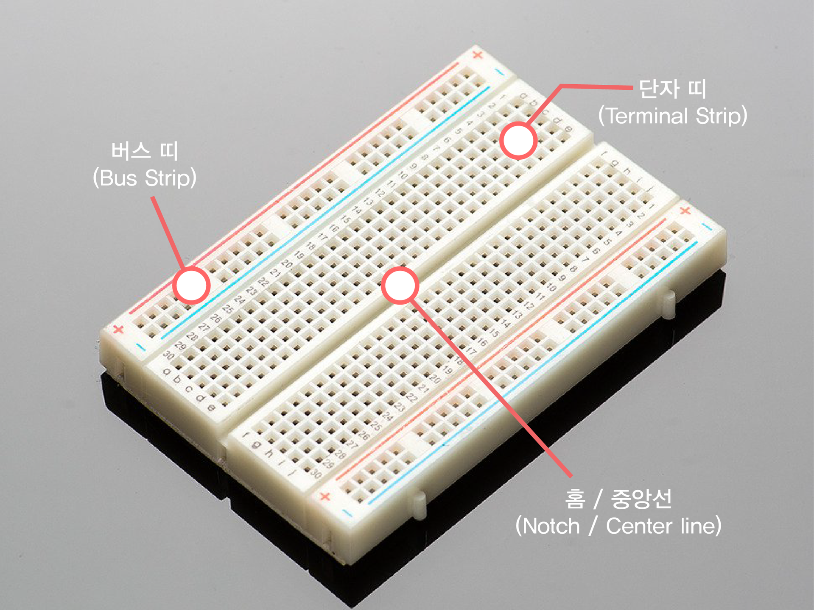
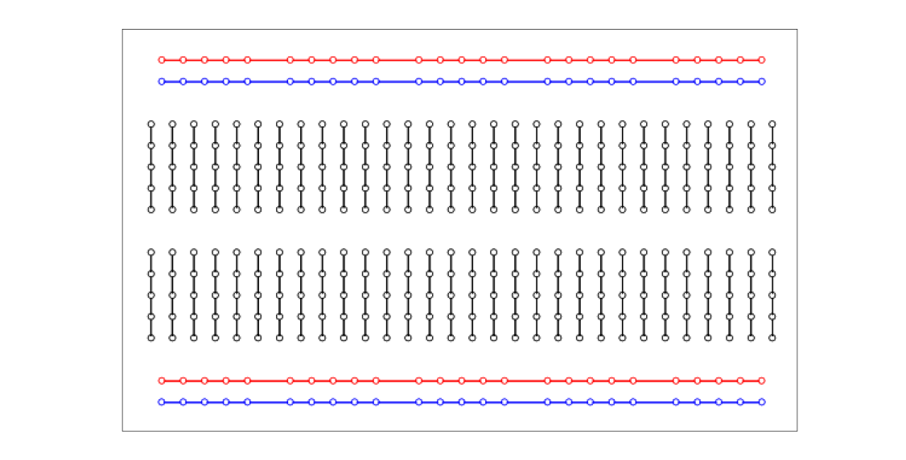

* **납땜 필요 제로(0)!** 부품 다리를 구멍에 쏙 꽂기만 하면 전기가 통해요!
* 잘못 꽂아도 쏙 뽑아서 다른 구멍에 꽂으면 끝!
* 수백 번, 수천 번 다시 쓸 수 있는 최고의 발명품이에요.

> 이번 슬라이드에서는 '✨ 3단계: 구멍에 쏙! 뽑으면 쏙!'에 대해 자세히 살펴보겠습니다. 화면의 다이어그램과 사진을 함께 참고해 주시기 바랍니다. 첫 번째 핵심은 납땜 필요 제로(0)! 부품 다리를 구멍에 쏙 꽂기만 하면 전기가 통해요!이며, 두 번째로는 잘못 꽂아도 쏙 뽑아서 다른 구멍에 꽂으면 끝!입니다. 여기에 덧붙여 수백 번, 수천 번 다시 쓸 수 있는 최고의 발명품이에요. 내용까지 함께 이해해 두시면 완벽합니다. 이 원리는 아두이노 시스템 전체를 관통하는 핵심 논리이므로 머릿속에 꼭 정리해 두시기 바랍니다.

---

## 🔍 4단계: 구멍 속에는 무엇이 들어있을까?

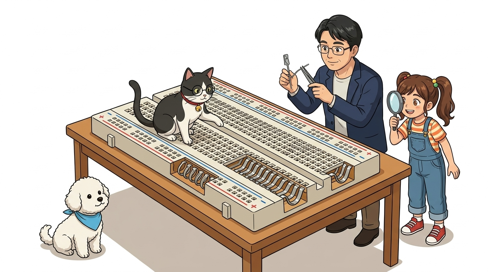

* **👧 도로시**: "우와! 지니 조수님이 루페로 보여주니까 하얀 플라스틱 속에 반짝이는 금속 집게 클립들이 길쭉하게 이어져 있어요!"
* **🐱 조수 지니**: "냥냥! 5개 구멍 아래에 하나의 스프링 금속 클립이 숨어 있어서, 같은 줄에 꽂으면 전선으로 묶어준 것과 똑같이 연결된다옹!"
* **👨‍🏫 호진 교수님**: "맞단다! 납땜 없이도 탄성 있는 클립이 부품 다리를 꽉 잡아주어 전기를 통하게 해주는 훌륭한 원리란다."

> 자, 이번 슬라이드의 질문을 함께 보시겠습니다. 바로 '🔍 4단계: 구멍 속에는 무엇이 들어있을까?'라는 핵심 내용입니다. 도로시가 루페로 관찰한 브레드보드 내부의 금속 클립 구조를 조수 지니와 호진 교수님이 명쾌하게 짚어줍니다. 플라스틱 구멍 밑에 자리잡은 전도성 금속 핀 클립의 구조를 정확히 이해하면 어떤 복잡한 회로도 막힘없이 연결할 수 있습니다.

---

## 🔴 5단계: 양쪽 가장자리는 가로로 쭉! (전원선)

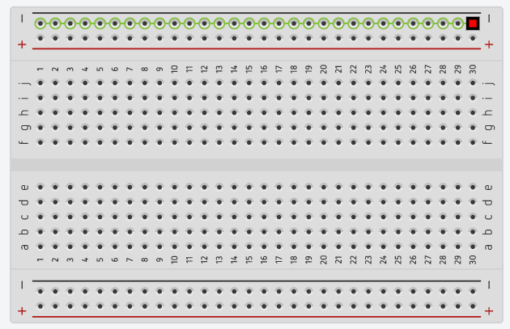
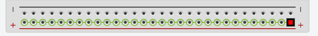

* **파란색 줄 (- 극)**: GND(땅)를 연결하는 긴 통로예요. **가로로 길게 모두 연결**되어 있어요!
* **빨간색 줄 (+ 극)**: 5V 전기를 연결하는 긴 통로예요. **가로로 길게 모두 연결**되어 있어요!
* 여러 부품에 전기를 골고루 나눠줄 때 아주 편리해요.

> 이번 슬라이드에서는 '🔴 5단계: 양쪽 가장자리는 가로로 쭉! (전원선)'에 대해 자세히 살펴보겠습니다. 화면의 다이어그램과 사진을 함께 참고해 주시기 바랍니다. 첫 번째 핵심은 파란색 줄 (- 극): GND(땅)를 연결하는 긴 통로예요. 가로로 길게 모두 연결되어 있어요!이며, 두 번째로는 빨간색 줄 (+ 극): 5V 전기를 연결하는 긴 통로예요. 가로로 길게 모두 연결되어 있어요!입니다. 여기에 덧붙여 여러 부품에 전기를 골고루 나눠줄 때 아주 편리해요. 내용까지 함께 이해해 두시면 완벽합니다. 이 원리는 아두이노 시스템 전체를 관통하는 핵심 논리이므로 머릿속에 꼭 정리해 두시기 바랍니다.

---

## 🔵 6단계: 가운데 영역은 세로로 5개씩! (부품 영역)

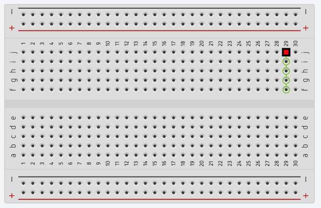

* 알파벳 **a, b, c, d, e** 와 숫자가 적힌 가운데 영역이에요.
* 이 영역은 **세로로 5개 구멍씩 한 줄로 연결**되어 있어요!
* 같은 숫자 줄(예: 10번 줄 a-b-c-d-e)에 꽂으면 같은 전선에 연결된 것과 같아요!

> 이번에 살펴볼 내용은 '🔵 6단계: 가운데 영역은 세로로 5개씩! (부품 영역)'입니다. 화면의 회로도와 부품 사진을 보면서 각 핀과 배선이 어떻게 구성되어 있는지 눈으로 직접 따라와 주시기 바랍니다. 첫째로 알파벳 a, b, c, d, e 와 숫자가 적힌 가운데 영역이에요.에 유의해야 하며, 둘째로 이 영역은 세로로 5개 구멍씩 한 줄로 연결되어 있어요!라는 점이 핵심입니다. 이 기본 개념을 확실히 잡아두셔야 실제 부품을 브레드보드에 꽂고 코딩할 때 실수 없이 완성할 수 있습니다.

---

## 🏞️ 7단계: 가운데 파인 홈은 왜 있을까요?

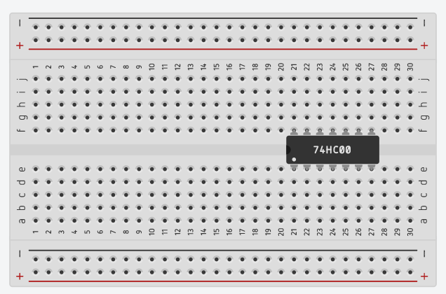

* 브레드보드 정중앙에는 아래위로 길쭉하게 파인 홈(계곡)이 있어요.
* 이 홈을 기준으로 **위쪽 5개 구멍과 아래쪽 5개 구멍은 서로 끊어져 있어요.**
* 다리가 양쪽으로 달린 IC 칩이나 스위치를 가운데에 쏙 꽂아서 다리가 서로 엉키지 않게 보호해 주는 곳이랍니다!

> 자, 이번 슬라이드의 질문을 함께 보시겠습니다. 바로 '🏞️ 7단계: 가운데 파인 홈은 왜 있을까요?'라는 아주 흥미로운 질문입니다. 우리가 일상에서 흔히 접하는 브레드보드 정중앙에는 아래위로 길쭉하게 파인 홈(계곡)이 있어요. 현상을 떠올려보면 왜 이런 의문이 생기는지 쉽게 공감할 수 있습니다. 이 질문 속에 숨겨진 전자 회로와 컴퓨팅의 핵심 원리를 지금부터 차근차근 하나씩 파헤쳐 보겠습니다.

---

## 🧶 8단계: 아두이노와 빵판을 잇는 점퍼선!

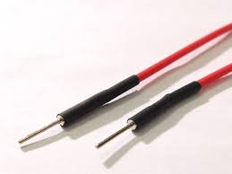
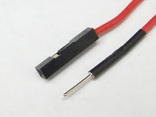

* 알록달록 무지개 색깔의 전선을 **'점퍼선(Jumper Wire)'**이라고 불러요.
* **수-수(Male-Male)**: 양쪽 끝에 뾰족한 침이 달려 있어 아두이노와 빵판에 쏙쏙 꽂아요!
* 전선 색깔에 맞춰 쓰면 헷갈리지 않아요:
* 🔴 **빨간선**: 5V 전원 (+)
* ⚫ **검은선**: GND 접지 (-)
* 🟡 **노랑/초록선**: 신호 핀

> 이번 슬라이드에서는 '🧶 8단계: 아두이노와 빵판을 잇는 점퍼선!'에 대해 자세히 살펴보겠습니다. 화면의 다이어그램과 사진을 함께 참고해 주시기 바랍니다. 첫 번째 핵심은 알록달록 무지개 색깔의 전선을 '점퍼선(Jumper Wire)'이라고 불러요.이며, 두 번째로는 수-수(Male-Male): 양쪽 끝에 뾰족한 침이 달려 있어 아두이노와 빵판에 쏙쏙 꽂아요!입니다. 여기에 덧붙여 전선 색깔에 맞춰 쓰면 헷갈리지 않아요 내용까지 함께 이해해 두시면 완벽합니다. 이 원리는 아두이노 시스템 전체를 관통하는 핵심 논리이므로 머릿속에 꼭 정리해 두시기 바랍니다.

---

## 🌟 미션 클리어! "나도 이제 회로 조립의 달인!"

* **👧 도로시**: "교수님, 지니 조수님! 이제 브레드보드의 비밀을 완전히 알았어요! 양쪽 가장자리는 가로 전원선, 가운데는 세로 5개 부품선 맞죠?"
* **👨‍🏫 호진 교수님**: "완벽하단다 도로시! 이제 손을 델 위험 없이 어떤 복잡한 회로도 자유롭게 조립하고 바꿀 수 있단다."
* **🐱 조수 지니**: "골골송 냥~! 다음 시간부터는 아두이노 보드와 컴퓨터의 두뇌를 본격적으로 탐험해보자옹!"
* **🐶 토토**: "멍멍! 나도 아두이노 선 물어다 줄 준비 완료 멍!"
* **👉 다음 시간 예고**: **"007. 컴퓨터란 무엇일까?"**를 배워보아요!

> 오늘 배운 '🌟 미션 클리어! "나도 이제 회로 조립의 달인!"'의 핵심 내용을 모두 정리해 보았습니다. 오늘 배운 내용을 꼭 다시 한번 복습해 보시고, 다음 강의에서 더욱 신나고 유익한 모험으로 다시 만나겠습니다. 모두 수고 많으셨습니다!