# 007_컴퓨터란_무엇일까 🖥️
### 교실만 했던 거인 컴퓨터에서 내 손바닥 위의 아두이노까지!

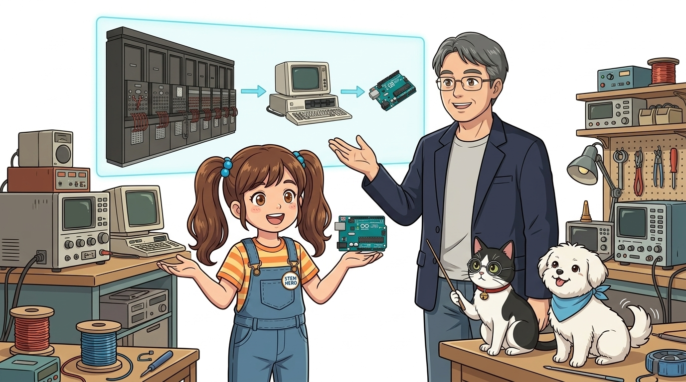

* **오늘의 탐험**: 컴퓨터(Compute)의 진짜 뜻과 5대 핵심 장치, 그리고 아두이노의 관계!
* **선생님과 친구들**: 호진 교수님 & 조수 지니(고양이) & 도로시 & 토토

* 🖥️ **강의 슬라이드**: [slides.md](./slides.md)

---

## ❓ 왜 '컴퓨터'라고 부를까요?

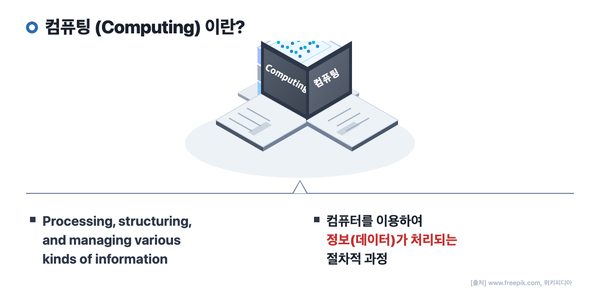

> **👧 도로시**: "교수님! 우리는 유튜브도 보고 게임도 하는데 왜 이름이 '컴퓨터(계산기)'예요? 숫자 더하기만 하는 기계인가요?"  
> **👨‍🏫 호진 교수님**: "'Compute'는 본래 **'계산하다'**라는 뜻이란다! 사람이 손으로 며칠씩 걸려 풀던 복잡한 덧셈·뺄셈을 빛의 속도로 척척 계산해 주는 만능 계산 기계로 태어난 거란다."  
> **🐱 조수 지니**: "냥! 지금은 숫자뿐 아니라 글자, 사진, 음악, 영상까지 모두 다루는 만능 정보 처리 기기가 되었다옹!"

---

## 🧮 1단계: 주판에서 기계식 톱니바퀴 계산기까지

### 💻 컴퓨터 (Computer)의 정의
* **초기의 컴퓨터**: 사람보다 계산을 훨씬 빠르고 정확하게 처리하기 위해 개발되었어요.
* **현대의 컴퓨터**: 단순한 숫자 계산을 넘어 문자, 그림, 소리, 동영상 등 다양한 유형의 데이터(정보)를 처리하는 만능 디지털 기기로 발전했답니다!

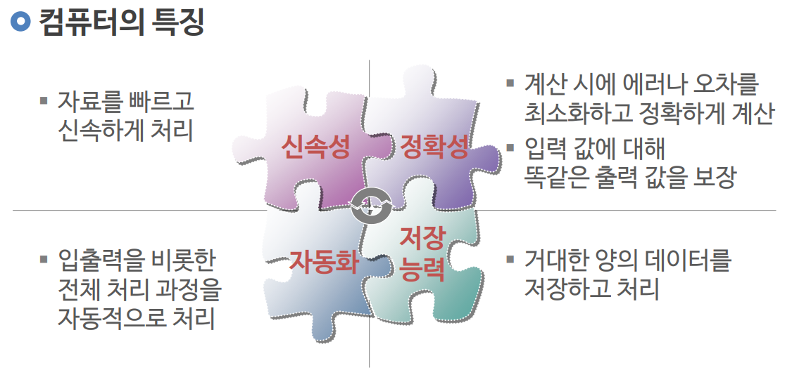

* 옛날 사람들은 조약돌이나 주판을 튕기며 계산했어요.
* 17세기 천재 수학자 파스칼은 아버지를 돕기 위해 톱니바퀴가 돌아가는 **세계 최초의 기계식 계산기(파스칼린)**를 만들었답니다!

---

## 🏢 2단계: 집채만 한 거인 컴퓨터의 등장! (에니악)

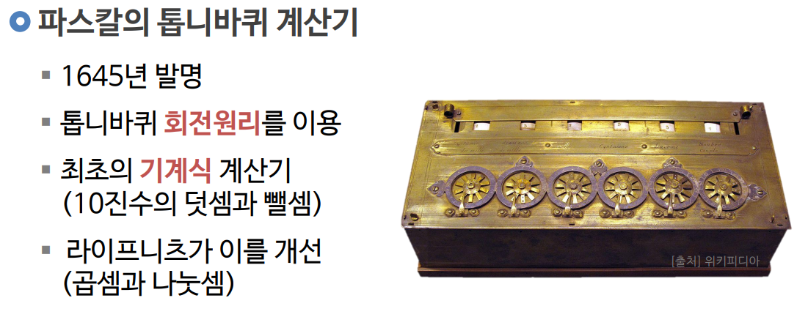
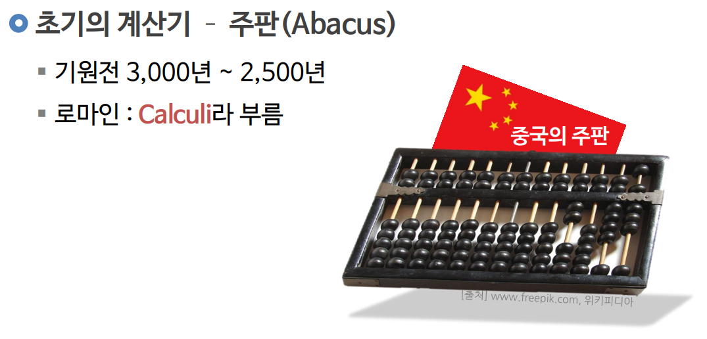
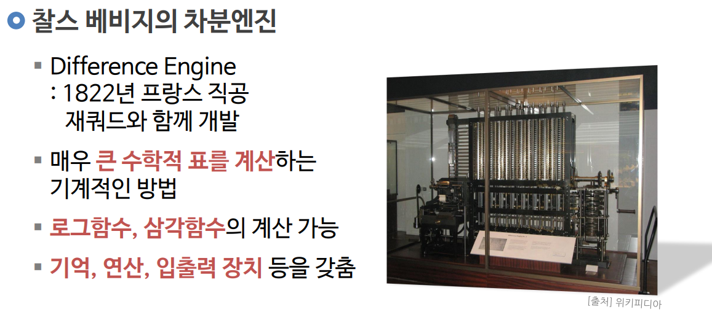

* 1946년에 만들어진 **에니악(ENIAC)**은 무게가 무려 30톤! 큰 교실 하나를 가득 채울 만큼 거대했어요.
* 18,000개가 넘는 유리 전구(진공관)가 붉게 달아오르며 전기를 뿜어냈답니다.

---

## 🔬 3단계: 거대한 진공관이 손톱만 한 칩 속으로!

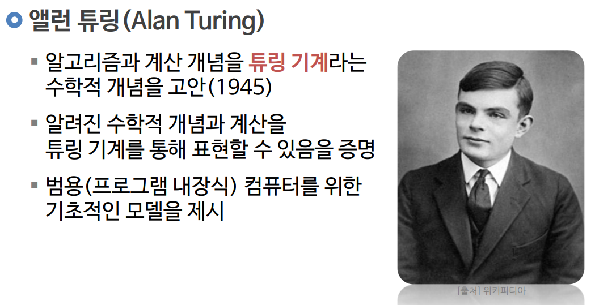
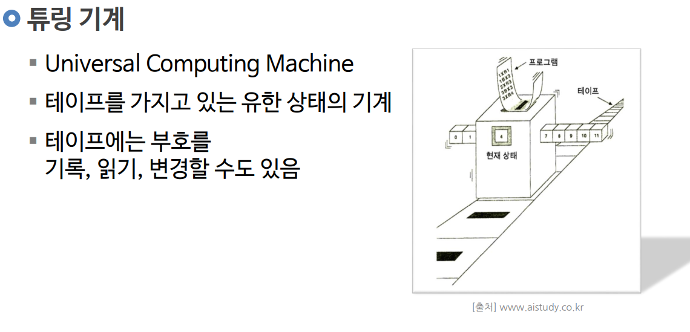
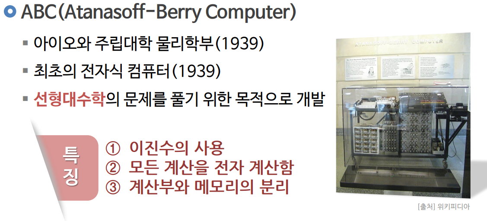

* 뜨겁고 잘 깨지는 진공관 대신 작은 **반도체 트랜지스터**가 발명되었어요.
* 그리고 마침내 인텔이 컴퓨터의 모든 두뇌를 칩 하나에 압축한 **마이크로프로세서(CPU)**를 개발했답니다!

---

## 🏠 4단계: 책상 위로 찾아온 개인용 컴퓨터 (PC)

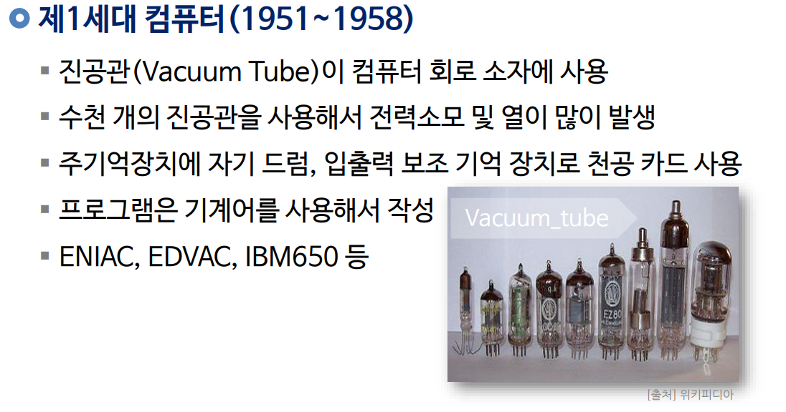
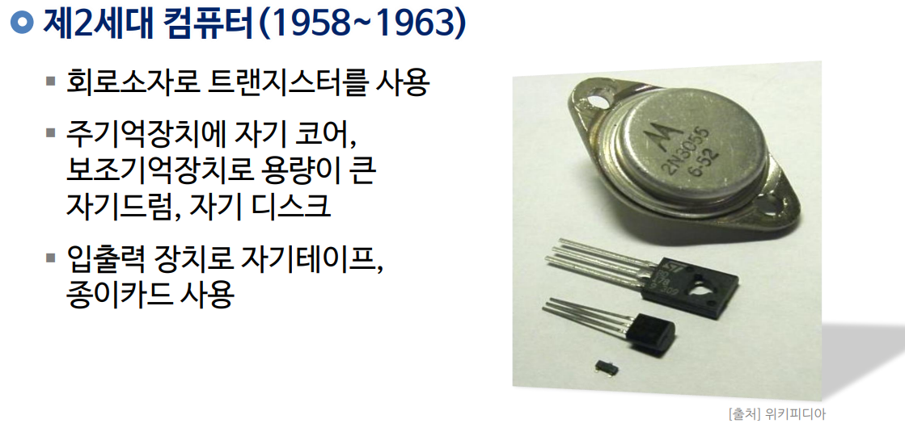
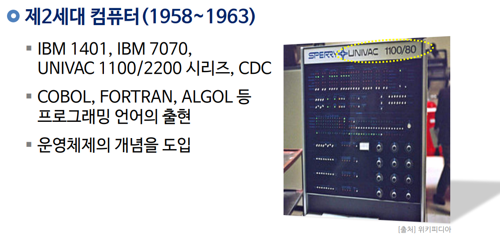

* 스티브 잡스와 빌 게이츠 같은 선구자들이 등장하며, 연구소에만 있던 컴퓨터가 모든 가정의 책상 위로 들어왔어요!
* 문서 작성, 인터넷 서핑, 게임까지 할 수 있는 만능 도구가 되었습니다.

---

## 🧠 5단계: 컴퓨터를 이루는 5가지 마법 부위!

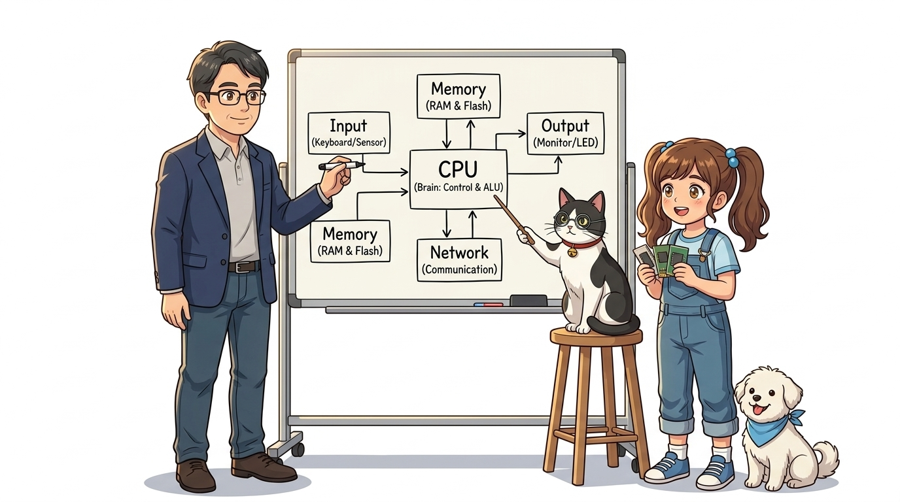

> **👧 도로시**: "사람 몸처럼 컴퓨터도 눈, 귀, 머리, 손발이 있네요!"  
> **🐱 조수 지니**: "그렇다옹! 입력장치(눈/귀), CPU(두뇌), 메모리(공책), 출력장치(손/발), 통신(목소리)이 합쳐져 완벽한 시스템이 된다냥!"  
> **👨‍🏫 호진 교수님**: "맞단다! 이 5가지 핵심 장치가 유기적으로 맞물려 일하는 것이 컴퓨터의 기본 원리란다."

---

## 🤝 6단계: 몸(하드웨어)과 영혼(소프트웨어)

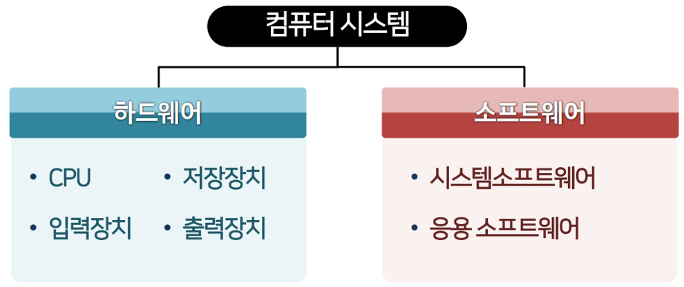
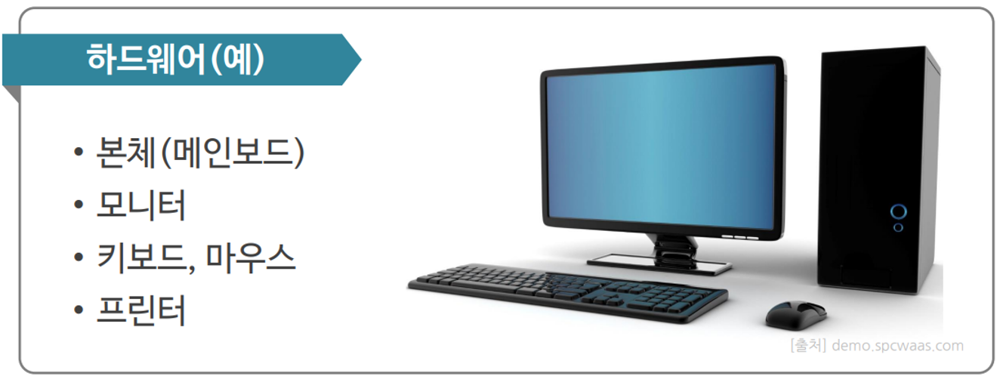

* **하드웨어 (Hardware, 몸체)**: 손으로 만질 수 있는 모니터, 키보드, 아두이노 기판.
* **소프트웨어 (Software, 정신/생각)**: 하드웨어에게 무엇을 할지 알려주는 C언어 코드와 프로그램!
* 아무리 멋진 아두이노 보드라도 우리가 코드를 넣어주지 않으면 잠자는 돌멩이에 불과해요!

---

## 🤖 7단계: 아두이노도 진짜 컴퓨터일까요?

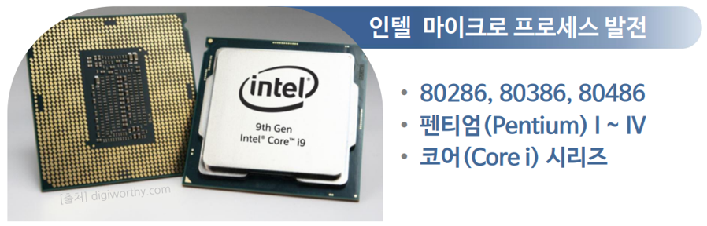
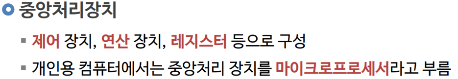

* **정답은 100% YES!**
* 아두이노 보드의 까만 칩(ATmega328P) 속에는 계산하는 CPU, 코드를 기억하는 플래시 메모리, 전선으로 소통하는 입출력 포트가 모두 들어있어요!
* 이를 사물 속에 쏙 들어가는 **'임베디드 컴퓨터'**라고 부릅니다.

---

## 🌟 미션 클리어! "컴퓨터의 정체를 밝혔어요!"

> **👧 도로시**: "교수님, 지니 조수님! 교실만 했던 30톤 거인 컴퓨터가 이렇게 손바닥만 한 아두이노 칩으로 작아졌다니 정말 신기해요!"  
> **👨‍🏫 호진 교수님**: "그렇단다 도로시! 다음 시간에는 아두이노의 진짜 두뇌인 마이크로컨트롤러(MCU)의 내부 구조를 더 깊이 탐구해 보자꾸나."  
> **🐱 조수 지니**: "골골송 냥~! 다음 시간 MCU 탐험도 기대해달라옹!"  
> **🐶 토토**: "멍멍! 다음 시간 MCU 탐험 출발 멍!"
