# 007. 컴퓨터란 무엇일까?
### 교실만 했던 거인 컴퓨터에서 내 손바닥 위의 아두이노까지!

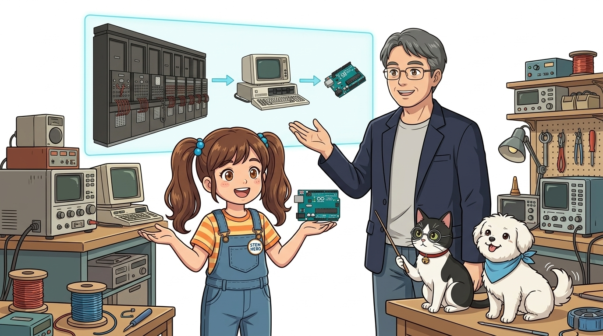

* **강의 주제**: 컴퓨터(Compute)의 어원과 5대 핵심 장치, 그리고 아두이노와의 관계
* **선생님과 친구들**: 호진 교수님 & 조수 지니(고양이) & 도로시 & 토토
* 📖 **상세 강의 교재**: [index.md](./index.md)

> 여러분 안녕하세요! 지난 시간 우리는 납땜 없이 회로를 자유자재로 연결하는 마법의 도화지, 브레드보드에 대해 배웠습니다. 오늘은 드디어 아두이노의 진짜 정체성을 파헤치는 날입니다. "컴퓨터란 과연 무엇일까?"라는 질문으로 시작해, 건물 하나를 가득 채우던 거대한 컴퓨터가 어떻게 내 손바닥 위의 작은 아두이노 칩 하나로 들어오게 되었는지, 그 놀라운 진화의 역사와 컴퓨터의 5대 핵심 장치를 함께 탐험해 보겠습니다. 호진 교수님의 흥미진진한 역사 강의와 조수 지니의 꼼꼼한 설명, 도로시와 토토의 열정적인 질문과 함께 출발해 볼까요?

---

## 1. 왜 '컴퓨터(Computer)'라고 부를까요?

* **👧 도로시**: "교수님! 우리는 매일 스마트폰으로 영상도 보고 게임도 하는데, 왜 이름이 '계산기(Computer)'예요? 단순한 숫자 계산만 하던 기계였나요?"
* **👨‍🏫 호진 교수님**: "아주 날카로운 통찰이란다 도로시! 컴퓨터의 시작은 방대한 수학 계산을 실수 없이 처리하기 위한 기계였지만, 지금은 모든 형태의 정보를 다루는 만능 두뇌로 진화했단다."
* **🐱 조수 지니**: "냥! 30톤짜리 거인 컴퓨터에서 오늘날 손바닥 위의 아두이노까지 어떻게 발전했는지 함께 살펴보자옹!"
* **🐶 토토**: "멍멍! 컴퓨터 역사 탐험 출발 멍!"

> 슬라이드 화면을 보시죠. 우리가 매일 스마트폰으로 유튜브를 보고, 노트북으로 게임을 하고, 문서를 작성하는데 왜 하필 이 기계의 이름이 '컴퓨터'일까요? 영어를 조금 아는 분들은 아시겠지만, '컴퓨터'라는 단어는 본래 '계산하는 사람', 혹은 '계산기'라는 뜻이었습니다. 숫자 더하기 빼기나 하던 기계가 어떻게 오늘날 전 세계를 연결하는 만능 디지털 기기가 되었을까요? 그 비밀의 문을 열어보겠습니다.

---

## 2. 'Compute(컴퓨트)'의 진짜 뜻

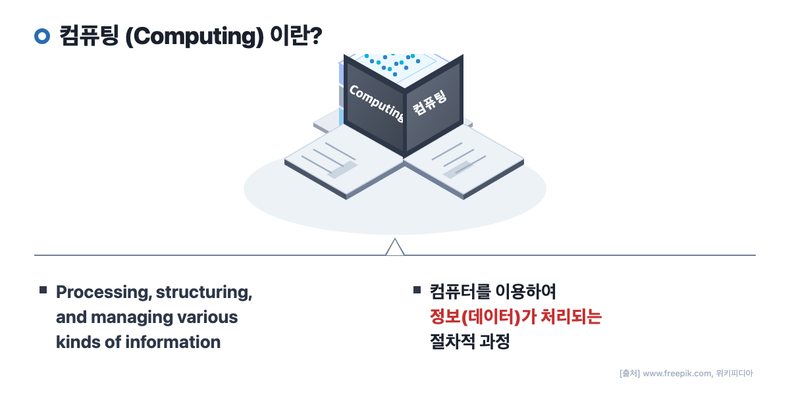

* **Compute (동사)**: '계산하다', '셈하다'
* **Computer (명사)**: 본래 복잡한 수학 계산을 대신 처리하던 사람 또는 기계
* **탄생 목적**: 인간이 손으로 며칠씩 걸려 풀던 방대한 연산을 빛의 속도로 오차 없이 해결하기 위해 탄생

> 'Compute'라는 영단어는 라틴어 'computare'에서 유래했습니다. '다 함께 셈하다', 즉 '계산하다'라는 뜻입니다. 컴퓨터가 처음 발명되었을 당시 인류에게 가장 절실했던 것은 바로 '엄청나게 복잡한 계산을 사람 대신 실수 없이 초고속으로 풀어주는 계산 기계'였습니다. 포탄의 궤적을 계산하거나 천체의 움직임을 예측하는 것처럼, 인간의 뇌로는 한 달이 걸리는 연산을 몇 초 만에 끝내기 위해 만들어진 것이 바로 컴퓨터의 시작이었습니다.

---

## 3. 컴퓨터의 정의: 과거에서 현재로

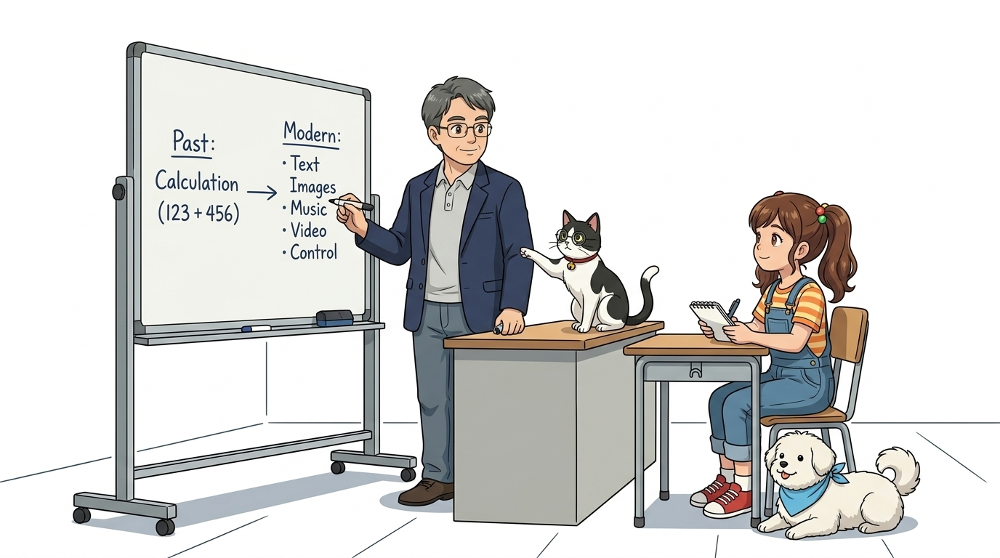

### 💻 컴퓨터(Computer)의 정의

* **초기의 컴퓨터 (1940~50년대)**
  * 오직 빠르고 정확한 **수치 계산(Calculation)**을 위해 개발된 전자기계장치
* **현대의 컴퓨터 (오늘날)**
  * 단순 숫자 계산을 넘어 문자, 이미지, 오디오, 비디오 등 **다양한 유형의 데이터(정보)를 입력받아 처리·저장·출력하는 범용 정보 처리 기기**

> 컴퓨터의 정의는 시대에 따라 크게 진화했습니다. 초기의 컴퓨터는 순수한 '수치 계산기'에 불과했습니다. 하지만 반도체 기술과 운영체제가 발전한 현대의 컴퓨터는 완전히 다릅니다. 숫자는 물론이고, 여러분의 음성, 사진, 동영상과 같은 멀티미디어 데이터를 0과 1의 디지털 신호로 변환하여 실시간으로 처리하고 전달하는 '범용 정보 처리 장치'로 거듭났습니다.

---

## 4. 컴퓨터의 4대 핵심 특징

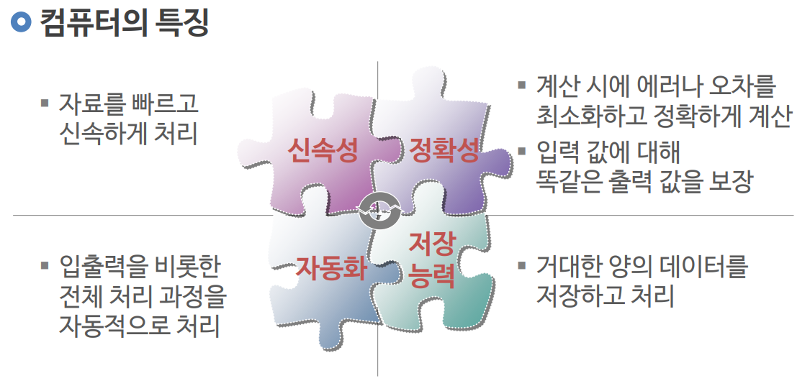

| 특징 | 설명 |
| :--- | :--- |
| **정확성 (Accuracy)** | 정해진 프로그램 명령에 따라 1의 오차도 없이 일관된 결과를 산출 |
| **신속성 (Speed)** | 1초에 수십억 번 이상의 연산을 초고속으로 수행 |
| **대용량성 (Storage)** | 방대한 양의 텍스트, 이미지, 소프트웨어를 영구 보존 |
| **범용성 (Versatility)** | 하드웨어 교체 없이 소프트웨어 변경만으로 다양한 목적에 활용 |

> 컴퓨터가 인간의 작업 방식을 완전히 바꿔놓은 데에는 4가지 핵심 특징이 있습니다. 첫째, 피로를 느끼지 않고 0과 1의 연산을 완벽하게 수행하는 '정확성'. 둘째, 초당 수십억 번의 클럭으로 처리하는 '신속성'. 셋째, 인간의 기억력을 아득히 뛰어넘는 방대한 데이터를 보관하는 '대용량성'. 그리고 마지막 넷째가 가장 중요합니다. 프로그램만 바꿔주면 타자기, 게임기, 영화관, 통신기로 자유자재로 변신하는 '범용성'입니다.

---

## 5. [1단계] 주판에서 기계식 톱니바퀴 계산기까지

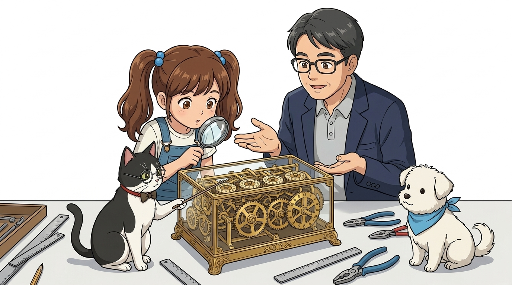

* **고대의 계산 도구**: 조약돌, 끈 매듭, 주판(Abacus)
* **세계 최초의 기계식 계산기 (1642년)**: 
  * 프랑스의 천재 수학자 **블레즈 파스칼(Blaise Pascal)** 발명
  * 아버지가 세금 계산으로 밤새 고생하는 모습을 보고 제작한 **'파스칼린(Pascaline)'**
  * 톱니바퀴가 맞물려 돌아가며 자릿수 올림을 자동으로 처리

> 이제 컴퓨터의 발전 단계를 역사 순으로 짚어보겠습니다. 첫 번째 단계는 기계식 계산기의 탄생입니다. 고대부터 사람들은 주판을 사용해 계산했습니다. 그러다 17세기, 프랑스의 천재 철학자이자 수학자인 파스칼이 세무 공무원이었던 아버지가 밤마다 세금 계산에 시달리는 것을 보고 효심 어린 발명을 합니다. 바로 톱니바퀴의 회전 원리를 이용해 덧셈과 뺄셈의 자릿수를 자동으로 올려주는 세계 최초의 기계식 계산기, '파스칼린'을 만들어낸 것입니다.

---

## 6. [2단계] 집채만 한 거인 컴퓨터의 탄생 (에니악, ENIAC)

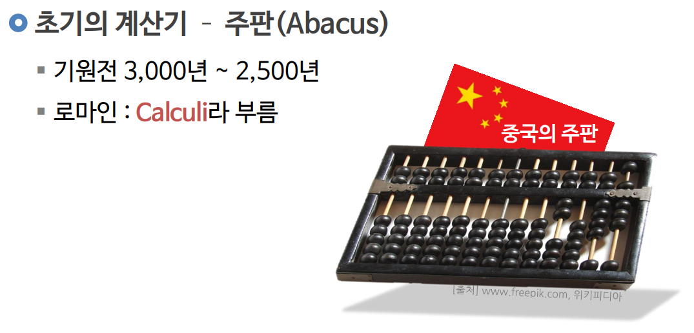

* **1946년 미국 펜실베이니아 대학**: 에니악(ENIAC) 탄생
* **거대한 스펙**:
  * 무게: **약 30톤** (코끼리 6마리 무게)
  * 크기: 폭 24m, 높이 2.5m (대형 교실 하나를 통째로 차지)
  * 전력 소비량: 150kW (주변 마을 전등이 깜빡일 정도의 막대한 전력 소모)

> 두 번째 단계는 전자식 컴퓨터의 시대를 연 거인, 1946년의 '에니악(ENIAC)'입니다. 에니악은 군사용 포탄의 궤도를 계산하기 위해 만들어졌는데, 크기와 규모가 상상을 초월했습니다. 무게만 무려 30톤, 대형 교실 하나를 꽉 채우는 거대한 덩치였고, 에니악을 켜면 인근 마을의 불빛이 순간적으로 어두워질 정도로 엄청난 전기를 소모했습니다.

---

## 7. 에니악의 심장: 18,000개의 진공관

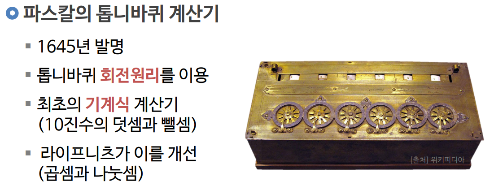
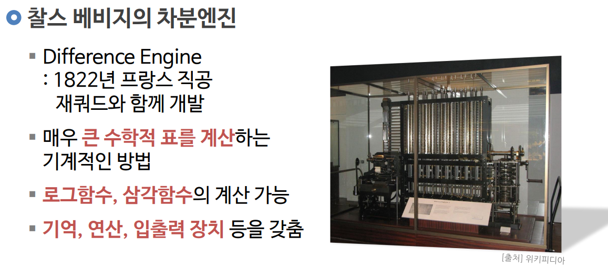

* **진공관(Vacuum Tube)**: 전기를 흘려 신호를 켜고 끄는(ON/OFF) 유리관 스위치
* **18,000개의 진공관**:
  * 엄청난 열 발생으로 하루에도 수십 개씩 파손
  * 프로그램을 바꾸려면 배선판의 전선을 일일이 손으로 뽑아서 다시 꽂아야 했음

> 이 거대한 에니악의 핵심 부품은 바로 유리 전구처럼 생긴 '진공관'이었습니다. 0과 1 신호를 스위칭하기 위해 무려 18,000개의 진공관이 사용되었는데요. 진공관은 엄청나게 뜨거운 열을 내뿜었고, 하루에도 몇 번씩 전구가 터지듯 나가버려 교체 작업에 매달려야 했습니다. 게다가 새로운 계산을 하려면 프로그래머들이 벽면의 수많은 전선을 손으로 직접 뽑아 다시 배선해야 했습니다.

---

## 8. [3단계] 거대한 진공관이 손톱만 한 칩 속으로!

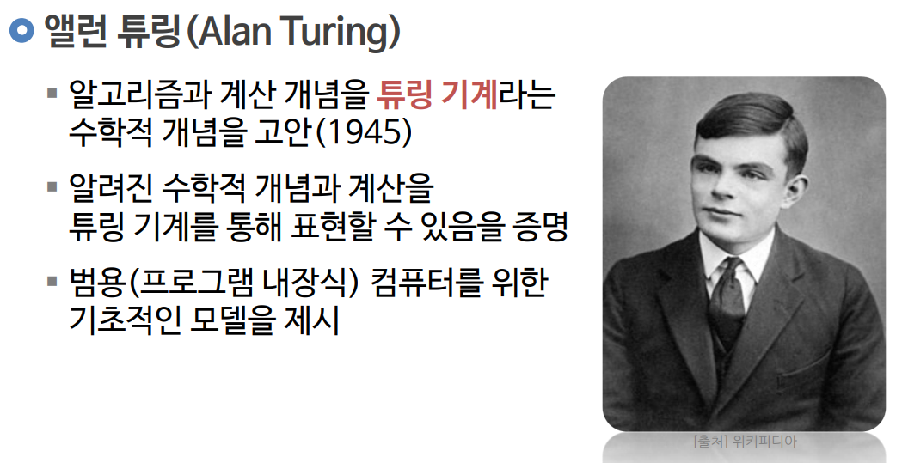
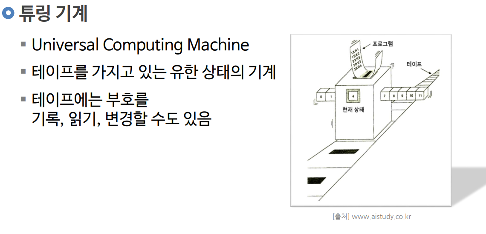

* **반도체 트랜지스터(Transistor, 1947년)**
  * 벨 연구소 발명: 진공관 대비 수천 배 작고, 열이 안 나며, 반영구적 수명
* **집적회로 (IC, Integrated Circuit, 1958년)**
  * 수천~수만 개의 트랜지스터를 하나의 실리콘 기판 위에 평면 인쇄

> 세 번째 단계는 인류 역사상 가장 위대한 반도체 혁명입니다. 1947년 벨 연구소에서 뜨겁고 깨지기 쉬운 진공관을 완벽하게 대체할 기적의 신소재, '트랜지스터'를 발명합니다. 트랜지스터는 크기가 새끼손가락 한 마디보다 작았고, 열도 거의 나지 않았습니다. 이후 과학자들은 이 트랜지스터 수만 개를 작은 실리콘 조각 하나에 집적하는 '집적회로(IC)' 기술을 완성하게 됩니다.

---

## 9. 마이크로프로세서(CPU)의 출현

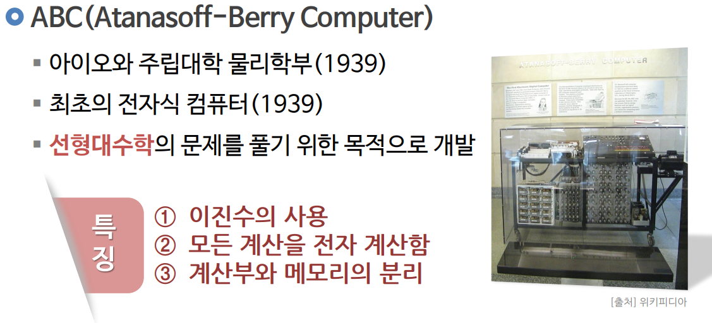

* **1971년 인텔 4004 (Intel 4004)**
  * 컴퓨터의 연산(ALU)과 제어(Control Unit) 기능을 손톱만 한 칩 1개에 모두 통합!
  * 거대한 컴퓨터의 '두뇌'가 단 하나의 마이크로프로세서(CPU)로 압축

> 그리고 1971년, 컴퓨터 역사에 기념비적인 이정표가 세워집니다. 바로 인텔이 개발한 최초의 마이크로프로세서 '인텔 4004'입니다. 과거 교실만 한 공간을 차지하던 에니악의 두뇌 연산 능력이 손톱만 한 검은색 실리콘 칩 하나 속으로 완벽하게 압축된 것입니다. 이제 컴퓨터는 연구실을 벗어나 사람들의 일상으로 들어갈 준비를 마쳤습니다.

---

## 10. [4단계] 책상 위로 찾아온 개인용 컴퓨터 (PC)

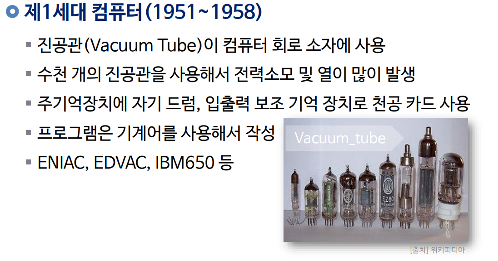
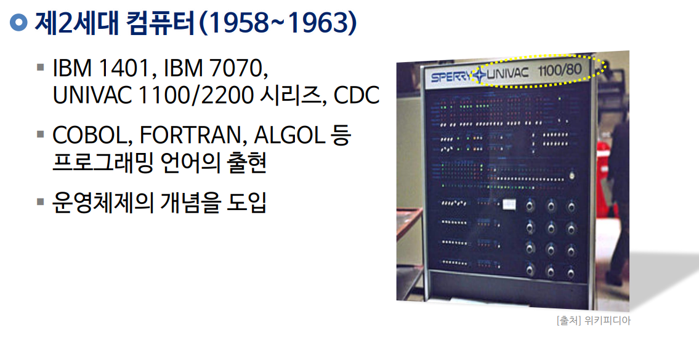

* **PC (Personal Computer) 혁명 (1970~1980년대)**
  * 스티브 잡스와 스티브 워즈니악의 **애플(Apple I, II)**
  * 기업 표준을 정립한 **IBM-PC**와 빌 게이츠의 마이크로소프트 **DOS/Windows**
* 대기업·군사 연구소의 전유물에서 **1가구 1컴퓨터 시대**로의 대전환

> 네 번째 단계는 개인용 컴퓨터, 즉 PC의 등장입니다. 1970년대 후반 스티브 잡스와 스티브 워즈니악은 차고에서 조립한 '애플' 컴퓨터를 통해 일반인도 컴퓨터를 가질 수 있다는 꿈을 현실로 만들었습니다. 뒤이어 IBM과 마이크로소프트의 윈도우가 등장하면서 연구소에만 갇혀 있던 컴퓨터가 전 세계 수억 대의 책상 위로 보급되는 PC 혁명이 폭발하게 되었습니다.

---

## 11. [5단계] 컴퓨터를 이루는 5대 마법 부위

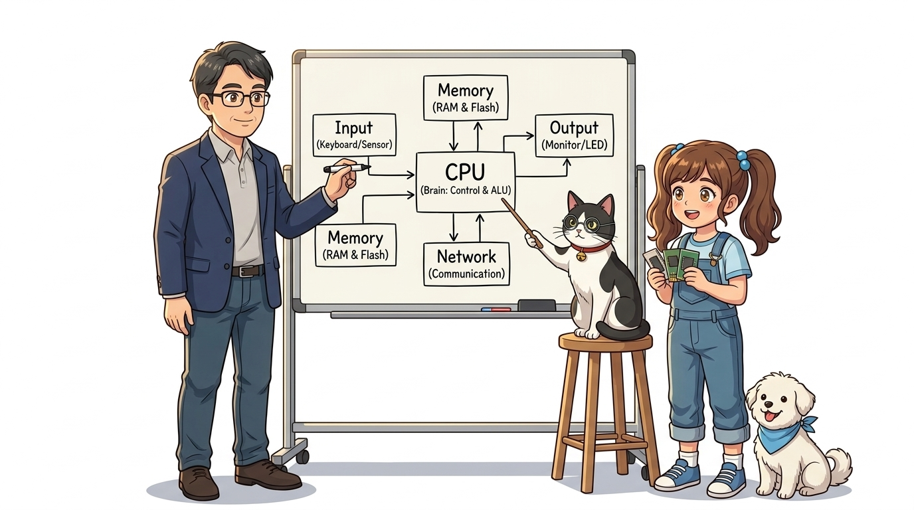

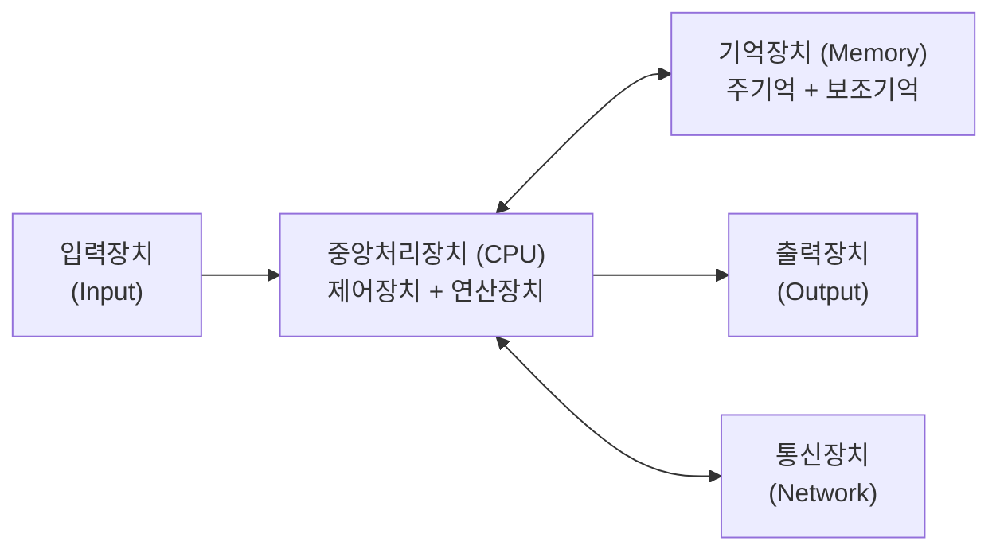

> 자, 그럼 오늘날 우리가 사용하는 모든 컴퓨터는 내부가 어떻게 생겼을까요? 컴퓨터는 인간의 신체 구조와 놀랍도록 똑같습니다. 인간이 오감으로 외부 정보를 받아들이듯 '입력장치'가 있고, 두뇌에 해당하는 '중앙처리장치(CPU)', 생각을 기록하는 공책인 '기억장치', 손발과 목소리로 결과를 표현하는 '출력장치', 그리고 타인과 대화하는 '통신장치'까지 5대 핵심 장치가 유기적으로 맞물려 동작합니다.

---

## 12. 5대 핵심 장치의 세부 역할

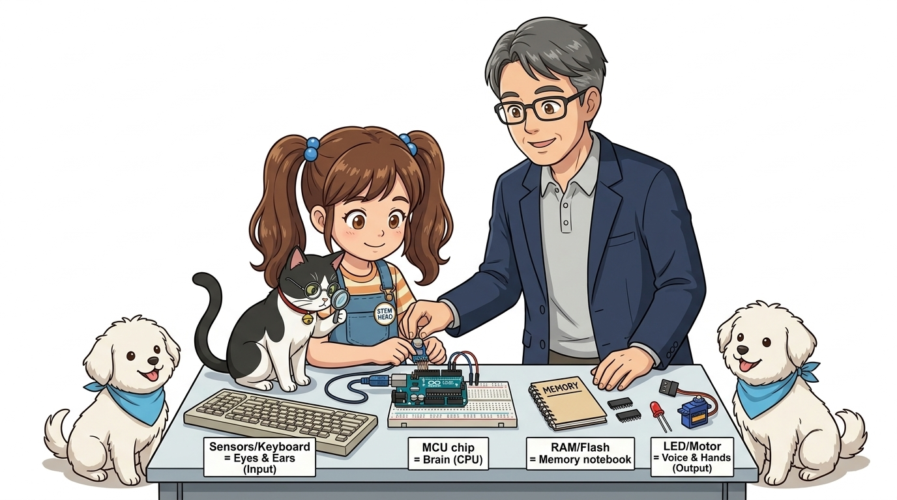

* **1. 입력장치 (Input)**: 외부 세상의 물리적 신호나 데이터를 컴퓨터 안으로 전달 (키보드, 마우스, 마이크, 센서)
* **2. 제어장치 (Control Unit)**: 모든 부품에 명령을 내리고 작업 순서를 지휘하는 사령관
* **3. 연산장치 (ALU)**: 사칙연산과 논리(참/거짓) 판단을 담당하는 계산기
* **4. 기억장치 (Memory)**: 
  * 주기억장치(RAM): 지금 당장 실행할 코드를 올려두는 빠른 작업대
  * 보조기억장치(SSD/Flash): 전원이 꺼져도 내용을 보존하는 영구 금고
* **5. 출력장치 (Output)**: 처리된 결과를 사람이 인식할 수 있게 변환 (모니터, 스피커, 모터, LED)

> 각 장치를 좀 더 구체적으로 매핑해 볼까요? 우리가 키보드를 두드리거나 버튼을 누르면 입력장치가 작동합니다. 이 신호를 받아서 CPU 속의 제어장치가 "메모리 몇 번지에서 데이터를 꺼내와서 연산장치(ALU)에 전달하라"고 명령을 내립니다. 연산장치가 결과를 계산해 내면, 그 결과를 모니터 화면에 글자로 띄우거나 모터를 돌려 출력장치로 보내는 것이죠.

---

## 13. [6단계] 몸(하드웨어)과 영혼(소프트웨어)의 조화

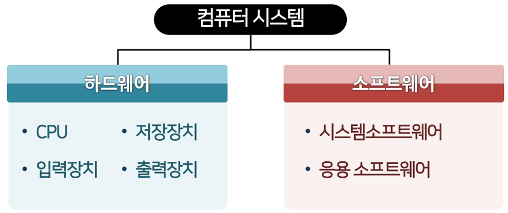
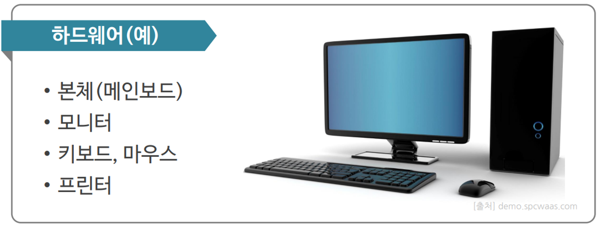

* **하드웨어 (Hardware)**: 손으로 만질 수 있는 물리적 전자 부품과 기판
* **소프트웨어 (Software)**: 하드웨어 부품들을 깨워 동작시키는 지능이자 명령어의 집합(Code)
* **결론**: 최첨단 아두이노 보드라도 소프트웨어(프로그램)가 없으면 아무 일도 하지 못하는 돌멩이에 불과합니다!

> 컴퓨터 시스템은 하드웨어와 소프트웨어의 완전한 결합체입니다. 하드웨어가 근육과 뼈대로 이루어진 인간의 육체라면, 소프트웨어는 그 육체에 생명과 생각을 불어넣는 영혼이자 정신입니다. 우리가 앞으로 배울 아두이노 보드나 점퍼선, 센서들은 모두 하드웨어입니다. 여기에 우리가 C언어로 코드를 짜서 불어넣어 줄 때 비로소 하드웨어가 목적을 가진 지능적인 로봇이나 스마트 장치로 깨어납니다.

---

## 14. [7단계] 아두이노도 진짜 컴퓨터일까요?

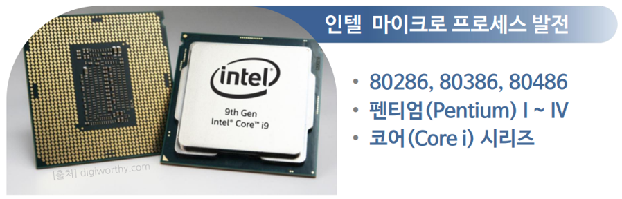
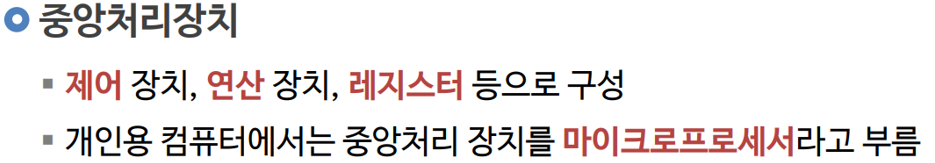

* **정답은 100% YES!**
* **마이크로컨트롤러 (MCU, ATmega328P)**:
  * CPU (연산·제어)
  * RAM & Flash Memory (기억)
  * GPIO 핀 (디지털·아날로그 입출력)
  * **컴퓨터의 5대 핵심 부품이 단 하나의 칩 속에 모두 탑재!**
* 이를 사물 속에 쏙 들어가는 **임베디드 컴퓨터(Embedded Computer)**라고 부릅니다.

> 자, 그럼 오늘 수업의 가장 중요한 질문을 던져보겠습니다. "손바닥 위에 쏙 올라가는 이 작은 아두이노 보드도 진짜 컴퓨터일까요?" 정답은 의심할 여지 없이 "100% 진짜 컴퓨터"입니다! 아두이노 보드 한가운데 박혀 있는 까만 직사각형 칩, ATmega328P 속을 들여다보면 연산을 하는 CPU, 코드를 기억하는 플래시 메모리와 RAM, 그리고 센서와 모터를 연결하는 입출력 포트가 전부 집적되어 있습니다. 사물 속에 쏙 들어가서 두뇌 역할을 하는 완벽한 초소형 '임베디드 컴퓨터'인 것입니다.

---

## 15. 오늘의 핵심 요약 및 차시 예고

### 🎯 오늘 배운 핵심 내용
1. 컴퓨터는 단순 계산기를 넘어 **데이터를 입력받아 처리·저장·출력하는 만능 기기**로 진화했습니다.
2. 30톤짜리 에니악에서 시작해 **반도체 트랜지스터와 마이크로프로세서(CPU)**를 거쳐 소형화되었습니다.
3. 아두이노의 ATmega328P 칩은 컴퓨터의 5대 장치를 모두 갖춘 어엿한 **마이크로컨트롤러(MCU) 컴퓨터**입니다.

* **👧 도로시**: "교수님! 손바닥만 한 아두이노가 옛날 교실만 한 30톤 컴퓨터보다 훨씬 똑똑한 컴퓨터라니 정말 신기해요!"
* **👨‍🏫 호진 교수님**: "그렇단다! 작은 실리콘 칩 속에 5대 장치가 모두 압축되어 있단다."
* **🐱 조수 지니**: "골골송 냥~! 다음 시간엔 아두이노의 핵심 심장인 마이크로컨트롤러(MCU)의 세계로 더 깊이 들어가보자옹!"
* **🐶 토토**: "멍멍! 나도 MCU 공부할 준비 완료 멍!"
* **👉 다음 탐험 (008강)**: **"008. 마이크로컨트롤러(MCU)란 무엇일까?"**

> 오늘 우리는 방 한 칸을 꽉 채우던 30톤짜리 거인 컴퓨터 에니악에서부터, 우리 손바닥 위의 아두이노 칩까지 이어지는 컴퓨터의 위대한 80년 진화 역사를 함께 여행했습니다. 아두이노가 왜 단순한 전자부품이 아니라 진정한 컴퓨터인지 이제 완벽하게 이해하셨을 것입니다. 다음 시간에는 아두이노의 두뇌인 마이크로컨트롤러(MCU)의 세부 구조를 차근차근 파헤쳐 보겠습니다. 모두 수고 많으셨습니다!
