# 008_마이크로컨트롤러_MCU란 🧠
### 밥솥과 세탁기, 아두이노 속에 숨겨진 작은 두뇌 이야기!

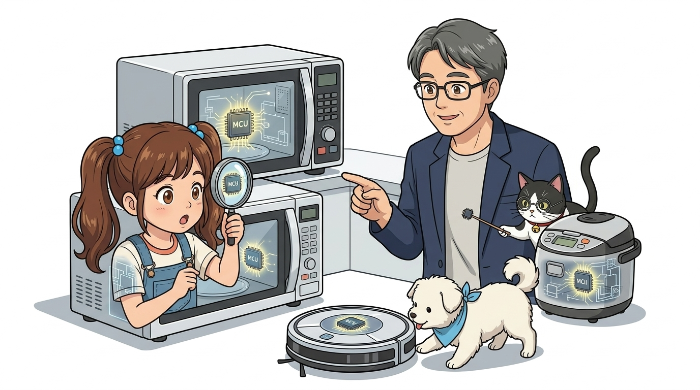

* **오늘의 탐험**: 큰 컴퓨터 CPU와 작은 MCU의 차이, 그리고 원칩 컴퓨터의 마법!
* **선생님과 친구들**: 호진 교수님 & 조수 지니(고양이) & 도로시 & 토토

* 🖥️ **강의 슬라이드**: [slides.md](./slides.md)

---

## ❓ 전자레인지랑 밥솥에도 컴퓨터가 들어있다고요?

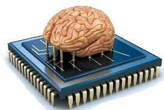

> **👧 도로시**: "교수님! 전자레인지는 1분을 돌리고 나면 삐- 소리를 내고, 밥솥은 밥이 다 되면 보온으로 알아서 바뀌잖아요! 기계들이 어떻게 스스로 생각하고 시간을 재는 거예요?"  
> **👨‍🏫 호진 교수님**: "하하, 아주 날카로운 관찰이란다 도로시! 바로 그 기계 속마다 손톱만 한 작은 원칩 컴퓨터 두뇌인 **'마이크로컨트롤러(MCU)'**가 쏙 숨어있기 때문이란다!"  
> **🐱 조수 지니**: "냥! 밥솥, 냉장고, 자동차 속까지 숨어있는 똑똑한 MCU 칩의 비밀을 지니 조수가 알기 쉽게 짚어주겠다옹!"  
> **🐶 토토**: "멍멍! (우리 집 로봇청소기 속에도 칩이 있대 멍!)"

---

## ⚙️ 1단계: 컴퓨터의 생각 공장, 프로세서(Processor)

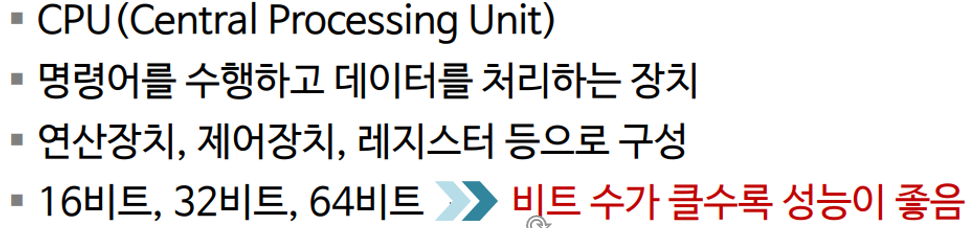
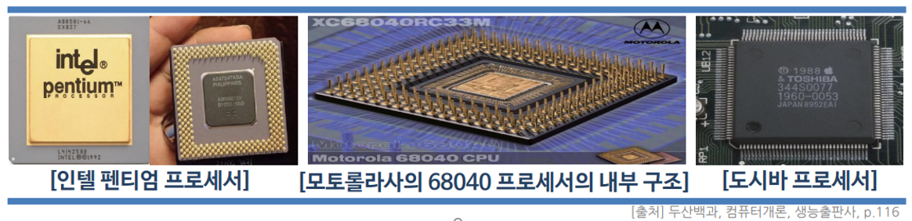

* **프로세서(Processor)**: 명령어를 읽고 0과 1의 전기 신호로 계산을 척척 해내는 중심 장치예요.
* 사람으로 치면 눈과 귀로 들어온 정보를 생각하고 손발에 명령을 내리는 **대뇌**와 같아요!

---

## 🏠 2단계: 컴퓨터 부품들이 한 지붕 아래 옹기종기!

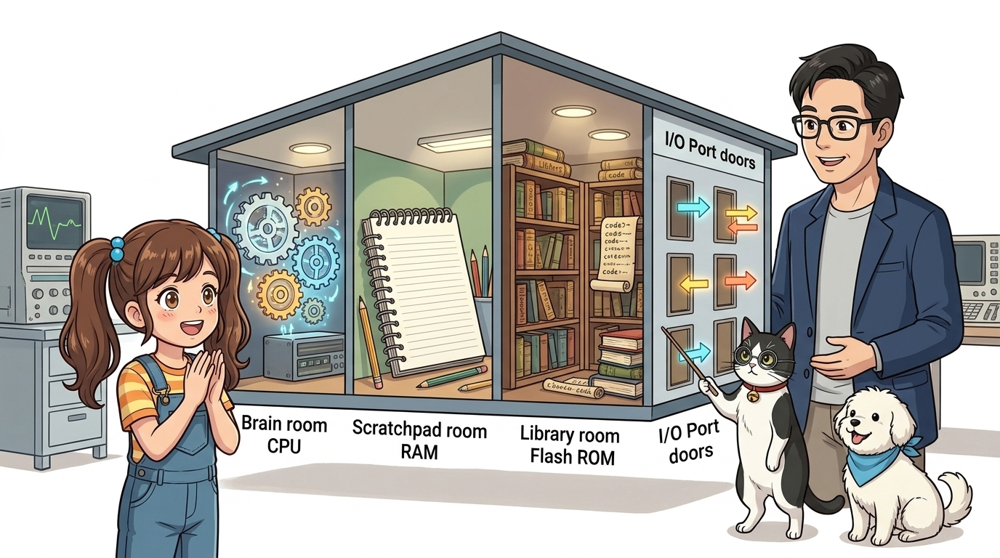

> **👧 도로시**: "우와! 일반 컴퓨터는 CPU, RAM, SSD가 따로따로 꽂혀 있는데, MCU는 작은 칩 하나에 4개의 방이 다 들어있네요!"  
> **👨‍🏫 호진 교수님**: "맞단다! **CPU(생각 방) + RAM(연습장) + Flash ROM(책장) + I/O(출입문)**이 모두 하나의 실리콘 칩 속에 모여서 **'원칩 컴퓨터(One-chip Computer)'**라고 부른단다."  
> **🐱 조수 지니**: "작고 저렴해서 어떤 물건 속에도 쏙 넣어 똑똑하게 만들 수 있다옹!"

---

## 🔬 3단계: 크기는 줄이고, 속도는 빛처럼 빠르게!

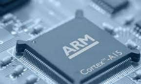
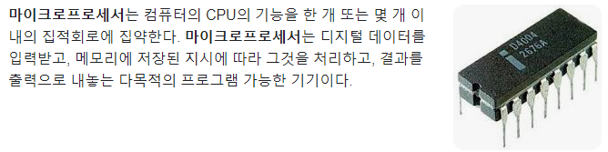

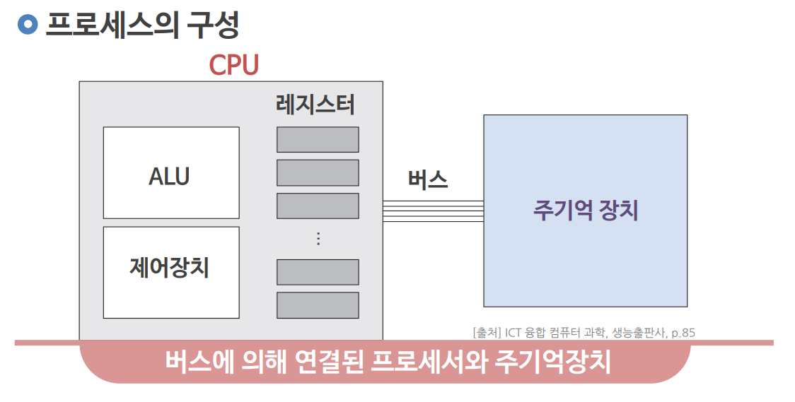
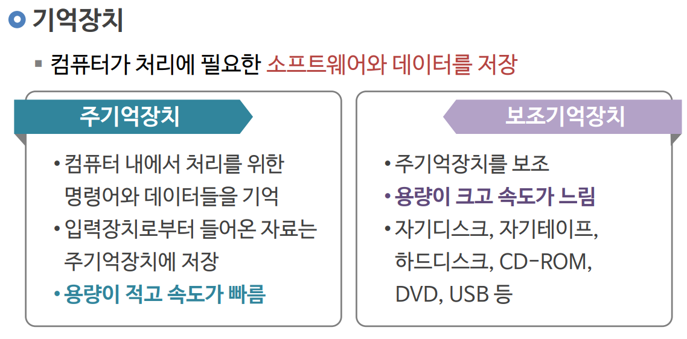

* 실리콘 웨이퍼라는 얇은 원판 위에 수억 개의 미세한 트랜지스터를 빛으로 새겨 넣어요.
* 손가락 마디만 한 크기지만 옛날 거대한 슈퍼컴퓨터보다 수천 배 빠르게 동작한답니다!

---

## 🚗 4단계: 사물 속에 쏙 들어간 '임베디드 시스템'

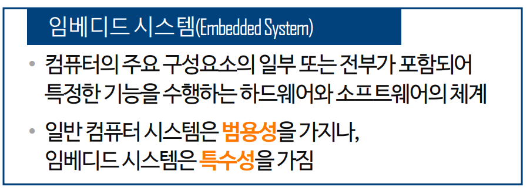
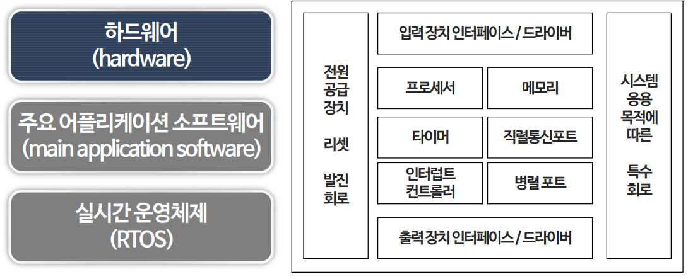
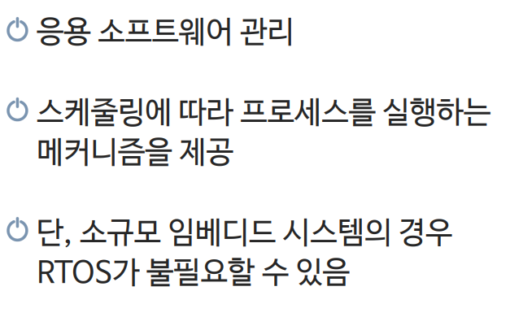

* **임베디드(Embedded)**: '안에 쏙 끼워 넣다'라는 뜻이에요.
* 컴퓨터 모니터나 키보드 없이, 자동차 엔진 속, 에어컨 속, 엘리베이터 속에 쏙 들어가서 오직 한 가지 임무를 완벽하게 해내는 특수 컴퓨터 시스템이랍니다!

---

## 💎 5단계: 모든 시스템을 칩 하나로! (SoC)

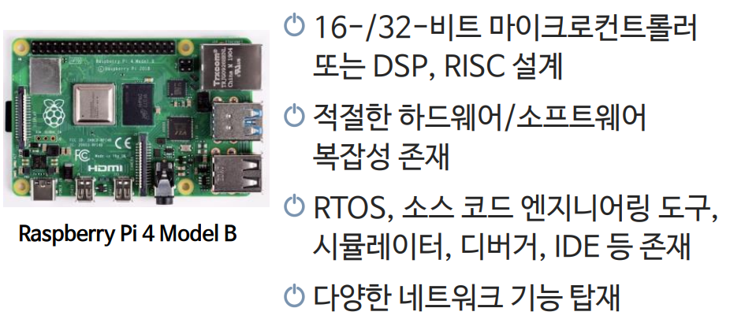
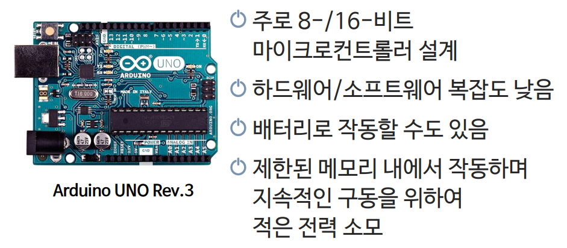

* 부품을 여러 개 기판에 납땜하면 제품이 커지고 전기도 많이 먹고 비싸져요.
* **SoC (System on Chip)**: 모든 제어 회로와 통신 장치를 단 하나의 반도체 칩으로 합쳐 스마트폰이나 스마트워치처럼 아주 작고 날렵하게 만들 수 있어요!

---

## 🤖 6단계: 아두이노 보드의 심장이 바로 MCU예요!

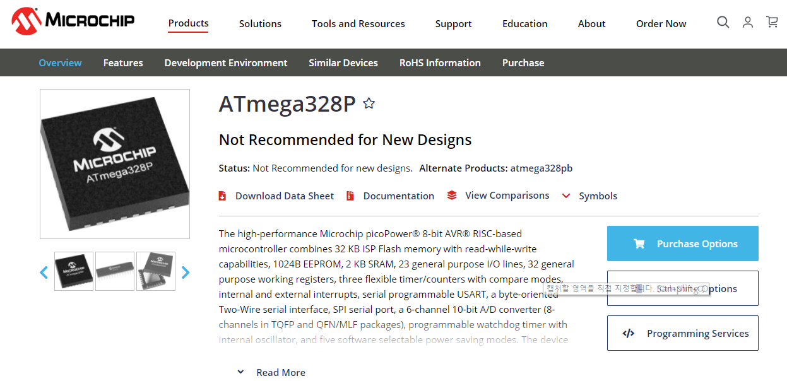

* 아두이노 우노 보드의 길쭉한 검은 지네 칩이 바로 **ATmega328P MCU**예요!
* 우리가 컴퓨터에서 작성한 코드는 이 MCU의 **Flash ROM 방**에 저장되고,
* 전원이 켜지면 **CPU 방**이 1초에 1,600만 번씩 코드를 실행하며 **I/O 핀 문**을 통해 LED를 깜빡이게 합니다!

---

## 🌟 미션 클리어! "손바닥 컴퓨터의 두뇌를 정복했어요!"

> **👧 도로시**: "교수님, 지니 조수님! 손바닥만 한 아두이노 보드의 진짜 심장이 바로 이 작은 ATmega328P MCU 칩이었군요!"  
> **👨‍🏫 호진 교수님**: "그렇단다 도로시! 다음 시간에는 아두이노 우노 보드의 구석구석 핀과 부품들을 돋보기로 정밀 탐구해보자꾸나."  
> **🐱 조수 지니**: "골골송 냥~! 다음 시간 아두이노 보드 탐구도 기대해달라옹!"  
> **🐶 토토**: "멍멍! 다음 시간 아두이노 보드 탐구 출발 멍!"

* **오늘 배운 핵심 3가지**:
  1. 🧠 **MCU**: 작은 칩 하나에 두뇌, 기억공책, 입출력 문이 다 들어있는 미니 컴퓨터!
  2. 🏠 **임베디드**: 밥솥, 냉장고, 자동차 등 사물 속에 들어가 똑똑하게 제어해요.
  3. ⚡ **아두이노**: 누구나 손쉽게 MCU를 다룰 수 있도록 도와주는 최고의 친구!
* **👉 다음 모험 (009강)**: **"009. 아두이노 우노 보드 탐구!"**
