# 009_아두이노우노_보드탐구 🤖
### 도로시와 함께 들여다보는 손바닥 위의 작은 컴퓨터!

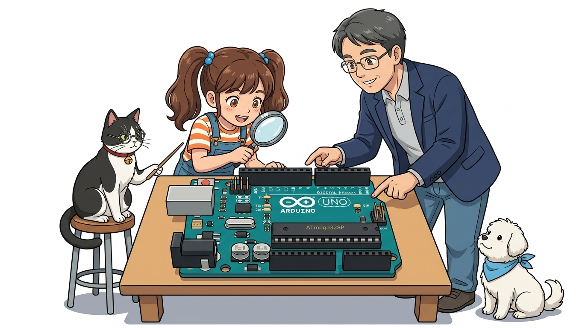

* **오늘의 배움**: 아두이노 보드의 비밀, 마이크로컨트롤러, 오픈소스의 놀라운 힘!
* **선생님과 친구들**: 호진 교수님 & 조수 지니(고양이) & 도로시 & 토토

* 🖥️ **강의 슬라이드**: [slides.md](./slides.md)

---

## ❓ 초록색 보드에는 무엇이 들어있을까?

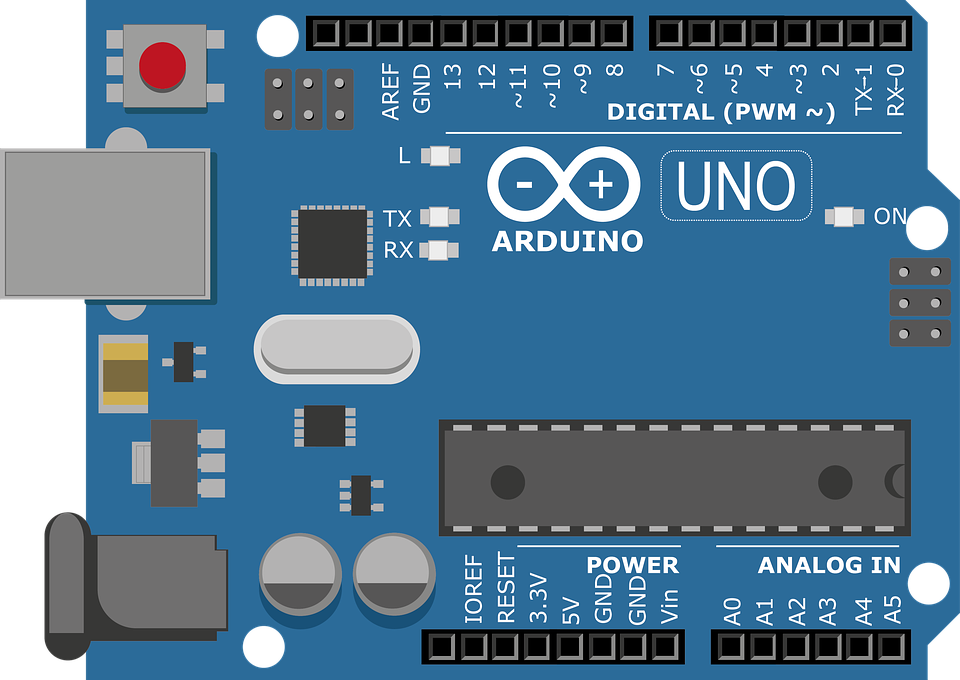

> **👧 도로시**: "교수님! 돋보기로 보니까 지네처럼 다리가 많은 검은색 칩도 있고, 은색 단추랑 구멍도 잔뜩 있어요! 이 보드는 도대체 정체가 뭐예요?"  
> **👨‍🏫 호진 교수님**: "하하, 아주 흥미롭지? 이 푸른색 기판의 이름이 바로 **'아두이노(Arduino)'**란다! 이탈리아어로 '강한 친구'라는 뜻을 품고 있는데, 누구나 쉽게 컴퓨터 회로와 사물인터넷을 만들 수 있도록 도와주는 마법 보드란다."  
> **🐱 조수 지니**: "냥냥! 14개의 디지털 핀과 6개의 아날로그 핀, 그리고 컴퓨터와 연결하는 USB 포트까지 조수 지니가 꼼꼼히 알려주겠다옹!"  
> **🐶 토토**: "멍멍! 나도 아두이노 부품 냄새 맡아보는 중 멍!"

---

## 🇮🇹 1단계: 왜 아두이노를 만들었을까요?

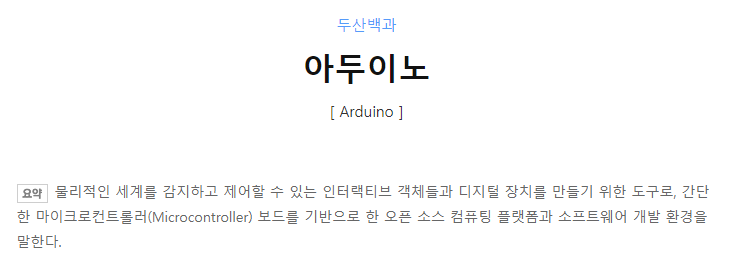

* 옛날에는 전자회로나 로봇을 만들려면 엄청 복잡한 회로를 직접 납땜하고 공부해야 했어요.
* 이탈리아의 한 디자인 학교 선생님들이 **"디자이너나 학생도 하루 만에 쉽게 작품을 만들 수는 없을까?"** 고민 끝에 아두이노를 발명했어요.
* 지금은 초등학생부터 로봇 과학자까지 전 세계인이 가장 사랑하는 교구랍니다!

---

## 🧠 2단계: 핵심 두뇌 - 마이크로컨트롤러(MCU)

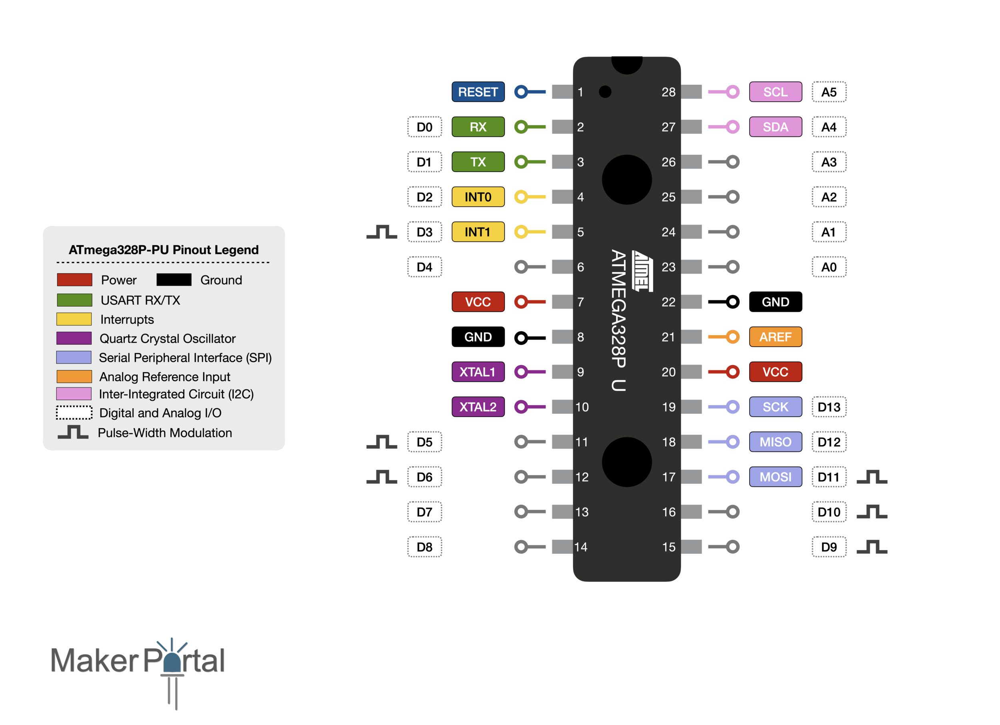

* **MCU (Micro Controller Unit)** = **아주 작은 초소형 컴퓨터!**
* 커다란 데스크톱 컴퓨터에 들어가는 계산장치(CPU), 기억장치(RAM/Flash), 입출력 통로가 **손톱만 한 검은색 반도체 칩 하나**에 쏙 다 들어가 있어요!
* 아두이노 우노(UNO)의 두뇌 이름은 **ATmega328P**랍니다.

---

## 📏 3단계: 용도에 따라 크기도 모양도 달라요!

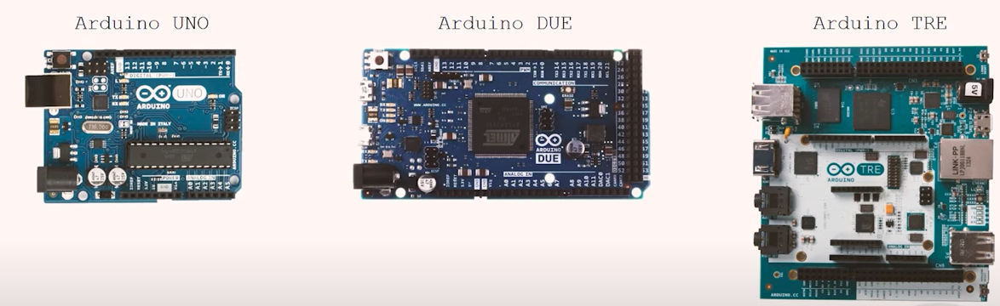

* **아두이노 우노 (UNO)**: 우리가 배우는 가장 표준적이고 튼튼한 기본형 보드!
* **아두이노 나노 (Nano)**: 손가락 두 마디 크기로 작은 로봇이나 RC카에 쏙 들어가요.
* **아두이노 메가 (Mega)**: 핀 구멍이 50개 이상! 3D 프린터처럼 부품이 많은 곳에 쓰여요.
* **아두이노 릴리패드 (LilyPad)**: 옷이나 가방에 실로 바느질해서 입을 수 있는 웨어러블 보드!

---

## 🌍 4단계: 오픈소스란 무엇일까요?

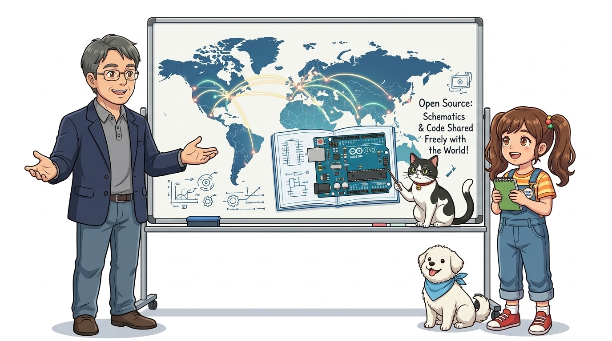

> **👧 도로시**: "교수님! '오픈소스'가 뭐예요? 그렇게 좋은 보드 설계도를 남들에게 비밀로 숨겨두지 않고 그냥 알려주나요?"  
> **👨‍🏫 호진 교수님**: "놀랍게도 그렇단다 도로시! 아두이노를 만든 개발자들은 회로 설계도와 소프트웨어 코드를 전 세계 모든 사람에게 **100% 무료로 공개**했단다. 누구나 자유롭게 복제하고 개선해서 더 멋진 세상을 만들도록 돕기 위한 위대한 나눔 철학이란다!"  
> **🐱 조수 지니**: "골골송 냥~! 그래서 정품뿐 아니라 착한 가격의 호환 보드들도 전 세계 곳곳에서 만들어져 우리가 부담 없이 배울 수 있게 된 거라옹!"

---

## 🏭 5단계: 정품과 호환 보드는 어떻게 다를까요?

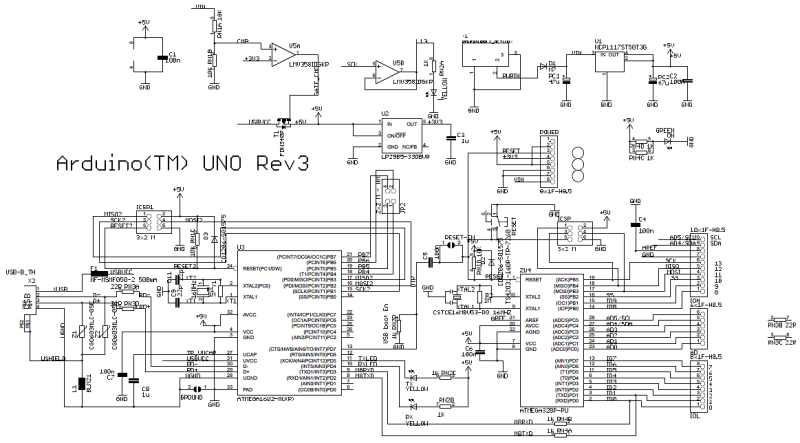
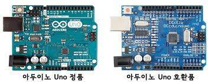

* **오픈소스 하드웨어**: 회로도가 공개되어 누구나 똑같은 보드를 만들 수 있어요.
* **이탈리아 정품 보드**: 아두이노 로고와 원산지(Made in Italy)가 새겨져 있어요.
* **호환 보드**: 똑같은 회로로 만들어져 성능과 기능은 100% 같고 가격이 매우 착해요!
* 💡 우리가 실습할 때 쓰는 보드도 훌륭하게 작동하는 호환 보드랍니다!

---

## ⭐ 6단계: 아두이노가 최고인 이유!

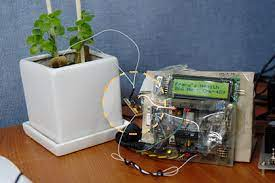
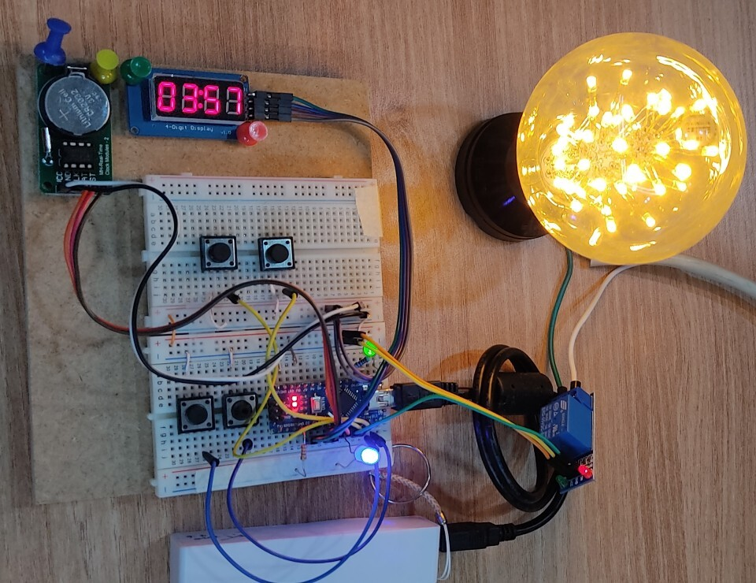
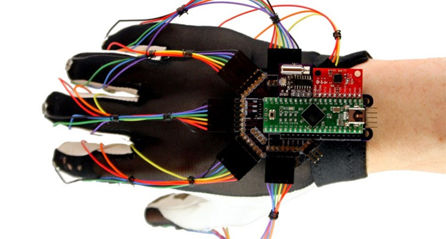

1. 빵판(브레드보드)에 선만 꽂으면 되니 **납땜할 필요가 없어요!**
2. 인터넷에 전 세계 친구들이 올려둔 **수만 가지 무료 예제 코드와 라이브러리**가 있어요!
3. LED, 온습도 센서, 모터, 카메라, 블루투스 등 **상상하는 모든 부품을 쉽게 연결**할 수 있어요!

---

## 🔌 7단계: 외부 핀(구멍)을 들여다보자!

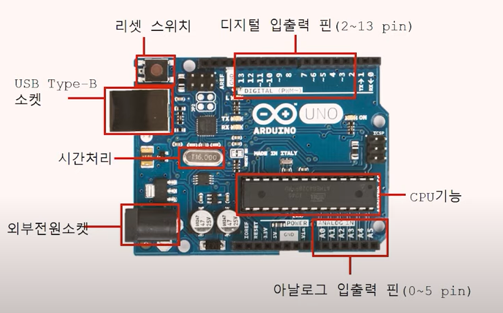
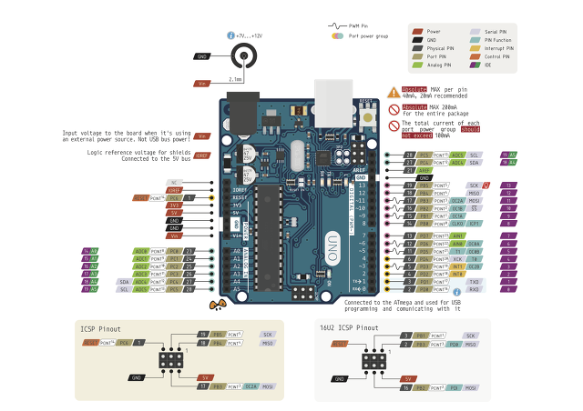

* **디지털 핀 (0번 ~ 13번)**: 켜짐(HIGH)과 꺼짐(LOW) 신호를 주고받는 통로예요.
* **아날로그 입력 핀 (A0 ~ A5)**: 빛의 밝기, 온도의 변화처럼 부드러운 아날로그 수치를 읽어요.
* **전원 핀 (Power)**:
  * **5V / 3.3V**: 부품들에게 전기를 뿜어주는 (+) 극!
  * **GND (Ground)**: 전기가 흘러 들어가는 (-) 땅 극!

---

## 🔍 8단계: 칩 모양이 조금씩 달라요!

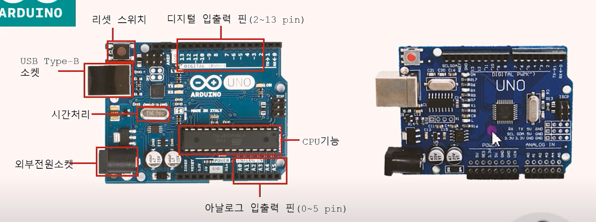

* **DIP 타입 (길쭉한 지네 모양)**:
  * 칩을 쏙 뽑았다 꽂을 수 있는 형태예요. 칩이 고장 나면 칩만 갈아 끼울 수 있어요!
* **SMD 타입 (납작한 네모 모양)**:
  * 기판 위에 납작하게 착 달라붙어 있어요. 크기가 작고 얇게 만들 수 있답니다.

---

## 🔋 9단계: 아두이노는 밥(전기)을 어떻게 먹을까요?

1. 💻 **USB 케이블 (5V)**: 컴퓨터에 꽂아 코딩할 때 전기를 함께 공급받아요!
2. 🔌 **DC 배럴 잭 (7V ~ 12V)**: 어댑터나 9V 사각 배터리를 꽂아서 컴퓨터 없이 작동해요!
3. 🔋 **VIN 핀 (외부 전원)**: 배터리의 (+)선을 직접 VIN 핀에 연결할 수도 있어요!

---

## 🌟 미션 클리어! "나도 이제 아두이노 박사!"

> **👧 도로시**: "교수님, 지니 조수님! 이제 아두이노 우노 보드의 구석구석 핀과 심장인 MCU 칩까지 완벽하게 파악했어요!"  
> **👨‍🏫 호진 교수님**: "훌륭하단다 도로시! 이제 손바닥 컴퓨터 아두이노의 구조를 정복했으니, 다음 시간에는 또 다른 대표 소형 컴퓨터인 라즈베리파이와 어떤 차이가 있는지 비교 탐험을 떠나보자꾸나."  
> **🐱 조수 지니**: "골골송 냥~! MCU 아두이노 vs MPU 라즈베리파이의 흥미진진한 맞대결을 기대해달라옹!"  
> **🐶 토토**: "멍멍! 다음 시간 라즈베리파이 비교 탐험도 출발 멍!"  
> **👉 다음 모험 (010강)**: **"010. 라즈베리파이와 비교하기!"**
