# 010_라즈베리파이와_비교하기 🍓

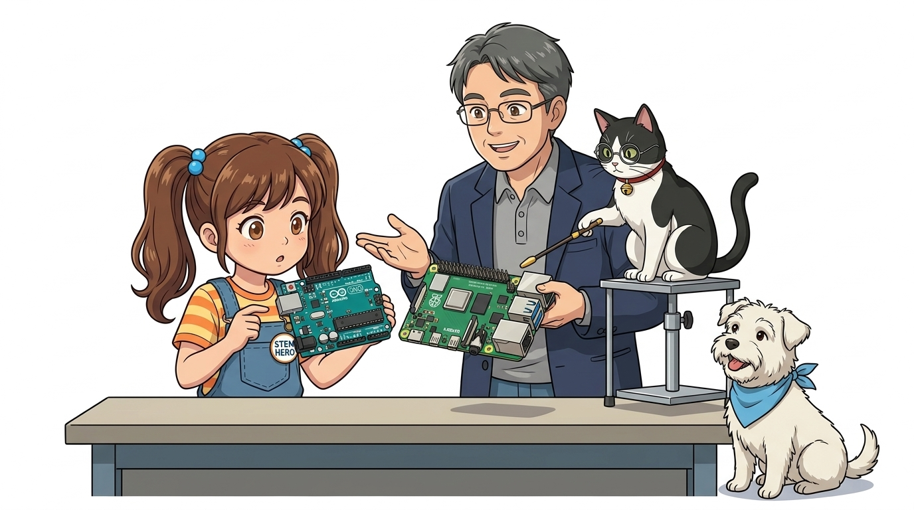

* **오늘의 탐험**: 영국의 교육용 미니 PC 라즈베리파이와 아두이노의 결정적 차이점!
* **선생님과 친구들**: 호진 교수님 & 조수 지니(고양이) & 도로시 & 토토

### 먹는 파이가 아니야! 신용카드 크기의 진짜 리눅스 미니 컴퓨터!
* 📖 **상세 강의 교재**: [index.md](./index.md)

> 여러분 안녕하세요! 이번 시간에는 '010. 라즈베리파이와 비교하기 🍓'을 주제로 소형 컴퓨터의 양대 산맥을 비교 탐험해 보겠습니다. 영국의 교육용 컴퓨터 재단에서 만든 신용카드 크기의 싱글 보드 컴퓨터 라즈베리파이와, 우리가 배운 아두이노 우노의 결정적인 차이점을 명쾌하게 짚어보겠습니다. 호진 교수님의 깊이 있는 컴퓨터 구조 강의와 조수 지니의 꼼꼼한 포트 비교, 도로시와 토토의 흥미진진한 실습과 함께 출발해 볼까요?

---

## ❓ 지니야, 진짜 먹는 산딸기 파이랑 같은 거야?

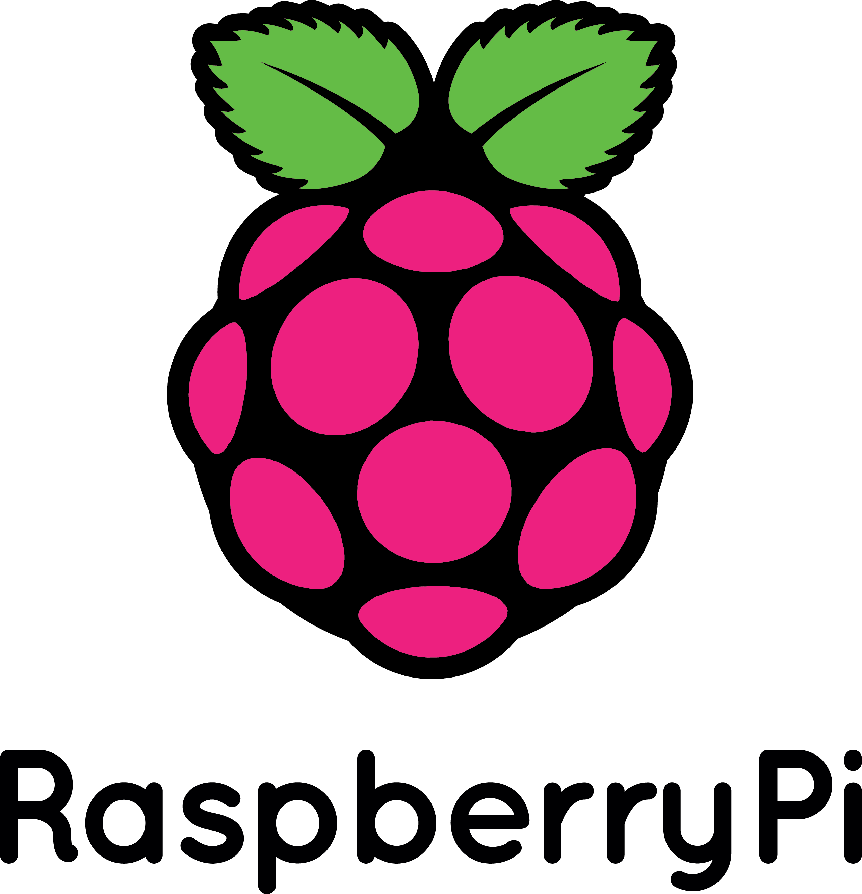

* **👧 도로시**: "교수님! 이름이 왜 '라즈베리 파이(Raspberry Pi)'예요? 베이커리 빵집에서 파는 달콤한 과일 파이 이름이잖아요!"
* **👨‍🏫 호진 교수님**: "하하, 아주 재미있는 이름이지? 옛날 컴퓨터 회사들이 애플(사과), 아콘(도토리)처럼 과일이나 열매 이름을 붙였던 전통에서 영감을 얻었단다. 또 교육용 언어인 '파이썬(Python)'의 앞 글자 'Pi'를 함께 담은 위트 넘치는 이름이란다!"
* **🐱 조수 지니**: "냥! 먹는 파이가 아니라 신용카드 크기 속에 쿼드코어 CPU와 4GB 메모리가 들어있는 진짜 초소형 리눅스 컴퓨터다옹!"
* **🐶 토토**: "멍멍! (먹을 건 아니지만 엄청 똑똑하대 멍!)"

> 자, 이번 슬라이드의 질문을 함께 보시겠습니다. 바로 '❓ 지니야, 진짜 먹는 산딸기 파이랑 같은 거야?'라는 아주 흥미로운 질문입니다. 도로시가 ' 지니야! 이름이 왜  '라고 질문하자, 지니 멘토는 ' 하하! 옛날 컴퓨터 회사들이 애플(사과), 아콘(도토리)처럼 과일 이름을 붙였던 전통을 이어받아, 영국 재단에서 붙인 귀여운 이름이란다! 게다가 프로그래밍 언어인  '라며 명쾌한 답을 들려주었는데요. 이 질문 속에 숨겨진 전자 회로와 컴퓨팅의 핵심 원리를 지금부터 차근차근 하나씩 파헤쳐 보겠습니다.

---

## 🇬🇧 1단계: 영국의 학교 교육을 위해 태어났어요!

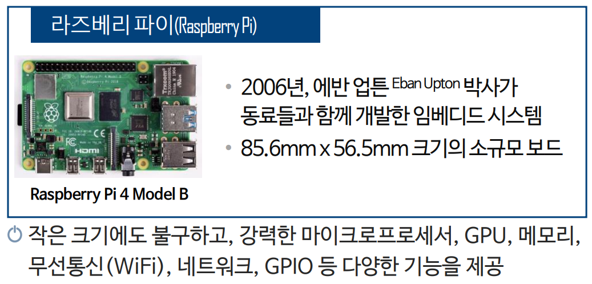
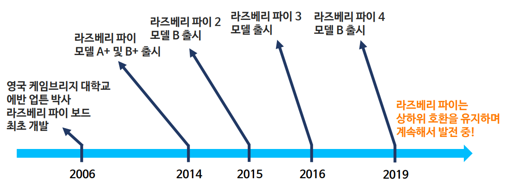

* 영국의 에벤 업턴(Eben Upton)과 케임브리지 대학 교수들이 개발했어요.
* **"모든 어린이와 학생들이 자기만의 컴퓨터를 가지고 프로그래밍을 배우게 하자!"**
* 가격을 35달러(약 4만 원)로 파격적으로 낮춰 전 세계에 코딩 열풍을 일으켰답니다!

> 이번 슬라이드에서는 '🇬🇧 1단계: 영국의 학교 교육을 위해 태어났어요!'에 대해 자세히 살펴보겠습니다. 화면의 다이어그램과 사진을 함께 참고해 주시기 바랍니다. 첫 번째 핵심은 영국의 에벤 업턴(Eben Upton)과 케임브리지 대학 교수들이 개발했어요.이며, 두 번째로는 "모든 어린이와 학생들이 자기만의 컴퓨터를 가지고 프로그래밍을 배우게 하자!"입니다. 여기에 덧붙여 가격을 35달러(약 4만 원)로 파격적으로 낮춰 전 세계에 코딩 열풍을 일으켰답니다! 내용까지 함께 이해해 두시면 완벽합니다. 이 원리는 아두이노 시스템 전체를 관통하는 핵심 논리이므로 머릿속에 꼭 정리해 두시기 바랍니다.

---

## 💻 2단계: 모니터와 마우스를 꽂으면 진짜 데스크톱 PC!

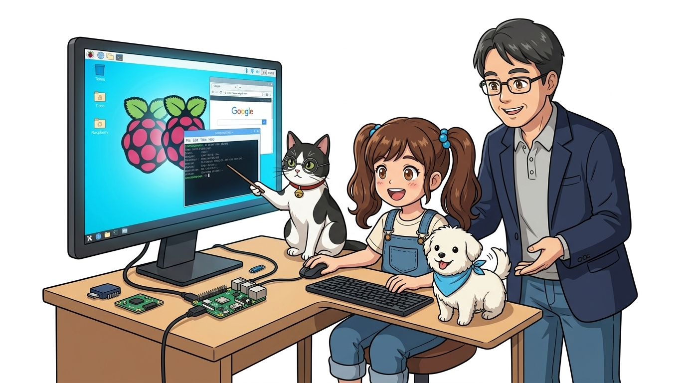

* **👧 도로시**: "우와! HDMI 케이블로 모니터를 연결하고 마우스를 꽂으니까 진짜 인터넷 브라우저도 뜨고 유튜브도 나와요!"
* **👨‍🏫 호진 교수님**: "맞단다! 아두이노는 운영체제 없이 단일 코드를 즉시 실행하는 MCU이지만, 라즈베리파이는 윈도우처럼 리눅스 운영체제(OS)가 돌아가는 어엿한 **'싱글 보드 컴퓨터(SBC)'**란다."
* **🐱 조수 지니**: "인공지능 카메라 인식이나 웹 서버까지 돌릴 수 있는 엄청난 파워를 가졌다옹!"

> 이번 슬라이드에서는 '💻 2단계: 모니터와 마우스를 꽂으면 진짜 데스크톱 PC!'에 대해 자세히 살펴보겠습니다. 화면의 다이어그램과 사진을 함께 참고해 주시기 바랍니다. 도로시와 지니의 대화처럼, 우와! HDMI 케이블로 모니터를 연결하고 마우스를 꽂으니까 진짜 인터넷 브라우저도 뜨고 유튜브도 나와!라는 상황에 대해 그렇단다! 라즈베리파이는 윈도우처럼 리눅스(Linux) 운영체제(OS)가 돌아가는 라는 원리가 작동하는 것입니다. 이 원리는 아두이노 시스템 전체를 관통하는 핵심 논리이므로 머릿속에 꼭 정리해 두시기 바랍니다.

---

## 🥊 3단계: 아두이노와 라즈베리파이는 어떻게 다를까?

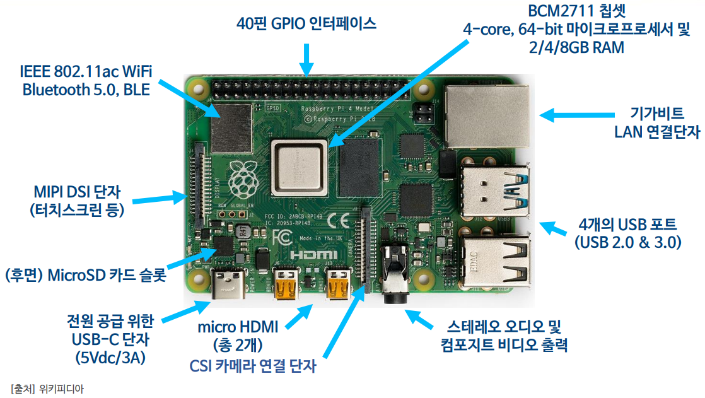

| 구분 | 아두이노 (Arduino) 🤖 | 라즈베리파이 (Raspberry Pi) 🍓 |
| :--- | :--- | :--- |
| **정체** | **마이크로컨트롤러 (MCU)** | **싱글 보드 컴퓨터 (SBC)** |
| **운영체제(OS)** | 없음 (전원 켜면 즉시 코드 실행) | **리눅스 (Raspberry Pi OS)** |
| **화면 출력** | 모니터 연결 불가 (LED 깜빡임) | **HDMI 4K 모니터 2대 연결 가능** |
| **주특기** | 센서 읽기, 모터 제어, 빠른 반응 | **인공지능(AI), 카메라 영상 처리, 웹 서버** |
| **가격과 전력** | 몇천 원, 건전지로 오래 감 | 수만 원, 전력을 많이 소모함 |

> 자, 이번 슬라이드의 질문을 함께 보시겠습니다. 바로 '🥊 3단계: 아두이노와 라즈베리파이는 어떻게 다를까?'라는 아주 흥미로운 질문입니다. 이 질문 속에 숨겨진 전자 회로와 컴퓨팅의 핵심 원리를 지금부터 차근차근 하나씩 파헤쳐 보겠습니다.

---

## 🔌 4단계: 옆면에 달린 풍성한 포트들!

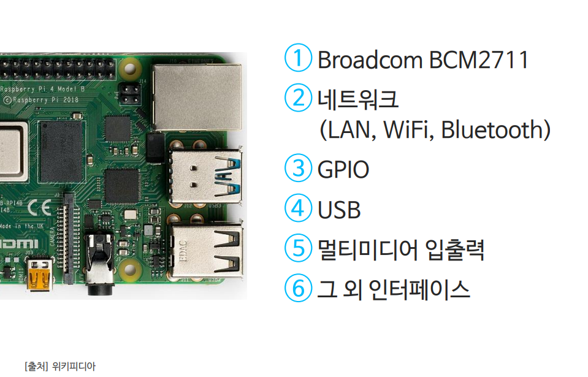
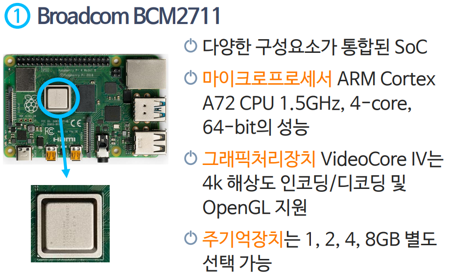
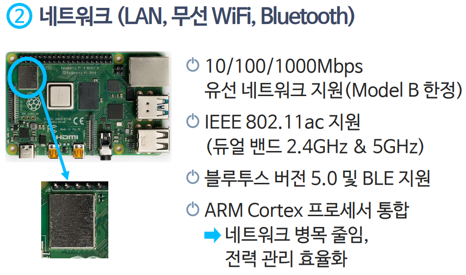

1. 💻 **USB 3.0 포트 4개**: 키보드, 마우스, USB 메모리를 꽂아요.
2. 📺 **마이크로 HDMI 포트 2개**: 듀얼 모니터로 화면을 띄워요.
3. 🌐 **기가비트 이더넷 & 와이파이**: 유무선 인터넷에 바로 연결돼요!
4. 📷 **CSI 카메라 & DSI 디스플레이 커넥터**: 작은 카메라 모듈을 연결해요.

> 이번 슬라이드에서는 '🔌 4단계: 옆면에 달린 풍성한 포트들!'에 대해 자세히 살펴보겠습니다. 화면의 다이어그램과 사진을 함께 참고해 주시기 바랍니다. 첫 번째 핵심은 💻 USB 3.0 포트 4개: 키보드, 마우스, USB 메모리를 꽂아요.이며, 두 번째로는 📺 마이크로 HDMI 포트 2개: 듀얼 모니터로 화면을 띄워요.입니다. 여기에 덧붙여 🌐 기가비트 이더넷 & 와이파이: 유무선 인터넷에 바로 연결돼요! 내용까지 함께 이해해 두시면 완벽합니다. 이 원리는 아두이노 시스템 전체를 관통하는 핵심 논리이므로 머릿속에 꼭 정리해 두시기 바랍니다.

---

## 💾 5단계: 하드디스크 대신 꽂는 마이크로 SD 카드!

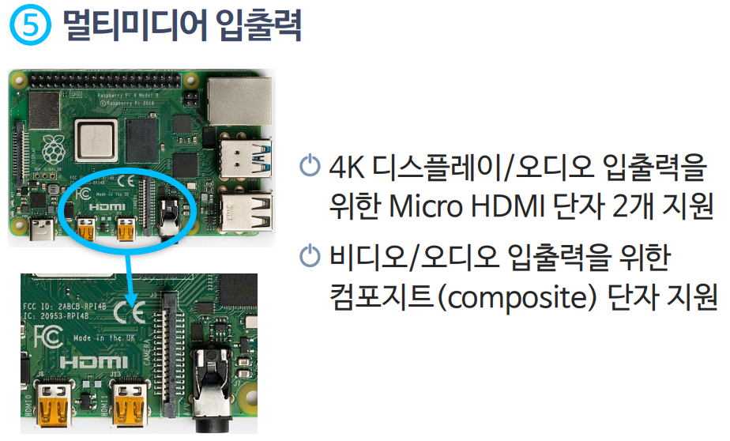
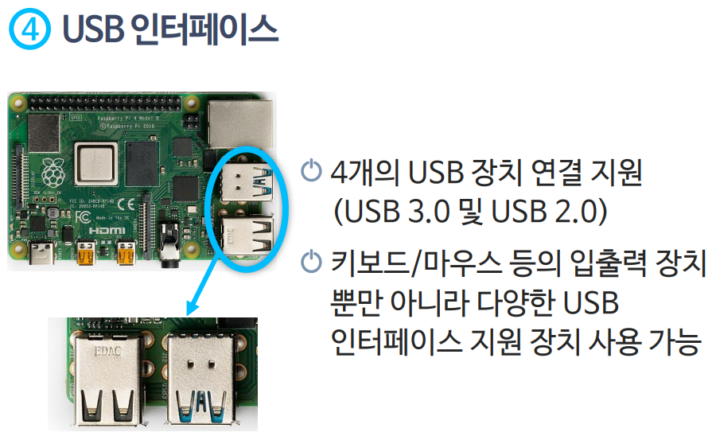
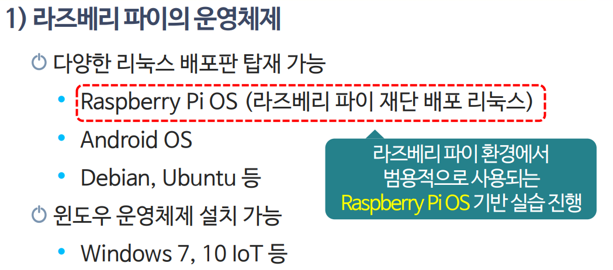

* 라즈베리파이는 무거운 하드디스크 대신 스마트폰에 넣는 **마이크로 SD 카드**를 써요.
* SD 카드에 리눅스 운영체제(OS)를 설치해 바닥 슬롯에 딸깍 꽂으면 부팅 완료!

> 이번 슬라이드에서는 '💾 5단계: 하드디스크 대신 꽂는 마이크로 SD 카드!'에 대해 자세히 살펴보겠습니다. 화면의 다이어그램과 사진을 함께 참고해 주시기 바랍니다. 첫 번째 핵심은 라즈베리파이는 무거운 하드디스크 대신 스마트폰에 넣는 마이크로 SD 카드를 써요.이며, 두 번째로는 SD 카드에 리눅스 운영체제(OS)를 설치해 바닥 슬롯에 딸깍 꽂으면 부팅 완료!입니다. 이 원리는 아두이노 시스템 전체를 관통하는 핵심 논리이므로 머릿속에 꼭 정리해 두시기 바랍니다.

---

## 📌 6단계: 아두이노처럼 부품을 제어하는 40개 핀!

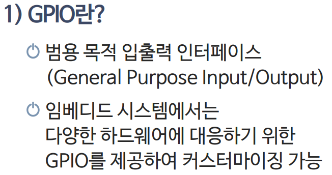
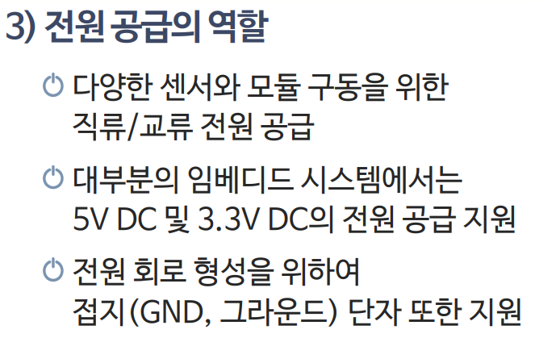
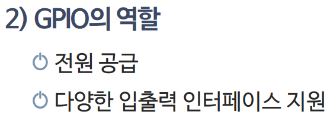

* 라즈베리파이 상단에 나란히 서 있는 40개의 뾰족한 침을 **GPIO 핀**이라고 불러요.
* 파이썬(Python) 코드로 이 핀들을 제어해 LED를 켜거나 모터를 움직일 수 있어요!

> 이번에 살펴볼 내용은 '📌 6단계: 아두이노처럼 부품을 제어하는 40개 핀!'입니다. 화면의 회로도와 부품 사진을 보면서 각 핀과 배선이 어떻게 구성되어 있는지 눈으로 직접 따라와 주시기 바랍니다. 첫째로 라즈베리파이 상단에 나란히 서 있는 40개의 뾰족한 침을 GPIO 핀이라고 불러요.에 유의해야 하며, 둘째로 파이썬(Python) 코드로 이 핀들을 제어해 LED를 켜거나 모터를 움직일 수 있어요!라는 점이 핵심입니다. 이 기본 개념을 확실히 잡아두셔야 실제 부품을 브레드보드에 꽂고 코딩할 때 실수 없이 완성할 수 있습니다.

---

## 🤝 7단계: 지니와 도로시의 환상 조합

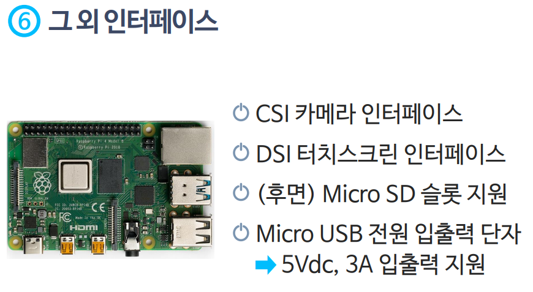

* **라즈베리파이**: 인공지능 카메라로 사물을 보고 판단하는 '지휘관' 역할!
* **아두이노**: 지휘관의 명령을 받아 0.001초 만에 모터를 돌리고 바퀴를 굴리는 '행동대장' 역할!
* 자율주행 자동차를 만들 때 두 친구를 USB로 연결해서 함께 쓴답니다!

> 이번 슬라이드에서는 '🤝 7단계: 지니와 도로시의 환상 조합'에 대해 자세히 살펴보겠습니다. 화면의 다이어그램과 사진을 함께 참고해 주시기 바랍니다. 첫 번째 핵심은 라즈베리파이: 인공지능 카메라로 사물을 보고 판단하는 '지휘관' 역할!이며, 두 번째로는 아두이노: 지휘관의 명령을 받아 0.001초 만에 모터를 돌리고 바퀴를 굴리는 '행동대장' 역할!입니다. 여기에 덧붙여 자율주행 자동차를 만들 때 두 친구를 USB로 연결해서 함께 쓴답니다! 내용까지 함께 이해해 두시면 완벽합니다. 이 원리는 아두이노 시스템 전체를 관통하는 핵심 논리이므로 머릿속에 꼭 정리해 두시기 바랍니다.

---

## 🌟 미션 클리어! "라즈베리파이의 매력을 정복했어요!"

* **👧 도로시**: "교수님, 지니 조수님! 이제 아두이노와 라즈베리파이의 차이를 명확히 알았어요! 센서와 모터를 빠르고 가볍게 다룰 땐 아두이노, 화면을 띄우고 AI를 돌릴 땐 라즈베리파이를 쓰면 되는 거죠?"
* **👨‍🏫 호진 교수님**: "정답이란다 도로시! 두 친구를 함께 연결하면 자율주행 로봇처럼 똑똑한 두뇌와 빠른 발을 모두 가진 멋진 작품을 만들 수 있단다."
* **🐱 조수 지니**: "골골송 냥~! 다음 시간에는 실제 부품이 없어도 컴퓨터 화면에서 자유자재로 회로를 만들어보는 팅커캐드 시뮬레이터로 떠나보자옹!"
* **🐶 토토**: "멍멍! 팅커캐드 가상 실습 출발 멍!"

* **오늘 배운 3가지 포인트**:
1. 🍓 **라즈베리파이**: 리눅스 OS가 돌아가는 완전한 카드 크기 컴퓨터!
2. 🤖 **아두이노**: 전기가 들어오면 즉시 센서와 모터를 다루는 임베디드 보드!
3. 🚀 **최고의 짝꿍**: 인공지능 영상 처리는 라즈베리파이, 정밀 회로 제어는 아두이노!
* **👉 다음 모험 (011강)**: 컴퓨터 안에서 부품 없이 가상으로 회로를 실험하는 **"011. 틴커캐드 가상 시뮬레이터"**를 배워보아요!

> 오늘 배운 '🌟 미션 클리어! "라즈베리파이의 매력을 정복했어요!"'의 핵심 내용을 모두 정리해 보았습니다. 오늘 다룬 내용 중에서도 오늘 배운 3가지 포인트 부분은 앞으로의 아두이노 실습과 프로젝트에서 계속 사용되는 매우 중요한 기초 지식입니다. 오늘 배운 내용을 꼭 다시 한번 복습해 보시고, 다음 강의에서 더욱 신나고 유익한 모험으로 다시 만나겠습니다. 모두 수고 많으셨습니다!