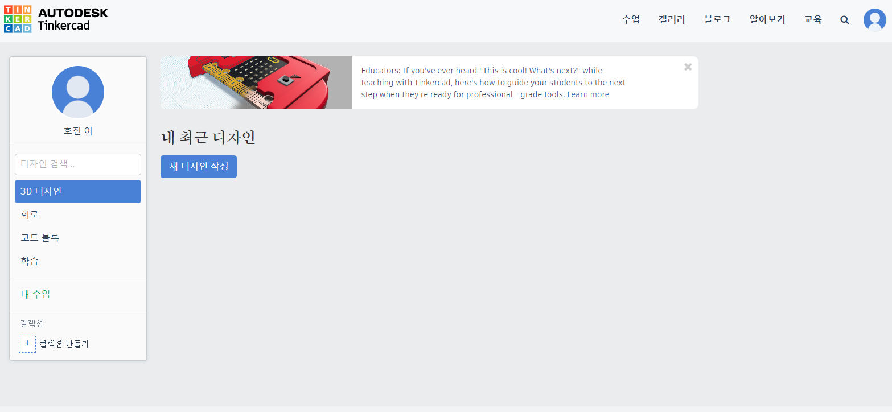
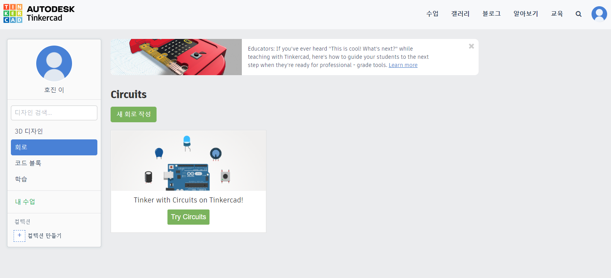
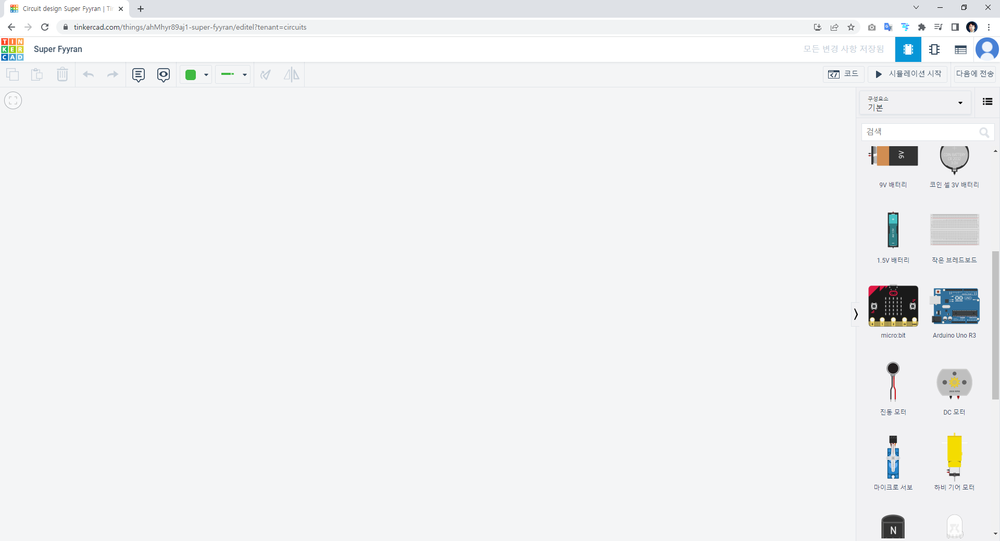
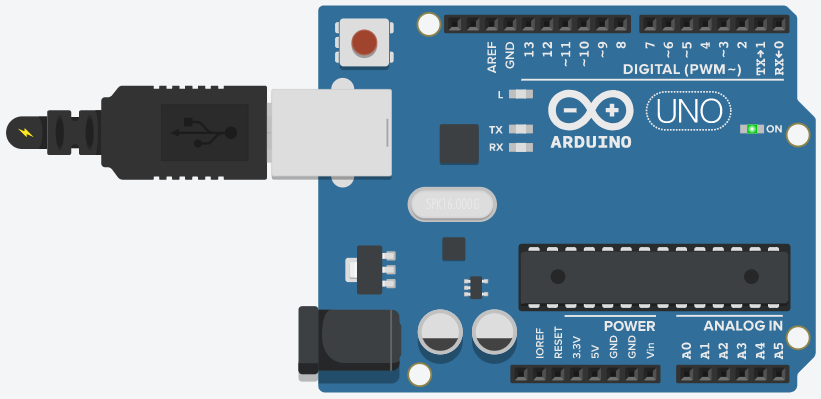

# 011_틴커캐드_가상시뮬레이터 🌐
### 보드가 없어도 괜찮아! 웹 브라우저에서 즐기는 가상 회로 실험실!

* **오늘의 탐험**: 오토데스크 팅커캐드(TinkerCAD)로 100% 무료 가상 아두이노 실습하기!
* **선생님과 친구들**: 호진 교수님 & 조수 지니(고양이) & 도로시 & 토토

* 🖥️ **강의 슬라이드**: [slides.md](./slides.md)

---

## ❓ 지니야, 지금 당장 아두이노 부품이 없으면 어떡해?

> **👧 도로시**: "교수님! 오늘 아두이노 보드 키트를 집에 두고 왔어요... 부품이 올 때까지 실습을 못 하고 기다려야만 하나요?"  
> **👨‍🏫 호진 교수님**: "하하, 천만에 도로시! 웹 브라우저만 켜면 인터넷 세상 속에 무제한 아두이노 부품이 가득한 **'오토데스크 팅커캐드(TinkerCAD)'** 가상 실험실이 있단다!"  
> **🐱 조수 지니**: "냥! 부품을 잃어버릴 염려도 없고, 언제 어디서든 클릭 한 번으로 회로를 만들 수 있는 마법 놀이터다옹!"  
> **🐶 토토**: "멍멍! (화면 속에 아두이노 다 있대 멍!)"

---

## 🛡️ 1단계: 부품이 타거나 망가질 걱정 제로(0)!

> **👧 도로시**: "앗! 저항 없이 LED를 연결했더니 화면에서 '펑!' 하고 만화 별똥별이 떴어요!"  
> **👨‍🏫 호진 교수님**: "괜찮단다 도로시! 가상 시뮬레이터에서는 아무리 큰 실수를 해도 실제 부품이 타지 않고 안전하단다. 마음껏 실패하며 올바른 회로를 배우는 최고의 실험실이지."  
> **🐱 조수 지니**: "냥냥! LED 다리 앞에 220Ω 저항을 쏙 끼워주면 안전하게 환한 불이 들어온다옹!"

---

## 🌐 2단계: 팅커캐드 웹사이트로 출발!

1. 인터넷 웹 브라우저를 엽니다.
2. 주소창에 **[https://www.tinkercad.com](https://www.tinkercad.com)** 을 입력하고 접속해요.
3. 구글 계정이나 학생 계정으로 간편하게 무료 로그인합니다!

---

## 🔌 3단계: [Circuits (회로)] 메뉴 누르기

* 왼쪽 대시보드 메뉴에서 **[Circuits (회로)]**를 콕 클릭해요.
* 초록색 **[+ 새 회로 작성]** 버튼을 누르면 깨끗한 가상 실험실 책상이 펼쳐집니다!

---

## 📦 4단계: 부품을 마우스로 쏙쏙 드래그!

1. 오른쪽 부품 목록에서 **[Arduino Uno R3]**를 마우스로 끌어다 놓아요.
2. **[소형 브레드보드]**, **[LED]**, **[저항]**도 쏙쏙 가져옵니다.
3. 부품의 다리를 마우스로 콕 찍고 드래그하면 알록달록 무지개 전선이 저절로 쓱쓱 연결돼요!

---

## 🚀 5단계: [시뮬레이션 시작] 버튼 클릭!

1. 상단의 **[코드(Code)]** 버튼을 누르면 블록 코딩 또는 C언어 텍스트 코드를 바로 작성할 수 있어요.
2. 초록색 **[시뮬레이션 시작(Start Simulation)]** 버튼을 누르면?
3. 가상 USB 케이블이 보드에 찰칵 꽂히며 LED가 깜빡깜빡 실제로 살아 움직입니다!

---

## 🌟 미션 클리어! "어디서나 아두이노를 즐겨요!"

> **👧 도로시**: "교수님, 지니 조수님! 팅커캐드가 있으니까 부품이 없는 곳에서도 자유롭게 회로를 꾸미고 코드를 테스트할 수 있어서 정말 편리해요!"  
> **👨‍🏫 호진 교수님**: "그렇단다 도로시! 이제 가상 실습과 컴퓨터의 기본 구조를 모두 마쳤으니, 다음 시간부터는 아두이노를 직접 코딩하는 진짜 프로그래밍 도구, '아두이노 IDE'의 설치와 환경 설정을 시작해보자꾸나!"  
> **🐱 조수 지니**: "골골송 냥~! 내 컴퓨터에 아두이노 IDE를 설치하는 다음 모험도 신나게 달려보자옹!"  
> **🐶 토토**: "멍멍! 다음 시간 아두이노 IDE 설치 출발 멍!"

* **팅커캐드의 3대 장점**:
  1. 💰 **100% 무료**: 인터넷만 있으면 태블릿, 노트북 어디서나 실습 가능!
  2. 🛡️ **안전한 실험**: 잘못 연결해도 부품 고장 걱정 없이 자유롭게 도전!
  3. 🧩 **블록 & C언어 동시 지원**: 코딩과 회로를 한눈에 검증!
* **👉 다음 모험 (012강)**: **"012. 아두이노 IDE 설치하기!"**
