# 012_아두이노IDE_설치하기 💻
### 도로시와 지니의 첫 번째 아두이노 소프트웨어 탐험!

* **대상**: 아두이노를 처음 시작하는 어린이 및 입문자
* **오늘의 목표**: 컴퓨터에 아두이노 마법 스케치북(IDE)을 설치하고 실행해 봐요!
* **선생님과 친구들**: 호진 교수님 & 조수 지니(고양이) & 도로시 & 토토

* 🖥️ **강의 슬라이드**: [slides.md](./slides.md)

---

## ❓ 아두이노한테 어떻게 명령을 내릴까요?

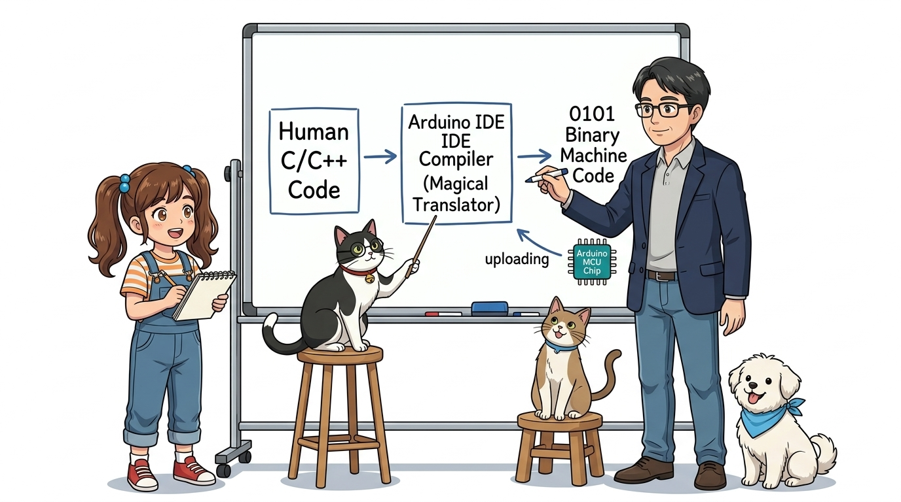

> **👧 도로시**: "교수님! 아두이노는 작은 컴퓨터라는데, 키보드도 모니터도 없어요! 우리가 쓴 명령을 어떻게 읽고 불을 켤 수 있나요?"  
> **👨‍🏫 호진 교수님**: "아주 좋은 질문이란다! 바로 우리 컴퓨터에 **'아두이노 통합 개발 환경(IDE)'**이라는 전문 소프트웨어를 설치해야 한단다. 사람이 쓴 C언어 코드를 아두이노가 이해하는 기계어로 번역해 USB를 통해 전송해 주는 마법의 번역기란다."  
> **🐱 조수 지니**: "냥! 공식 홈페이지에서 무료로 다운로드하고 설치하는 과정을 조수 지니가 하나씩 차근차근 보여주겠다옹!"  
> **🐶 토토**: "멍멍! (얼른 아두이노 IDE 깔아주세요 멍!)"

---

## 🛠️ 통합 개발 환경(IDE)이란 무엇일까요?

* **IDE (Integrated Development Environment)** = **통합 개발 환경**
* 쉽게 말해 **"프로그래밍 종합 선물 세트"**예요!
  1. 📝 **코드 에디터**: 소스코드를 예쁘게 작성하는 스케치북
  2. ⚙️ **컴파일러**: 사람이 쓴 영어 코드를 0과 1의 기계어로 바꿔주는 번역가
  3. 🚀 **업로더**: 번역된 명령을 USB 케이블을 통해 아두이노 두뇌로 슝 보내주는 배달부

---

## 🌐 1단계: 공식 홈페이지로 출발!

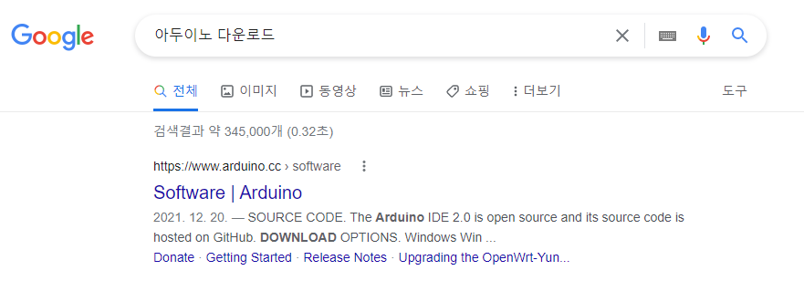

1. 인터넷 브라우저(크롬 또는 엣지)를 엽니다.
2. 검색창에 **"Arduino"** 또는 **"아두이노"**를 입력하거나 공식 사이트로 접속해요.
   * 공식 주소: **[https://www.arduino.cc](https://www.arduino.cc)**
3. 상단 메뉴에서 **[Software]** 탭을 클릭합니다.

---

## 💻 2단계: 내 컴퓨터 OS에 맞는 버전 선택!

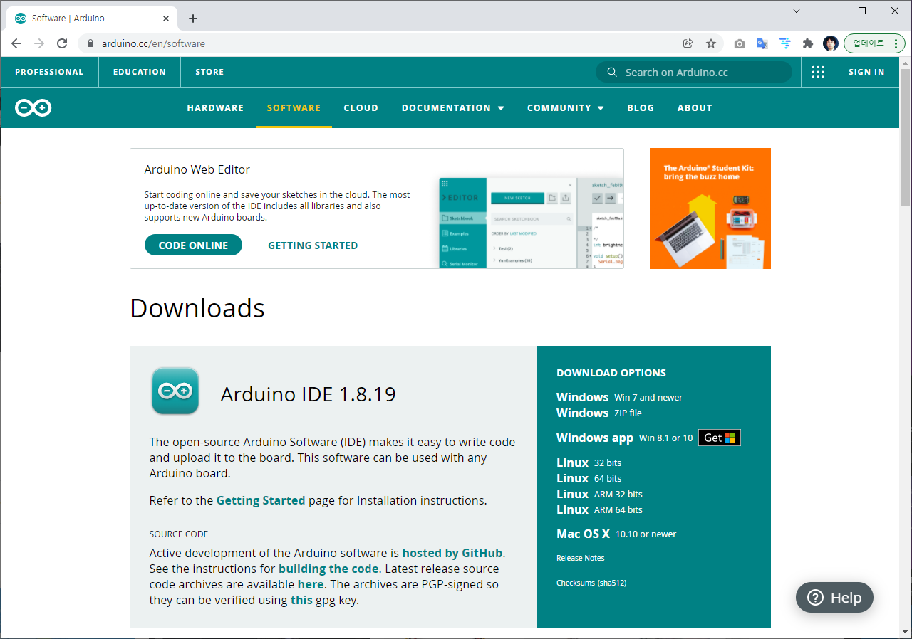

* **윈도우 컴퓨터 (Windows)**:
  * `Windows Win 10 and newer` (또는 Windows Installer)를 선택해요.
* **애플 맥 컴퓨터 (macOS)**:
  * Intel 맥 또는 Apple Silicon(M1/M2/M3)에 맞는 버전을 선택해요.
* 💡 **지니의 꿀팁**: 자신의 컴퓨터 운영체제가 윈도우인지 맥인지 먼저 확인해 보세요!

---

## 🎁 3단계: 기부 화면에서 "JUST DOWNLOAD" 누르기!

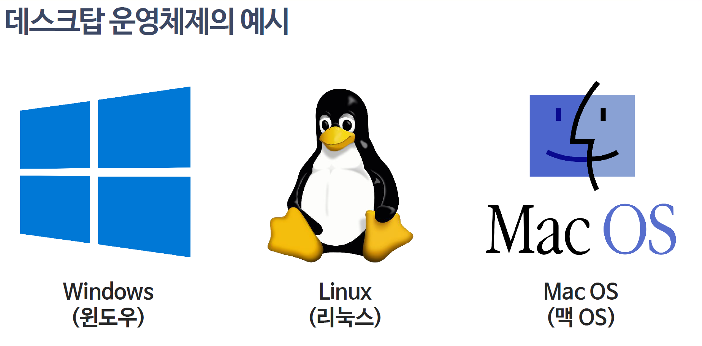

> **👧 도로시**: "앗 교수님! 돈을 내야 다운로드되는 기부 화면($3, $5, $10...)이 나왔어요! 유료 프로그램인가요?"  
> **👨‍🏫 호진 교수님**: "놀라지 마렴 도로시! 아두이노는 전 세계 모든 학생과 메이커들을 위한 **100% 오픈소스 무료 소프트웨어**란다. 아래쪽에 보이는 **[JUST DOWNLOAD] (그냥 다운로드)** 버튼을 살짝 누르면 무료로 즉시 다운로드된단다!"  
> **🐱 조수 지니**: "냥냥! 여유가 생기면 나중에 기부해도 되니, 지금은 JUST DOWNLOAD를 누르면 된다옹!"  
> **👧 도로시**: "와아! 정말 바로 다운로드가 시작되네요! 감사합니다 교수님!"

---

## 📦 4단계: 설치 마법사 시작 & 이용 약관 동의

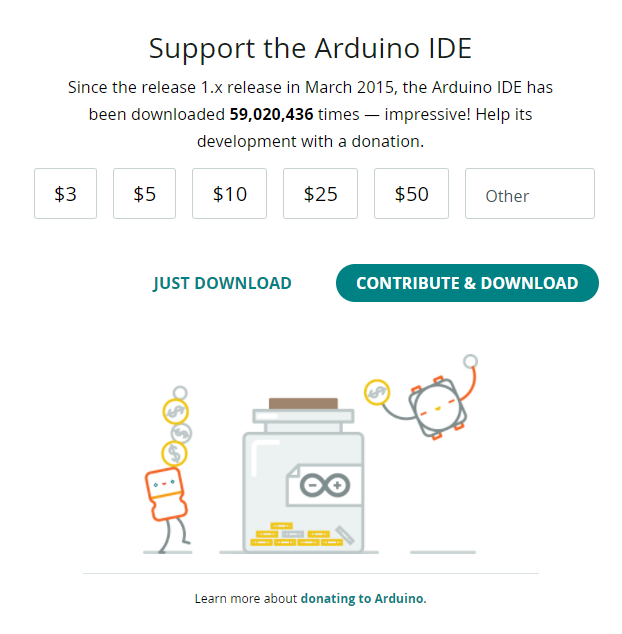

1. 다운로드 폴더에서 `arduino-xxx-windows.exe` 파일을 더블클릭해요.
2. 라이선스 동의 화면이 나오면 **[I Agree] (동의함)** 버튼을 클릭합니다.
3. 옵션 선택 화면(바탕화면 아이콘, USB 드라이버 등)에서는 **모든 체크박스를 그대로 둔 채 [Next]**를 클릭해요!

---

## ⏳ 5단계: 쑥쑥 차오르는 초록색 설치 막대

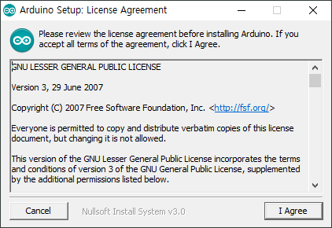
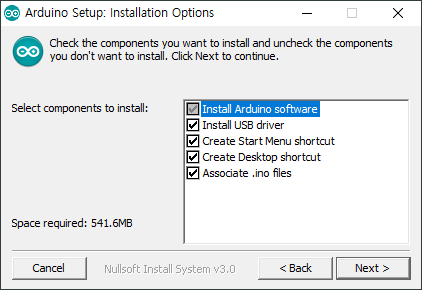

1. 설치 폴더 위치를 확인하고 **[Install] (설치)** 버튼을 꾹 누릅니다.
2. 초록색 게이지 막대가 오른쪽으로 쑥쑥 차오르며 파일들이 컴퓨터에 복사돼요.
3. 설치가 끝날 때까지 컴퓨터를 끄지 말고 잠시만 기다려 주세요!

---

## 🌉 6단계: USB 통신 다리(드라이버)가 필요해!

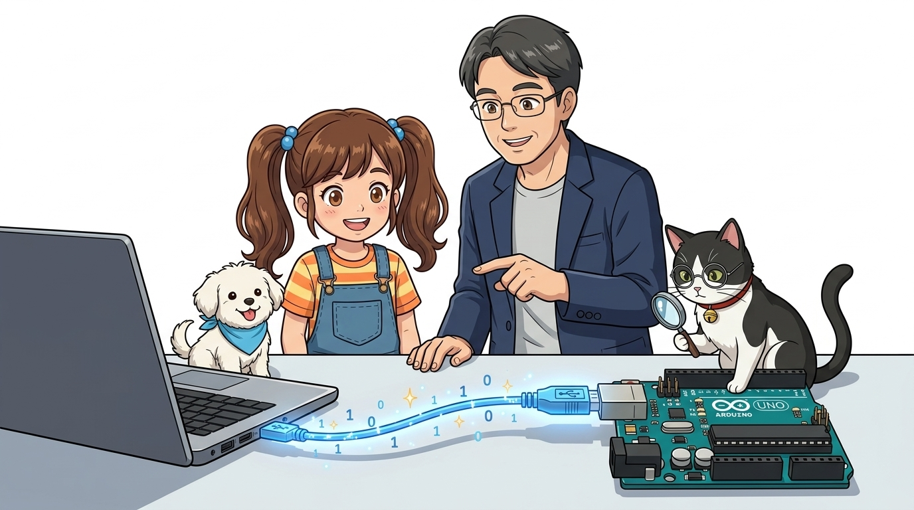

> **👧 도로시**: "교수님! '장치 소프트웨어를 설치하시겠습니까?'라는 윈도우 보안 팝업창이 떠요! 이건 뭐예요?"  
> **👨‍🏫 호진 교수님**: "이건 컴퓨터와 아두이노를 연결해 주는 **'통신 다리(USB 시리얼 드라이버)'**란다! 컴퓨터의 USB 신호와 아두이노의 시리얼 통신을 서로 이어주는 핵심 통로이니 **반드시 [설치]를 눌러줘야 한단다!**"  
> **🐱 조수 지니**: "망설이지 말고 [설치(I)]를 콕 눌러주면 안전하게 연결된다옹!"

---

## 🔌 7단계: 장치 드라이버 팝업에서 "설치" 클릭!

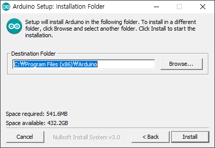
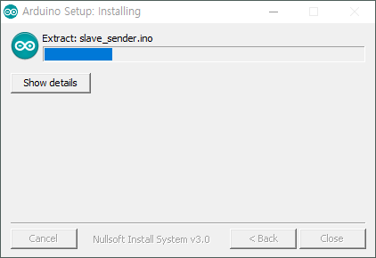
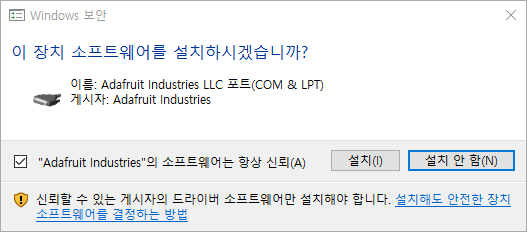

* 설치 중 위와 같은 윈도우 보안 경고 창이 2~3회 연속으로 나타날 수 있어요.
* 이 프로그램들은 아두이노 정품 칩셋(FTDI, Arduino LLC, Adafruit 등)의 통신 드라이버입니다.
* 망설이지 말고 **[설치(I)]** 버튼을 모두 눌러주세요!

---

## 🔍 8단계: 컴퓨터는 아두이노를 어떻게 알아볼까?

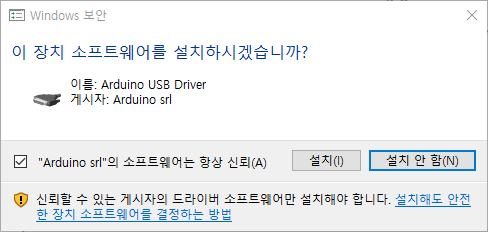
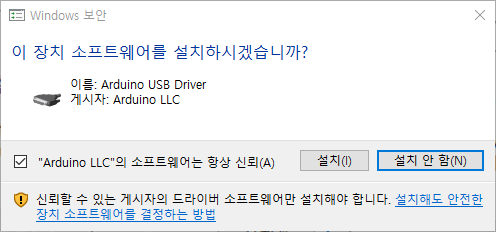

* USB 케이블을 컴퓨터에 꽂으면, 컴퓨터의 **[장치 관리자] -> [포트(COM & LPT)]** 항목에 아두이노가 나타나요!
* 예: `Arduino Uno (COM3)` 또는 `USB Serial Port (COM5)`
* 이제 컴퓨터와 아두이노가 서로 손을 꼭 잡고 대화할 준비가 완벽히 끝난 거예요!

---

## 🎯 9단계: 설치 완료! 청록색 무한대 아이콘 발견!

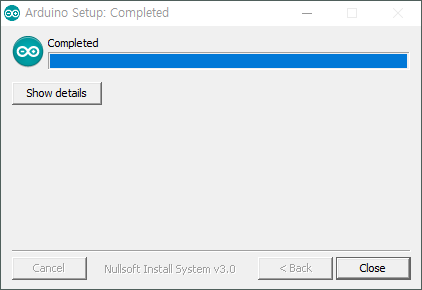

1. 설치 창에 `Completed`가 뜨면 **[Close]**를 눌러 마칩니다.
2. 바탕화면을 보면 귀여운 청록색 **무한대(∞) 기호**의 **'Arduino IDE'** 아이콘이 짠! 나타납니다.
3. 아이콘을 더블클릭하면 깨끗한 코딩 스케치북 창이 활짝 열립니다!

---

## 🌟 미션 클리어! "지니와 함께 첫 발을 내딛었어요!"

> **👧 도로시**: "만세! 교수님, 지니 조수님, 토토야! 우리 컴퓨터에 아두이노 IDE가 성공적으로 설치됐어요!"  
> **👨‍🏫 호진 교수님**: "축하한단다 도로시! 이제 아두이노에게 코드를 보내 동작시킬 모든 준비가 끝났단다."  
> **🐱 조수 지니**: "골골송 냥~! 다음 시간에는 아두이노 IDE의 도구 버튼들과 스케치 창의 구조를 하나씩 익혀보자옹!"  
> **🐶 토토**: "멍멍! 다음 시간 아두이노 IDE 메뉴 탐험 출발 멍!"  
> **👉 다음 시간 예고**: **"013. 개발환경과 마법 스케치!"**
