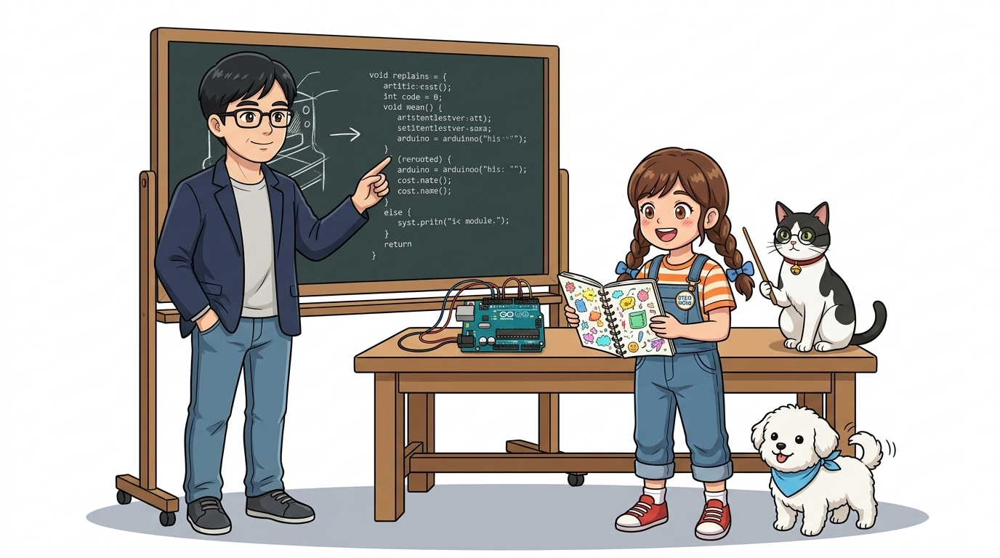
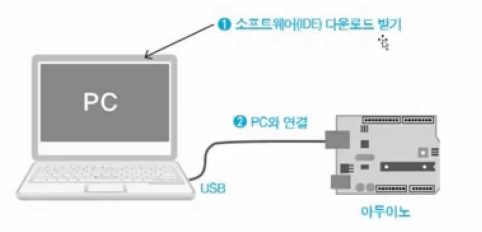
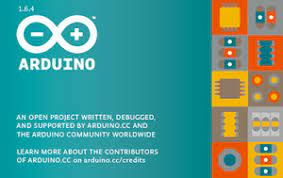
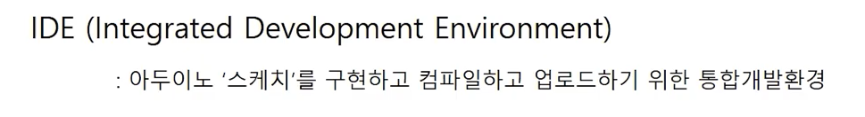
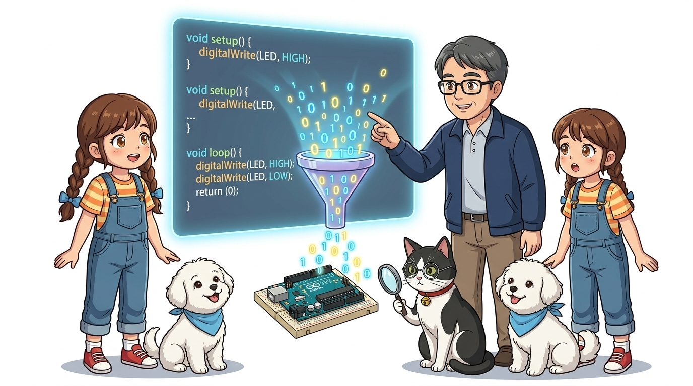
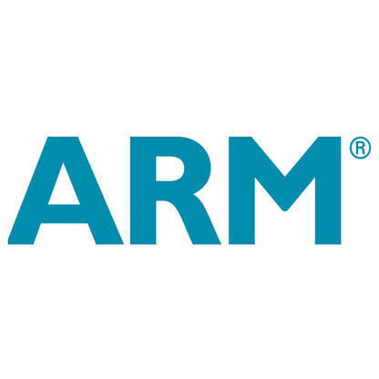
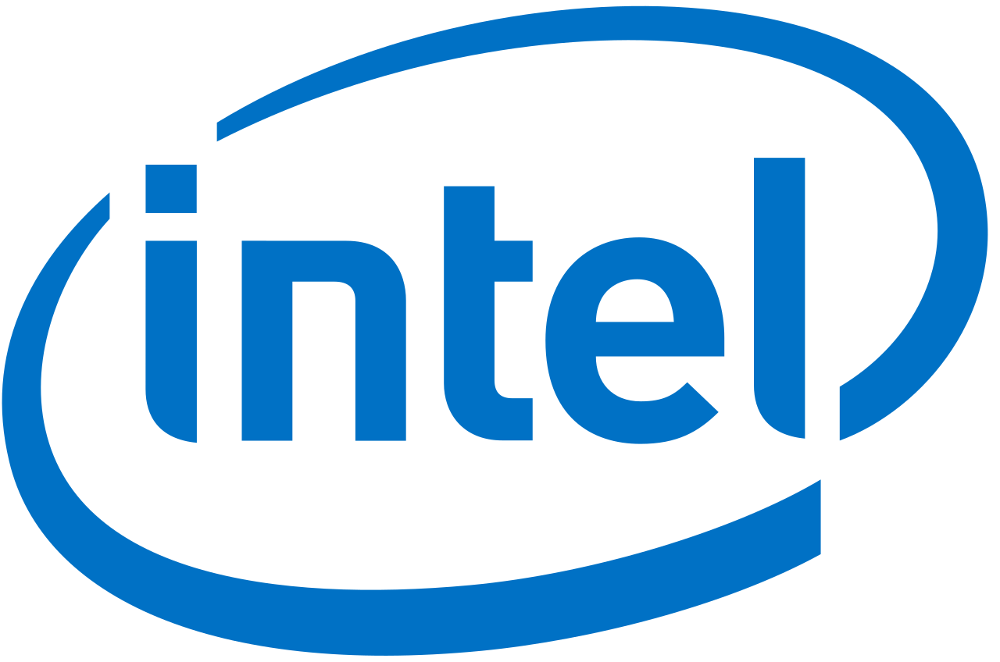
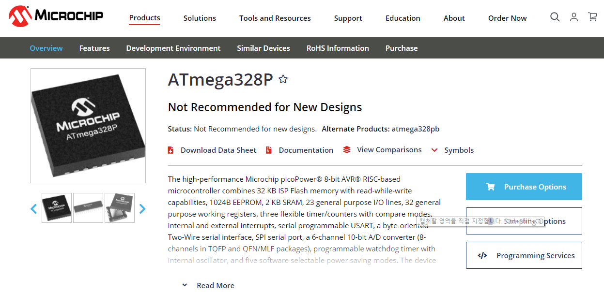
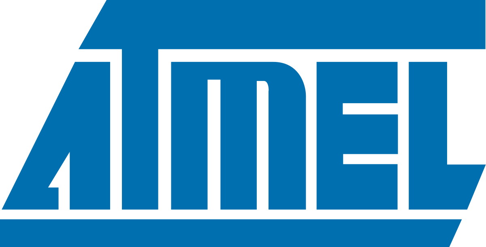

# 013_개발환경과_마법스케치 🎨



* **오늘의 탐험**: 왜 개발환경이 필요할까? 스케치(Sketch)와 컴파일(Compile)의 원리!
* **선생님과 친구들**: 호진 교수님 & 조수 지니(고양이) & 도로시 & 토토

### 도로시와 함께 배우는 코드 작성과 컴파일의 비밀!
* 📖 **상세 강의 교재**: [index.md](./index.md)


> 여러분 안녕하세요! 호진 교수님 연구실에 오신 것을 환영합니다! 이번 시간에는 '013. 개발환경과 마법스케치 🎨'를 주제로, 우리가 떠올린 멋진 아이디어가 어떻게 아두이노 코드가 되고 기계어로 번역되어 움직이는지 그 신비로운 원리를 알아봅니다. 똑똑한 조수 지니와 호기심 많은 메이커 도로시, 귀여운 토토와 함께 신나는 아두이노 모험을 시작해 봅시다!

---

## ❓ 왜 '프로그램' 대신 '스케치'라고 부를까요?


* **👧 도로시**: "교수님! 보통 컴퓨터 코딩할 땐 '프로그램을 짠다'고 하잖아요. 그런데 아두이노는 왜 그림을 그리는 것처럼 '스케치(Sketch)를 한다'고 불러요?"
* **👨‍🏫 호진 교수님**: "화가가 하얀 캔버스나 스케치북에 떠오르는 영감을 자유롭고 가볍게 그리듯이, 누구나 복잡한 공학 지식 없이도 창의적인 아이디어를 코드로 가볍게 구현해 보라는 따뜻한 뜻이 담겨 있단다!"
* **🐱 조수 지니**: "야옹! 맞아요 도로시. 전 세계 아티스트와 디자이너들도 손쉽게 작품을 만들 수 있도록 친근한 이름을 붙여준 거랍니다."
* **🐶 토토**: "멍멍! (마법 스케치북에 번쩍이는 아이디어를 그려보자 멍!)"

> 자, 이번 슬라이드의 질문을 함께 보시겠습니다. 바로 '❓ 왜 '프로그램' 대신 '스케치'라고 부를까요?'라는 아주 흥미로운 질문입니다. 아두이노는 공학자뿐만 아니라 예술가와 디자이너, 어린이들도 쉽게 다룰 수 있도록 진입 장벽을 낮춘 플랫폼입니다. 그래서 딱딱한 '프로그램'이라는 단어 대신, 가볍게 아이디어를 스케치하듯 코드를 적는다는 의미에서 '스케치'라는 예쁜 이름을 붙였습니다.

---

## ⚙️ 1단계: 개발환경(IDE)이 꼭 필요한 3가지 이유


1. 📝 **글쓰기(에디터, Editor)**: C/C++ 언어로 컴퓨터 명령어를 깔끔하고 정확하게 작성해요.
2. 🔄 **통역하기(컴파일러, Compiler)**: 사람이 쓴 영문 코드를 아두이노 칩이 읽을 수 있는 0과 1의 기계어로 번역해요.
3. 🚀 **보내주기(업로더, Uploader)**: 번역된 마법 기계어를 USB 케이블을 통해 아두이노 마이크로컨트롤러 플래시 메모리에 쏙 집어넣어 줘요!
* 이 3가지 복잡한 단계를 단 하나의 소프트웨어 안에서 원클릭으로 해결해 주는 것이 바로 **통합 개발 환경(IDE, Integrated Development Environment)**이랍니다!

> 이번 슬라이드에서는 '⚙️ 1단계: 개발환경(IDE)이 꼭 필요한 3가지 이유'에 대해 자세히 살펴보겠습니다. 과거에는 에디터에서 코드를 작성한 후 별도의 컴파일러 프로그램을 실행하고, 다시 별도의 하드웨어 프로그래머를 연결해 코드를 칩에 구워 넣어야 했습니다. 하지만 아두이노 IDE는 이 모든 번거로운 과정을 한 번의 버튼 클릭으로 자동 처리해 주는 획기적인 개발 도구입니다.

---

## 🔌 2단계: 파란색 USB 케이블의 비밀



* 컴퓨터와 아두이노를 USB 케이블로 찰칵 꽂으면 두 가지 일이 동시에 일어나요:
1. ⚡ **전원 공급(Power)**: 컴퓨터 USB 포트가 아두이노에게 동작할 수 있는 안정적인 5V 전기를 실시간으로 나눠줘요!
2. 💬 **데이터 통신(Data)**: 우리가 컴퓨터에서 번역한 기계어 코드가 전선을 타고 아두이노로 슝 날아가요!
* 별도의 크고 무거운 배터리팩 없이도 컴퓨터와 USB 선 하나만 있으면 바로 회로와 코딩을 실험할 수 있답니다.

> 이번 슬라이드에서는 '🔌 2단계: 파란색 USB 케이블의 비밀'에 대해 살펴보겠습니다. USB 케이블 내부에는 전기를 공급하는 전원선(+5V, GND)과 데이터를 주고받는 통신선(D+, D-)이 함께 들어 있습니다. 덕분에 전원선 연결과 데이터 다운로드를 케이블 하나로 깔끔하게 해결할 수 있습니다.

---

## ✍️ 3단계: 알록달록 무지개 글씨 (코드 에디터)


* 일반 메모장으로 코딩하면 오타가 나도 찾기 힘들어요.
* 하지만 아두이노 IDE 에디터는 문법에 따라 글자 색을 다르게 보여줘요:
  * 중요한 키워드와 함수(`pinMode`, `digitalWrite`, `setup`, `loop`)는 **알록달록 예쁜 주황색·청록색**으로 강조돼요!
  * 괄호 짝 `()`이나 중괄호 `{}`가 맞지 않거나 세미콜론이 빠지면 친절하게 알려준답니다!

```cpp
void setup() {
  // 한 번만 실행되는 초기 설정 마법!
}

void loop() {
  // 전원이 켜져 있는 동안 계속 반복 실행되는 마법!
}
```

> 이번 슬라이드에서는 '✍️ 3단계: 알록달록 무지개 글씨 (코드 에디터)'에 대한 실제 동작 환경을 분석해 보겠습니다. 이를 구문 강조(Syntax Highlighting)라고 부르며, 프로그래머가 오타를 줄이고 코드의 구조를 한눈에 파악할 수 있도록 돕는 IDE의 핵심 편의 기능입니다.

---

## 📂 4단계: 스케치 파일(`.ino`) 알아보기




* 아두이노에서 작성한 코드는 파일 이름 끝에 **`.ino`** 라는 확장자가 붙어요! (예: `Blink.ino`)
* 아두이노 IDE는 반드시 **파일 이름과 똑같은 이름의 폴더** 안에 스케치 파일을 보관하는 엄격한 규칙이 있어요!
* 덕분에 프로젝트별로 코드와 회로 사진, 추가 헤더 파일을 섞이지 않고 깔끔하게 관리할 수 있어요.

> 이번 슬라이드에서는 '📂 4단계: 스케치 파일(.ino) 알아보기'에 대해 자세히 살펴보겠습니다. 이탈리아어 '아두이노(Arduino)'의 뒷글자를 따서 만들어진 `.ino` 확장자는 스케치 파일임을 나타내며, 폴더 구조가 일치하지 않으면 IDE가 실행 시 자동으로 전용 폴더 생성을 묻는 팝업을 띄우게 됩니다.

---

## 🧙‍♂️ 5단계: 지니의 번역 마법 - 컴파일이란?



* **👧 도로시**: "교수님! 아두이노 칩은 조그만 반도체인데, 어떻게 우리가 영어로 쓴 `digitalWrite` 같은 글자를 알아듣고 불을 켜는 거예요?"
* **👨‍🏫 호진 교수님**: "사실 아두이노 마이크로컨트롤러는 영어나 한글을 전혀 읽지 못한단다. 오직 전기가 흐르는 '1'과 끊어지는 '0'의 2진 신호만 이해할 수 있지!"
* **🐱 조수 지니**: "야옹! 그래서 우리의 든든한 통역사인 **'컴파일러(Compiler)'**가 사람이 쓴 C/C++ 소스코드를 반짝이는 기계어(0과 1)로 순식간에 통역해 주는 거랍니다!"
* **🐶 토토**: "멍멍! (0과 1의 언어로 마법이 통하는 거구나 멍!)"

> 자, 이번 슬라이드의 질문을 함께 보시겠습니다. 바로 '🧙‍♂️ 5단계: 지니의 번역 마법 - 컴파일이란?'라는 질문입니다. 인간의 언어와 가장 가까운 고수준 언어(C/C++)를 컴퓨터 하드웨어가 직접 실행할 수 있는 기계어(이진 코드)로 변환해 주는 소프트웨어가 바로 컴파일러입니다.

---

## 🔄 6단계: C언어 소스코드 ➔ 0과 1의 기계어로 변신!


1. **소스코드(Source Code)**: 사람이 이해하기 쉬운 영어 문장 (`digitalWrite(13, HIGH);`)
2. **컴파일러(Compiler)**: 문법을 꼼꼼하게 검사하고 최적화된 기계어로 번역하는 똑똑한 번역 엔진!
3. **마이크로코드(기계어, Machine Code)**: 컴퓨터 두뇌가 바로 실행할 수 있는 `01011100...` 형태의 이진 기계어 파일(`.hex`)!

> 이번 슬라이드에서는 '🔄 6단계: C언어 소스코드 ➔ 0과 1의 기계어로 변신!' 과정을 다이어그램과 함께 살펴봅니다. 컴파일 과정에서 코드에 문법적 오류가 있으면 에러 메시지를 띄워주고, 문법이 완벽하면 최종적으로 16진수 기계어 파일인 HEX 파일이 생성됩니다.

---

## 🎯 7단계: 컴파일러는 왜 2가지 일을 할까요?


* **첫 번째 목적 (속도와 최적화)**:
  * 사람이 읽기 좋게 길게 쓴 코드를 컴퓨터 칩이 가장 빠르게 처리할 수 있도록 불필요한 군더더기를 싹 정리해 줘요!
* **두 번째 목적 (하드웨어 맞춤 번역)**:
  * 컴퓨터 칩마다 알아듣는 고유 명령어(명령어 세트, ISA)가 달라요. 아두이노 우노의 AVR 칩에 딱 맞는 전용 기계어로 정밀하게 번역해 줍니다!

> 이번 슬라이드에서는 '🎯 7단계: 컴파일러는 왜 2가지 일을 할까요?'라는 주제를 다룹니다. 컴파일러는 단순 번역기에 그치지 않고, 제한된 메모리와 연산 속도를 가진 마이크로컨트롤러가 최고의 효율을 낼 수 있도록 코드를 최적화하는 매우 중요한 두뇌 역할을 수행합니다.

---

## 🏭 8단계: CPU 제조사마다 다른 기계어의 비밀





* 스마트폰(ARM), 인텔 노트북(x86), 아두이노(AVR)는 서로 다른 아키텍처를 가진 CPU예요.
* 회사마다 반도체 내부 회로 설계가 완전히 달라서 각자 고유한 기계어 명령어 체계를 씁니다.
* 하지만 걱정 마세요! 우리는 **표준 C언어 하나만 잘 배워두면**, 컴파일러가 해당 타깃 칩에 맞추어 알아서 알맞은 기계어로 번역해 준답니다!

> 이번 슬라이드에서는 '🏭 8단계: CPU 제조사마다 다른 기계어의 비밀'을 알아봅니다. 서로 다른 하드웨어 구조를 추상화하여 프로그래머가 동일한 문법으로 다양한 기기를 제어할 수 있도록 해 주는 것이 고수준 프로그래밍 언어와 컴파일러의 위대한 힘입니다.

---

## 🧠 9단계: 아두이노 우노의 두뇌 - ATmega328P




* 원래 Atmel(아트멜)사에서 개발한 **AVR 계열 8비트 마이크로컨트롤러**예요.
* 지금은 Microchip(마이크로칩)사에 인수되어 전 세계로 공급되고 있어요.
* 32KB의 아담한 플래시 메모리를 가지고 있지만, 센서 값을 읽고 모터를 돌리며 불빛을 제어하는 데는 아주 든든하고 강력하답니다!

> 이번 슬라이드에서는 아두이노 우노의 심장부인 ATmega328P 칩을 살펴봅니다. 16MHz 클럭 속도, 32KB Flash, 2KB SRAM, 1KB EEPROM을 내장하고 있어 다양한 피지컬 컴퓨팅 프로젝트를 수행하기에 최적화된 마이크로컨트롤러입니다.

---

## 🌟 미션 클리어! "나도 이제 개발환경 마스터!"


* **👧 도로시**: "교수님, 지니야! 스케치는 상상을 자유롭게 펼치는 생각 스케치북이고, 컴파일러는 아두이노가 알아듣는 0과 1로 바꿔주는 친절한 통역사라는 걸 완벽하게 배웠어요!"
* **👨‍🏫 호진 교수님**: "정말 훌륭하구나 도로시! 원리를 완벽하게 꿰뚫었으니 다음 시간에는 **아두이노 IDE 프로그램을 직접 실행해서 화면 구성과 주요 버튼들**을 하나씩 정복해 보자꾸나!"
* **🐱 조수 지니**: "야옹! 툴바의 확인 버튼과 업로드 버튼이 어떤 역할을 하는지 제가 꼼꼼하게 안내해 드릴게요!"
* **🐶 토토**: "멍멍! 다음 시간 아두이노 IDE 첫 실행도 정말 기대된다 멍!"

> 오늘 배운 '🌟 미션 클리어! "나도 이제 개발환경 마스터!"'의 핵심 내용을 모두 정리해 보았습니다. 스케치와 컴파일, 그리고 IDE의 3요소를 머릿속에 기억하시고 다음 014강에서 더욱 신나는 실습으로 다시 만나겠습니다! 수고하셨습니다!