# 014_아두이노IDE_첫실행하기 🚀

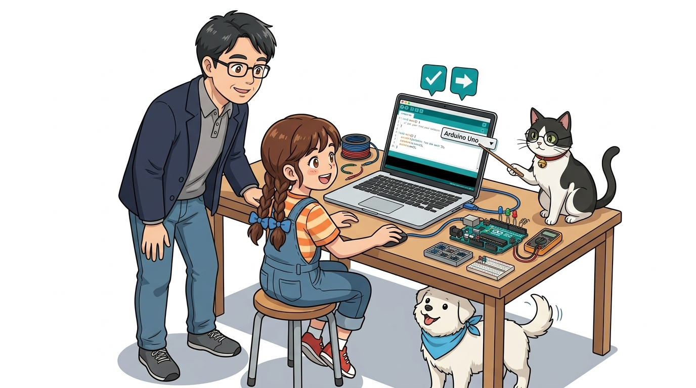

* **오늘의 미션**: 아두이노 IDE를 열고 보드와 포트를 연결한 뒤, 1초 깜빡이를 0.5초로 바꿔보기!
* **선생님과 친구들**: 호진 교수님 & 조수 지니(고양이) & 도로시 & 토토

### 보드 연결부터 첫 번째 Blink 예제 실행까지 척척!
* 📖 **상세 강의 교재**: [index.md](./index.md)


> 여러분 안녕하세요! 호진 교수님 연구실에 오신 것을 환영합니다! 이번 시간에는 드디어 아두이노 IDE를 직접 컴퓨터에서 켜고, 파란색 USB 케이블로 내 아두이노 보드와 컴퓨터를 찰칵 연결해 보는 첫 실습 시간입니다. 똑똑한 연구실 조수 지니 고양이와 귀여운 메이커 도로시, 마스코트 토토와 함께 신나는 불빛 깜빡이 실습을 완성해 봅시다!

---

## ❓ 프로그램을 켰는데, 아두이노랑 어떻게 연결해요?


* **👧 도로시**: "교수님! 바탕화면에서 아두이노 아이콘을 더블클릭해서 하얀 창을 띄웠어요! 그런데 컴퓨터는 책상 위에 있는 제 아두이노 우노 보드를 어떻게 알고 찾아내나요?"
* **👨‍🏫 호진 교수님**: "비행기가 관제탑과 비밀 무전 주파수를 맞추듯, 컴퓨터도 **'보드 종류(내 보드 이름)'**와 **'통신 포트 번호(문 번호)'**를 딱 맞춰주어야 서로 대화를 시작할 수 있단다!"
* **🐱 조수 지니**: "야옹! 제가 상단 메뉴에서 [Arduino Uno] 보드와 [COM 포트]를 콕 집어내는 비법을 알려드릴게요!"
* **🐶 토토**: "멍멍! (첫 코딩 실행 출발이다 멍!)"

> 자, 이번 슬라이드의 질문을 함께 보시겠습니다. 아두이노 IDE를 설치하고 처음 실행했을 때 가장 많이 겪는 첫 번째 관문이 바로 하드웨어 통신 포트 연결입니다. 컴퓨터는 여러 USB 기기를 다루기 때문에, 어떤 기기가 아두이노인지 정확하게 지정해 주는 보드 및 시리얼 포트 설정 단계가 반드시 필요합니다.

---

## 🛡️ 1단계: 방화벽 팝업에서 "액세스 허용" 누르기!

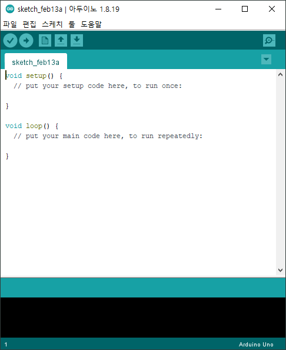

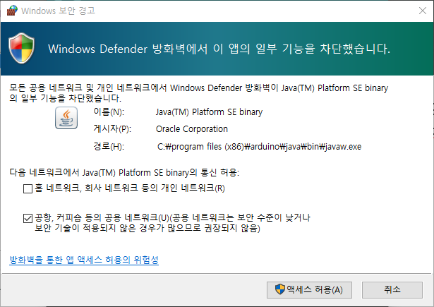

* 아두이노 IDE를 처음 켜면 윈도우 보안 경고 창이 뜰 수 있어요.
* 내부 컴파일러와 디버거 엔진이 로컬 네트워크 통신을 준비하는 안전한 과정이므로 **[액세스 허용(A)]** 버튼을 꼭 눌러주세요!

> 이번 슬라이드에서는 초기 구동 시 나타나는 방화벽 설정에 대해 다룹니다. 아두이노 IDE 내부의 컴파일 데몬 프로세스가 정상 작동하려면 로컬 포트 액세스가 허용되어야 하므로, 망설이지 말고 허용 버튼을 눌러주시면 됩니다.

---

## 🎯 2단계: 내 보드 이름 알려주기 (보드 설정)

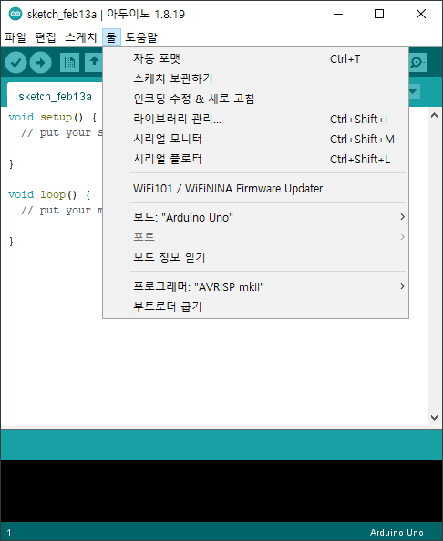
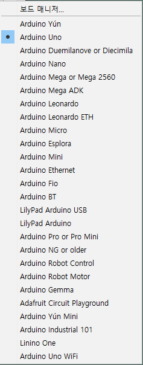
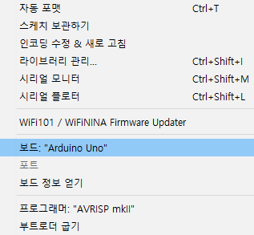

1. 상단 메뉴에서 **[툴(Tools)] ➔ [보드(Board)]**를 클릭해요.
2. 목록에서 우리가 사용하는 **[Arduino Uno]**를 찾아 클릭합니다!
3. 💡 **지니의 팁**: 보드를 잘못 고르면 컴파일러가 다른 칩 규격으로 번역해 버려 업로드 에러가 난답니다!

> 이번 슬라이드에서는 '🎯 2단계: 내 보드 이름 알려주기 (보드 설정)'을 살펴봅니다. 아두이노는 나노, 메가, 레오나르도 등 다양한 패밀리가 있습니다. 우리가 실습에 사용하는 표준 보드는 [Arduino AVR Boards] 그룹의 [Arduino Uno]이므로 정확하게 지정해 줍니다.

---

## 🔌 3단계: USB 케이블로 컴퓨터와 보드 연결!

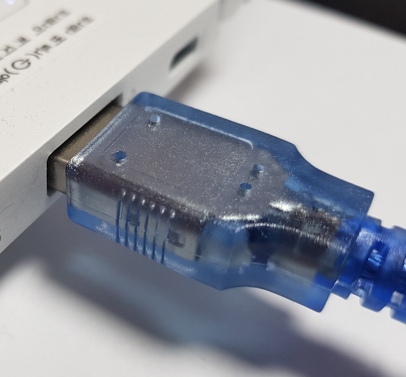
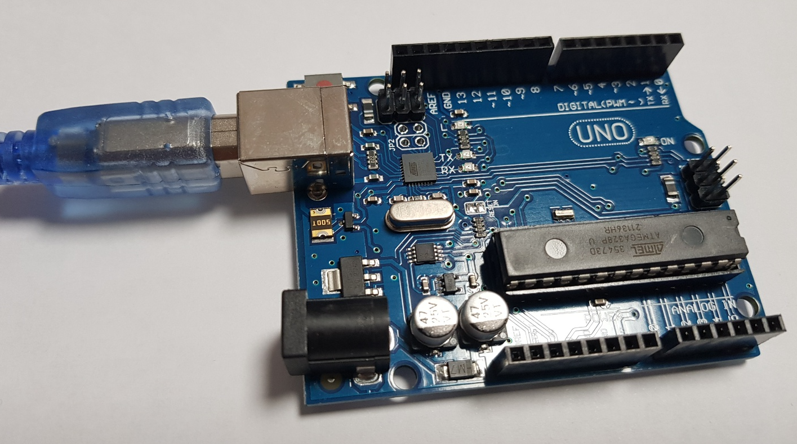

* 파란색 USB 케이블의 네모난 끝(Type-B)은 아두이노에, 납작한 끝(Type-A)은 컴퓨터 USB 포트에 꽂아요.
* 아두이노 보드의 초록색 **ON LED 불빛**이 환하게 켜지는지 확인해요!

> 이번 슬라이드에서는 물리적 하드웨어 연결을 확인합니다. 케이블을 연결했을 때 보드의 녹색 전원 표시등(ON)에 불이 들어와야 정상적으로 5V 직류 전원이 공급되고 있는 상태입니다.

---

## 🚪 4단계: 통신 문 번호 맞추기 (포트 설정)

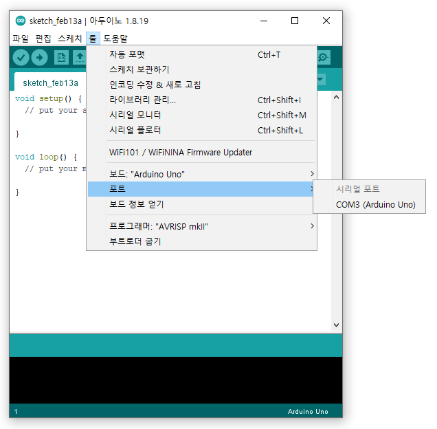

1. 상단 메뉴에서 **[툴(Tools)] ➔ [포트(Port)]**를 클릭해요.
2. `COM3`, `COM4`, `COM5` 처럼 숫자가 적힌 시리얼 통신 포트를 선택해요!
  * 맥(Mac) 컴퓨터라면 `/dev/cu.usbmodem...` 형태를 선택합니다.
3. 아두이노 보드 이름이 옆에 적혀 있거나, 케이블을 꽂았을 때 새로 나타난 번호가 바로 아두이노의 통신 문이랍니다!

> 이번 슬라이드에서는 포트(Port) 지정을 다룹니다. 운영체제가 아두이노 우노의 USB-to-Serial 변환 칩에 부여한 고유 가상 COM 포트 번호를 선택해 줌으로써 컴퓨터와 아두이노 간의 통신 고속도로가 개통됩니다.

---

## 🔍 5단계: 포트 번호가 헷갈릴 땐 '장치 관리자'!


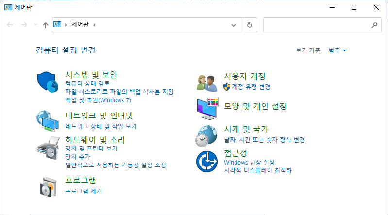
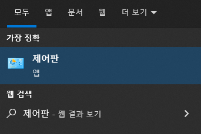
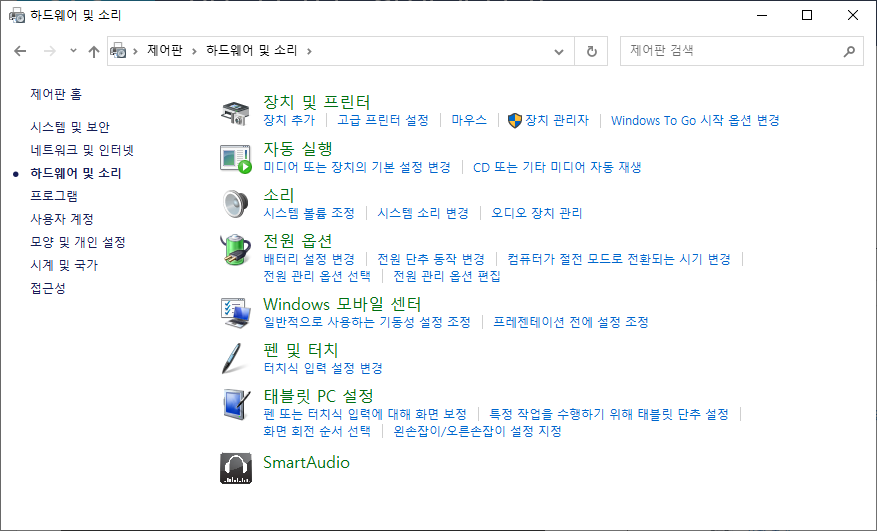
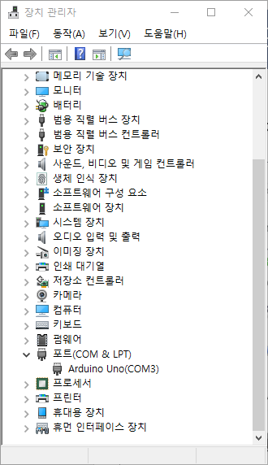

* 윈도우 시작 창에서 **"장치 관리자"**를 검색해 열어요.
* **[포트(COM & LPT)]** 항목을 펼치면 내 아두이노의 정확한 번호(예: `Arduino Uno (COM3)`)를 직접 눈으로 확인할 수 있어요!

> 여러 개의 USB 장치가 연결되어 있거나 포트 번호가 여러 개 떠서 헷갈릴 때는 윈도우의 '장치 관리자'를 열어 포트 목록을 확인하면 가장 확실하고 정확하게 확인할 수 있습니다.

---

## 📂 6단계: 첫 번째 마법 예제 'Blink' 열기

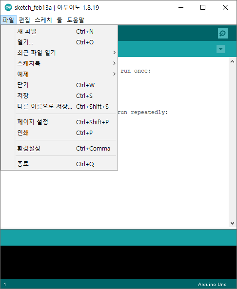
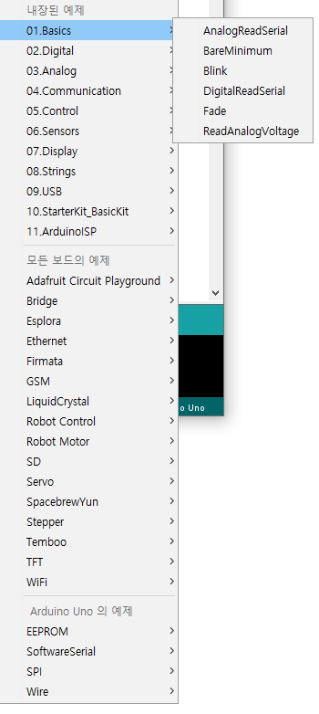
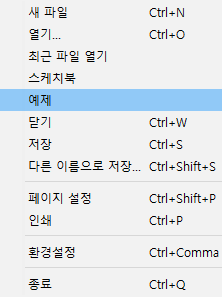

1. 상단 메뉴에서 **[파일(File)] ➔ [예제(Examples)]**로 들어가요.
2. **[01.Basics] ➔ [Blink]**를 차례대로 클릭합니다.
3. 짠! 아두이노 창작자들이 전 세계 메이커들을 위해 미리 완벽하게 준비해 둔 표준 점등 예제 코드가 새 창에 열려요!

> 아두이노 IDE에는 수많은 기초 및 센서 예제가 내장되어 있습니다. 'Blink'는 프로그래밍 세계의 'Hello World!'에 해당하는 가장 상징적인 첫 실습 코드입니다.

---

## 🚀 7단계: 화살표(➔) 업로드 버튼 클릭!

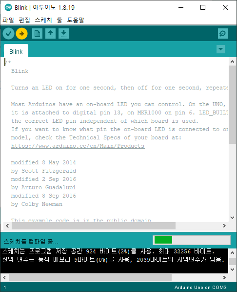
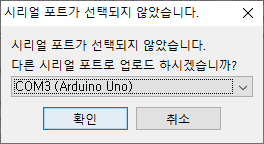

1. 에디터 왼쪽 위에 있는 **오른쪽 화살표(➔) [업로드] 버튼**을 꾹 누릅니다.
2. 아래쪽 검은색 콘솔 창에 **"스케치를 컴파일하는 중..."** ➔ **"업로드 완료"**가 뜨면 대성공!
3. 아두이노 보드의 작은 주황색 LED(13번)가 1초마다 깜빡깜빡 춤을 추기 시작해요!

> 업로드 버튼을 누르면 IDE 내부에서 컴파일러가 동작하여 C코드를 기계어로 번역한 뒤, 아두이노 부트로더와 통신하여 플래시 메모리에 고속으로 라이팅(Writing)을 완료합니다.

---

## ⚡ 8단계: 깜빡이 속도를 2배로 빠르게 바꿔볼까?

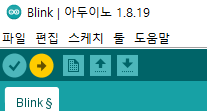

* 코드 속의 숫자 **`delay(1000);`** 을 찾아서 **`delay(500);`** 으로 바꿔보세요!
* 다시 **[→ (업로드)]** 버튼을 누르면 무슨 일이 일어날까요?
* 1000밀리초(1초)에서 500밀리초(0.5초)로 대기 시간이 절반으로 줄어들어 불빛이 2배나 빠르게 깜빡거려요!

```cpp
// Blink 예제: 0.5초(500ms) 주기로 빠르게 깜빡이도록 수정
void loop() {
  digitalWrite(LED_BUILTIN, HIGH);   // LED 켜기 (5V 공급)
  delay(500);                       // 0.5초(500ms) 동안 대기
  digitalWrite(LED_BUILTIN, LOW);    // LED 끄기 (0V 차단)
  delay(500);                       // 0.5초(500ms) 동안 대기
}
```

> 코드 속의 `delay()` 함수는 밀리초(1/1000초) 단위로 대기 시간을 설정합니다. 숫자를 변경하고 다시 업로드하는 것만으로 하드웨어의 동작 특성을 실시간으로 바꿀 수 있는 것이 바로 피지컬 컴퓨팅의 묘미입니다.

---

## 🎉 9단계: "만세! 불빛이 2배나 빨리 깜빡여!"

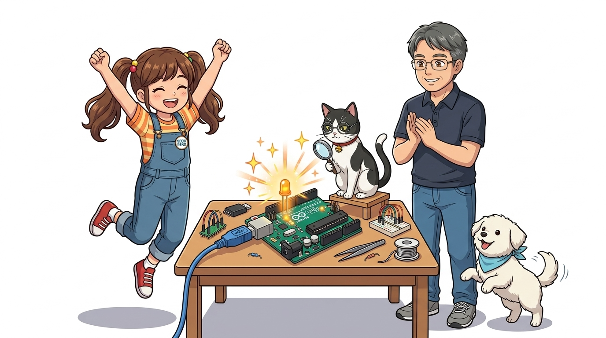

* **👧 도로시**: "우와 교수님, 지니야! 숫자 1000을 500으로 바꿨더니, 주황색 불빛이 깜빡! 깜빡! 2배나 신나게 춤을 춰요!"
* **👨‍🏫 호진 교수님**: "하하! 축하한다 도로시! 우리가 컴퓨터에 쓴 코드가 실제로 물리적인 빛의 리듬을 바꾼 것이란다!"
* **🐱 조수 지니**: "야옹! 숫자를 100으로 줄이면 심장박동처럼 콩닥콩닥 깜빡이고, 2000으로 늘리면 느긋하게 숨을 쉬듯 깜빡인답니다."
* **🐶 토토**: "멍멍! (불빛이 신나서 나도 꼬리가 절로 흔들린다 멍!)"

> 도로시의 성공적인 첫 코드 수정 장면입니다. 눈앞의 LED가 우리가 입력한 숫자에 반응하여 정확하게 작동하는 경험은 코딩에 대한 흥미와 성취감을 극대화해 줍니다.

---

## 🌟 미션 클리어! "나도 이제 아두이노 프로그래머!"


* **오늘 정복한 3가지 핵심 열쇠**:
  1. **보드 설정**: 내 보드는 바로 `Arduino Uno`!
  2. **포트 설정**: 내 통신 포트 번호(`COMx` 또는 `usbmodem`) 꼭 맞춰주기!
  3. **코드 수정과 업로드**: `delay()` 속 숫자를 바꾸고 화살표(➔)를 누르면 동작이 변해요!
* **👉 다음 모험**: 다음 015강에서는 마우스로 알록달록 블록을 조립하는 **"블록코딩 mBlock 맛보기"**로 떠나봅니다!

> 오늘 배운 '🌟 미션 클리어! "나도 이제 아두이노 프로그래머!"'의 핵심 내용을 모두 정리해 보았습니다. 보드와 포트 설정, 업로드 프로세스를 머릿속에 기억하시고 다음 015강에서 더욱 흥미진진한 블록 코딩의 세계로 떠나봅시다! 수고하셨습니다!