# 015_블록코딩_mBlock맛보기 🧱
### 영어가 어려워도 괜찮아! 레고 블록 맞추듯 신나는 코딩!

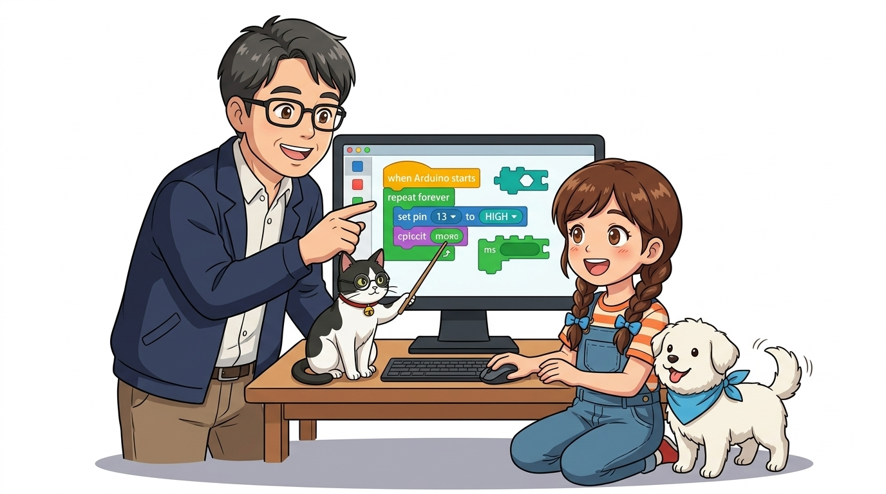

* **오늘의 탐험**: 글자 코딩 대신 알록달록 퍼즐 블록으로 아두이노를 움직여봐요!
* **선생님과 친구들**: 호진 교수님 & 조수 지니(고양이) & 도로시 & 토토

* 🖥️ **강의 슬라이드**: [slides.md](./slides.md)

---

## ❓ 교수님, 영어가 아직 서툰데도 아두이노를 할 수 있나요?


> **👧 도로시**: "교수님! `digitalWrite`나 세미콜론(`;`) 같은 영문 코드를 키보드로 치려니까 오타도 자주 나고 아직 좀 어려워요... 더 쉽고 직관적인 방법은 없을까요?"  
> **👨‍🏫 호진 교수님**: "걱정하지 마렴 도로시! 레고 블록을 맞추거나 스크래치를 하듯이, 마우스로 알록달록 퍼즐 블록을 찰칵찰칵 조립해서 아두이노를 제어하는 **'mBlock'**이라는 훌륭한 도구가 있단다!"  
> **🐱 조수 지니**: "야옹! 블록을 쌓으면 컴퓨터가 진짜 C++ 코드로 알아서 실시간 번역까지 해준답니다!"  
> **🐶 토토**: "멍멍! (퍼즐 맞추기 블록 코딩 신난다 멍!)"

---

## 🧩 1단계: 블록 코딩이란? (눈으로 보는 알고리즘)

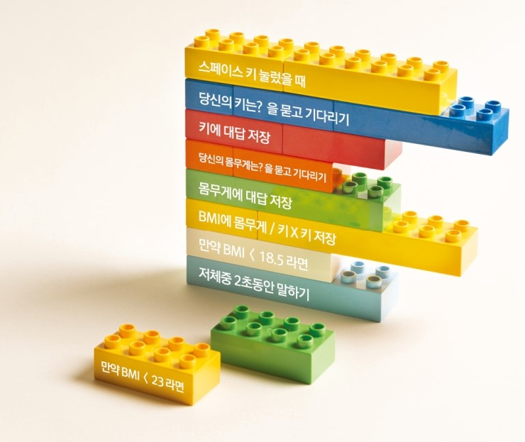

* **텍스트 코딩**: 스펠링 하나나 쉼표 하나만 틀려도 빨간 에러 창이 떠서 초보자에게 진입 장벽이 높아요.
* **블록 코딩**: 명령어가 적힌 예쁜 퍼즐 조각들을 위에서 아래로 마우스로 끼워 맞추기만 하면 완성!
* 오타 스트레스 없이 **"어떤 순서로 부품을 작동시킬까?"**라는 코딩의 핵심 논리력(컴퓨팅 사고력)을 쑥쑥 키울 수 있어요!

---

## 🌐 2단계: mBlock 설치 파일 다운로드

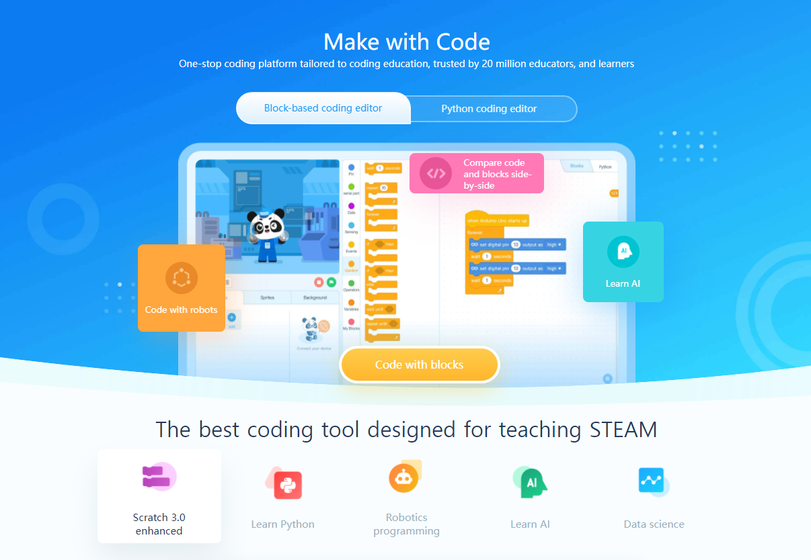

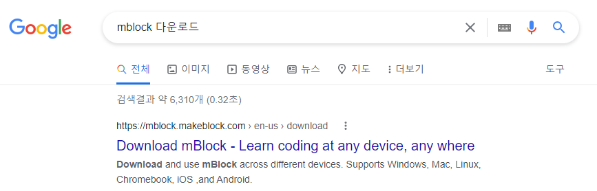
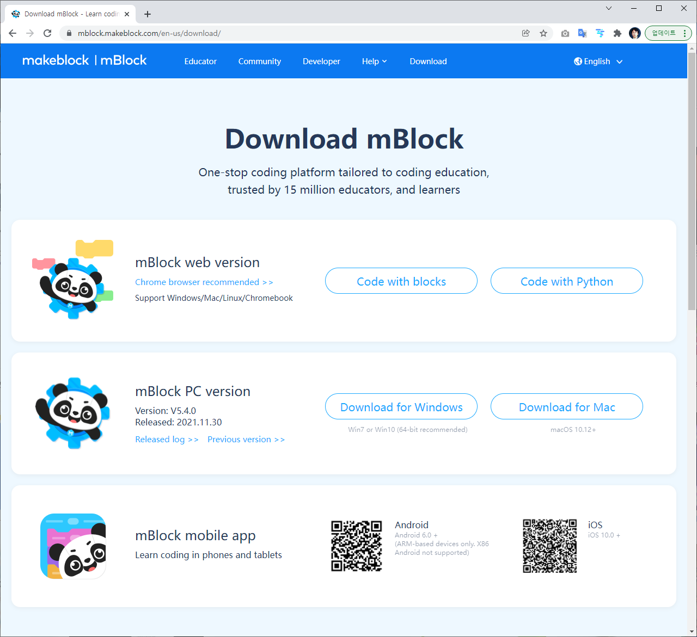

1. 인터넷 브라우저 검색창에 **"mBlock 다운로드"**라고 검색해요.
2. 공식 웹사이트(makeblock.com)에 접속해 내 컴퓨터 OS(윈도우 또는 맥OS)용 최신 버전을 다운로드합니다.

---

## 📦 3단계: 설치 마법사 & 통신 드라이버 허용

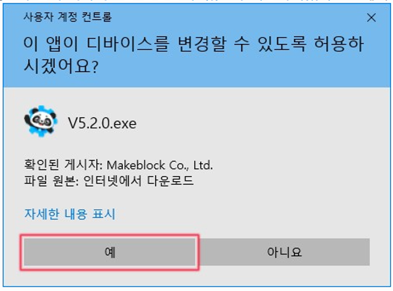
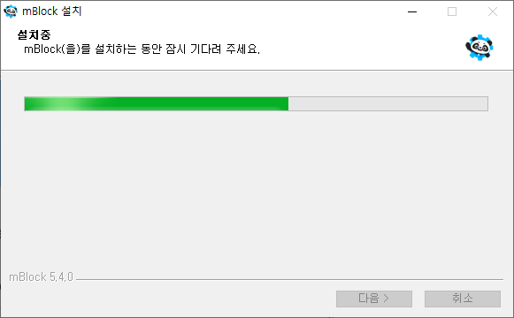
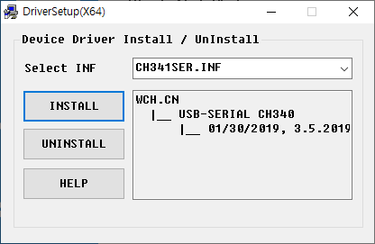
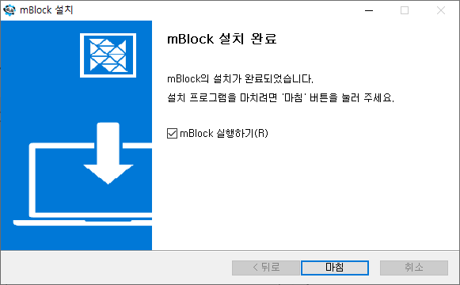

* 설치 과정 중 나타나는 **"장치 제어 허용"**과 **"USB 통신 드라이버(CH340/FTDI) 설치"** 창에서 모두 **[설치/허용]**을 클릭해요!
* 이 드라이버가 깔려야 컴퓨터가 아두이노 보드를 완벽하게 인식할 수 있습니다.

---

## 🐼 4단계: mBlock 실행하기!

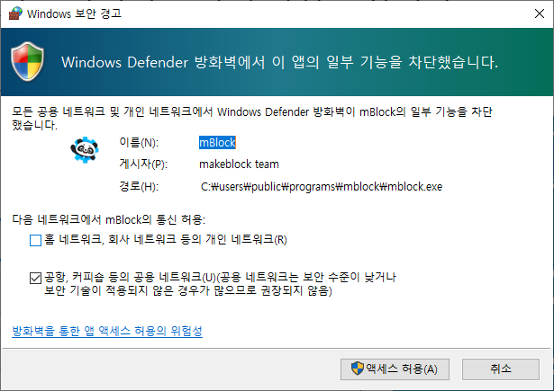

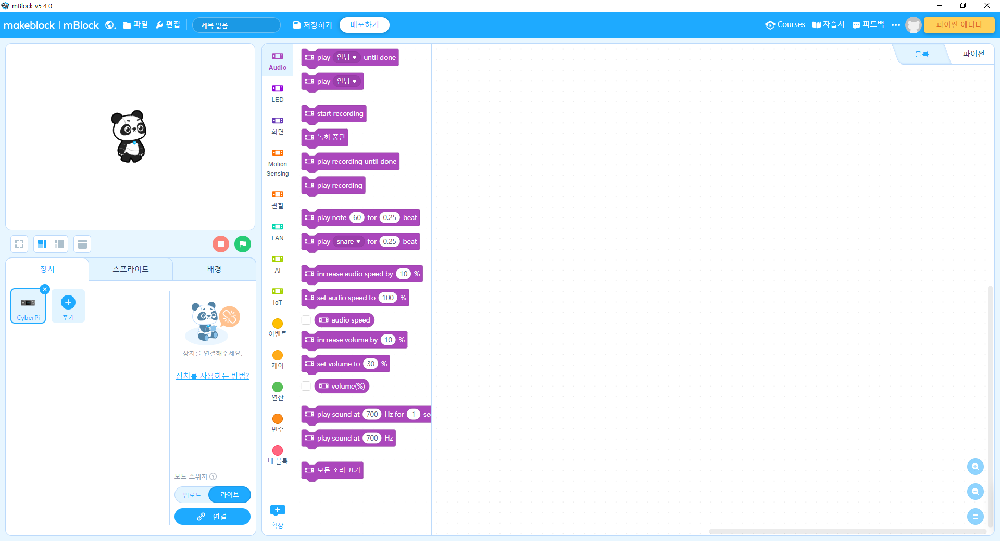

* 방화벽 팝업에서 **[액세스 허용]**을 누르면 귀여운 아기 판다 캐릭터가 반겨주는 mBlock 메인 화면이 활짝 열립니다!
* 왼쪽은 무대와 스프라이트, 가운데는 블록 팔레트, 오른쪽은 넓은 블록 코딩 작업 공간입니다.

---

## ➕ 5단계: 내 장치에 '아두이노 Uno' 추가!

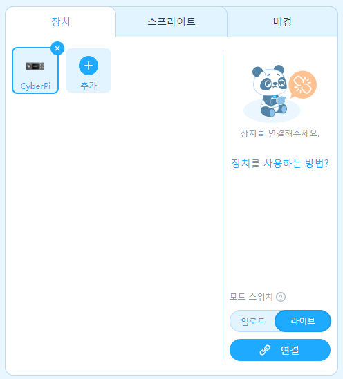
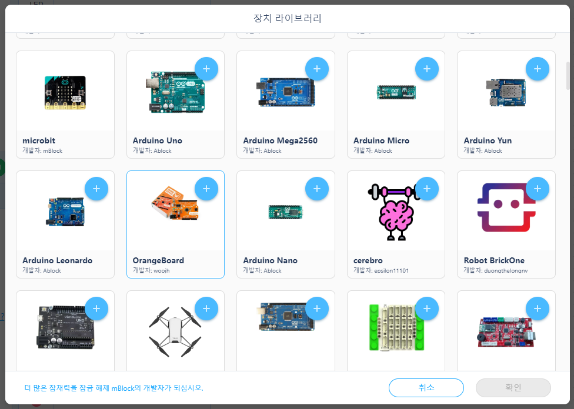
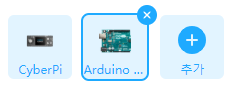

1. 화면 왼쪽 아래 **[장치(Devices)]** 탭에서 초록색 **[+ 추가]** 버튼을 클릭해요.
2. 지원되는 수많은 마이크로컨트롤러 보드 중에서 **[Arduino Uno]**를 선택하고 확인을 누릅니다!
3. 아두이노 핀을 제어할 수 있는 전용 마법 블록들이 팔레트에 짠! 나타납니다.

---

## 🔗 6단계: USB 포트 연결(Connect) 누르기

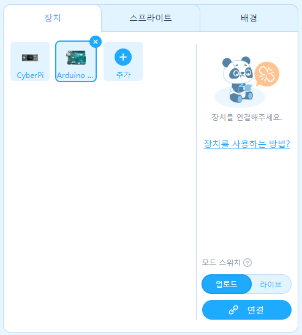
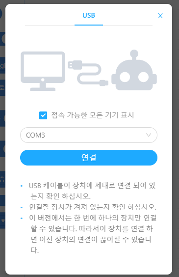

* 파란색 **[연결(Connect)]** 버튼을 누르고, 내 아두이노가 연결된 시리얼 포트(`COMx`)를 선택한 뒤 연결을 클릭해요!
* 연결이 정상적으로 완료되면 띠링~ 소리와 함께 버튼이 초록색 '연결됨' 상태로 바뀝니다.

---

## 🌈 7단계: 블록이 진짜 C언어 코드로 변신!

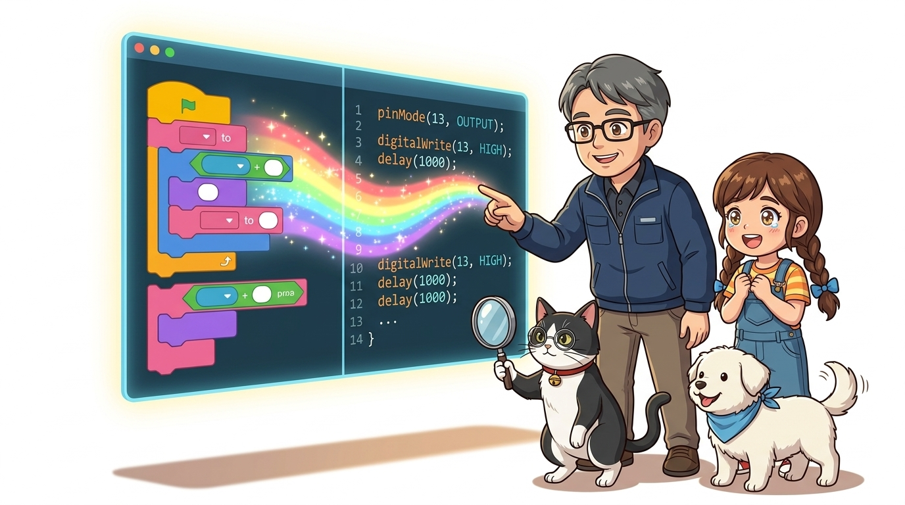

> **👧 도로시**: "우와 교수님, 지니야! 오른쪽 접혀 있던 창을 펼치니까, 내가 왼쪽에 놓은 퍼즐 블록 그대로 진짜 C++ 코드가 마법처럼 저절로 적혀 나와요!"  
> **👨‍🏫 호진 교수님**: "그렇단다 도로시! 블록 코딩은 단순한 놀이가 아니라, 진짜 프로그래밍 언어로 건너가는 가장 아름답고 튼튼한 무지개다리란다!"  
> **🐱 조수 지니**: "야옹! 블록 하나를 바꿀 때마다 오른쪽 C++ 코드가 실시간으로 어떻게 바뀌는지 비교해 보면 코딩 실력이 쑥쑥 자라요!"  
> **🐶 토토**: "멍멍! (블록도 배우고 C언어도 배우니 1석 2조다 멍!)"

---

## 💡 8단계: 깜빡이 블록 조립 & C코드 확인

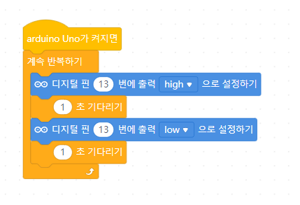

```cpp
// ==========================================
// mBlock5 블록 조립 시 자동 생성되는 C++ 코드
// ==========================================
#include <Arduino.h>

void setup() {
  pinMode(13, OUTPUT); // 13번 핀을 출력 모드로 설정
}

void loop() {
  digitalWrite(13, HIGH); // 13번 LED 켜기 (5V)
  delay(1000);            // 1초(1000ms) 대기
  digitalWrite(13, LOW);  // 13번 LED 끄기 (0V)
  delay(1000);            // 1초(1000ms) 대기
}
```

1. `[이벤트]`에서 `[아두이노가 켜지면]` 모자 블록을 가져와요.
2. `[제어]`에서 `[무한 반복하기]` 블록을 연결하고, 그 속에 `[디지털 13번 핀 켜기]` ➔ `[1초 기다리기]` ➔ `[디지털 13번 핀 끄기]` ➔ `[1초 기다리기]`를 쏙 넣어요!

---

## 🚀 9단계: 업로드 모드와 라이브 모드

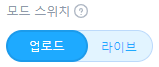

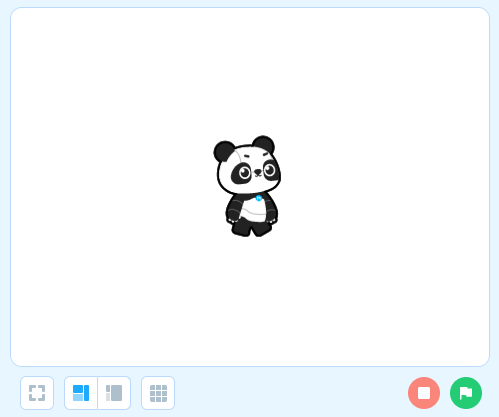
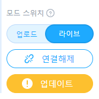

* **업로드 모드(Upload Mode)**: 아두이노 보드의 플래시 메모리에 코드를 직접 구워 넣어, 컴퓨터 USB 선을 뽑고 배터리만 연결해도 독립적으로 작동해요!
* **라이브 모드(Live Mode)**: 컴퓨터와 아두이노가 실시간 통신을 유지하며 초록 깃발을 누르면 화면의 판다와 아두이노가 함께 연동되어 동작해요!

---

## 💾 10단계: 파일 저장하기 & 작품 공유하기

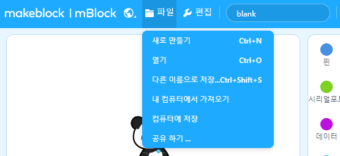
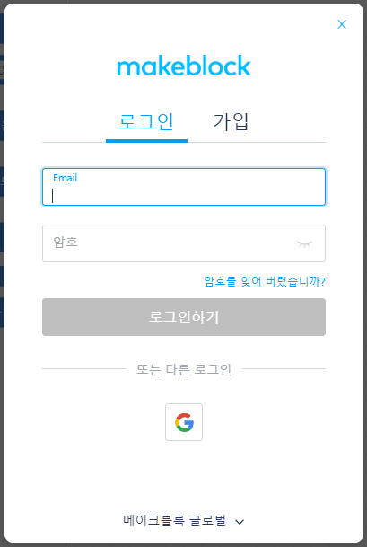

* 내가 조립한 소중한 블록 프로젝트는 **`[파일] ➔ [내 컴퓨터에 저장]`**을 눌러 언제든 다시 불러올 수 있어요.
* 파일 이름 끝에 `.mblock` 확장자가 붙어 안전하게 저장됩니다!

---

## 🌟 미션 클리어! "블록 코딩도 완벽 마스터!"


> **👧 도로시**: "교수님, 지니야! 알록달록 블록으로 먼저 알고리즘 순서를 눈으로 확인하고 C언어 코드를 보니까 하나도 안 어렵고 쏙쏙 이해돼요!"  
> **👨‍🏫 호진 교수님**: "대견하구나 도로시! 소프트웨어 작성 도구를 텍스트와 블록 모두 정복했으니, 다음 시간부터는 본격적으로 컴퓨터의 깊은 비밀인 **'016. 디지털 세상과 2진법'**으로 탐험을 떠나보자꾸나!"  
> **🐱 조수 지니**: "야옹! 0과 1이 어떻게 컴퓨터의 모든 마법을 부리는지 제가 신기한 이야기들을 들려드릴게요!"  
> **🐶 토토**: "멍멍! 다음 2진법 탐험으로 신나게 달려가자 멍!"

