# 016_디지털세상과_2진법 🌐

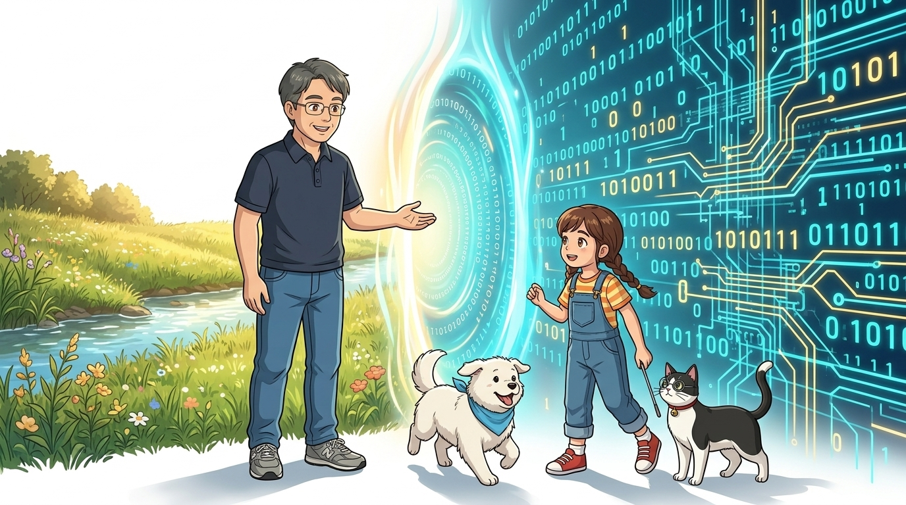

* **오늘의 탐험**: 현실 세계(아날로그)와 컴퓨터(디지털)는 어떻게 만나 소통할까?
* **선생님과 친구들**: 호진 교수님 & 조수 지니(고양이) & 도로시 & 토토

### 따뜻한 자연의 현실과 0과 1의 사이버 세상을 잇는 마법의 포털!
* 📖 **상세 강의 교재**: [index.md](./index.md)

> 여러분 안녕하세요! 호진 교수님 연구실에 오신 것을 환영합니다! 이번 시간에는 '016. 디지털 세상과 2진법 🌐'을 주제로, 우리가 살아가는 연속적인 자연(아날로그)의 세계와 컴퓨터가 이해하는 0과 1(디지털)의 세계가 어떻게 마법처럼 연결되는지 그 신비로운 원리를 탐험해 보겠습니다. 똑똑한 조수 지니, 호기심 많은 메이커 도로시, 귀여운 토토와 함께 신나는 모험을 시작해 봅시다!

---

## ❓ 컴퓨터는 어떻게 바깥 날씨를 알 수 있을까요?

* **👧 도로시**: "교수님! 사람은 눈으로 햇빛을 보고 피부로 따뜻한 온도를 느끼잖아요. 그런데 딱딱한 실리콘 칩으로 만들어진 아두이노는 어떻게 방이 어두워졌는지, 온도가 올라갔는지 알 수 있나요?"
* **👨‍🏫 호진 교수님**: "아주 날카롭고 훌륭한 질문이란다 도로시! 자연계의 물리적 자극을 전압 신호(0과 1의 숫자)로 번역해 주는 **'센서(Sensor)'**와, 계산된 숫자를 다시 물리적인 힘과 빛으로 구현해 주는 **'액추에이터(Actuator)'**가 있기 때문이란다!"
* **🐱 조수 지니**: "야옹! 그 사이에서 아두이노가 두뇌 역할을 맡아 빛의 세기를 숫자로 세고 판단하는 것이지요!"
* **🐶 토토**: "멍멍! (바깥세상과 통하는 신비한 감각 기관이네 멍!)"

> 자, 이번 슬라이드의 질문을 함께 보시겠습니다. 인간은 오감(시각, 청각, 촉각 등)을 통해 자연을 인지하지만, 전자기기는 오직 전압과 전류의 변화만을 감지할 수 있습니다. 피지컬 컴퓨팅(Physical Computing)은 센서와 액추에이터를 통해 현실의 아날로그 신호와 컴퓨터의 디지털 연산을 양방향으로 융합하는 첨단 기술입니다.

---

## 🔄 1단계: 입력 ➔ 생각 ➔ 출력 (피지컬 컴퓨팅)

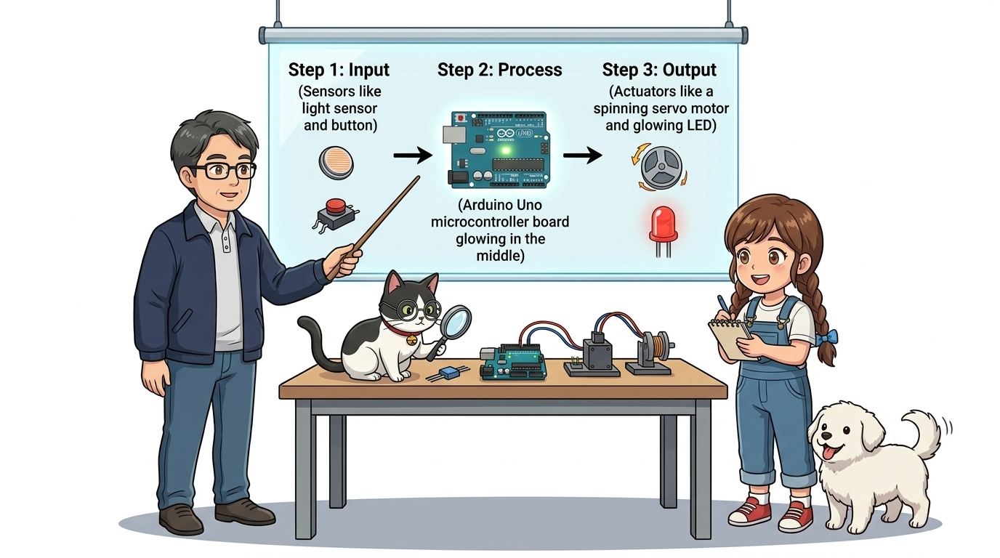

* 👁️ **1단계: Input (입력 / 센서)**: 빛, 소리, 온도를 감지해 아날로그 전압 신호로 바꿔요!
* 🧠 **2단계: Process (처리 / 아두이노 두뇌)**: 코드로 작성된 규칙에 따라 0과 1의 2진 신호로 계산하고 판단해요!
* 🦾 **3단계: Output (출력 / 액추에이터)**: 모터를 붕 돌리고, LED 불을 밝히며, 경보음을 울려요!

> 피지컬 컴퓨팅의 3대 핵심 메커니즘인 '입력(Input) - 처리(Process) - 출력(Output)'의 순환 고리입니다. 아두이노 프로젝트의 99%는 이 3단계를 바탕으로 설계됩니다.

---

## 🌈 2단계: 끝없이 이어지는 세상 vs 똑똑 끊어지는 숫자

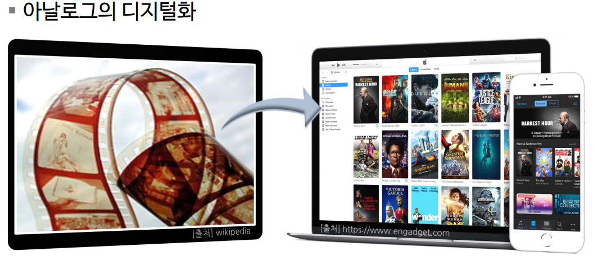
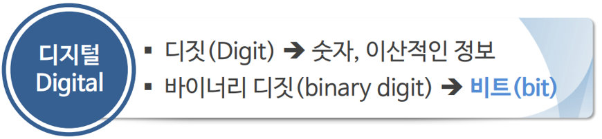
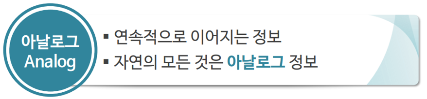

* **현실(아날로그, Analogue)**: 무지개 색이나 해질녘 하늘빛처럼 빈틈없이 부드럽게 연속적으로 변해요.
* **컴퓨터(디지털, Digital)**: 전기가 들어오는 1(HIGH, 5V)과 나가는 0(LOW, 0V)처럼 딱 떨어지는 숫자로만 세상을 이해해요.
* 아두이노는 이 연속적인 자연의 언어와 이산적인 디지털 언어를 실시간으로 매핑해 주는 최고의 통역사입니다!

> 현실 세계의 모든 물리량(소리, 압력, 온도, 조도)은 연속적인 아날로그 형태입니다. 반면 컴퓨터는 노이즈에 강하고 연산이 정확한 이진수(0과 1) 체계로 동작하기 때문에 둘 사이의 변환 기술이 필수적입니다.

---

## 🎛️ 3단계: 자연의 언어를 숫자로 번역하기 (ADC)

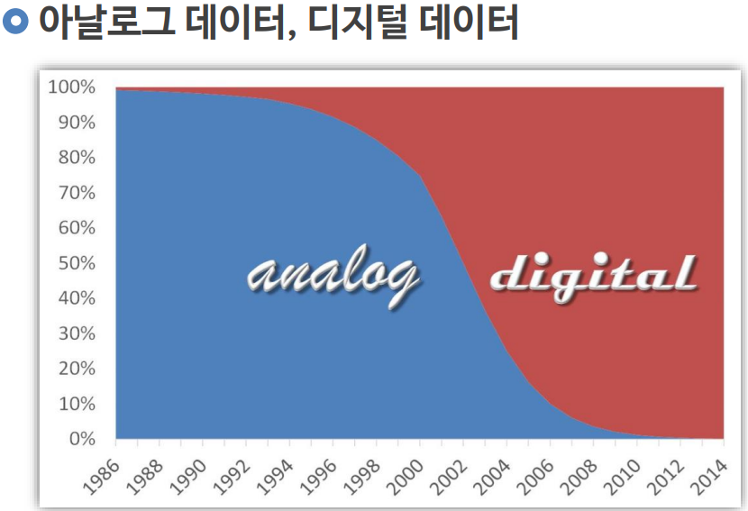
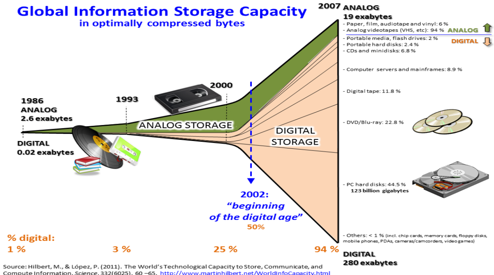

* **ADC (Analog to Digital Converter, 아날로그-디지털 변환기)**:
  * 빛 센서(Cds)가 만들어내는 0V~5V 사이의 연속적인 전압을 **0 ~ 1023 (총 1024단계, 10비트 해상도)**의 정수 숫자로 정밀하게 변환해 줘요!
  * 아두이노 우노 보드의 **A0 ~ A5 핀**이 바로 이 ADC 변환기 역할을 전담하고 있답니다.

> 아두이노 우노에 내장된 10비트 ADC는 입력 전압(0~5V)을 $2^{10} = 1024$ 등분하여 0V는 0, 5V는 1023으로 수치화합니다. 이를 통해 소프트웨어가 현실의 미세한 환경 변화를 정량적으로 계산할 수 있게 됩니다.

---

## 🚀 4단계: 상상이 현실이 되는 디지털 혁명

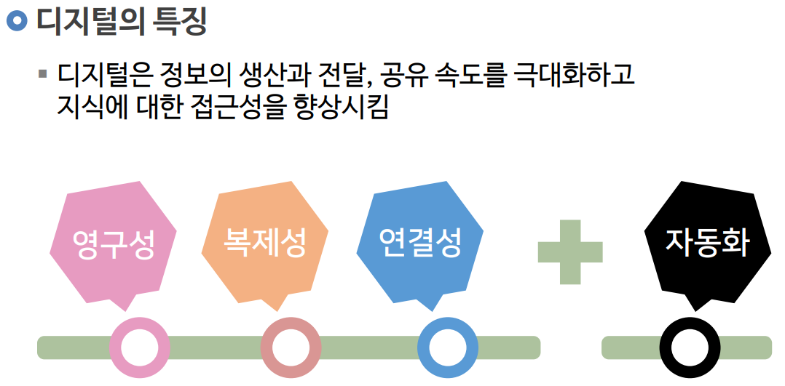

* 옛날에는 종이 지도, 필름 카메라, LP 레코드판처럼 물리적 매체에 아날로그 형태로 기록했어요.
* 지금은 사진, 음악, 지도가 모두 0과 1의 디지털 데이터로 변환되어 손바닥만 한 스마트폰 속에 쏙 들어갔어요!
* 100만 번을 복사해도 원본이 조금도 손상되지 않고, 인터넷을 타고 빛의 속도로 전 세계에 전송됩니다.

> 디지털 신호는 복제와 압축, 장거리 전송에 있어서 왜곡과 열화가 발생하지 않는다는 결정적인 장점이 있어 인류 문명의 정보 혁명을 이끌었습니다.

---

## 🏙️ 5단계: 모든 사물이 인터넷으로 연결돼요! (IoT)

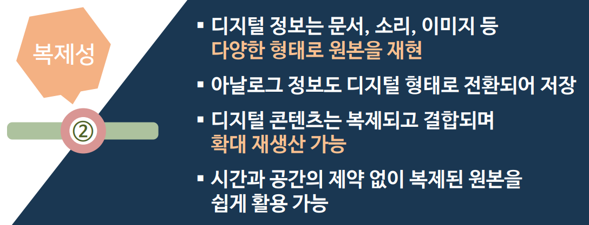
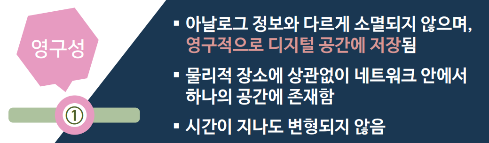
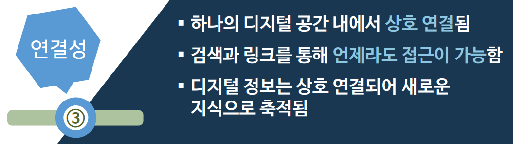

* 어두워지면 스스로 켜지는 스마트 가로등, 흙이 마르면 물을 주는 스마트 화분, 장애물을 피하는 스마트 모빌리티!
* 아두이노와 센서가 네트워크와 결합하면 주변 환경을 스스로 인지하고 판단하는 똑똑한 사물인터넷(IoT) 세상이 열립니다.

> 사물인터넷(IoT, Internet of Things)의 기본 단위 기기가 바로 센서와 마이크로컨트롤러, 통신 모듈이 결합된 임베디드 시스템입니다.

---

## 💡 6단계: 아이디어가 곧 제품이 되는 메이커(Maker) 문화

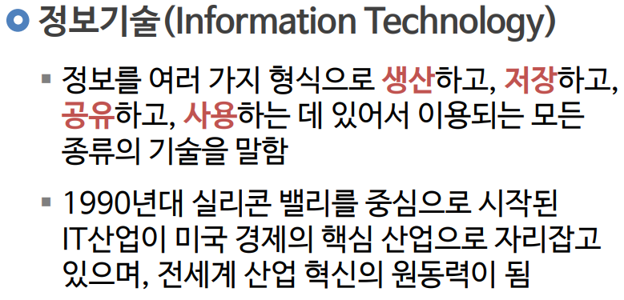
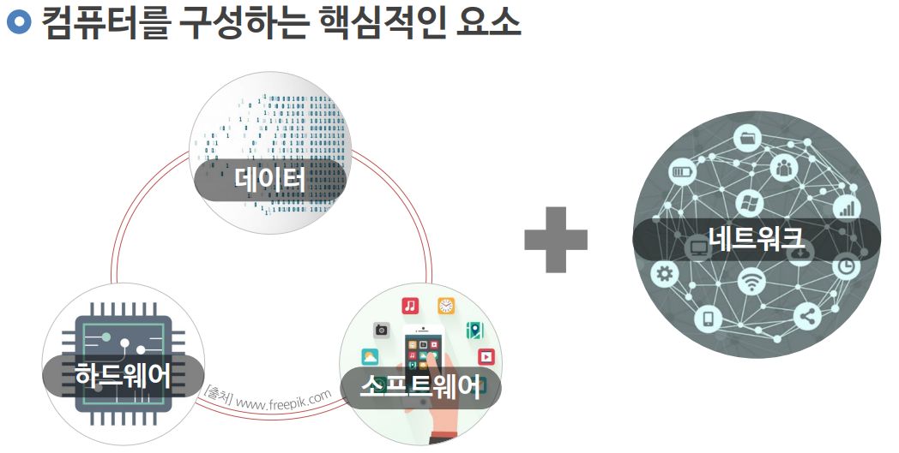

* 이제 거대한 공장이나 막대한 자본이 없어도, 누구나 내 책상 위에서 나만의 창의적인 발명품을 만들 수 있어요!
* 아두이노, 3D 프린터, 그리고 코딩 사고력만 갖추면 상상 속의 모든 로봇과 장치를 현실로 구현할 수 있답니다.

> 스스로 필요한 것을 직접 만들고 공유하는 메이커 무브먼트(Maker Movement)의 중심에 아두이노 오픈소스 하드웨어가 있습니다.

---

## 🌟 미션 클리어! "디지털 세상의 문을 열었어요!"

* **👧 도로시**: "교수님, 지니야! 센서가 아두이노의 눈과 귀가 되고, 코드가 0과 1로 생각하고, 모터와 LED가 씩씩한 손발이 된다는 피지컬 컴퓨팅의 원리를 완벽히 깨달았어요!"
* **👨‍🏫 호진 교수님**: "정말 훌륭하구나 도로시! 원리를 꿰뚫었으니 다음 017강에서는 이 모든 똑똑한 판단을 설계하는 핵심 비결인 **'컴퓨팅 사고력(Computational Thinking)의 힘'**을 길러보자꾸나!"
* **🐱 조수 지니**: "야옹! 문제를 쪼개고 규칙을 찾는 마법 같은 생각의 기술을 함께 배워봐요!"
* **🐶 토토**: "멍멍! 다음 생각 모험으로 힘차게 출발하자 멍!"

> 오늘 배운 '🌟 미션 클리어! "디지털 세상의 문을 열었어요!"'의 핵심 내용을 모두 정리해 보았습니다. 아날로그와 디지털의 차이, 피지컬 컴퓨팅의 3단계 구조를 머릿속에 기억하시고 다음 017강에서 더욱 깊이 있는 생각의 힘을 길러봅시다! 수고하셨습니다!