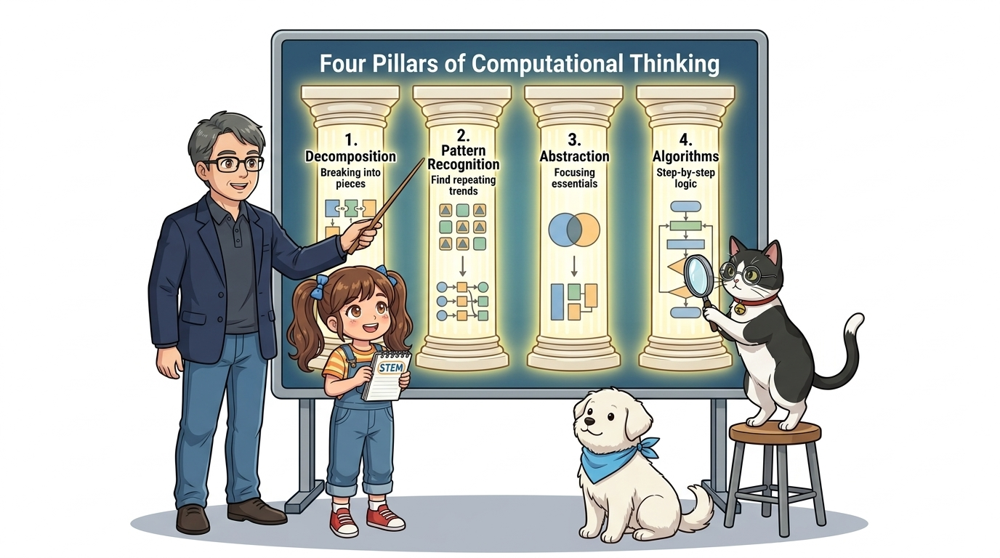
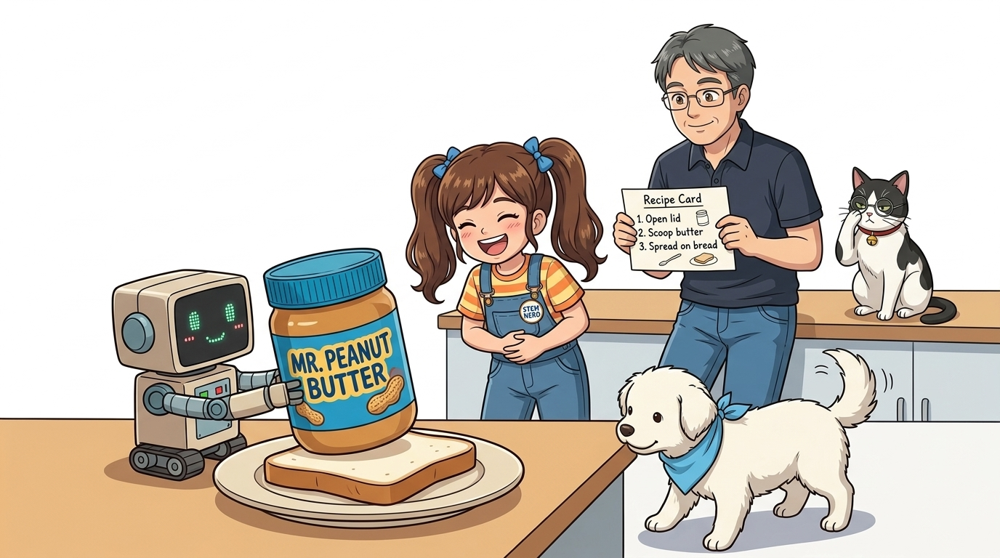
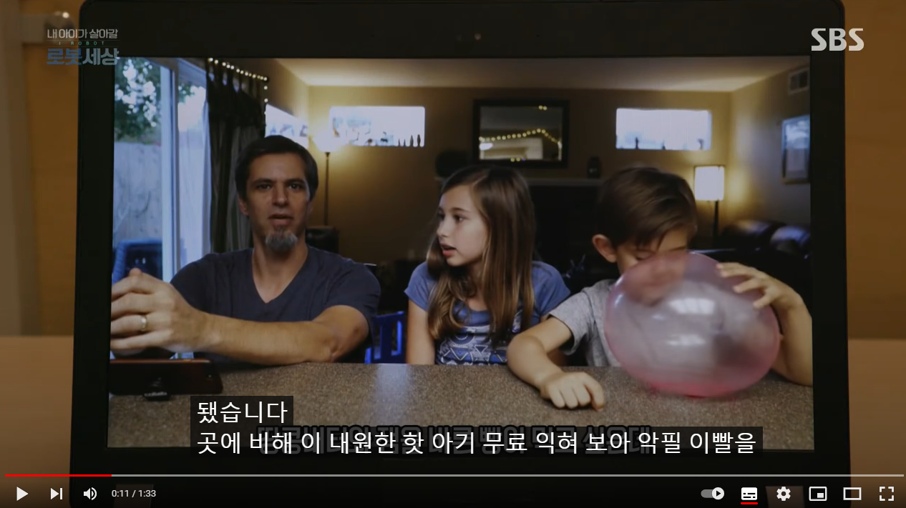
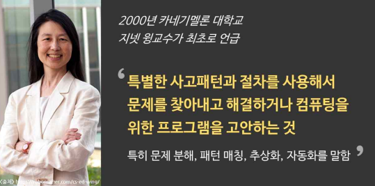
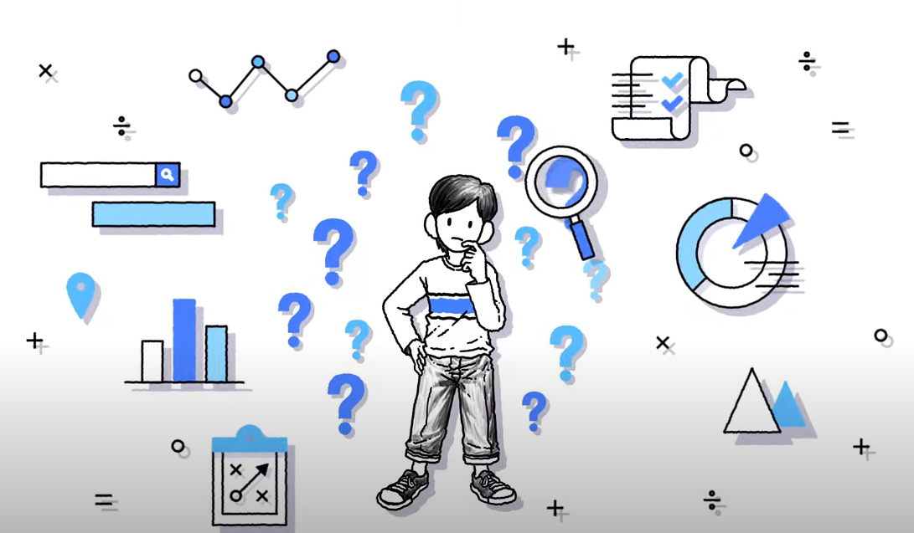
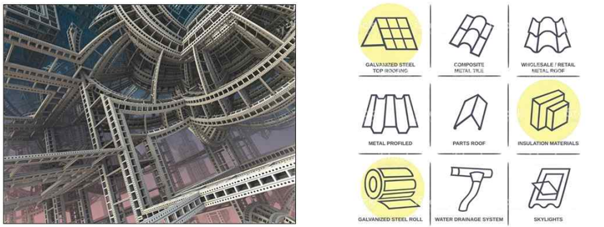
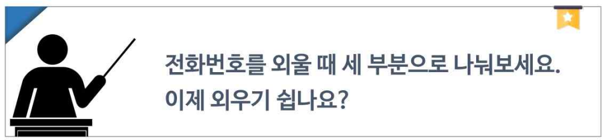
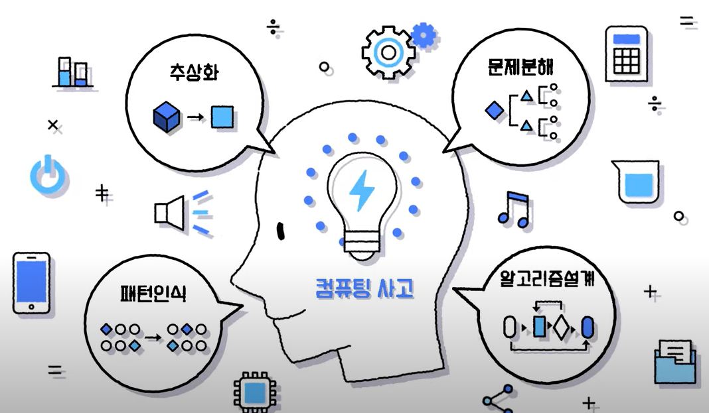
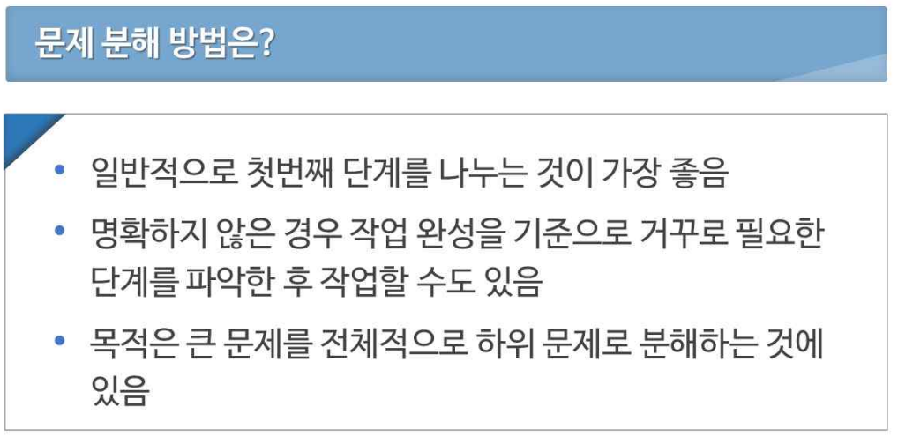
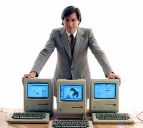

# 017_컴퓨팅사고력의_힘 🧠

* **오늘의 탐험**: 코딩을 잘하려면 문법보다 '생각하는 힘'이 먼저! 4대 핵심 기둥 배우기!
* **선생님과 친구들**: 호진 교수님 & 조수 지니(고양이) & 도로시 & 토토

### 똑똑한 로봇처럼 생각하고 문제를 해결하는 4가지 비밀 열쇠!
* 📖 **상세 강의 교재**: [index.md](./index.md)

> 여러분 안녕하세요! 호진 교수님 연구실에 오신 것을 환영합니다! 프로그래밍을 배울 때 가장 중요한 것은 어려운 영문 철자나 복잡한 문법을 외우는 것이 아닙니다. 진짜 중요한 것은 복잡한 문제를 만났을 때 당황하지 않고 논리적으로 쪼개어 해결책을 찾아내는 '생각하는 힘', 즉 **컴퓨팅 사고력(Computational Thinking)**입니다. 똑똑한 조수 지니 고양이와 재치 넘치는 도로시, 토토와 함께 4대 생각의 기둥을 정복해 봅시다!

---

## 🥪 교수님, 로봇한테 샌드위치를 만들어달라고 하면 어떻게 되나요?

* **👧 도로시**: "교수님! 로봇한테 '식빵에 땅콩버터 좀 발라줘!'라고 부탁했더니, 뚜껑도 안 연 잼 병을 식빵 위에 통째로 쾅 올려두고 멈춰버렸어요! 깔깔깔!"
* **👨‍🏫 호진 교수님**: "하하! 로봇과 컴퓨터는 사람처럼 '눈치'나 '상식'이 전혀 없단다. 그래서 1번부터 10번까지 아주 구체적이고 순서대로 설명해 주지 않으면 엉뚱한 행동을 하게 되지!"
* **🐱 조수 지니**: "야옹! 이렇게 컴퓨터가 알아들을 수 있도록 문제를 명확하게 쪼개고 순서화하는 지혜가 바로 **'컴퓨팅 사고력'**이랍니다."
* **🐶 토토**: "멍멍! (맛있는 냄새는 나는데 뚜껑을 먼저 열어야지 멍!)"

> 자, 이번 슬라이드의 질문을 함께 보시겠습니다. 인간은 일상적인 대화에서 수많은 맥락과 상식을 생략한 채 소통합니다. 하지만 컴퓨터 프로그램은 모든 단계를 명시적이고 논리적인 절차로 지시받아야만 올바르게 동작합니다. 이것이 알고리즘적 사고의 출발점입니다.

---

## 📝 1단계: 컴퓨터에게는 구체적으로 말해줘야 해요!

1. 🍞 식빵 봉지를 열고 빵 2장을 꺼내 평평한 접시에 놓는다.
2. 🥜 땅콩버터 뚜껑을 반시계 방향으로 돌려 연다.
3. 🍴 버터 나이프를 쥐고 땅콩버터를 1스푼 듬뿍 뜬다.
4. 🍯 식빵의 윗면에 나이프로 골고루 펴 바른다.
5. 🥪 남은 식빵 1장을 그 위에 반듯하게 덮는다! ➔ 컴퓨터는 이 순서 그대로 정확하게 실행해요!

> 일상적인 행동도 컴퓨터에게 명령할 때는 최소 실행 단위의 작업으로 분해해야 합니다. 프로그래밍이란 결국 사람이 머릿속으로 생각한 이 순서도를 코드로 옮겨 적는 작업입니다.

---

## 💡 2단계: 컴퓨팅 사고력 = '문제 해결의 지혜'

* 프로그래머뿐만 아니라 모든 사람이 복잡한 문제를 만났을 때 스마트하게 해결하는 인지적 사고방식이에요!
* 거대한 난관에 부딪혔을 때 포기하거나 당황하지 않고, 차근차근 문제를 풀어가는 21세기 미래 인재의 핵심 역량입니다.

> 카네기 멜론 대학의 지넷 윙(Jeannette Wing) 교수가 주창한 컴퓨팅 사고력은 컴퓨터 과학자처럼 생각하여 주변의 복잡한 시스템을 분석하고 해결책을 도출하는 융합적 문제 해결 방법론입니다.

---

## 🧩 3단계: [1] 문제 분해 - 큰 문제를 작은 조각으로!

* 거대한 바위를 한 번에 들 수 없듯, 큰 문제를 작은 조각(모듈)으로 쪼개요! (Decomposition)
* 예: **"자율주행 아두이노 자동차 만들기"**라는 큰 문제를 쪼개면?
  1. 초음파 센서로 전방 장애물 거리 측정하기
  2. 모터 드라이버로 바퀴 회전 제어하기
  3. 장애물이 15cm 이내면 후진 후 좌회전하기 등으로 손쉽게 나눌 수 있어요!

> 문제를 감당할 수 있는 작은 하위 문제로 분할하면, 복잡성이 극적으로 낮아지고 각 기능별로 집중하여 디버깅할 수 있습니다.

---

## 🔍 4단계: [2] 패턴 인식 - 반복되는 규칙 찾기!

* "어라? 이 동작은 아까 했던 것과 똑같은 주기로 반복되네!" (Pattern Recognition)
* 신호등 불빛이 **빨강 ➔ 초록 ➔ 노랑 ➔ 빨강** 순서로 무한 반복되듯, 규칙을 발견하면 코드를 수백 줄 쓰지 않고 단 몇 줄의 반복문(`loop`, `for`)으로 스마트하게 해결할 수 있어요!

> 데이터나 프로세스 속에서 공통된 패턴을 찾아내는 능력은 소프트웨어의 효율성을 높이고 코드 중복을 제거하는 핵심 열쇠입니다.

---

## 🎨 5단계: [3] 추상화 - 핵심만 남기고 덜어내기!

* 불필요하고 복잡한 세부 묘사는 과감히 지우고, **가장 본질적인 뼈대만 쏙 뽑아내는 기술**이에요! (Abstraction)
* 지하철 노선도가 실제 도로의 굽이침과 지형을 다 그리지 않고 직선과 환승역 이름만 단순하게 보여주듯, 우리 코드도 핵심 동작만 명확하게 간추려야 실수가 없습니다.

> 추상화는 복잡성을 단순화하여 시스템의 핵심 인터페이스에만 집중할 수 있게 해 주는 컴퓨터 과학 최고의 무기입니다.

---

## 🗺️ 6단계: [4] 알고리즘 - 문제 해결의 보물 지도!

* 1단계 출발 ➔ 2단계 판단 ➔ 3단계 도착! 순서대로 따라가면 보물 상자에 도달하는 요리 레시피! (Algorithm)
* **순서도(Flowchart)**나 슈도코드(의사코드)로 단계별 실행 흐름을 명확하게 시각화하는 과정입니다.

> 알고리즘은 명확하게 정의된 입력에서 원하는 출력을 얻기까지의 유한한 단계별 절차입니다. 컴퓨터는 이 절차를 단 1초의 오차도 없이 신속하게 수행합니다.

---

## 🌟 미션 클리어! "나도 이제 논리적인 생각 대장!"

* **컴퓨팅 사고의 4대 기둥 총정리**:
  1. 🧩 **문제 분해(Decomposition)**: 큰 문제를 작은 덩어리로 쪼개기!
  2. 🔍 **패턴 인식(Pattern Recognition)**: 반복되는 규칙과 공통점 찾기!
  3. 🎨 **추상화(Abstraction)**: 군더더기는 덜어내고 핵심 뼈대만 남기기!
  4. 🗺️ **알고리즘(Algorithm)**: 순서대로 따라 하면 해결되는 단계별 지도 만들기!
* **👉 다음 모험**: 이 강력한 4가지 힘을 가지고 다음 018강에서는 **"코딩과 알고리즘이란?"**을 탐험해 봅시다!

> 오늘 배운 '🌟 미션 클리어! "나도 이제 논리적인 생각 대장!"'의 핵심 내용을 모두 정리해 보았습니다. 컴퓨팅 사고의 4대 기둥을 가슴에 새기고, 다음 018강에서 코딩과 알고리즘의 진정한 매력 속으로 함께 떠나봅시다! 수고하셨습니다!