# 018_코딩과_알고리즘이란 💻

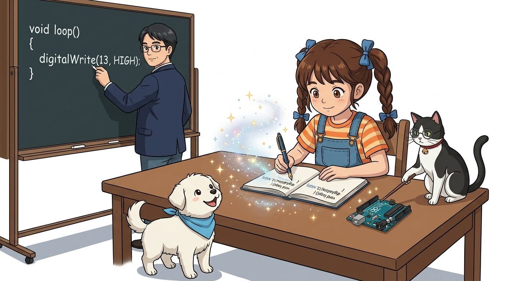

* **오늘의 탐험**: 코딩의 진짜 의미와 프로그래밍 역사의 발전, 왜 C언어를 배울까?
* **등장인물**: 이호진 교수님, 연구실 조수 지니(고양이), 학생 도로시, 토토

### 컴퓨터와 기계에게 마법 주문을 거는 새로운 언어의 세계!
* 📖 **상세 강의 교재**: [index.md](./index.md)

> 여러분 안녕하세요! 이번 시간에는 '018. 코딩과 알고리즘이란 💻'을 주제로 함께 흥미진진한 탐험을 떠나보겠습니다. 오늘 강의에서는 호진 교수님의 쉽고 명쾌한 설명과 조수 지니의 꼼꼼한 어시스트, 그리고 호기심 가득한 도로시와 귀여운 토토와 함께 코딩의 진짜 의미와 프로그래밍 역사의 발전, 그리고 아두이노가 왜 C언어를 사용하는지 핵심 원리를 차근차근 배워보겠습니다. 준비되셨나요?

---

## ❓ 왜 '글쓰기'를 코딩이라고 불러요?

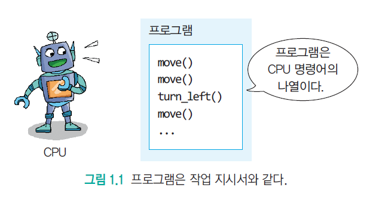

* **👧 도로시**: "교수님! 우리가 키보드로 글자를 치는 건데, 왜 그냥 글쓰기라고 안 하고 '코딩(Coding)'이라고 멋지게 불러요?"
* **👨‍🏫 호진 교수님**: "'Code(코드)'는 원래 컴퓨터나 사람 사이의 비밀 암호나 규칙을 뜻한단다. 여기에 동작을 뜻하는 '~ing'가 붙어서 **'컴퓨터가 알아듣는 명령 규칙으로 글(명령서)을 작성하는 행동'**을 코딩이라고 부르는 거지!"
* **🐱 조수 지니**: "야옹! 제가 안경을 쓰고 코드를 검사하듯, 컴퓨터가 오해하지 않도록 정확한 문법 규칙을 지켜 써야 한답니다!"
* **🐶 토토**: "멍멍! (컴퓨터한테 보내는 마법 편지네 멍!)"

> 자, 이번 슬라이드의 질문을 함께 보시겠습니다. 바로 '❓ 왜 글쓰기를 코딩이라고 불러요?'라는 질문입니다. 도로시의 궁금증에 호진 교수님이 코딩의 어원과 참뜻을 명쾌하게 설명해 주셨죠. 지니 조수와 토토의 응원과 함께, 컴퓨터와 소통하는 언어의 원리를 파헤쳐 보겠습니다.

---

## 📜 1단계: 프로그램은 문제 해결 레시피!

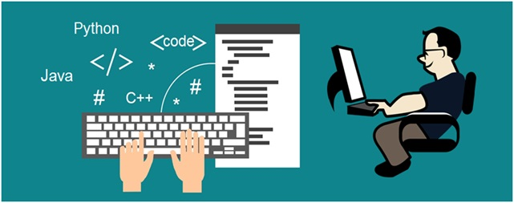
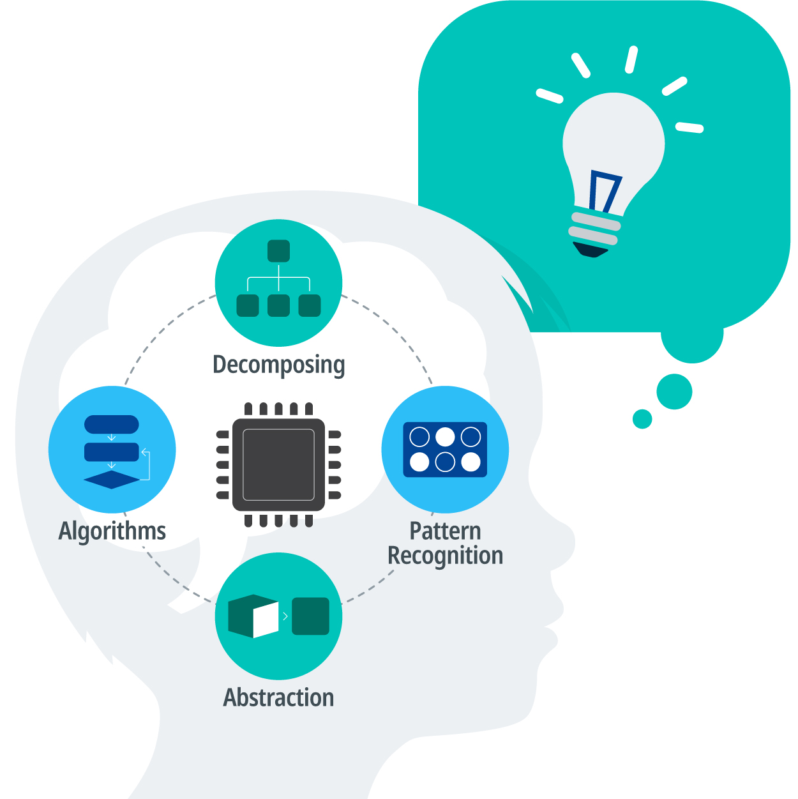

* **프로그램(Program)**: 문제를 해결하기 위한 명령문들의 집합체!
* 우리가 지난 시간에 배운 **'컴퓨팅 사고력(머릿속 생각)'**을 컴퓨터가 직접 일할 수 있도록 키보드로 구현하는 도구가 바로 **'코딩'**이에요!

> 이번 슬라이드에서는 '📜 1단계: 프로그램은 문제 해결 레시피!'에 대해 자세히 살펴보겠습니다. 화면의 다이어그램과 사진을 함께 참고해 주시기 바랍니다. 첫 번째 핵심은 프로그램(Program): 문제를 해결하기 위한 명령문들의 집합체!이며, 두 번째로는 우리가 지난 시간에 배운 '컴퓨팅 사고력(머릿속 생각)'을 컴퓨터가 직접 일할 수 있도록 키보드로 구현하는 도구가 바로 '코딩'이에요!입니다. 이 원리는 아두이노 시스템 전체를 관통하는 핵심 논리이므로 머릿속에 꼭 정리해 두시기 바랍니다.

---

## 📜 2단계: 종이에 구멍을 뚫던 시절 (천공 카드)

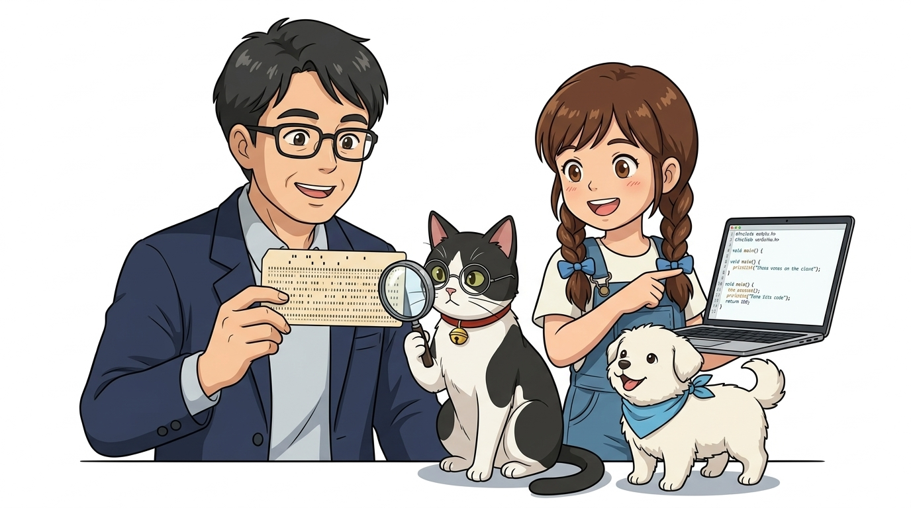

* **👨‍🏫 호진 교수님**: "자 도로시, 이 종이 카드를 보렴. 옛날에는 키보드나 모니터가 없어서 두꺼운 종이에 구멍을 뚫어(천공카드) 컴퓨터에 넣었단다."
* **👧 도로시**: "우와! 종이에 구멍을 뚫어서 명령을 전달했다고요? 신기해요!"
* **🐱 조수 지니**: "구멍이 뚫리면 1(전기 통함), 안 뚫리면 0(전기 차단)! 즉 2진법 전기로 컴퓨터와 대화했던 역사의 증거랍니다."
* **🐶 토토**: "멍멍! (지금은 화면에 글자만 치면 되니 정말 편해졌어 멍!)"

> 이번 슬라이드에서는 '📜 2단계: 종이에 구멍을 뚫던 시절 (천공 카드)'에 대해 자세히 살펴보겠습니다. 화면의 다이어그램과 사진을 함께 참고해 주시기 바랍니다. 이 원리는 아두이노 시스템 전체를 관통하는 핵심 논리이므로 머릿속에 꼭 정리해 두시기 바랍니다.

---

## 🔌 3단계: 전선 갈아 끼우기 ➔ 기계어 ➔ C언어

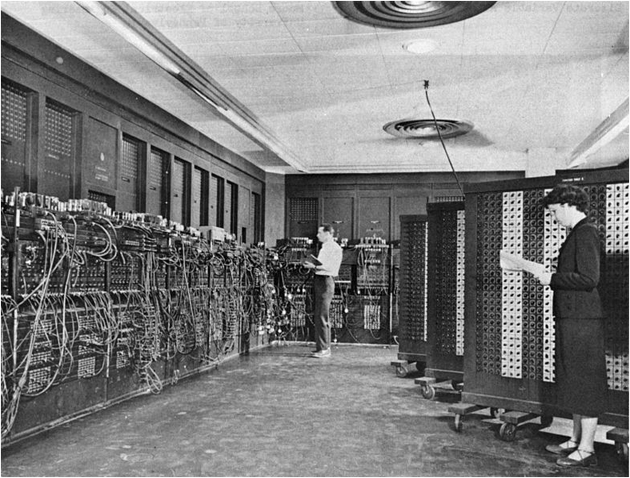
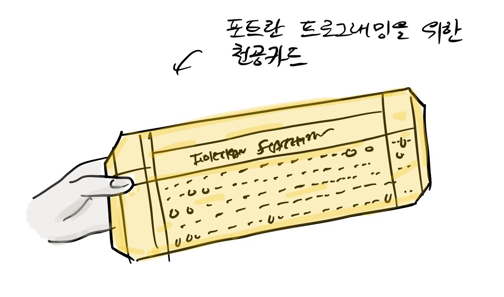
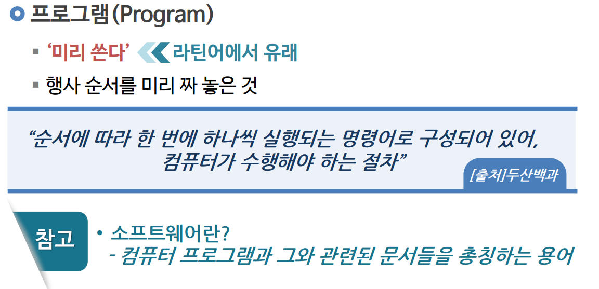

1. **1세대 (전선 배선)**: 에니악 컴퓨터처럼 손으로 전선을 일일이 뽑았다 꽂았어요.
2. **2세대 (천공카드 / 기계어)**: 0과 1 숫자를 종이 카드에 펀칭했어요.
3. **3세대 (고급 언어 - C언어, 파이썬)**: 사람이 쓰는 영어 문장과 기호로 쉽고 명확하게 코딩해요!

> 이번 슬라이드에서는 '🔌 3단계: 전선 갈아 끼우기 ➔ 기계어 ➔ C언어'에 대해 자세히 살펴보겠습니다. 화면의 다이어그램과 사진을 함께 참고해 주시기 바랍니다. 첫 번째 핵심은 세대 (전선 배선): 에니악 컴퓨터처럼 손으로 전선을 일일이 뽑았다 꽂았어요.이며, 두 번째로는 세대 (천공카드 / 기계어): 0과 1 숫자를 종이 카드에 펀칭했어요.입니다. 여기에 덧붙여 세대 (고급 언어 - C언어, 파이썬): 사람이 쓰는 영어 문장과 기호로 쉽고 명확하게 코딩해요! 내용까지 함께 이해해 두시면 완벽합니다. 이 원리는 아두이노 시스템 전체를 관통하는 핵심 논리이므로 머릿속에 꼭 정리해 두시기 바랍니다.

---

## ⚡ 4단계: 아두이노가 C언어를 사랑하는 3가지 이유

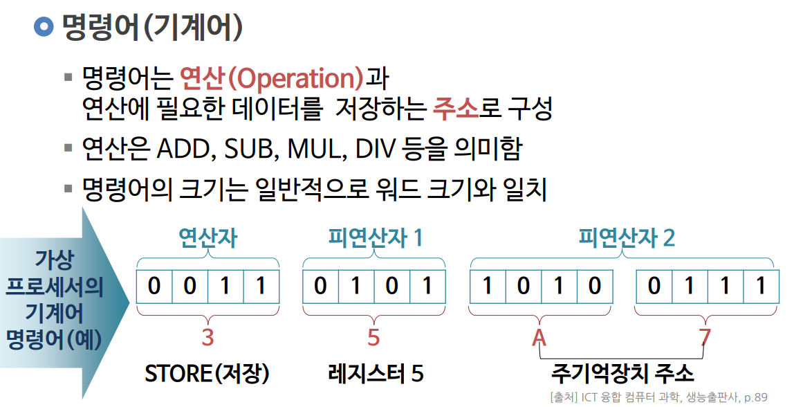
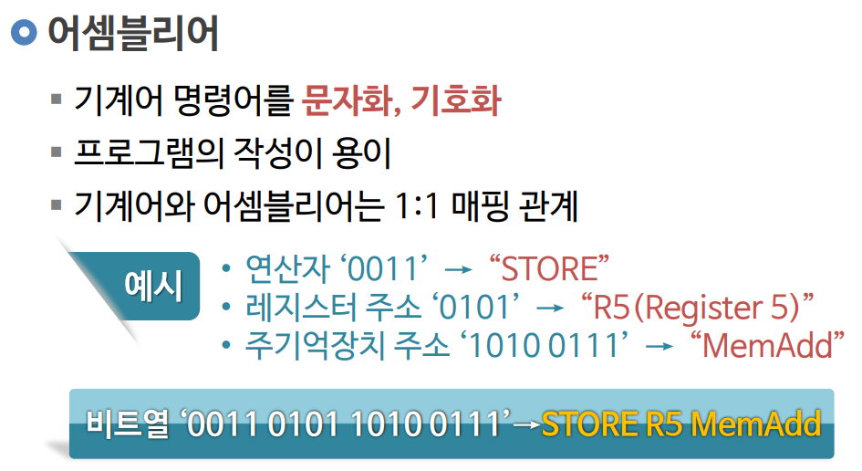

1. 🏎️ **빛처럼 빠른 속도**: 전기가 흐르는 하드웨어를 0.000001초 단위로 빠르게 제어해요!
2. 💾 **초소형 메모리 최적화**: 32KB의 작은 아두이노 칩에도 가볍고 날렵하게 쏙 들어가요!
3. 📌 **핀 직접 제어**: 13번 핀, 2번 핀의 전압을 마음대로 정밀하게 다룰 수 있어요!

> 이번 슬라이드에서는 '⚡ 4단계: 아두이노가 C언어를 사랑하는 3가지 이유'에 대해 자세히 살펴보겠습니다. 화면의 다이어그램과 사진을 함께 참고해 주시기 바랍니다. 첫 번째 핵심은 🏎️ 빛처럼 빠른 속도: 전기가 흐르는 하드웨어를 0.000001초 단위로 빠르게 제어해요!이며, 두 번째로는 💾 초소형 메모리 최적화: 32KB의 작은 아두이노 칩에도 가볍고 날렵하게 쏙 들어가요!입니다. 여기에 덧붙여 📌 핀 직접 제어: 13번 핀, 2번 핀의 전압을 마음대로 정밀하게 다룰 수 있어요! 내용까지 함께 이해해 두시면 완벽합니다. 이 원리는 아두이노 시스템 전체를 관통하는 핵심 논리이므로 머릿속에 꼭 정리해 두시기 바랍니다.

---

## 🪜 5단계: 블록 코딩(mBlock) ➔ 텍스트 코딩(C언어)

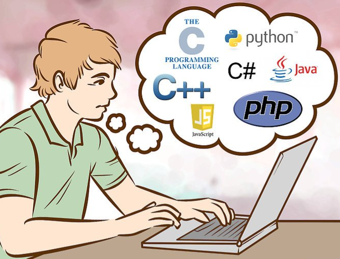
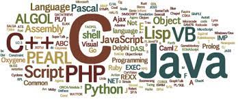

* 처음에는 mBlock 같은 블록 코딩으로 전체적인 알고리즘의 순서와 원리를 익혀요.
* 자신감이 붙으면 아두이노 C언어로 건너와서 나만의 정밀한 로봇 프로그램을 자유자재로 만들 수 있어요!

> 이번 슬라이드에서는 '🪜 5단계: 블록 코딩(mBlock) ➔ 텍스트 코딩(C언어)'에 대해 자세히 살펴보겠습니다. 화면의 다이어그램과 사진을 함께 참고해 주시기 바랍니다. 첫 번째 핵심은 처음에는 mBlock 같은 블록 코딩으로 전체적인 알고리즘의 순서와 원리를 익혀요.이며, 두 번째로는 자신감이 붙으면 아두이노 C언어로 건너와서 나만의 정밀한 로봇 프로그램을 자유자재로 만들 수 있어요!입니다. 이 원리는 아두이노 시스템 전체를 관통하는 핵심 논리이므로 머릿속에 꼭 정리해 두시기 바랍니다.

---

## 🌟 미션 클리어! "나도 이제 진짜 코더(Coder)!"

* **오늘 배운 코딩의 참뜻**:
1. 💻 **코딩**: 컴퓨터에게 일할 순서를 알려주는 마법 명령서 작성하기!
2. 📜 **역사**: 구멍 뚫던 천공카드에서 이제는 영어 C언어로 똑똑하게 코딩해요.
3. 🚀 **아두이노**: C언어로 핀을 직접 다뤄 세상을 깜짝 놀라게 할 발명품을 만들어요!
* **👉 다음 모험**: 이제 진짜 코드가 실행되는 심장부인 **"01.5-1 코드는 어떻게 차례대로 움직일까?"**를 배우러 떠나요!

> 오늘 배운 '🌟 미션 클리어! "나도 이제 진짜 코더(Coder)!"'의 핵심 내용을 모두 정리해 보았습니다. 오늘 다룬 내용 중에서도 오늘 배운 코딩의 참뜻 부분은 앞으로의 아두이노 실습과 프로젝트에서 계속 사용되는 매우 중요한 기초 지식입니다. 오늘 배운 내용을 꼭 다시 한번 복습해 보시고, 다음 강의에서 더욱 신나고 유익한 모험으로 다시 만나겠습니다. 모두 수고 많으셨습니다!