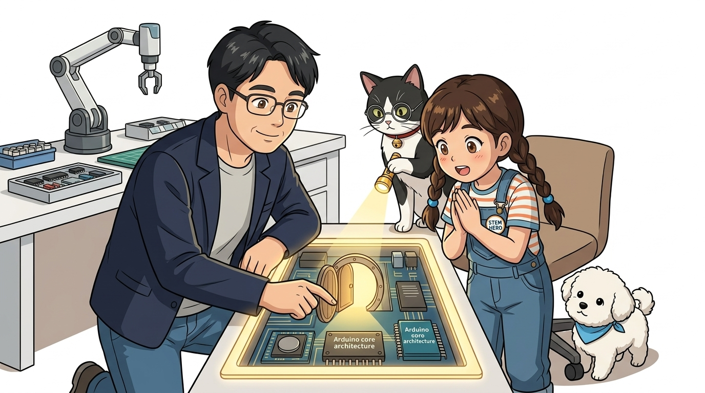
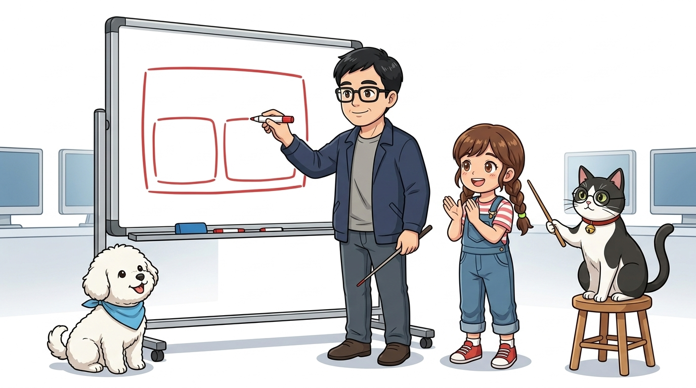
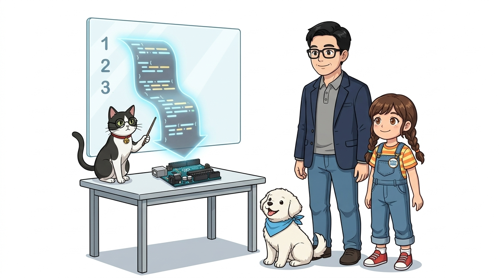
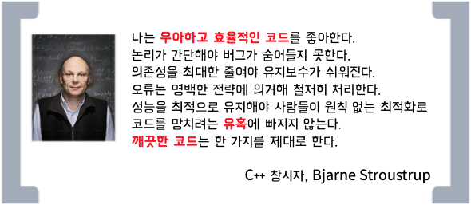
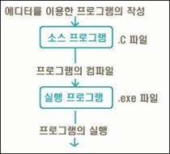
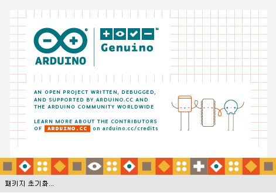
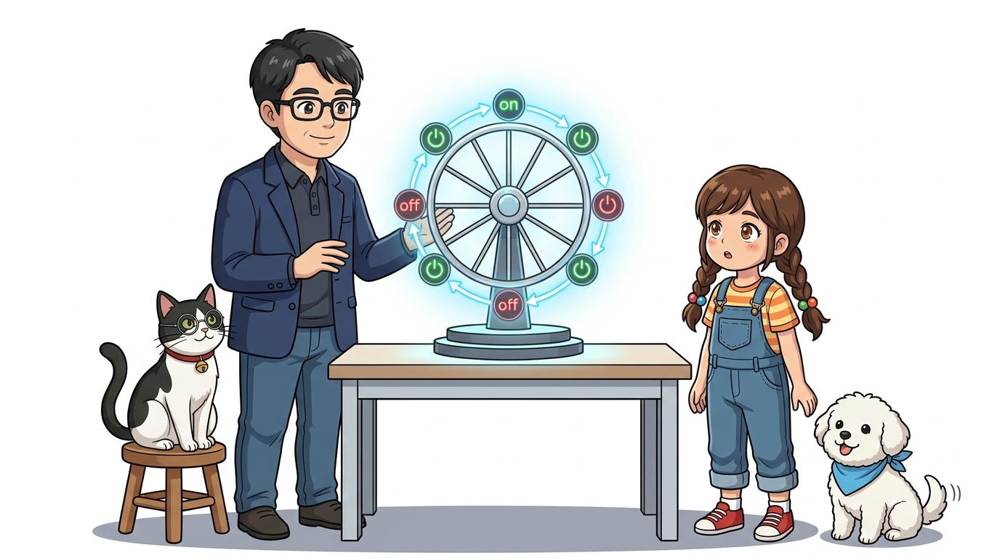
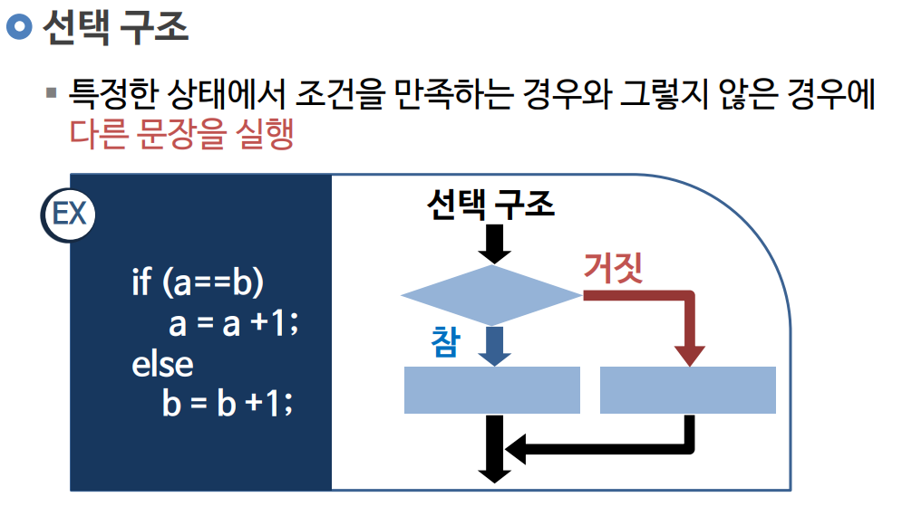

# 019_코드동작원리_컴파일과업로드 ⚙️



* **오늘의 탐험**: 코드가 실행되는 순서(순차 실행)와 setup(), loop()의 숨겨진 원리!
* **등장인물**: 이호진 교수님, 연구실 조수 지니(고양이), 학생 도로시, 토토

### 숨겨진 main()의 비밀과 영원히 춤추는 무한 루프 대관람차!
* 📖 **상세 강의 교재**: [index.md](./index.md)


> 여러분 안녕하세요! 이번 시간에는 '019. 코드동작원리 컴파일과업로드 ⚙️'을 주제로 함께 흥미진진한 탐험을 떠나보겠습니다. 오늘 강의에서는 호진 교수님의 명쾌한 원리 강의와 조수 지니의 꼼꼼한 코드 점검, 그리고 도로시와 토토와 함께 코드가 실행되는 순서(순차 실행)와 setup(), loop()의 숨겨진 원리를 파헤쳐 보겠습니다. 준비되셨나요?

---

## ❓ C언어 책에는 main()이 있다는데, 아두이노엔 왜 없어요?



* **👧 도로시**: "교수님! 컴퓨터 C언어를 배울 땐 항상 `int main()`부터 시작하라고 배웠는데, 아두이노 스케치북에는 `setup()`이랑 `loop()`만 있고 `main`은 어디로 갔나요?"
* **👨‍🏫 호진 교수님**: "하하, 아주 예리한 질문이란다 도로시! 아두이노 개발자들이 초보자 친구들이 복잡한 시스템 설정 때문에 머리 아프지 않도록, `main()`을 시스템 깊숙한 코어 라이브러리 속에 보물처럼 꽁꽁 숨겨둔 거란다!"
* **🐱 조수 지니**: "야옹! 백그라운드에 숨어있는 진짜 `main()` 함수가 여러분이 만든 `setup()`을 딱 한 번 부르고, 이어서 `loop()`를 쉬지 않고 계속 호출해 주는 마법 집사 역할을 한답니다!"
* **🐶 토토**: "멍멍! (우리가 편리하게 코딩할 수 있게 배려해 준 거네 멍!)"

```cpp
// 1. 우리가 작성하는 아두이노 스케치 (스케치북 화면)
void setup() {
  // 아두이노 전원이 켜지거나 리셋될 때 "딱 한 번" 실행
}

void loop() {
  // 전원이 꺼질 때까지 "쉬지 않고 영원히 반복" 실행
}
```
```cpp
// 2. 아두이노 코어 내부의 진짜 main.cpp (시스템 깊숙이 숨겨진 main 함수)
int main(void) {
    init();        // 아두이노 하드웨어 타이머 및 핀 초기화
    initVariant(); // 특정 MCU 보드별 변형 설정

#if defined(USBCON)
    USBDevice.attach(); // USB 통신 장치 활성화
#endif

    setup(); // 사용자가 스케치에 작성한 setup()을 1회 호출!
    
    for (;;) {
        loop(); // 사용자가 스케치에 작성한 loop()를 무한 루프로 호출!
        if (serialEventRun) serialEventRun(); // 시리얼 데이터 수신 이벤트 감시
    }
        
    return 0;
}
```

> 자, 이번 슬라이드의 질문을 함께 보시겠습니다. 바로 '❓ C언어 책에는 main()이 있다는데, 아두이노엔 왜 없어요?'라는 아주 흥미로운 질문입니다. 도로시가 ' 지니야! 컴퓨터 C언어를 배울 땐 항상 int main()부터 시작하라고 배웠어. 그런데 아두이노 스케치북에는 setup()이랑 loop()만 있고 main은 온데간데없어! '라고 질문하자, 지니 멘토는 ' 하하, 아주 날카로운 관찰력이야! 아두이노 개발자들이 초보자 친구들이 골치 아프지 않게 main()을 시스템 깊숙한 곳에 보물처럼 예쁘게 숨겨둔 거란다! '라며 명쾌한 답을 들려주었는데요. 이 질문 속에 숨겨진 전자 회로와 컴퓨팅의 핵심 원리를 지금부터 차근차근 하나씩 파헤쳐 보겠습니다.

---

## 🎢 1단계: 코드는 위에서 아래로 미끄러져요!



* 프로그램은 책을 읽듯 **1번 줄 ➔ 2번 줄 ➔ 3번 줄** 차례대로 위에서 아래로 실행돼요!
* 준비 운동인 `setup()`을 딱 한 번 거치고 나면,
* 대관람차처럼 쉬지 않고 영원히 뱅글뱅글 도는 **`loop()` 무한 루프**에 탑승하게 된답니다!

> 이번 슬라이드에서는 '🎢 1단계: 코드는 위에서 아래로 미끄러져요!'에 대해 자세히 살펴보겠습니다. 화면의 다이어그램과 사진을 함께 참고해 주시기 바랍니다. 첫 번째 핵심은 프로그램은 책을 읽듯 1번 줄 ➔ 2번 줄 ➔ 3번 줄 차례대로 위에서 아래로 실행돼요!이며, 두 번째로는 준비 운동인 setup()을 딱 한 번 거치고 나면,입니다. 여기에 덧붙여 대관람차처럼 쉬지 않고 영원히 뱅글뱅글 도는 loop() 무한 루프에 탑승하게 된답니다! 내용까지 함께 이해해 두시면 완벽합니다. 이 원리는 아두이노 시스템 전체를 관통하는 핵심 논리이므로 머릿속에 꼭 정리해 두시기 바랍니다.

---

## 📜 2단계: 유닉스와 함께 태어난 C언어 (1972년)




* 1972년 미국의 벨 연구소에서 켄 톰슨과 데니스 리치가 개발했어요.
* 컴퓨터 하드웨어를 직접 제어할 수 있으면서도 사람이 읽기 편한 가장 완벽한 언어로 인정받아, 지금도 모든 운영체제(윈도우, 맥, 리눅스)와 아두이노의 뿌리가 되고 있어요!

> 이번 슬라이드에서는 '📜 2단계: 유닉스와 함께 태어난 C언어 (1972년)'에 대해 자세히 살펴보겠습니다. 화면의 다이어그램과 사진을 함께 참고해 주시기 바랍니다. 첫 번째 핵심은 년 미국의 벨 연구소에서 켄 톰슨과 데니스 리치가 개발했어요.이며, 두 번째로는 컴퓨터 하드웨어를 직접 제어할 수 있으면서도 사람이 읽기 편한 가장 완벽한 언어로 인정받아, 지금도 모든 운영체제(윈도우, 맥, 리눅스)와 아두이노의 뿌리가 되고 있어요!입니다. 이 원리는 아두이노 시스템 전체를 관통하는 핵심 논리이므로 머릿속에 꼭 정리해 두시기 바랍니다.

---

## 🔄 3단계: 타이핑 ➔ 컴파일 ➔ USB 배달




1. 💻 **코드 작성**: 우리가 아두이노 IDE에 예쁜 C언어 문장을 써요.
2. ⚙️ **컴파일(변환)**: 컴퓨터가 0과 1 기계어(HEX 파일)로 번역해요.
3. 🚀 **업로드**: USB 선을 타고 아두이노의 플래시 메모리 속으로 쏙 들어갑니다!

> 이번 슬라이드에서는 '🔄 3단계: 타이핑 ➔ 컴파일 ➔ USB 배달'에 대해 자세히 살펴보겠습니다. 화면의 다이어그램과 사진을 함께 참고해 주시기 바랍니다. 첫 번째 핵심은 💻 코드 작성: 우리가 아두이노 IDE에 예쁜 C언어 문장을 써요.이며, 두 번째로는 ⚙️ 컴파일(변환): 컴퓨터가 0과 1 기계어(HEX 파일)로 번역해요.입니다. 여기에 덧붙여 🚀 업로드: USB 선을 타고 아두이노의 플래시 메모리 속으로 쏙 들어갑니다! 내용까지 함께 이해해 두시면 완벽합니다. 이 원리는 아두이노 시스템 전체를 관통하는 핵심 논리이므로 머릿속에 꼭 정리해 두시기 바랍니다.

---

## 🏁 4단계: `void setup() { ... }` (준비 방)




* 아침에 일어나서 세수하고 신발을 신듯, 보드가 켜질 때 단 한 번만 실행하는 초기화 공간이에요.

```cpp
void setup() {
  // 아두이노 전원이 켜지거나 리셋 버튼을 누르면 "딱 한 번"만 실행돼요!
  pinMode(13, OUTPUT); // 13번 핀을 전기를 내보내는 출구로 지정!
}
```

> 이번 슬라이드에서는 '🏁 4단계: void setup() { ... } (준비 방)'에 대한 실제 동작 코드를 분석해 보겠습니다. 화면의 코드를 살펴보시면, 컴퓨터가 아두이노 하드웨어에 단계별로 명령을 내리는 흐름을 명확하게 확인할 수 있습니다. 여기서 핵심은 아침에 일어나서 세수하고 신발을 신듯, 보드가 켜질 때 단 한 번만 실행하는 초기화 공간이에요.입니다. 각 함수의 역할과 괄호 안의 매개변수가 하드웨어 핀과 어떤 관계를 맺고 동작하는지 주의 깊게 살펴보시기 바랍니다.

---

## 🎡 5단계: `void loop() { ... }` (반복 방)



```cpp
void loop() {
  // 맨 윗줄부터 실행하고, 끝나면 다시 맨 위로 돌아와 끝없이 반복해요!
  digitalWrite(13, HIGH); // 켜기
  delay(1000);            // 1초 기다리기
  digitalWrite(13, LOW);  // 끄기
  delay(1000);            // 1초 기다리기
}
```

> 이번 슬라이드에서는 '🎡 5단계: void loop() { ... } (반복 방)'에 대한 실제 동작 코드를 분석해 보겠습니다. 화면의 코드를 살펴보시면, 컴퓨터가 아두이노 하드웨어에 단계별로 명령을 내리는 흐름을 명확하게 확인할 수 있습니다. 각 함수의 역할과 괄호 안의 매개변수가 하드웨어 핀과 어떤 관계를 맺고 동작하는지 주의 깊게 살펴보시기 바랍니다.

---

## ♾️ 6단계: 전자제품은 멈추면 안 돼요!



* **👧 도로시**: "교수님! 보통 컴퓨터 프로그램은 계산이 끝나면 창이 닫히는데, 아두이노는 왜 코드를 영원히 반복해요?"
* **👨‍🏫 호진 교수님**: "좋은 질문이야 도로시! 전자시계나 화재경보기, 에어컨 같은 임베디드 기기가 한 번만 동작하고 스스로 꺼져버리면 큰일 나겠지? 전원이 들어와 있는 동안 24시간 내내 센서를 감시하고 불을 켜야 하니 **무한 루프(Infinite Loop)**가 필수란다!"
* **🐱 조수 지니**: "야옹! 그래서 `loop()` 함수가 영원히 지치지 않고 회전목마처럼 돌아가는 거랍니다!"
* **🐶 토토**: "멍멍! (우리를 안전하게 지켜주는 수호신 루프네 멍!)"

> 이번 슬라이드에서는 '♾️ 6단계: 전자제품은 멈추면 안 돼요!'에 대해 자세히 살펴보겠습니다. 화면의 다이어그램과 사진을 함께 참고해 주시기 바랍니다. 이 원리는 아두이노 시스템 전체를 관통하는 핵심 논리이므로 머릿속에 꼭 정리해 두시기 바랍니다.

---

## 🌟 미션 클리어! "코드의 춤추는 순서를 배웠어요!"


* **오늘 배운 핵심 3가지**:
1. 📜 **순차 실행**: 코드는 첫 줄부터 차례대로 하나씩 실행돼요!
2. 🚪 **setup()**: 보드가 켜질 때 준비 운동으로 딱 한 번만 실행!
3. 🎡 **loop()**: 전원이 꺼질 때까지 쉬지 않고 끝없이 반복 실행!
* **👉 다음 모험**: 코드를 깔끔하게 정리하는 마법 주문 상자, **"01.5-2 C언어 함수(Function)"**를 배워보아요!

> 오늘 배운 '🌟 미션 클리어! "코드의 춤추는 순서를 배웠어요!"'의 핵심 내용을 모두 정리해 보았습니다. 오늘 다룬 내용 중에서도 오늘 배운 핵심 3가지 부분은 앞으로의 아두이노 실습과 프로젝트에서 계속 사용되는 매우 중요한 기초 지식입니다. 오늘 배운 내용을 꼭 다시 한번 복습해 보시고, 다음 강의에서 더욱 신나고 유익한 모험으로 다시 만나겠습니다. 모두 수고 많으셨습니다!