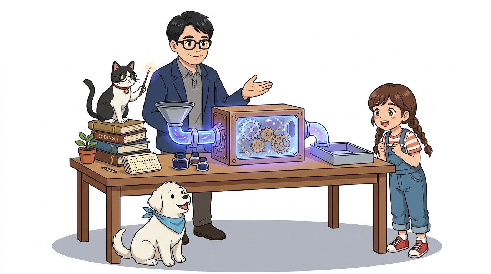
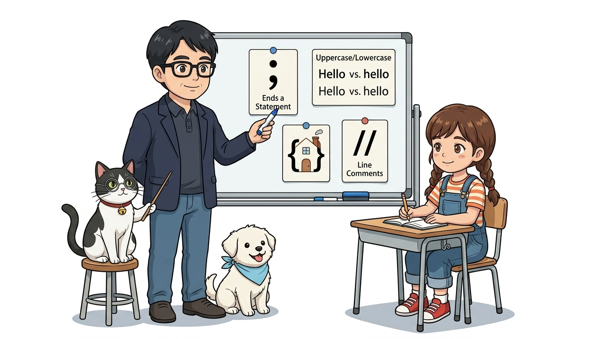
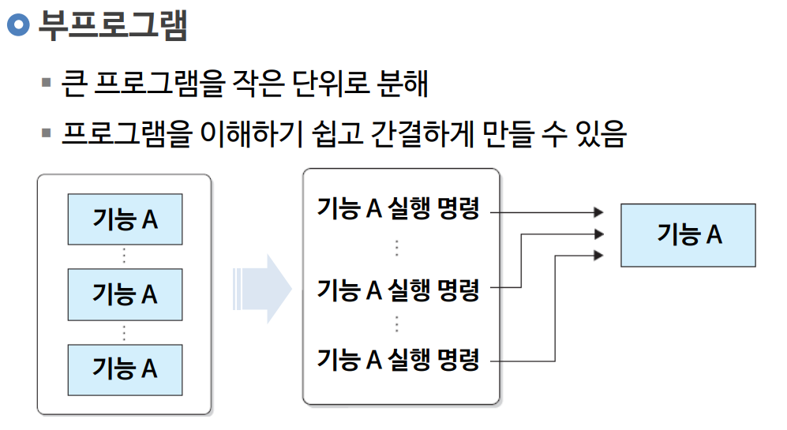
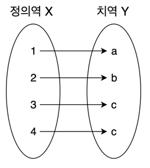
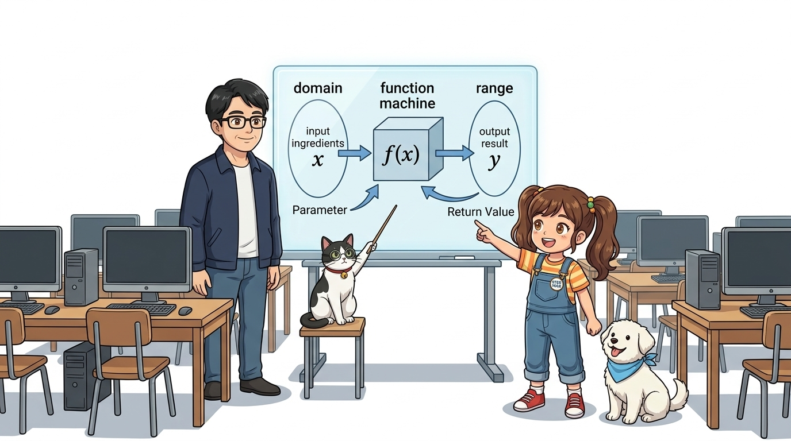
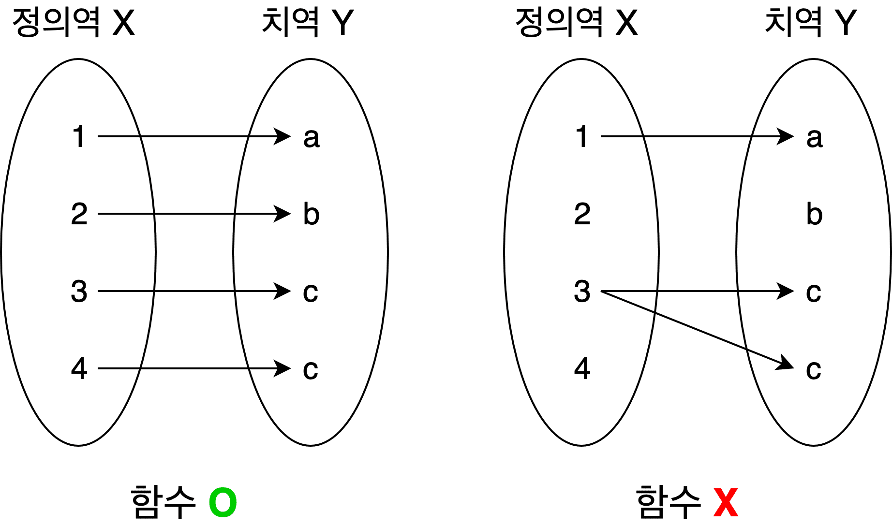
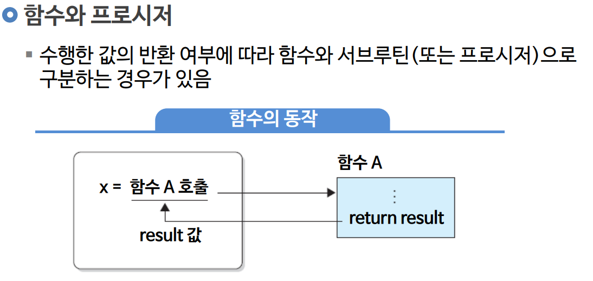

# 020_C언어기초1_마법상자함수 🎁



* **오늘의 탐험**: C/C++ 기본 문법 규칙과 마법 도구 상자 '함수(Function)'의 모든 것!
* **등장인물**: 이호진 교수님, 연구실 조수 지니(고양이), 학생 도로시, 토토

* **👧 도로시**: "교수님! 코드가 길어지면 똑같은 걸 계속 또 써야 하나요? 너무 손이 아파요!"
* **👨‍🏫 호진 교수님**: "하하, 도로시! 그럴 땐 C언어의 가장 강력한 마법 도구 상자 **'함수(Function)'**를 쓰면 된단다. 재료를 넣으면 뚝딱 완성품이 나오는 자판기 같지!"
* **🐱 조수 지니**: "야옹! 반복되는 명령을 이름 붙인 상자 속에 쏙 넣어두면 언제든 이름만 불러서 꺼내 쓸 수 있답니다!"
* **🐶 토토**: "멍멍! (마법 상자에 쏙 넣으면 코드가 깔끔해진다 멍!)"
* 📖 **상세 강의 교재**: [index.md](./index.md)


> 여러분 안녕하세요! 이번 시간에는 '020. C언어기초1 마법상자함수 🎁'을 주제로 함께 흥미진진한 탐험을 떠나보겠습니다. 호진 교수님의 든든한 강의와 조수 지니의 꼼꼼한 어시스트, 그리고 호기심 대장 도로시와 토토와 함께 신나는 아두이노 모험을 힘차게 시작해 봅시다. 준비되셨나요?

---

## 1. 아두이노의 기초 언어: C/C++ 기본 문법 규칙 📜



* **👧 도로시**: "세미콜론 하나만 빼먹어도 아두이노가 오류를 내며 멈추는 이유가 있었군요!"
* **👨‍🏫 호진 교수님**: "그렇단다. 문장의 마침표인 세미콜론과 대소문자, 중괄호 울타리를 잘 지켜주면 C언어는 세상에서 가장 든든한 일꾼이 되어준단다!"
* **🐱 조수 지니**: "제가 안경 너머로 매의 눈으로 문법 오류를 잡아내 줄게요, 야옹!"

1. **문장의 마침표, 세미콜론 (`;`)**:
- C언어에서 모든 실행 명령문은 반드시 세미콜론(`;`)으로 끝나야 합니다. 세미콜론을 빠뜨리면 컴파일러는 문장이 어디서 끝나는지 알 수 없어 오류를 냅니다.
2. **대소문자 엄격 구분 (Case Sensitivity)**:
- C언어는 대소문자를 완전히 다른 글자로 취급합니다. 예를 들어 `pinMode`와 `pinmode`, `digitalWrite`와 `DigitalWrite`는 전혀 다른 단어입니다!
3. **코드 블록의 울타리, 중괄호 (`{ }`)**:
- 여러 줄의 명령어를 하나로 묶을 때는 여는 중괄호 `{`와 닫는 중괄호 `}`로 감싸서 '코드 블록(Block)'을 형성합니다.
4. **사람을 위한 설명문, 주석 (Comments)**:
- `//`: 한 줄 주석 (컴파일러가 무시)
- `/* ... */`: 여러 줄 주석

아두이노 스케치(Sketch)는 사실 **C/C++ 프로그래밍 언어**로 작성됩니다. 본격적인 함수 학습에 앞서, 컴파일러가 엄격하게 검사하는 C언어의 4대 기본 문법 규칙을 먼저 기억해야 합니다.

> 이번 슬라이드에서는 '1. 아두이노의 기초 언어: C/C++ 기본 문법 규칙 📜'에 대해 자세히 살펴보겠습니다. 화면의 다이어그램과 사진을 함께 참고해 주시기 바랍니다. 도로시와 지니의 대화처럼, 세미콜론 하나만 빼먹어도 아두이노가 화를 내며 멈추는 이유가 있었구나!라는 상황에 대해 맞아! 규칙을 잘 지켜주면 C언어는 세상에서 가장 든든한 일꾼이 되어준단다!라는 원리가 작동하는 것입니다. 첫 번째 핵심은 문장의 마침표, 세미콜론 (;)이며, 두 번째로는 C언어에서 모든 실행 명령문은 반드시 세미콜론(;)으로 끝나야 합니다. 세미콜론을 빠뜨리면 컴파일러는 문장이 어디서 끝나는지 알 수 없어 오류를 냅니다.입니다. 여기에 덧붙여 대소문자 엄격 구분 (Case Sensitivity) 내용까지 함께 이해해 두시면 완벽합니다. 이 원리는 아두이노 시스템 전체를 관통하는 핵심 논리이므로 머릿속에 꼭 정리해 두시기 바랍니다.

---

## 2. 코드 반복의 함정과 번거로움 😫


- 컴퓨터와 아두이노는 우리가 적어준 명령어를 위에서부터 순서대로 실행해요.
- 만약 똑같은 동작(예: LED를 깜빡이거나 모터를 돌리는 일)을 프로그램 곳곳에서 여러 번 실행해야 한다면, 같은 코드를 복사해서 계속 붙여넣어야 할까요?
1. **코드 길이 증가**: 코드가 수백 줄로 불어나 읽기 어려워집니다.
2. **수정의 지옥**: 500ms 지연시간을 200ms로 바꾸려면 복사한 수십 군데를 일일이 찾아 고쳐야 합니다.
3. **오류 발생**: 수정하다가 한 줄이라도 빠뜨리면 찾기 힘든 버그가 발생합니다.

### ⚠️ 반복 복사의 3대 문제점

```cpp
// 똑같은 계산이나 제어를 4번이나 반복해서 복사/붙여넣기 해야 한다면?
digitalWrite(13, HIGH); delay(500); digitalWrite(13, LOW); delay(500);
digitalWrite(13, HIGH); delay(500); digitalWrite(13, LOW); delay(500);
digitalWrite(13, HIGH); delay(500); digitalWrite(13, LOW); delay(500);
digitalWrite(13, HIGH); delay(500); digitalWrite(13, LOW); delay(500);
```

> 이번 슬라이드에서는 '2. 코드 반복의 함정과 번거로움 😫'에 대한 실제 동작 코드를 분석해 보겠습니다. 화면의 코드를 살펴보시면, 컴퓨터가 아두이노 하드웨어에 단계별로 명령을 내리는 흐름을 명확하게 확인할 수 있습니다. 여기서 핵심은 컴퓨터와 아두이노는 우리가 적어준 명령어를 위에서부터 순서대로 실행해요.입니다. 각 함수의 역할과 괄호 안의 매개변수가 하드웨어 핀과 어떤 관계를 맺고 동작하는지 주의 깊게 살펴보시기 바랍니다.

---

## 3. 마법의 도구 상자 '함수' 만들기 📦



* **🐱 조수 지니**: "이제 이름 뒤에 소괄호 `()`만 붙여서 부르면 몇 번이든 바로 실행된단다! 코드를 고칠 때도 함수 내부의 코드 딱 한 곳만 고치면 끝이야!"

반복되는 명령들을 중괄호 `{ }` 안에 모아 넣고, 이름을 붙여주는 것을 **'함수 정의(Function Definition)'**라고 해요.

```cpp
// 1. 함수 정의하기 (도구 상자 만들기)
void blinkOnce() {
    digitalWrite(13, HIGH);
    delay(500);
    digitalWrite(13, LOW);
    delay(500);
}

// 2. 함수 호출하기 (이름만 부르면 어디서든 즉시 실행!)
blinkOnce();
blinkOnce();
blinkOnce();
```

> 이번 슬라이드에서는 '3. 마법의 도구 상자 '함수' 만들기 📦'에 대한 실제 동작 코드를 분석해 보겠습니다. 화면의 코드를 살펴보시면, 컴퓨터가 아두이노 하드웨어에 단계별로 명령을 내리는 흐름을 명확하게 확인할 수 있습니다. 각 함수의 역할과 괄호 안의 매개변수가 하드웨어 핀과 어떤 관계를 맺고 동작하는지 주의 깊게 살펴보시기 바랍니다.

---

## 4. 현대 프로그래밍은 '함수의 집합체' 🧩


- 멋진 로봇, 스마트홈 시스템, 자율주행 자동차도 모두 잘 짜인 작은 함수들이 모여서 완성돼요.
- **모듈화(Modularity)**: 큰 문제를 작은 부품(함수)으로 나누어 레고 블록처럼 조립하는 개발 방법론입니다.
* **가독성 향상**: 메인 코드가 한눈에 들어와 어떤 동작을 하는지 쉽게 읽힙니다.
* **유지보수 용이**: 특정 기능에 문제가 생기면 해당 함수만 열어서 고치면 됩니다.
* **팀 협업 가능**: "철수는 `readSensor()` 함수를 만들고, 영희는 `displayLCD()` 함수를 만들자!"며 분업할 수 있습니다.

### 📌 함수 분할의 장점

> 이번 슬라이드에서는 '4. 현대 프로그래밍은 '함수의 집합체' 🧩'에 대해 자세히 살펴보겠습니다. 화면의 다이어그램과 사진을 함께 참고해 주시기 바랍니다. 첫 번째 핵심은 멋진 로봇, 스마트홈 시스템, 자율주행 자동차도 모두 잘 짜인 작은 함수들이 모여서 완성돼요.이며, 두 번째로는 모듈화(Modularity): 큰 문제를 작은 부품(함수)으로 나누어 레고 블록처럼 조립하는 개발 방법론입니다.입니다. 여기에 덧붙여 가독성 향상: 메인 코드가 한눈에 들어와 어떤 동작을 하는지 쉽게 읽힙니다. 내용까지 함께 이해해 두시면 완벽합니다. 이 원리는 아두이노 시스템 전체를 관통하는 핵심 논리이므로 머릿속에 꼭 정리해 두시기 바랍니다.

---

## 5. 함수의 유래: 수학에서 컴퓨터로! 📐



* **👧 도로시**: "수학 시간에 배운 $f(x)$가 프로그래밍의 함수와 같은 거였어?"
* **🐱 조수 지니**: "완벽히 같아! $x$라는 재료를 주면 $2x + 1$이라는 작업을 거쳐 $y$라는 결과물을 내놓는 규칙 상자란다."

- 함수(Function, 函數)는 상자 **'함(函)'** 자를 써요. "상자 안에 수를 넣는다"는 뜻이죠!
- 수학에서는 $x$라는 값을 상자에 넣으면 정해진 규칙에 따라 $y$가 계산되어 튀어나와요:

$$y = f(x) = 2x + 1$$

> 이번 슬라이드에서는 '5. 함수의 유래: 수학에서 컴퓨터로! 📐'에 대해 자세히 살펴보겠습니다. 화면의 다이어그램과 사진을 함께 참고해 주시기 바랍니다. 도로시와 지니의 대화처럼, 수학 시간에 배운 $f(x)$가 프로그래밍의 함수와 같은 거였어?라는 상황에 대해 완벽히 같아! $x$라는 재료를 주면 $2x + 1$이라는 작업을 거쳐 $y$라는 결과물을 내놓는 규칙 상자란다.라는 원리가 작동하는 것입니다. 첫 번째 핵심은 함수(Function, 函數)는 상자 '함(函)' 자를 써요. "상자 안에 수를 넣는다"는 뜻이죠!이며, 두 번째로는 수학에서는 $x$라는 값을 상자에 넣으면 정해진 규칙에 따라 $y$가 계산되어 튀어나와요입니다. 이 원리는 아두이노 시스템 전체를 관통하는 핵심 논리이므로 머릿속에 꼭 정리해 두시기 바랍니다.

---

## 6. 수학의 정의역과 치역 ➔ 프로그래밍 매개변수와 반환값 🎯



- 수학에서 함수에 집어넣는 입력값들의 모임을 **정의역(Domain)**이라고 해요.
- 함수 상자를 거쳐서 나온 결과값들의 모임을 **치역(Range)**이라고 불러요.

| 수학 개념 | C언어 프로그래밍 대응 | 설명 | 아두이노 비유 |
| :--- | :--- | :--- | :--- |
| **정의역 (입력)** | **매개변수 (Parameter)** | 함수를 실행하기 위해 건네주는 재료 | 제어할 핀 번호, 지연 시간, 주파수 |
| **함수 규칙 ($f$)** | **함수 본체 (Body, `{ }`)** | 중괄호 안의 구체적인 C언어 실행 명령 | 핀 전압 출력, 센서 ADC 계산 |
| **치역 (출력)** | **반환값 (Return Value)** | 계산을 마치고 돌려주는 최종 결과 | 계산된 온도($^\circ\text{C}$), 거리($\text{cm}$) |

> 이번에 살펴볼 내용은 '6. 수학의 정의역과 치역 ➔ 프로그래밍 매개변수와 반환값 🎯'입니다. 슬라이드에 정리된 표를 통해 각 항목의 특징과 수치, 차이점을 한눈에 비교해 보실 수 있습니다. 첫째로 수학에서 함수에 집어넣는 입력값들의 모임을 정의역(Domain)이라고 해요.에 유의해야 하며, 둘째로 함수 상자를 거쳐서 나온 결과값들의 모임을 치역(Range)이라고 불러요.라는 점이 핵심입니다. 이 기본 개념을 확실히 잡아두셔야 실제 부품을 브레드보드에 꽂고 코딩할 때 실수 없이 완성할 수 있습니다.

---

## 7. C언어 함수의 구조 4대 요소 🧱


1. **반환형 (Return Type)**: 함수가 모든 일을 마치고 돌려줄 결과값의 자료형 (`int`, `float`, `char`, `bool` 등).
2. **함수 이름 (Function Name)**: 동작을 잘 나타내는 알기 쉬운 이름 (카멜 표기법 `blinkLED`, `readTemperature` 권장).
3. **매개변수 목록 (Parameter List)**: 함수가 동작할 때 필요한 외부 재료. 없으면 빈 괄호 `()`로 둡니다.
4. **함수 본체 (Body)**: 중괄호 `{ }` 안에 작성되는 실제 실행 코드 블록.

C언어에서 함수는 다음과 같은 명확한 구조적 틀(문법)을 갖추어야 컴파일러가 인식합니다.

```cpp
반환형 함수이름(매개변수타입 매개변수이름) {
    // 실행할 C언어 명령어들 (함수 본체)
    return 반환값;
}
```

> 이번 슬라이드에서는 '7. C언어 함수의 구조 4대 요소 🧱'에 대한 실제 동작 코드를 분석해 보겠습니다. 화면의 코드를 살펴보시면, 컴퓨터가 아두이노 하드웨어에 단계별로 명령을 내리는 흐름을 명확하게 확인할 수 있습니다. 여기서 핵심은 반환형 (Return Type): 함수가 모든 일을 마치고 돌려줄 결과값의 자료형 (int, float, char, bool 등).입니다. 각 함수의 역할과 괄호 안의 매개변수가 하드웨어 핀과 어떤 관계를 맺고 동작하는지 주의 깊게 살펴보시기 바랍니다.

---

## 8. 반환값이 없는 함수: `void`의 의미 📭


* **👧 도로시**: "교수님! 아두이노 기본 코드에 왜 `void setup()`, `void loop()`라고 쓰여 있는지 드디어 알겠어요!"
* **👨‍🏫 호진 교수님**: "맞단다 도로시! `setup`과 `loop`는 아두이노를 준비시키고 반복 실행하는 '동작'만 할 뿐, 아무런 계산 결과를 보고서로 반환할 필요가 없기 때문에 '비어있다'는 뜻의 `void`를 쓴단다."
* **🐱 조수 지니**: "야옹! 돌려줄 값이 없으니 `return`도 필요 없는 깔끔한 동작형 함수랍니다!"

- 모든 함수가 계산 결과를 돌려줄 필요는 없습니다.
- 하드웨어 핀에 전기를 흘려보내거나 화면에 글씨를 출력하는 것처럼 **"동작만 수행하고 끝나는 함수"**는 반환형 자리에 **`void`**를 적습니다.
- `void`는 영어로 **"비어있다(Empty)"**는 뜻입니다!

```cpp
// 13번 핀에 연결된 부저를 1번 삐- 소리 내는 동작형 함수
void beepAlarm() {
    tone(8, 1000, 200); // 8번 핀에 1000Hz 소리 0.2초 출력
    delay(200);
    // 반환할 값이 없으므로 return문이 필요 없습니다!
}
```

> 이번 슬라이드에서는 '8. 반환값이 없는 함수: void의 의미 📭'에 대한 실제 동작 코드를 분석해 보겠습니다. 화면의 코드를 살펴보시면, 컴퓨터가 아두이노 하드웨어에 단계별로 명령을 내리는 흐름을 명확하게 확인할 수 있습니다. 여기서 핵심은 모든 함수가 계산 결과를 돌려줄 필요는 없습니다.입니다. 각 함수의 역할과 괄호 안의 매개변수가 하드웨어 핀과 어떤 관계를 맺고 동작하는지 주의 깊게 살펴보시기 바랍니다.

---

## 9. 실전! 아두이노 맞춤형 매개변수 함수 만들기 🛠️


* **🐶 토토**: "멍멍! 함수 하나 만들었더니 13번, 12번, 11번 핀을 자유자재로 조종한다 멍!"

매개변수를 사용하면 **하나의 함수로 여러 개의 다른 핀이나 다양한 시간을 자유자재로 제어**할 수 있습니다.

```cpp
// 핀 번호(pin)와 깜빡일 시간(durationMs)을 매개변수로 받는 만능 깜빡이 함수!
void blinkLED(int pin, int durationMs) {
    digitalWrite(pin, HIGH);   // 전달받은 pin에 불 켜기
    delay(durationMs);         // 전달받은 시간만큼 대기
    digitalWrite(pin, LOW);    // 불 끄기
    delay(durationMs);
}

void loop() {
    blinkLED(13, 500);  // 13번 LED를 0.5초 주기로 깜빡!
    blinkLED(12, 200);  // 12번 LED를 0.2초 주기로 빠르게 깜빡!
    blinkLED(11, 1000); // 11번 LED를 1초 주기로 느리게 깜빡!
}
```

> 이번 슬라이드에서는 '9. 실전! 아두이노 맞춤형 매개변수 함수 만들기 🛠️'에 대한 실제 동작 코드를 분석해 보겠습니다. 화면의 코드를 살펴보시면, 컴퓨터가 아두이노 하드웨어에 단계별로 명령을 내리는 흐름을 명확하게 확인할 수 있습니다. 각 함수의 역할과 괄호 안의 매개변수가 하드웨어 핀과 어떤 관계를 맺고 동작하는지 주의 깊게 살펴보시기 바랍니다.

---

## 10. 결과를 돌려주는 함수: `return`문 📤



* [!IMPORTANT]
* C언어 함수에서 **`return`은 오직 단 하나의 값만 반환**할 수 있습니다. 또한 `return` 명령을 만나는 순간, 함수는 그 즉시 종료되어 호출한 위치로 되돌아갑니다.

센서 측정값을 섭씨 온도로 변환하거나 두 숫자의 평균을 낼 때는 결과값을 돌려주는 반환 함수를 작성합니다.

```cpp
// 아날로그 센서 값을 읽어 섭씨 온도(float)로 계산하여 반환하는 함수
float getTemperature(int pin) {
    int rawValue = analogRead(pin);       // 0 ~ 1023 아날로그 값
    float voltage = rawValue * (5.0 / 1023.0); // 전압 변환
    float temperature = voltage * 100.0;  // 10mV 당 1도 (LM35 기준)
    
    return temperature; // 최종 계산 결과를 호출한 곳으로 반환!
}

void loop() {
    float currentTemp = getTemperature(A0); // 함수 호출 후 결과를 변수에 저장
    Serial.print("현재 온도: ");
    Serial.println(currentTemp);
    delay(1000);
}
```

> 이번 슬라이드에서는 '10. 결과를 돌려주는 함수: return문 📤'에 대한 실제 동작 코드를 분석해 보겠습니다. 화면의 코드를 살펴보시면, 컴퓨터가 아두이노 하드웨어에 단계별로 명령을 내리는 흐름을 명확하게 확인할 수 있습니다. 각 함수의 역할과 괄호 안의 매개변수가 하드웨어 핀과 어떤 관계를 맺고 동작하는지 주의 깊게 살펴보시기 바랍니다.

---

## 11. 아두이노의 양대 기둥: `setup()` & `loop()`, 그리고 `main.cpp`의 비밀 🔄



아두이노 스케치에 기본 제공되는 두 함수는 C 언어의 표준 런타임과 어떻게 연결되어 있을까요?
### 🔍 아두이노 내부의 숨겨진 `main.cpp` 소스코드
표준 C언어 프로그램은 반드시 **`int main(void)`** 함수부터 시작해야 합니다. 아두이노 코어 내부에는 다음과 같은 숨겨진 `main()` 함수가 컴파일 시 자동으로 결합됩니다:

```cpp
// 1. 초기화 함수 (전원 인가 시 딱 1회 실행)
void setup() {
    pinMode(13, OUTPUT);
    Serial.begin(9600);
}

// 2. 무한 반복 함수 (전원이 꺼질 때까지 계속 실행)
void loop() {
    digitalWrite(13, HIGH);
    delay(1000);
    digitalWrite(13, LOW);
    delay(1000);
}
```
```cpp
// 아두이노 내부 main.cpp (실제 구현부)
int main(void) {
    init();          // 타이머, ADC 등 하드웨어 초기화
    setup();         // 사용자가 작성한 setup() 1회 호출!
    
    for (;;) {       // 무한 루프 (while(true)와 동일)
        loop();      // 사용자가 작성한 loop()를 끝없이 호출!
        if (serialEventRun) serialEventRun();
    }
    return 0;
}
```

> 이번 슬라이드에서는 '11. 아두이노의 양대 기둥: setup() & loop(), 그리고 main.cpp의 비밀 🔄'에 대한 실제 동작 코드를 분석해 보겠습니다. 화면의 코드를 살펴보시면, 컴퓨터가 아두이노 하드웨어에 단계별로 명령을 내리는 흐름을 명확하게 확인할 수 있습니다. 각 함수의 역할과 괄호 안의 매개변수가 하드웨어 핀과 어떤 관계를 맺고 동작하는지 주의 깊게 살펴보시기 바랍니다.

---

## 🌟 도로시와 지니의 이번 시간 핵심 정리! 🏆


* **👧 도로시**: "이제 나만의 함수를 만들어서 복잡한 아두이노 코드도 블록처럼 깔끔하게 정리할 수 있어요!"
* **👨‍🏫 호진 교수님**: "아주 훌륭하단다 도로시! 다음 시간에는 데이터를 담는 이름표 보관함, **'C언어 기초2: 변수와 연산자'**를 정복해 보자꾸나!"
* **🐱 조수 지니**: "야옹! 지니 조수도 돋보기를 챙겨서 다음 모험을 준비할게요!"
* **🐶 토토**: "멍멍! (변수 상자도 정복하러 가자 멍!)"

* [x] **C언어 기본 문법**: 세미콜론(`;`), 대소문자 구분, 중괄호 블록(`{}`), 주석을 정확히 지킵니다.
* [x] **함수의 4요소**: `반환형`, `함수이름`, `매개변수`, `본체`의 역할을 완벽히 이해했습니다.
* [x] **`void`의 의미**: 반환할 결과값이 없이 동작만 실행하는 함수에 사용합니다.
* [x] **매개변수와 반환값**: 입력 재료는 매개변수로 전달하고, 최종 결과는 `return`으로 1개 돌려줍니다.
* [x] **`setup()`과 `loop()`**: 내부의 `main()` 함수가 `setup()`을 1회 호출한 후 `loop()`를 무한 반복 실행합니다.

축하합니다! 아두이노 프로그래밍을 관통하는 가장 핵심적인 기둥인 C언어 **함수(Function)**의 모든 비밀을 정복했습니다.
### 📋 핵심 요약 체크리스트

> 오늘 배운 '🌟 도로시와 지니의 이번 시간 핵심 정리! 🏆'의 핵심 내용을 모두 정리해 보았습니다. 오늘 다룬 내용 중에서도 [x] C언어 기본 문법: 세미콜론(;), 대소문자 구분, 중괄호 블록({}), 주석을 정확히 지킵니다. 부분은 앞으로의 아두이노 실습과 프로젝트에서 계속 사용되는 매우 중요한 기초 지식입니다. 지니 멘토가 강조했듯이 훌륭해! 다음 시간에는 데이터를 담는 이름표 보관함, 라는 점을 꼭 마음에 새겨두시길 바랍니다. 오늘 배운 내용을 꼭 다시 한번 복습해 보시고, 다음 강의에서 더욱 신나고 유익한 모험으로 다시 만나겠습니다. 모두 수고 많으셨습니다!