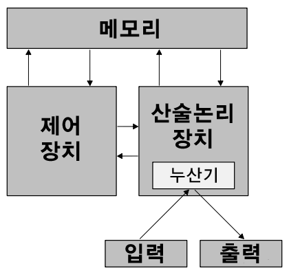
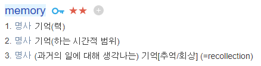
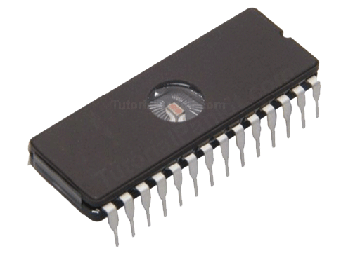
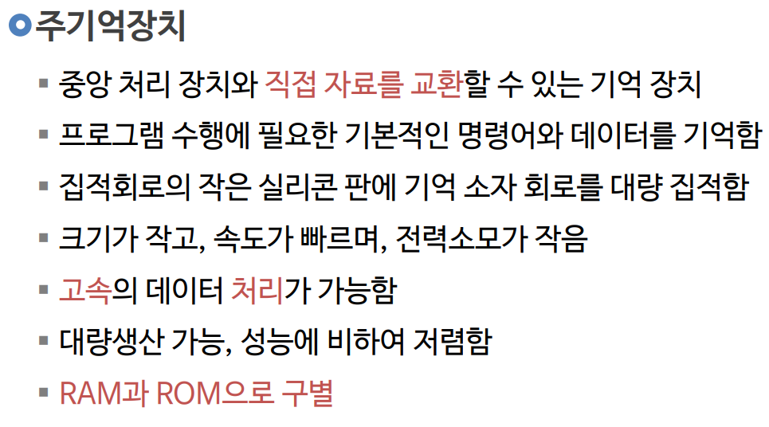
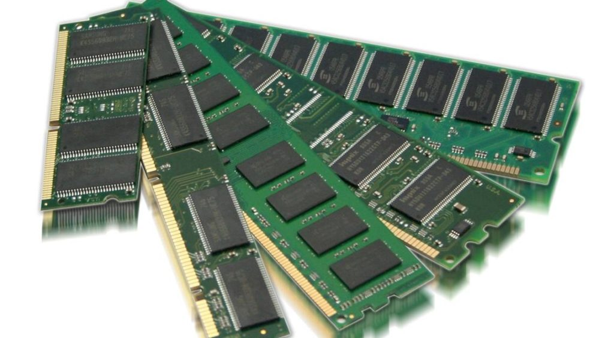
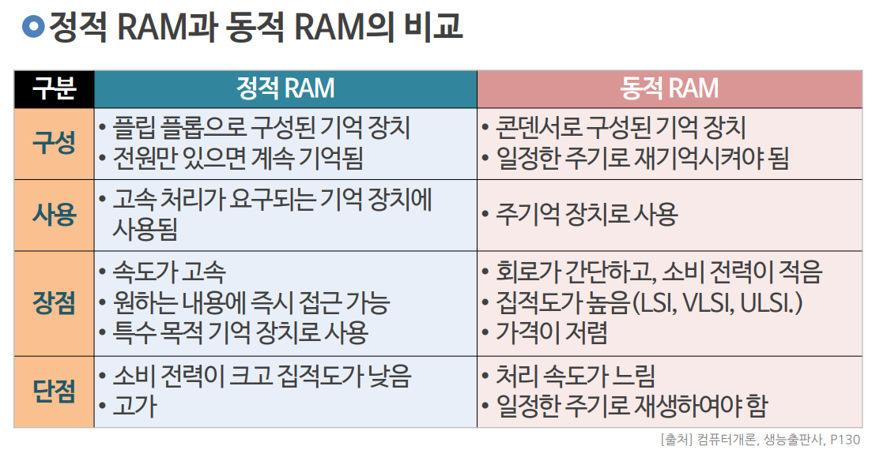
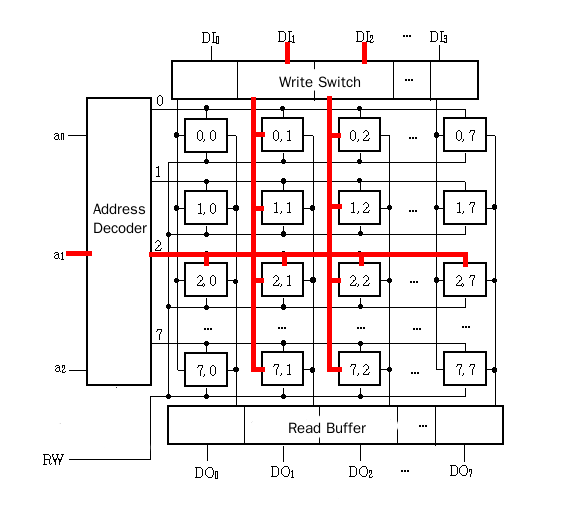
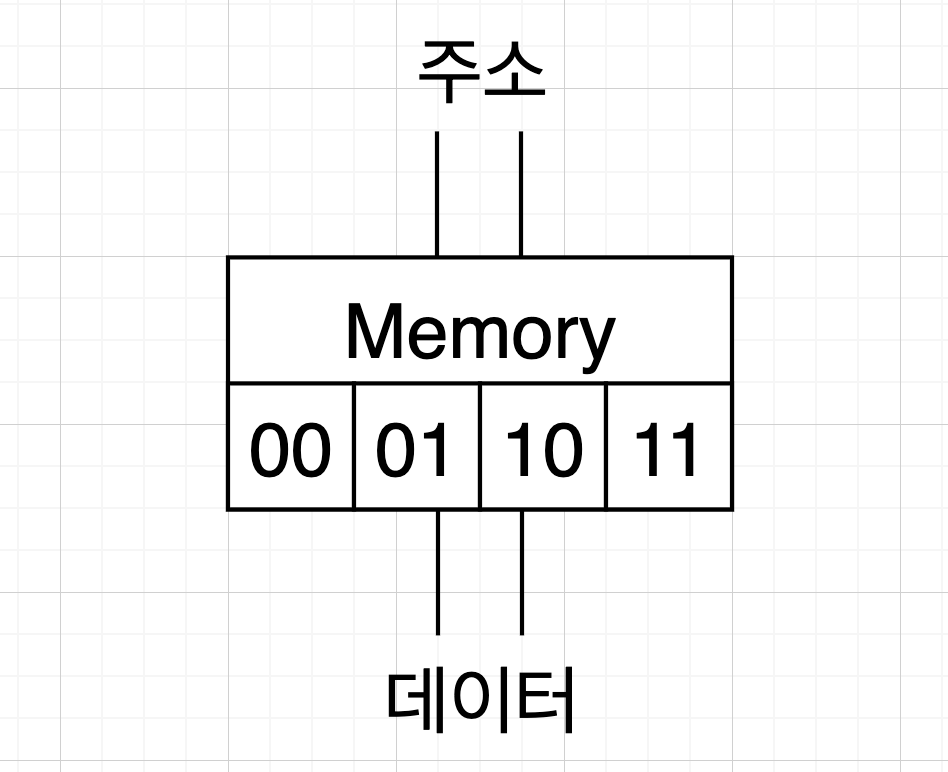
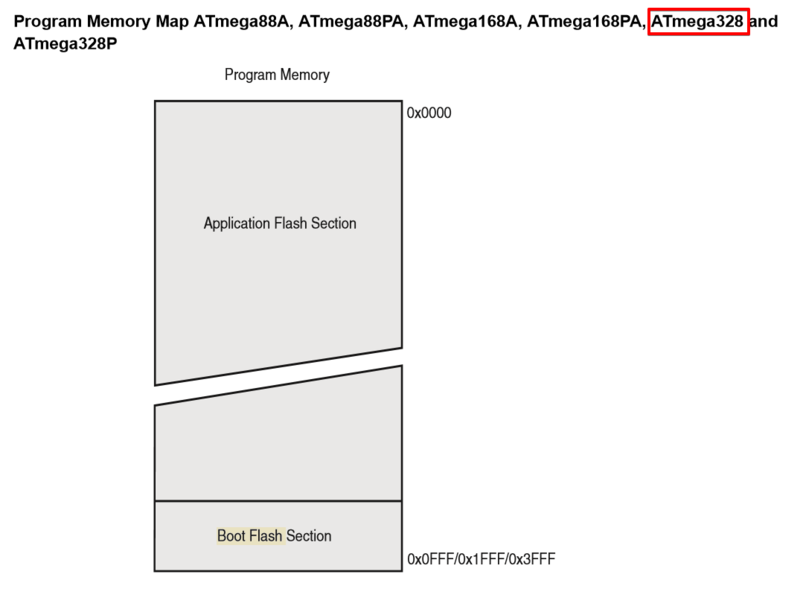

# 021_컴퓨터의기억소_메모리 🧠

> **👧 도로시**: "교수님! 아두이노는 우리가 준 숫자나 단어를 어디에 기억해 두고 있는 거예요?"  
> **👨‍🏫 호진 교수님**: "사람의 뇌처럼 컴퓨터도 값을 기억하는 보물창고가 있단다! 바로 **'메모리(Memory)'**라고 부르지."  
> **🐱 조수 지니**: "야옹! 번호표가 매겨진 수많은 사물함 속에 0과 1을 전기로 쏙쏙 보관해 둔답니다!"  
> **🐶 토토**: "멍멍! (사물함마다 번호가 매겨져 있다 멍!)"

* 🖥️ **강의 슬라이드**: [slides.md](./slides.md)

---

## 1. 메모리란 무엇일까요? 💾

- 컴퓨터가 계산하고 명령을 처리하려면 중간 계산값과 결과를 어딘가에 저장해야 해요.
- **기억장치(Memory)**는 전기적 신호로 0과 1을 보관하는 전자 부품이에요.

> **👧 도로시**: "우리가 머릿속으로 '3 더하기 5는 8' 할 때 3과 5를 잠깐 기억하는 것과 같네요!"  
> **👨‍🏫 호진 교수님**: "정확하단다 도로시! 기억장치가 없으면 컴퓨터는 1초 전의 일도 모두 잊어버리고 만단다."  
> **🐱 조수 지니**: "야옹! 그래서 계산대 역할을 하는 CPU 옆에 항상 단짝 친구 메모리가 붙어 있는 거랍니다!"

---

## 2. 폰 노이만 구조와 기억장치 🏛️

- 현대의 거의 모든 컴퓨터는 천재 수학자 **존 폰 노이만**이 설계한 방식을 따르고 있어요.
- **연산 장치(ALU)**, **제어 장치(CU)**, 그리고 이들이 일할 수 있게 데이터를 주는 **기억 장치(메모리)**로 구성됩니다.

> **🐱 조수 지니**: "프로그램(코드)과 데이터가 모두 메모리에 들어가서 CPU와 신호를 주고받는단다."

---

## 3. 메모리의 두 얼굴: 비휘발성과 휘발성 ⚖️

- 메모리는 전기가 꺼졌을 때 기억이 사라지는지에 따라 크게 두 종류로 나뉘어요.

| 구분 | 휘발성 메모리 (Volatile) | 비휘발성 메모리 (Non-Volatile) |
| :--- | :--- | :--- |
| **전원 꺼짐** | 기억이 모두 깨끗이 지워짐 | 전원이 꺼져도 영구 보존! |
| **읽기 / 쓰기** | 자유롭게 읽고 쓰기 가능 (초고속) | 주로 읽기 전용 (ROM, Flash) |
| **대표 예시** | **RAM (주기억장치)** | **ROM, SD카드, USB 메모리** |

---

## 4. 영원히 잊지 않는 '비휘발성 메모리 (ROM)' 🔒

- **ROM (Read Only Memory)**: "오직 읽기만 가능한 메모리"라는 뜻이에요.
- 공장에서 만들 때 중요한 기본 시스템(BIOS나 펌웨어)을 영구적으로 새겨 넣어요.
- 전원을 꺼도 지워지지 않아서 컴퓨터나 아두이노가 부팅할 때 가장 먼저 읽어요.

> **👧 도로시**: "돌판에 글자를 단단히 새겨놓아서 비가 와도 안 지워지는 것 같아!"

---

## 5. 다양한 비휘발성 메모리의 발전 📜

- 예전의 마스크 롬(Mask ROM)부터, 자외선으로 지우는 EPROM, 전기로 지우고 다시 쓰는 **EEPROM**과 **Flash 메모리**로 발전했어요.
- 우리가 아두이노에 코드를 업로드하면 바로 이 **Flash 메모리**에 영구 저장됩니다!

> **🐱 조수 지니**: "그래서 아두이노의 USB를 뽑았다가 내일 다시 꽂아도 코드가 그대로 실행되는 거야!"

---

## 6. 빠르고 활발한 '휘발성 메모리 (RAM)' ⚡

- **RAM (Random Access Memory)**: 컴퓨터가 켜져 있는 동안 데이터를 순식간에 읽고 쓰는 작업대예요.
- 속도가 엄청나게 빠르지만, 전원이 끊어지면 담겨있던 내용이 눈 녹듯 사라져요.
- 프로그램을 실행할 때 필요한 변수와 계산 과정이 모두 RAM에 머물러요.

> **👧 도로시**: "공책에 연필로 썼다가 지우개로 슥슥 지우는 연습장 같네!"

---

## 7. RAM의 종류: SRAM vs DRAM 🔬

- **SRAM (Static RAM)**:
  - 전원만 들어오면 재충전 없이 데이터를 안정적으로 유지해요.
  - 구조가 복잡해 비싸지만 속도가 극도로 빨라 CPU 캐시나 아두이노 메모리로 쓰여요.
- **DRAM (Dynamic RAM)**:
  - 구조가 단순해 대용량으로 만들기 좋아서 PC의 메인 메모리로 널리 쓰여요.

---

## 8. 메모리의 최소 방: '메모리 셀(Cell)' 📦

- 메모리 안에는 0 또는 1 (1비트)을 담을 수 있는 수억 개의 작은 방(셀)이 바둑판처럼 펼쳐져 있어요.
- 가로선과 세로선이 만나는 지점에 전기 스위치(트랜지스터와 커패시터)가 위치해요.

> **🐶 토토**: "멍멍! (바둑판 격자마다 간식이 0개냐 1개냐 들어있다 멍!)"

---

## 9. 사물함의 번호표: '메모리 주소(Address)' 🏷️

- 수많은 메모리 셀 중에서 내가 원하는 값을 찾으려면 각 사물함마다 고유한 **주소(Address)**가 필요해요.
- 컴퓨터는 주소를 보통 **16진수(`0x00`, `0x01`, `0xFF`...)**로 표기해요.
- 주소만 알면 어느 위치의 방이든 빛의 속도로 쏙 찾아갈 수 있답니다!

> **👧 도로시**: "우체부 아저씨가 번지수를 보고 편지를 배달하는 것과 똑같아!"

---

## 10. 아두이노 우노(ATmega328P)의 메모리 크기 📏

- 컴퓨터는 수 기가바이트(GB)의 거대한 메모리를 쓰지만, 작은 아두이노는 메모리가 아담해요:
  - **Flash 메모리 (코드 저장용 ROM)**: **32 KB**
  - **SRAM (변수 저장용 RAM)**: **2 KB** (약 2,048 글자 분량!)
  - **EEPROM (설정값 저장용)**: **1 KB**

> **💡 주의**: 아두이노에서는 메모리가 2KB로 매우 작기 때문에 변수를 아껴 쓰고 낭비하지 않는 것이 중요해요!

---

## 🌟 도로시와 지니의 이번 시간 핵심 정리!

1. **메모리는 기억 저장소**: 0과 1의 전기 신호로 컴퓨터의 모든 데이터를 보관해요.
2. **ROM과 RAM**: 전원이 꺼져도 남는 영구 보관소 ROM/Flash, 전원이 꺼지면 지워지는 빠른 작업대 RAM!
3. **주소와 셀**: 메모리는 바둑판 셀로 나뉘어 있고, 16진수 주소 번지수로 값을 찾아가요.
4. **아두이노 메모리**: SRAM이 2KB로 작기 때문에 효율적인 코딩 습관이 필요해요!

> **👧 도로시**: "메모리 사물함의 원리를 알고 나니 아두이노와 컴퓨터가 훨씬 더 친근하게 느껴져요!"  
> **👨‍🏫 호진 교수님**: "훌륭하단다 도로시! 다음 시간에는 이 사물함에 직접 예쁜 이름표를 붙여 값을 담는 **'C언어 기초2: 이름표 상자 변수'**를 배워보자꾸나!"  
> **🐱 조수 지니**: "야옹! 지니 조수도 소중한 변수 상자를 함께 지켜줄게요!"  
> **🐶 토토**: "멍멍! (이름표 달린 사물함 만나러 가자 멍!)"

