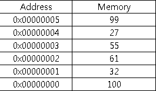
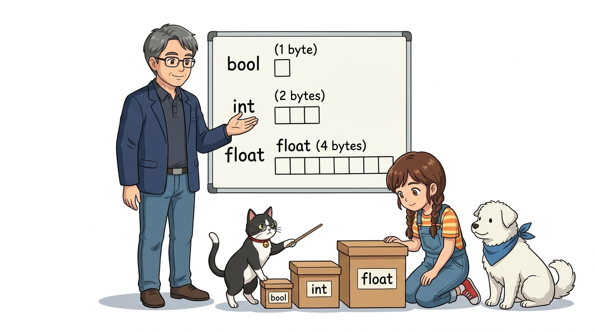
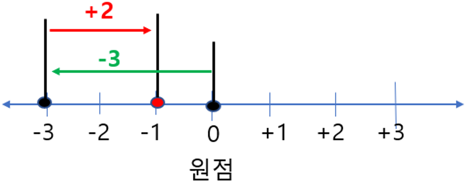
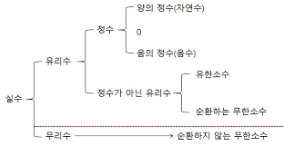
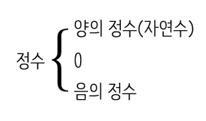
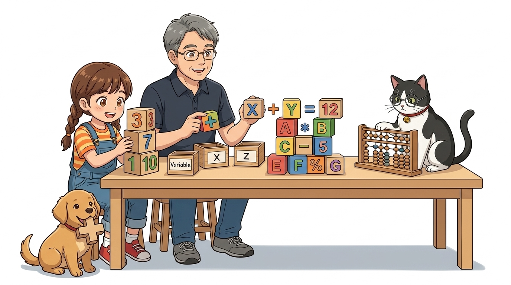

# 022_C언어기초2_이름표상자변수 📦🧮

> **👧 도로시**: "교수님! 센서가 잰 온도나 버튼 누른 횟수를 프로그램 안에서 계속 기억하고 계산하려면 어떻게 해야 하나요?"  
> **👨‍🏫 호진 교수님**: "그럴 땐 이름표가 붙은 마법의 보관 상자 **'변수(Variable)'**와 수학 계산기 **'연산자(Operators)'**를 쓰면 된단다. 언제든 새로운 값을 넣고 연산할 수 있지!"  
> **🐱 조수 지니**: "야옹! 상자마다 크기와 담을 수 있는 데이터 종류(자료형)가 정해져 있으니 알맞은 규격을 골라야 한답니다!"  
> **🐶 토토**: "멍멍! (상자마다 크기와 담을 수 있는 물건이 다르다 멍!)"


* 🖥️ **강의 슬라이드**: [slides.md](./slides.md)

---

## 1. 변수(Variable)란 무엇일까요? 🔄

- 수학에서 유래한 개념으로 **"변할 수 있는 수"**를 뜻해요.
- 프로그래밍에서는 **컴퓨터 메모리(RAM)의 특정 저장 공간에 값을 넣고 빼기 위해 붙여준 이름표**예요.

$$y = f(x) = ax + 1$$

- 수학 공식에서 $x$에 어떤 숫자가 들어가느냐에 따라 결과 $y$가 달라지듯, 코드에서도 변수에 담긴 값에 따라 아두이노의 동작이 실시간으로 바뀝니다!


---

## 2. 메모리 주소 대신 친근한 이름표! 🏷️

- 컴퓨터 메모리(SRAM)의 실제 위치는 `0x0042` 처럼 사람이 외우기 힘든 16진수 번지수로 되어 있어요.
- 사람이 이 복잡한 번호를 직접 기억하고 쓰기 어렵기 때문에, 기억하기 쉬운 **별칭(이름표)**을 붙여주는 것이 바로 **변수명(Variable Name)**이에요!

```cpp
int score = 99; // '0x0042' 주소에 'score'라는 이름을 붙이고 정수 99를 저장!
```

### 📌 좋은 변수 이름 짓기 3대 규칙
1. **의미 있는 이름**: `a`, `b` 대신 `ledPin`, `sensorValue`, `buttonState` 처럼 담긴 뜻이 명확한 단어를 사용합니다.
2. **카멜 표기법 (camelCase)**: 여러 단어를 조합할 때 첫 단어는 소문자, 두 번째 단어부터 첫 글자를 대문자로 씁니다 (예: `ledBlinkInterval`).
3. **금지 규칙**: 숫자로 시작할 수 없으며 (`1stPin` ❌), 공백이나 특수문자(`-`, `@`) 및 C언어 예약어(`int`, `void` 등)는 변수명으로 쓸 수 없습니다.



---

## 3. 왜 다양한 '자료형(Data Type)'이 필요할까요? 📐

- 아두이노 우노(ATmega328P)의 메모리(SRAM)는 **단 2KB(2,048 바이트)**로 매우 작아요!
- 작은 동전 하나를 거대한 옷장에 담으면 공간이 낭비되고, 거대한 이불을 작은 서랍에 억지로 넣으면 터져버리겠죠?
- C언어는 메모리를 가장 알뜰하게 쓰기 위해 **데이터 종류와 크기에 꼭 맞는 규격 상자(자료형)**를 준비합니다.

| 자료형 | 크기 (메모리) | 저장 가능한 값의 범위 | 대표적인 아두이노 용도 |
| :--- | :---: | :--- | :--- |
| **`bool`** | 1 바이트 | `true` (1) 또는 `false` (0) | 스위치 눌림 감지, On/Off 상태 플래그 |
| **`byte`** | 1 바이트 (8비트) | `0 ~ 255` | 디지털 핀 번호, PWM 밝기, 모터 속도 |
| **`char`** | 1 바이트 (8비트) | `-128 ~ 127` 또는 단일 문자 | ASCII 영문자 (`'A'`, `'Z'`, `'1'`) |
| **`int`** | 2 바이트 (16비트) | `-32,768 ~ +32,767` | 아날로그 센서 읽기 (`0 ~ 1023`), 루프 카운터 |
| **`unsigned int`** | 2 바이트 (16비트) | `0 ~ 65,535` | 음수가 필요 없는 양수 전용 카운터 |
| **`unsigned long`**| 4 바이트 (32비트) | `0 ~ 4,294,967,295` (약 43억) | **`millis()` 시간 측정, 타이머 (필수!)** |
| **`float`** | 4 바이트 (32비트) | 소수점 6~7자리 정밀도 | 온습도 센서 측정값, 거리 센서 계산 |



---

## 4. 정수를 담는 상자: `int`와 `byte` 🔢

- 소수점이 없는 양수, 음수, 0을 저장하는 대표적인 정수형 상자입니다.
- **아두이노 우노(8비트 MCU)**에서 `int`는 **2바이트(16비트)** 크기를 차지합니다:
  - 저장 가능 범위: **$-32,768 \sim +32,767$**

```cpp
int sensorVal = analogRead(A0); // 0 ~ 1023 사이의 아날로그 측정값 저장
int counter = 0;                // 횟수 카운터
```

### 💡 1바이트 챔피언 `byte` 적극 활용하기!
- 아두이노 핀 번호(0~13, A0~A5)나 PWM 밝기(0~255)는 결코 255를 넘지 않습니다.
- 이때 `int` 대신 **`byte`**를 사용하면 메모리를 절반이나 절약할 수 있습니다!

```cpp
byte ledPin = 13;      // 1바이트만 절약하여 사용!
byte brightness = 200; // 0 ~ 255 PWM 값
```



---

## 5. 소수점을 담는 상자: `float` (부동소수점) 🌡️

- 온도 센서, 습도 센서, 초음파 거리 센서처럼 소수점이 필요한 정밀한 측정값을 담아요.
- 4바이트(32비트)를 사용하며, 소수점의 위치가 둥둥 떠다니며 정밀도를 유지합니다.

```cpp
float temperature = 26.75; // 방 온도 26.75°C
float distanceCm = 15.3;   // 장애물 거리 15.3cm
```

> **👧 도로시**: "센서가 잰 온도가 딱 26도가 아니라 26.3도일 때는 꼭 `float`을 써야겠네!"  
> **🐱 조수 지니**: "맞아! 다만 아두이노의 8비트 프로세서는 소수점 계산에 힘을 많이 쓰니, 꼭 정밀도가 필요한 곳에만 쓰는 것이 임베디드 최적화의 비결이란다!"



---

## 6. 글자 하나를 담는 상자: `char` (Character) 🔤

- 컴퓨터는 사실 글자를 직접 알지 못해요. 오직 0과 1의 숫자만 알 수 있죠!
- 대신 전 세계가 약속한 **아스키 코드(ASCII Code)** 표를 사용하여 글자에 숫자를 대응시킵니다:
  - 대문자 `'A'`는 숫자 **65**, 소문자 `'a'`는 **97**, 숫자 문자 `'0'`은 **48**이에요.
- `char` 상자는 딱 **1바이트(8비트)** 크기로 글자 하나를 작은따옴표(`' '`)로 감싸서 저장합니다.

```cpp
char command = 'S'; // 모터 정지(Stop) 명령 문자 저장
if (command == 'S') {
    stopMotors();
}
```


---

## 7. 스위치를 닮은 참/거짓 상자: `bool` (Boolean) 💡

- 꺼짐(0) 또는 켜짐(1), 거짓(`false`) 또는 참(`true`) 딱 두 가지만 담는 가장 단순하고 명확한 상자예요.
- 스위치가 눌렸는지, 화재가 감지되었는지 시스템의 상태를 기억할 때 필수적입니다.

```cpp
bool isLedOn = true;         // LED가 켜져 있으면 참(true)!
bool buttonPressed = false;  // 버튼에서 손을 뗐으면 거짓(false)!
```

> **🐶 토토**: "멍멍! (토토가 배고프면 isHungry = true 다 멍!)"  
> **👧 도로시**: "다음 시간에 배울 조건문 `if`와 결합하면 똑똑한 로봇을 만들 수 있겠어!"



---

## 8. 변하지 않는 고정값: `const`와 `#define` 🔒

핀 번호처럼 실행 도중에 절대로 바뀌어서는 안 되는 값은 상수로 선언하여 코드의 안전성을 높이고 실수를 방지합니다.

```cpp
// 1. C++ 상수 키워드 const (권장)
const byte LED_PIN = 13;      // 읽기 전용 상수로 잠금!
// LED_PIN = 12; // ❌ 컴파일러가 오류를 잡아내어 실수 방지!

// 2. 전처리기 매크로 #define
#define BUZZER_PIN 8         // 컴파일 전 글자 치환 (SRAM 소모 0바이트!)
```

### 📌 `const` vs `#define` 비교
* **`const`**: 자료형 검사를 수행하므로 안전하며 디버깅이 쉽습니다.
* **`#define`**: 코드 컴파일 직전에 단순 문자열로 치환되므로 변수 메모리(RAM)를 전혀 차지하지 않습니다.


---

## 9. C언어 핵심 연산자 총정리 🧮

변수에 담긴 값을 더하고, 빼고, 배수로 불리는 C언어의 연산 기호들입니다.

```cpp
int a = 10;
int b = 3;

int sum  = a + b; // 13 (덧셈)
int diff = a - b; // 7  (뺄셈)
int mult = a * b; // 30 (곱셈)
int div  = a / b; // 3  (정수 나눗셈 몫!)
int rem  = a % b; // 1  (나머지 연산자!)
```

### ⚠️ [주의] 정수 나눗셈의 치명적인 함정!
- `int`끼리 나누면 소수점이 무조건 버려집니다: `5 / 2`의 결과는 `2.5`가 아니라 **`2`**입니다!
- 소수점까지 구하려면 둘 중 하나를 실수로 변환해야 합니다: `(float)5 / 2` ➡️ **`2.5`**

### 🌟 마법의 나머지 연산자 (`%`)
- `counter % 2 == 0`: 짝수/홀수 판별에 사용 (LED 깜빡임 토글!)
- `step = (step + 1) % 4`: 0 ➡️ 1 ➡️ 2 ➡️ 3 ➡️ 0 순환 카운터 구현!

### 📌 복합 대입 연산자와 증감 연산자
- `x += 5;` ➡️ `x = x + 5;` (밝기 5 증가)
- `x -= 2;` ➡️ `x = x - 2;` (속도 2 감소)
- `counter++;` ➡️ `counter = counter + 1;` (1씩 카운트 증가)



---

## 10. 아두이노 코딩의 최대 복병! 변수의 유효 범위(Scope) 🌐🏠

아두이노 입문자들이 가장 많이 겪는 미스터리 버그는 **"변수를 어디에 선언했는가?"**에서 발생합니다.

```cpp
// [1] 전역 변수 (Global Variable): 함수 바깥에 선언!
int pushCount = 0; // 스케치 전체가 공유하며, 값이 영원히 보존됨!

void setup() {
    Serial.begin(9600);
}

void loop() {
    // ❌ 초보자의 치명적 실수!
    // int localCount = 0; // loop()가 돌 때마다 매번 0으로 리셋됨!
    
    pushCount++; // 전역 변수는 loop()가 반복되어도 계속 1, 2, 3... 증가!
    Serial.println(pushCount);
    delay(1000);
}
```

### 📌 전역 변수(Global) vs 지역 변수(Local) 비교
1. **전역 변수 (Global)**:
   - 함수 바깥(맨 윗줄)에 선언.
   - `setup()`, `loop()`, 사용자 함수 어디서든 읽고 쓸 수 있음.
   - 아두이노가 켜져 있는 동안 값이 메모리에 계속 보존됨.
2. **지역 변수 (Local)**:
   - 함수나 중괄호 `{ }` 내부에 선언.
   - 해당 함수나 중괄호 블록 안에서만 살아있고, 블록을 벗어나면 즉시 메모리에서 소멸!

> [!WARNING]
> 누적 카운터, 센서 이전 측정값 등 시간이 지나도 유지되어야 하는 상태 변수는 **반드시 전역 변수로 선언**해야 합니다!


---

## 🌟 도로시와 지니의 이번 시간 핵심 정리! 🏆

축하합니다! 아두이노 메모리를 알뜰하게 다루는 변수 상자와 C언어 연산자의 핵심 규칙을 완벽히 마스터했습니다.


### 📋 핵심 요약 체크리스트
* [x] **변수는 메모리 이름표**: 알기 쉬운 이름과 camelCase 표기법을 준수합니다.
* [x] **알맞은 자료형 선택**: 핀 번호와 밝기는 `byte`, 시간 측정은 `unsigned long`, 소수점은 `float`!
* [x] **상수 보호**: 변하지 않는 핀 번호는 `const`로 잠가 컴파일러 실수를 방지합니다.
* [x] **정수 나눗셈 함정 탈출**: `5 / 2`는 `2`이므로, 소수점이 필요할 땐 `(float)` 형변환을 합니다.
* [x] **유효 범위(Scope)**: `loop()`가 돌아도 값이 지워지지 않게 하려면 **전역 변수**로 선언합니다.

> **👧 도로시**: "전역 변수와 지역 변수의 비밀을 알고 나니 이제 카운터 코딩도 완벽히 이해돼요!"  
> **👨‍🏫 호진 교수님**: "아주 훌륭하단다 도로시! 다음 시간에는 아두이노와 컴퓨터가 직접 글자로 대화하는 **'시리얼 모니터'**를 정복해 보자꾸나!"  
> **🐱 조수 지니**: "야옹! 지니 조수도 시리얼 통신 케이블을 챙겨서 대기할게요!"  
> **🐶 토토**: "멍멍! (컴퓨터와 대화하러 가자 멍!)"
