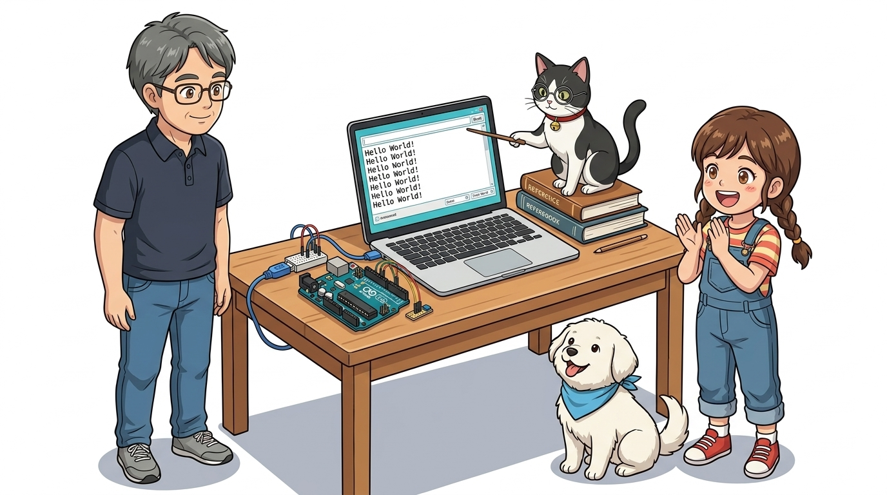
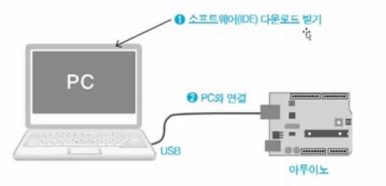
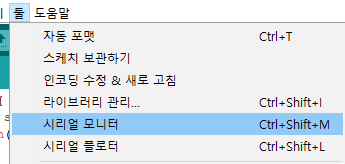
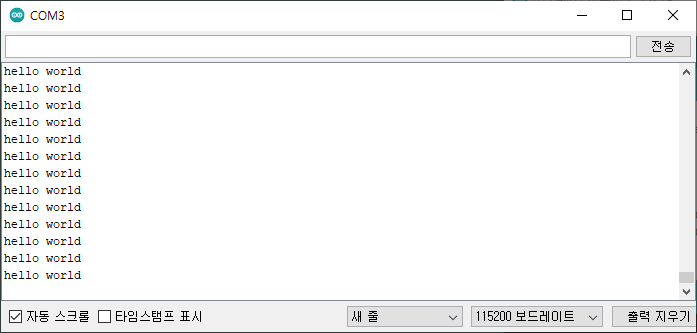

# 023_시리얼모니터_PC대화하기 💬

> **👧 도로시**: "교수님! 아두이노가 지금 무슨 생각을 하고 있는지 화면으로 볼 수는 없을까요?"  
> **👨‍🏫 호진 교수님**: "좋은 질문이란다, 도로시! USB 케이블을 통해 글자를 주고받는 **'시리얼 모니터(Serial Monitor)'** 창을 열면 아두이노와 채팅하듯 대화할 수 있단다!"  
> **🐱 조수 지니**: "야옹! 센서가 잰 온도나 오류 메시지도 시리얼 모니터로 똑똑하게 전달받을 수 있어요!"  
> **🐶 토토**: "멍멍! (아두이노의 목소리를 직접 들어보자 멍!)"



* 🖥️ **강의 슬라이드**: [slides.md](./slides.md)

---

## 1. 아두이노와 컴퓨터의 대화: 시리얼 통신 🔌

- 아두이노와 컴퓨터는 파란색 USB 케이블로 연결되어 있어요.
- 이 케이블을 통해 0과 1의 전기 신호를 한 줄로 차례차례 주고받는 방식을 **'시리얼(직렬) 통신'**이라고 불러요.

> **👧 도로시**: "데이터가 기차처럼 한 줄로 줄을 서서 칙칙폭폭 건너가는 거군요!"  
> **👨‍🏫 호진 교수님**: "정확하단다 도로시! 0과 1의 전기 신호를 순서대로 하나씩 보내는 방식을 '직렬(Serial) 통신'이라고 부른단다."  
> **🐱 조수 지니**: "야옹! 이제 아두이노가 우리 컴퓨터로 인사를 보내게 코드를 만들어볼까요?"


---

## 2. 첫 번째 통신 실습: 에코(Echo) 프로그램 📢

- 메아리(Echo)처럼 아두이노가 컴퓨터에게 끊임없이 메시지를 외치도록 만들어 볼 거예요.
- 시리얼 통신을 배우면 센서가 측정한 온도나 습도, 빛의 밝기를 화면에 숫자로 바로 띄울 수 있어요!

> **👧 도로시**: "나중에는 온도가 몇 도인지도 아두이노가 직접 컴퓨터 화면에 알려주겠네!"  
> **🐱 조수 지니**: "맞아! 시리얼 모니터는 센서 값을 눈으로 확인하고 버그를 잡는 최고의 도구란다."



---

## 3. 1단계: 스케치 코드 작성하기 ✍️

- 아두이노 IDE를 열고 아래와 같이 두 개의 함수(`setup`, `loop`)에 코드를 입력해요.

```cpp
void setup() {
  Serial.begin(9600); // 9600 속도로 컴퓨터와 대화 준비!
}

void loop() {
  Serial.println("Hello World"); // 컴퓨터로 메시지 전송!
  delay(1000);                   // 1초 쉬기
}
```

```cpp
void setup() {
  // PC와 115200 bps 속도로 시리얼 통신 시작
  Serial.begin(115200);
}

void loop() {
  // 1초마다 시리얼 모니터로 인사말 출력
  Serial.println("Hello World!");
  delay(1000);
}
```

---

## 4. 2단계: 코드 업로드와 시리얼 모니터 열기 🔍

1. 아두이노 IDE 상단의 **체크 표시(확인)** 버튼을 눌러 문법 검사를 해요.
2. **오른쪽 화살표(업로드)** 버튼을 눌러 아두이노 보드에 구워 넣어요.
3. 오른쪽 상단의 **돋보기 아이콘(시리얼 모니터)** 버튼을 찰칵 클릭해요!

> **🐶 토토**: "멍멍! (돋보기 모양 단추를 누르면 마법의 채팅창이 뜬다 멍!)"



---

## 5. 3단계: 화면에 쏟아지는 아두이노의 인사! 🎉

- 시리얼 모니터 창 하단에 **"Hello World"** 문장이 1초마다 줄줄이 출력되는 것을 볼 수 있어요!
- 아두이노의 TX(송신) 작은 LED 불빛이 깜빡이며 컴퓨터로 신호를 쏘고 있는 것도 눈으로 확인해 보세요.

> **👧 도로시**: "우와! 지니야, 아두이노가 나한테 진짜로 안녕이라고 인사해!"  
> **🐱 조수 지니**: "아두이노 심장에 깃든 코드가 살아 움직이며 메시지를 보내는 순간이란다!"



---

## 6. 코드 돋보기 ①: `Serial.begin(9600)` 🚦

- **`Serial.begin(속도);`**: 컴퓨터와 아두이노 사이의 **말하는 속도(Baud Rate)**를 맞추는 명령어예요.
- 한쪽은 초속 100단어로 말하는데 다른 쪽이 초속 10단어로 들으면 외계어로 깨져 보여요!
- `setup()` 안에 있으므로 전원이 켜질 때 딱 한 번만 속도를 세팅합니다.

> **💡 주의**: 시리얼 모니터 창 우측 하단의 속도(보드레이트)도 똑같이 **9600 baud**로 맞춰져 있어야 깨지지 않아요!


---

## 7. 코드 돋보기 ②: `Serial.println()` 🖨️

- **`Serial.print("내용");`**: 괄호 안의 글자나 변수를 컴퓨터 모니터에 출력해요.
- **`Serial.println("내용");`**: 출력을 마친 후 **엔터(줄바꿈, New Line)**를 자동으로 쳐줘요! (`ln`은 line의 줄임말)
- `loop()` 함수 안에 들어있기 때문에 1초마다 무한히 인사를 반복해서 전송합니다.

```cpp
Serial.print("Hello ");
Serial.println("World!"); // 한 줄 완성 후 다음 줄로 이동!
```


---

## 🌟 도로시와 지니의 이번 시간 핵심 정리!

1. **시리얼 모니터**: 컴퓨터와 아두이노가 USB 케이블로 대화하는 만능 모니터링 창이에요.
2. **`Serial.begin(9600)`**: 대화 시작 전 서로의 말하는 속도를 9600으로 꼭 일치시켜요!
3. **`Serial.println()`**: 컴퓨터로 글자와 센서 값을 출력하고 줄을 바꿀 때 써요.

> **👧 도로시**: "이제 아두이노가 보내는 소식을 화면으로 볼 수 있어서 너무 신기해요!"  
> **👨‍🏫 호진 교수님**: "훌륭하단다 도로시! 다음 시간에는 반대로 컴퓨터 키보드로 아두이노에게 명령을 보내는 **'024. 시리얼 Read'**를 배워보자꾸나!"  
> **🐱 조수 지니**: "야옹! 지니 조수도 양방향 통신을 위한 준비를 완벽히 마칠게요!"  
> **🐶 토토**: "멍멍! (키보드로 아두이노 조종하러 가자 멍!)"


