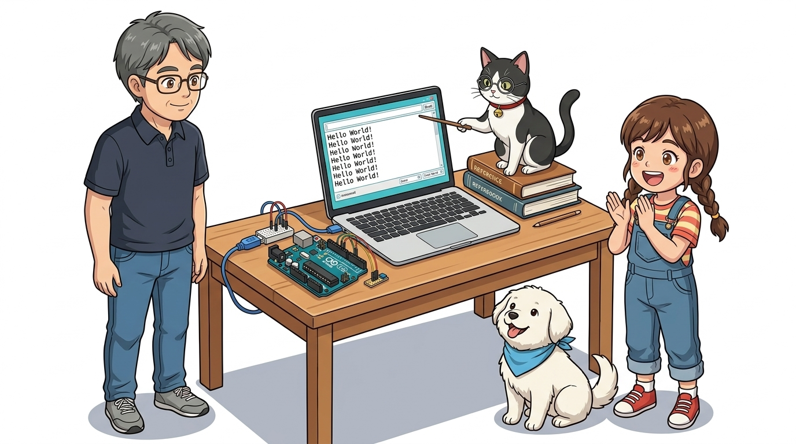
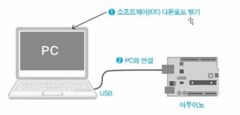
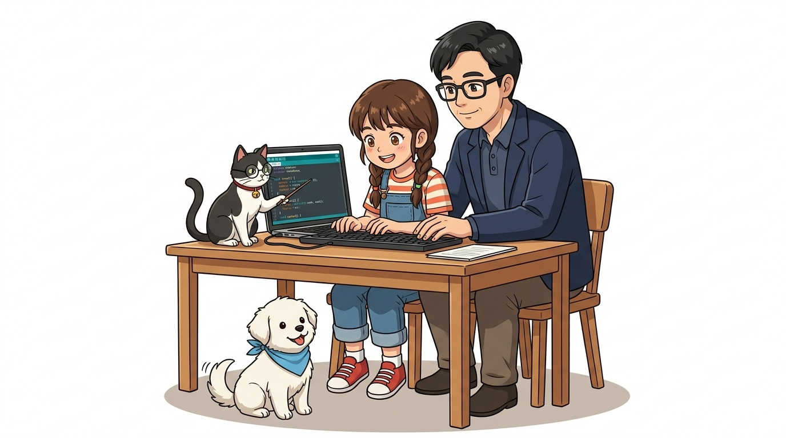
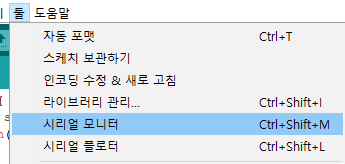
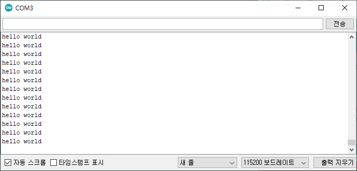
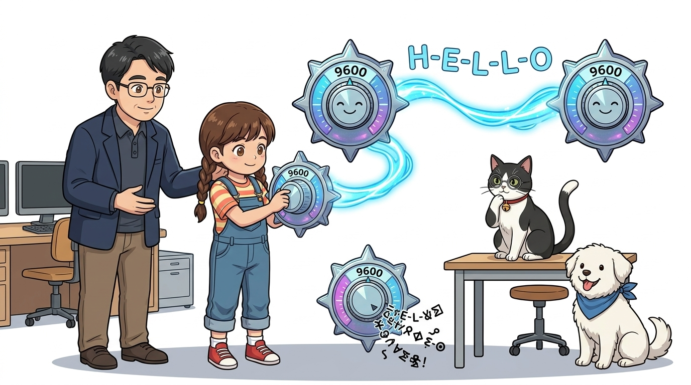

# 023_시리얼모니터_PC대화하기 💬



* **오늘의 탐험**: USB 케이블로 아두이노와 PC가 글자를 주고받는 시리얼 통신의 비밀!
* **등장인물**: 이호진 교수님, 연구실 조수 지니(고양이), 학생 도로시, 토토

* **👧 도로시**: "교수님! 아두이노가 지금 무슨 생각을 하고 있는지 화면으로 볼 수는 없을까요?"
* **👨‍🏫 호진 교수님**: "좋은 질문이란다, 도로시! USB 케이블을 통해 글자를 주고받는 **'시리얼 모니터(Serial Monitor)'** 창을 열면 아두이노와 채팅하듯 대화할 수 있단다!"
* **🐱 조수 지니**: "야옹! 센서가 잰 온도나 오류 메시지도 시리얼 모니터로 똑똑하게 전달받을 수 있어요!"
* **🐶 토토**: "멍멍! (아두이노의 목소리를 직접 들어보자 멍!)"
* 📖 **상세 강의 교재**: [index.md](./index.md)


> 여러분 안녕하세요! 이번 시간에는 '023. 시리얼모니터 PC대화하기 💬'을 주제로 함께 흥미진진한 탐험을 떠나보겠습니다. 호진 교수님의 든든한 설명과 조수 지니의 꼼꼼한 코드 가이드, 그리고 호기심 가득한 도로시와 귀여운 토토와 함께 아두이노와 컴퓨터의 직렬 통신 세계를 신나게 탐험해 봅시다. 준비되셨나요?

---

## 1. 아두이노와 컴퓨터의 대화: 시리얼 통신 🔌


* **👧 도로시**: "데이터가 기차처럼 한 줄로 줄을 서서 칙칙폭폭 건너가는 거군요!"
* **👨‍🏫 호진 교수님**: "정확하단다 도로시! 0과 1의 전기 신호를 순서대로 하나씩 보내는 방식을 '직렬(Serial) 통신'이라고 부른단다."
* **🐱 조수 지니**: "야옹! 이제 아두이노가 우리 컴퓨터로 인사를 보내게 코드를 만들어볼까요?"

- 아두이노와 컴퓨터는 파란색 USB 케이블로 연결되어 있어요.
- 이 케이블을 통해 0과 1의 전기 신호를 한 줄로 차례차례 주고받는 방식을 **'시리얼(직렬) 통신'**이라고 불러요.

> 이번 슬라이드에서는 '1. 아두이노와 컴퓨터의 대화: 시리얼 통신 🔌'에 대해 자세히 살펴보겠습니다. 화면의 다이어그램과 사진을 함께 참고해 주시기 바랍니다. 도로시와 지니의 대화처럼, 데이터가 기차처럼 줄을 서서 칙칙폭폭 건너가는 거구나!라는 상황에 대해 정확해! 이제 아두이노가 우리 컴퓨터로 인사를 보내게 코드를 만들어보자!라는 원리가 작동하는 것입니다. 첫 번째 핵심은 아두이노와 컴퓨터는 파란색 USB 케이블로 연결되어 있어요.이며, 두 번째로는 이 케이블을 통해 0과 1의 전기 신호를 한 줄로 차례차례 주고받는 방식을 '시리얼(직렬) 통신'이라고 불러요.입니다. 이 원리는 아두이노 시스템 전체를 관통하는 핵심 논리이므로 머릿속에 꼭 정리해 두시기 바랍니다.

---

## 2. 첫 번째 통신 실습: 에코(Echo) 프로그램 📢



* **👧 도로시**: "나중에는 온도가 몇 도인지도 아두이노가 직접 컴퓨터 화면에 알려주겠네!"
* **🐱 조수 지니**: "맞아! 시리얼 모니터는 센서 값을 눈으로 확인하고 버그를 잡는 최고의 도구란다."

- 메아리(Echo)처럼 아두이노가 컴퓨터에게 끊임없이 메시지를 외치도록 만들어 볼 거예요.
- 시리얼 통신을 배우면 센서가 측정한 온도나 습도, 빛의 밝기를 화면에 숫자로 바로 띄울 수 있어요!

> 이번 슬라이드에서는 '2. 첫 번째 통신 실습: 에코(Echo) 프로그램 📢'에 대해 자세히 살펴보겠습니다. 화면의 다이어그램과 사진을 함께 참고해 주시기 바랍니다. 도로시와 지니의 대화처럼, 나중에는 온도가 몇 도인지도 아두이노가 직접 컴퓨터 화면에 알려주겠네!라는 상황에 대해 맞아! 시리얼 모니터는 센서 값을 눈으로 확인하고 버그를 잡는 최고의 도구란다.라는 원리가 작동하는 것입니다. 첫 번째 핵심은 메아리(Echo)처럼 아두이노가 컴퓨터에게 끊임없이 메시지를 외치도록 만들어 볼 거예요.이며, 두 번째로는 시리얼 통신을 배우면 센서가 측정한 온도나 습도, 빛의 밝기를 화면에 숫자로 바로 띄울 수 있어요!입니다. 이 원리는 아두이노 시스템 전체를 관통하는 핵심 논리이므로 머릿속에 꼭 정리해 두시기 바랍니다.

---

## 3. 1단계: 스케치 코드 작성하기 ✍️



- 아두이노 IDE를 열고 아래와 같이 두 개의 함수(`setup`, `loop`)에 코드를 입력해요.

```cpp
void setup() {
  Serial.begin(9600); // 9600 속도로 컴퓨터와 대화 준비!
}

void loop() {
  Serial.println("Hello World"); // 컴퓨터로 메시지 전송!
  delay(1000);                   // 1초 쉬기
}
```
```cpp
void setup() {
  // PC와 115200 bps 속도로 시리얼 통신 시작
  Serial.begin(115200);
}

void loop() {
  // 1초마다 시리얼 모니터로 인사말 출력
  Serial.println("Hello World!");
  delay(1000);
}
```

> 이번 슬라이드에서는 '3. 1단계: 스케치 코드 작성하기 ✍️'에 대한 실제 동작 코드를 분석해 보겠습니다. 화면의 코드를 살펴보시면, 컴퓨터가 아두이노 하드웨어에 단계별로 명령을 내리는 흐름을 명확하게 확인할 수 있습니다. 여기서 핵심은 아두이노 IDE를 열고 아래와 같이 두 개의 함수(setup, loop)에 코드를 입력해요.입니다. 각 함수의 역할과 괄호 안의 매개변수가 하드웨어 핀과 어떤 관계를 맺고 동작하는지 주의 깊게 살펴보시기 바랍니다.

---

## 4. 2단계: 코드 업로드와 시리얼 모니터 열기 🔍



* **🐶 토토**: "멍멍! (돋보기 모양 단추를 누르면 마법의 채팅창이 뜬다 멍!)"

1. 아두이노 IDE 상단의 **체크 표시(확인)** 버튼을 눌러 문법 검사를 해요.
2. **오른쪽 화살표(업로드)** 버튼을 눌러 아두이노 보드에 구워 넣어요.
3. 오른쪽 상단의 **돋보기 아이콘(시리얼 모니터)** 버튼을 찰칵 클릭해요!

> 이번 슬라이드에서는 '4. 2단계: 코드 업로드와 시리얼 모니터 열기 🔍'에 대해 자세히 살펴보겠습니다. 화면의 다이어그램과 사진을 함께 참고해 주시기 바랍니다. 첫 번째 핵심은 아두이노 IDE 상단의 체크 표시(확인) 버튼을 눌러 문법 검사를 해요.이며, 두 번째로는 오른쪽 화살표(업로드) 버튼을 눌러 아두이노 보드에 구워 넣어요.입니다. 여기에 덧붙여 오른쪽 상단의 돋보기 아이콘(시리얼 모니터) 버튼을 찰칵 클릭해요! 내용까지 함께 이해해 두시면 완벽합니다. 이 원리는 아두이노 시스템 전체를 관통하는 핵심 논리이므로 머릿속에 꼭 정리해 두시기 바랍니다.

---

## 5. 3단계: 화면에 쏟아지는 아두이노의 인사! 🎉



* **👧 도로시**: "우와! 교수님, 아두이노가 나한테 진짜로 'Hello World!'라고 인사를 건네요!"
* **👨‍🏫 호진 교수님**: "하하, 그렇단다 도로시! 아두이노 마이크로컨트롤러에 업로드된 코드가 실행되면서 시리얼 포트를 통해 컴퓨터로 첫 인사를 보낸 거란다."
* **🐱 조수 지니**: "야옹! 아두이노 보드의 TX LED가 깜빡이는 게 바로 데이터를 쏘고 있다는 증거랍니다!"

- 시리얼 모니터 창 하단에 **"Hello World"** 문장이 1초마다 줄줄이 출력되는 것을 볼 수 있어요!
- 아두이노의 TX(송신) 작은 LED 불빛이 깜빡이며 컴퓨터로 신호를 쏘고 있는 것도 눈으로 확인해 보세요.

> 이번 슬라이드에서는 '5. 3단계: 화면에 쏟아지는 아두이노의 인사! 🎉'에 대해 자세히 살펴보겠습니다. 화면의 다이어그램과 사진을 함께 참고해 주시기 바랍니다. 첫 번째 핵심은 시리얼 모니터 창 하단에 "Hello World" 문장이 1초마다 줄줄이 출력되는 것을 볼 수 있어요!이며, 두 번째로는 아두이노의 TX(송신) 작은 LED 불빛이 깜빡이며 컴퓨터로 신호를 쏘고 있는 것도 눈으로 확인해 보세요.입니다. 이 원리는 아두이노 시스템 전체를 관통하는 핵심 논리이므로 머릿속에 꼭 정리해 두시기 바랍니다.

---

## 6. 코드 돋보기 ①: `Serial.begin(9600)` 🚦



* **💡 주의**: 시리얼 모니터 창 우측 하단의 속도(보드레이트)도 똑같이 **9600 baud**로 맞춰져 있어야 깨지지 않아요!

- **`Serial.begin(속도);`**: 컴퓨터와 아두이노 사이의 **말하는 속도(Baud Rate)**를 맞추는 명령어예요.
- 한쪽은 초속 100단어로 말하는데 다른 쪽이 초속 10단어로 들으면 외계어로 깨져 보여요!
- `setup()` 안에 있으므로 전원이 켜질 때 딱 한 번만 속도를 세팅합니다.

> 이번 슬라이드에서는 '6. 코드 돋보기 ①: Serial.begin(9600) 🚦'에 대해 자세히 살펴보겠습니다. 첫 번째 핵심은 Serial.begin(속도);: 컴퓨터와 아두이노 사이의 말하는 속도(Baud Rate)를 맞추는 명령어예요.이며, 두 번째로는 한쪽은 초속 100단어로 말하는데 다른 쪽이 초속 10단어로 들으면 외계어로 깨져 보여요!입니다. 여기에 덧붙여 setup() 안에 있으므로 전원이 켜질 때 딱 한 번만 속도를 세팅합니다. 내용까지 함께 이해해 두시면 완벽합니다. 이 원리는 아두이노 시스템 전체를 관통하는 핵심 논리이므로 머릿속에 꼭 정리해 두시기 바랍니다.

---

## 7. 코드 돋보기 ②: `Serial.println()` 🖨️


- **`Serial.print("내용");`**: 괄호 안의 글자나 변수를 컴퓨터 모니터에 출력해요.
- **`Serial.println("내용");`**: 출력을 마친 후 **엔터(줄바꿈, New Line)**를 자동으로 쳐줘요! (`ln`은 line의 줄임말)
- `loop()` 함수 안에 들어있기 때문에 1초마다 무한히 인사를 반복해서 전송합니다.

```cpp
Serial.print("Hello ");
Serial.println("World!"); // 한 줄 완성 후 다음 줄로 이동!
```

> 이번 슬라이드에서는 '7. 코드 돋보기 ②: Serial.println() 🖨️'에 대한 실제 동작 코드를 분석해 보겠습니다. 화면의 코드를 살펴보시면, 컴퓨터가 아두이노 하드웨어에 단계별로 명령을 내리는 흐름을 명확하게 확인할 수 있습니다. 여기서 핵심은 Serial.print("내용");: 괄호 안의 글자나 변수를 컴퓨터 모니터에 출력해요.입니다. 각 함수의 역할과 괄호 안의 매개변수가 하드웨어 핀과 어떤 관계를 맺고 동작하는지 주의 깊게 살펴보시기 바랍니다.

---

## 🌟 도로시와 지니의 이번 시간 핵심 정리!


* **👧 도로시**: "이제 아두이노가 보내는 소식을 화면으로 볼 수 있어서 너무 신기해요!"
* **👨‍🏫 호진 교수님**: "훌륭하단다 도로시! 다음 시간에는 반대로 컴퓨터 키보드로 아두이노에게 명령을 보내는 **'024. 시리얼 Read'**를 배워보자꾸나!"
* **🐱 조수 지니**: "야옹! 지니 조수도 양방향 통신을 위한 준비를 완벽히 마칠게요!"
* **🐶 토토**: "멍멍! (키보드로 아두이노 조종하러 가자 멍!)"

1. **시리얼 모니터**: 컴퓨터와 아두이노가 USB 케이블로 대화하는 만능 모니터링 창이에요.
2. **`Serial.begin(9600)`**: 대화 시작 전 서로의 말하는 속도를 9600으로 꼭 일치시켜요!
3. **`Serial.println()`**: 컴퓨터로 글자와 센서 값을 출력하고 줄을 바꿀 때 써요.

> 오늘 배운 '🌟 도로시와 지니의 이번 시간 핵심 정리!'의 핵심 내용을 모두 정리해 보았습니다. 오늘 다룬 내용 중에서도 시리얼 모니터: 컴퓨터와 아두이노가 USB 케이블로 대화하는 만능 모니터링 창이에요. 부분은 앞으로의 아두이노 실습과 프로젝트에서 계속 사용되는 매우 중요한 기초 지식입니다. 지니 멘토가 강조했듯이 다음 시간에는 아두이노가 숫자와 문자를 기억하는 창고, 라는 점을 꼭 마음에 새겨두시길 바랍니다. 오늘 배운 내용을 꼭 다시 한번 복습해 보시고, 다음 강의에서 더욱 신나고 유익한 모험으로 다시 만나겠습니다. 모두 수고 많으셨습니다!