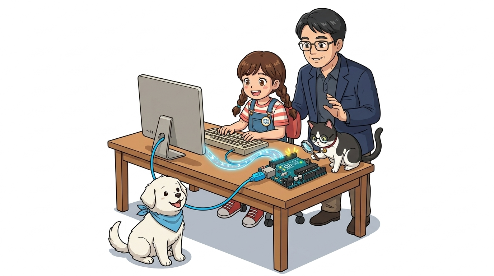
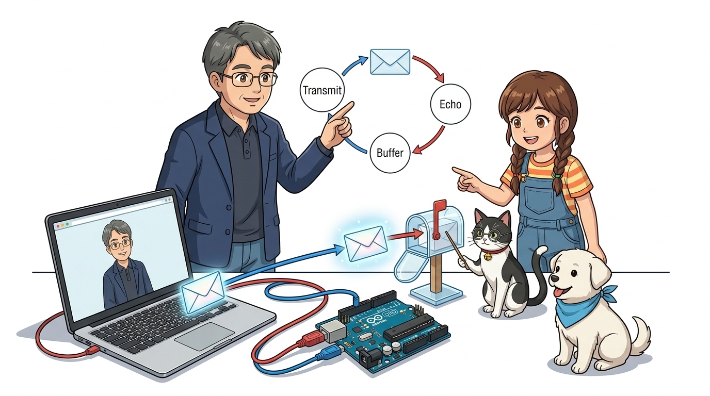
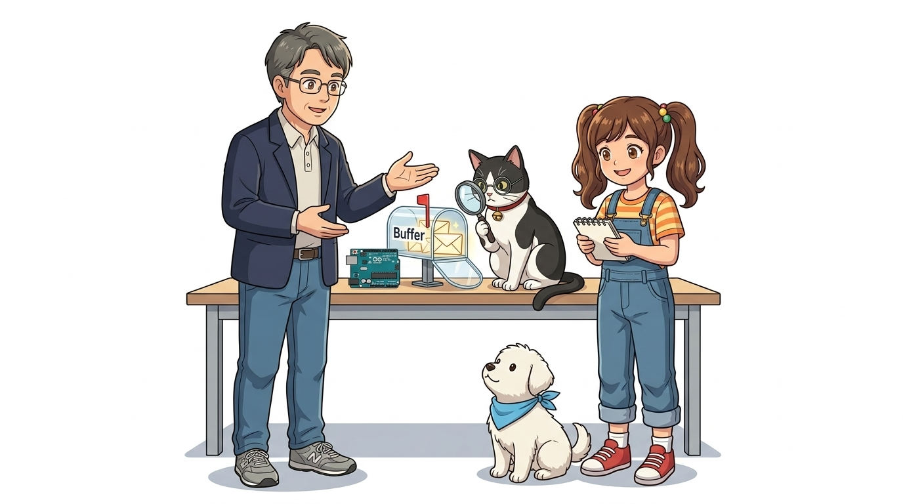
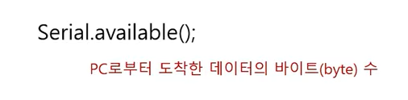
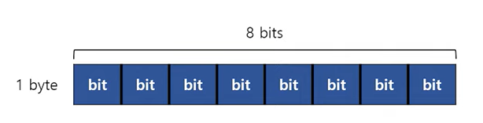
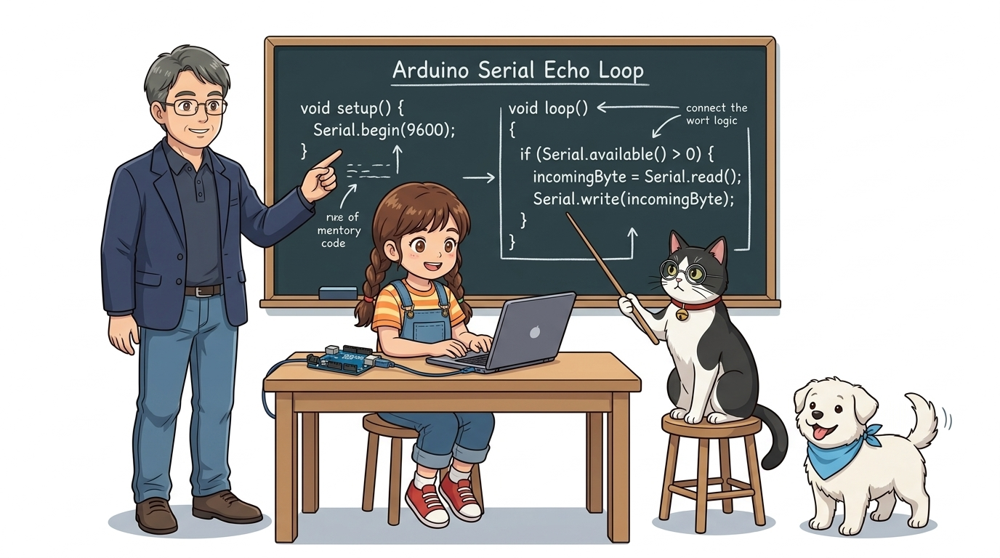
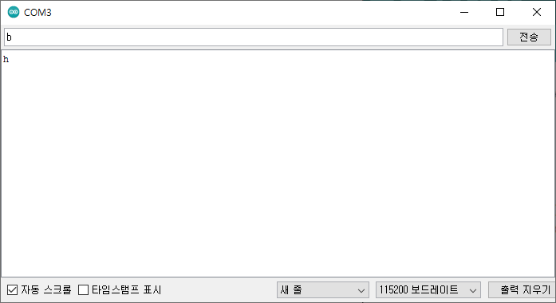

# 024_시리얼Read_키보드명령전송 ✉️

> **👨‍🏫 이호진 교수님**: "이번 시간에는 컴퓨터에서 아두이노로 글자를 보내고, 아두이노가 읽어서 응답하는 '양방향 시리얼 통신'을 배워볼까요?"  
> **👧 도로시**: "와! 아두이노가 보낸 편지만 받는 게 아니라, 내가 키보드로 글자를 쳐서 아두이노에게 명령을 보낼 수도 있는 거군요!"  
> **🐱 조수 지니**: "그렇답니다! 시리얼 모니터 상단 입력창에 글자를 치면 아두이노의 **'시리얼 수신 버퍼(우편함)'**로 쏙 배달돼요! 차근차근 읽어봅시다, 냐옹!"  
> **🐶 토토**: "멍멍! (주고받는 진짜 메아리 대화가 시작된다 멍!)"



* 🖥️ **강의 슬라이드**: [slides.md](./slides.md)

---

## 1. 일방통행에서 '양방향 대화'로! ↔️

- 지난 시간에는 아두이노가 컴퓨터로 일방적으로 글자를 보내는 `Serial.println()`을 배웠어요.
- 이번에는 컴퓨터에서 키보드로 입력한 글자를 아두이노가 읽고, 다시 우리에게 메아리(Echo)처럼 돌려주는 **시리얼 에코 프로그램**을 만들어 봅니다!

> **👧 도로시**: "내가 '안녕'이라고 치면 아두이노가 '안녕'이라고 답장해 주는 거네요!"  
> **👨‍🏫 이호진 교수님**: "맞아요! 일방적으로 메시지를 뿌리는 방송국에서 서로 말을 주고받는 무전기나 전화기 시스템으로 진화하는 셈입니다."


---

## 2. 시리얼 에코 프로그램의 동작 원리 📬

1. 컴퓨터의 시리얼 모니터 상단 입력창에 글자를 타이핑하고 전송 버튼을 눌러요.
2. USB 케이블을 타고 아두이노의 **'시리얼 수신 버퍼(임시 우편함)'**에 글자가 도착해요.
3. 아두이노 코드가 우편함에 편지가 왔는지 확인(`Serial.available()`)해요.
4. 편지를 한 글자 꺼내서(`Serial.read()`) 컴퓨터 모니터로 다시 쏴줘요!

```cpp
// 키보드로 입력한 문자를 그대로 되돌려주는 에코(Echo) 스케치
void setup() {
  Serial.begin(9600); // 9600 bps 시리얼 통신 초기화
}

void loop() {
  char a;
  // PC에서 보낸 문자가 도착했는지 확인
  if (Serial.available()) {
    a = Serial.read();  // 도착한 문자 1바이트 읽기
    Serial.println(a); // PC 화면으로 다시 전송 (에코 출력)
  }
}
```



---

## 3. 1단계: 대화 속도 맞추기 `setup()` 🚦

- 컴퓨터와 아두이노가 서로 같은 속도로 귀를 기울여야 글자가 깨지지 않아요.
- `setup()` 함수에 `Serial.begin(9600);`을 적어 통신 속도를 세팅합니다.

```cpp
void setup() {
  Serial.begin(9600); // 9600 보드레이트로 통신 시작!
}
```

> **🐱 조수 지니**: "아두이노 IDE 시리얼 모니터 창 오른쪽 아래 통신 속도도 9600 baud로 똑같이 맞춰져 있는지 꼭 확인하세요, 냐옹!"  
> **👨‍🏫 이호진 교수님**: "두 장치의 통신 속도(보드레이트)가 일치해야 정확한 문자 비트가 해석됩니다."



---

## 4. 2단계: 도착한 글자를 담을 상자 `char a;` 📦

- 편지 봉투에 담겨온 알파벳 글자 하나를 보관할 **1바이트짜리 문자형 변수 `a`**를 준비해요.

```cpp
char a; // 문자 하나를 담을 변수 상자 선언!
```

> **👧 도로시**: "지난 시간에 배운 `char` 상자가 바로 여기서 활약하는군요!"  
> **🐶 토토**: "멍멍! (알파벳 하나씩 쏙쏙 담을 예쁜 상자다 멍!)"


---

## 5. 3단계: 우편함 확인 `Serial.available()` 📬

- 컴퓨터에서 글자를 보내지 않았는데 억지로 읽으려고 하면 이상한 빈 쓰레기 값이 읽혀요!
- **`Serial.available()`**: 지금 수신 버퍼(우편함)에 몇 개의 글자가 도착해 쌓여있는지 알려주는 함수예요.
- 우편함에 글자가 1개 이상 있을 때만(`> 0`) 문을 열고 읽어야 안전해요!

> **🐱 조수 지니**: "우편함이 비어있는데 억지로 열어보려 하면 쓰레기 값(-1)이 읽힐 수 있어요!"  
> **👨‍🏫 이호진 교수님**: "`Serial.available()` 함수로 버퍼에 도착한 데이터 크기를 먼저 확인하는 방어 코딩이 필수입니다."



---

## 6. 4단계: 조건문 `if`로 똑똑하게 검사하기 🔍

- "만약 새 편지가 도착했다면? 그때만 편지를 읽어라!"

```cpp
if (Serial.available()) {
  // 새 글자가 우편함에 도착했을 때만 이 안의 명령을 실행해요!
}
```



---

## 7. 5단계: 편지 꺼내 읽기 `Serial.read()` 📖

- **`Serial.read()`**: 우편함(버퍼) 맨 앞에 들어온 글자 하나를 쏙 꺼내서 반환해요.
- 꺼낸 글자를 변수 `a`에 저장한 뒤, 곧바로 `Serial.print(a)`로 컴퓨터 화면에 다시 띄워줍니다!

```cpp
a = Serial.read(); // 버퍼에서 글자 하나 꺼내기
Serial.print(a);   // 컴퓨터 화면으로 다시 돌려보내기(에코)!
```


---

## 8. 전체 코드 조립과 무한 반복 `loop()` 🔄

```cpp
void setup() {
  Serial.begin(9600);
}

void loop() {
  if (Serial.available()) {
    char a = Serial.read();
    Serial.print(a);
  }
}
```

- `loop()` 덕분에 아두이노는 1초에 수만 번씩 우편함을 확인하며 우리가 타자를 치자마자 즉각 응답해요!

> **👧 도로시**: "`loop()`가 1초에 수만 번씩 우편함을 확인해 주니까, 내가 키보드를 누르자마자 번개처럼 답장이 오는군요!"  
> **👨‍🏫 이호진 교수님**: "바로 그 원리 덕분에 나중에 로봇이나 드론을 조종할 때도 실시간 원격 제어가 가능해집니다."



---

## 9. 시리얼 모니터로 직접 대화해 보기! 💬

1. 코드를 업로드하고 **시리얼 모니터**를 켭니다.
2. 맨 위 텍스트 상자에 영어로 **"hello"**를 치고 **전송(Send)** 버튼을 누릅니다.
3. 아래 창에 아두이노가 즉시 **"hello"**를 똑같이 따라 하며 메아리를 울리는 것을 확인하세요!

> **👧 도로시**: "내가 타이핑한 'hello'를 아두이노가 읽고 나한테 즉시 되돌려줬어요!"  
> **🐱 조수 지니**: "이제 컴퓨터와 아두이노가 완벽한 한 쌍의 친구가 된 셈입니다, 냐옹!"



---

## 🌟 이번 시간 핵심 정리!

1. **`Serial.available()`**: 우편함(버퍼)에 도착한 데이터가 있는지 똑똑하게 확인해요.
2. **`Serial.read()`**: 우편함에서 1바이트 문자 데이터를 하나 꺼내와요.
3. **양방향 통신의 시작**: 이제 컴퓨터로 명령을 입력해서 아두이노의 LED를 켜거나 모터를 돌릴 수 있어요!

> **👧 도로시**: "교수님, 지니야! 시리얼 통신 기초를 완벽하게 정복했어요! 다음엔 진짜 부품으로 불빛을 켜보고 싶어요!"  
> **👨‍🏫 이호진 교수님**: "아주 훌륭합니다, 도로시! 이제 아두이노의 포트와 액추에이터를 통해 반짝이는 LED와 전자 부품들을 직접 제어하는 세계로 나아가 봅시다!"  
> **🐱 조수 지니**: "저 지니와 토토도 부품 키트를 준비해 둘 테니 힘차게 출발해 봐요, 냐옹!"  
> **🐶 토토**: "멍멍! (반짝반짝 LED 실습으로 가자 멍!)"


