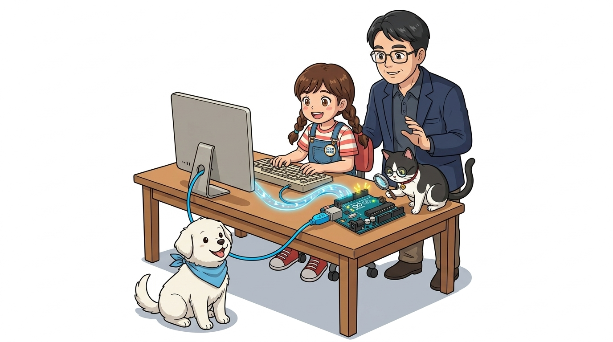
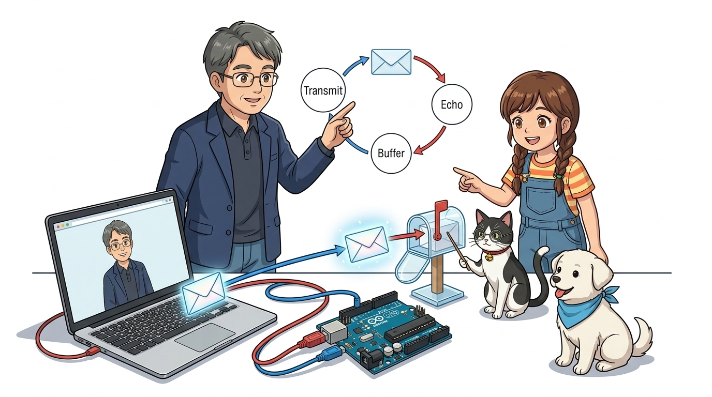
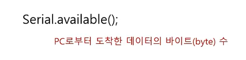
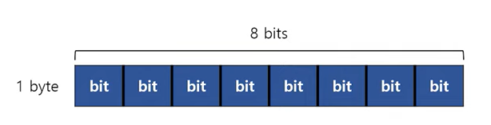
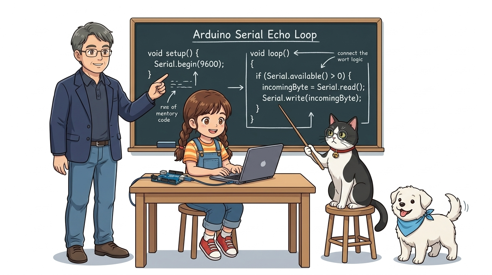
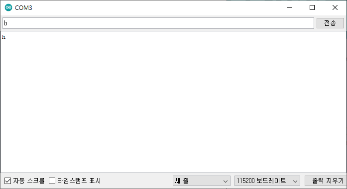

# 024_시리얼Read_키보드명령전송 ✉️



* **👨‍🏫 이호진 교수님**: "이번 시간에는 컴퓨터에서 아두이노로 글자를 보내고, 아두이노가 읽어서 응답하는 '양방향 시리얼 통신'을 배워볼까요?"
* **👧 도로시**: "와! 아두이노가 보낸 편지만 받는 게 아니라, 내가 키보드로 글자를 쳐서 아두이노에게 명령을 보낼 수도 있는 거군요!"
* **🐱 조수 지니**: "그렇답니다! 시리얼 모니터 상단 입력창에 글자를 치면 아두이노의 **'시리얼 수신 버퍼(우편함)'**로 쏙 배달돼요! 차근차근 읽어봅시다, 냐옹!"
* **🐶 토토**: "멍멍! (주고받는 진짜 메아리 대화가 시작된다 멍!)"
* 📖 **상세 강의 교재**: [index.md](./index.md)


> 여러분 안녕하세요! 이번 시간에는 '024. 시리얼Read 키보드명령전송 ✉️'을 주제로 함께 흥미진진한 탐험을 떠나보겠습니다. 공학 멘토 이호진 교수님과 꼼꼼한 조수 지니, 호기심 많은 탐험가 도로시, 그리고 귀여운 토토와 함께 신나는 아두이노 모험을 힘차게 시작해 봅시다. 준비되셨나요?

---

## 1. 일방통행에서 '양방향 대화'로! ↔️


* **👧 도로시**: "내가 '안녕'이라고 치면 아두이노가 '안녕'이라고 답장해 주는 거네요!"
* **👨‍🏫 이호진 교수님**: "맞아요! 일방적으로 메시지를 뿌리는 방송국에서 서로 말을 주고받는 무전기나 전화기 시스템으로 진화하는 셈입니다."

- 지난 시간에는 아두이노가 컴퓨터로 일방적으로 글자를 보내는 `Serial.println()`을 배웠어요.
- 이번에는 컴퓨터에서 키보드로 입력한 글자를 아두이노가 읽고, 다시 우리에게 메아리(Echo)처럼 돌려주는 **시리얼 에코 프로그램**을 만들어 봅니다!

> 이번 슬라이드에서는 '1. 일방통행에서 '양방향 대화'로! ↔️'에 대해 자세히 살펴보겠습니다. 지난 시간에는 아두이노가 컴퓨터로 일방적으로 글자를 보내는 Serial.println()을 배웠다면, 이번에는 컴퓨터에서 키보드로 입력한 글자를 아두이노가 읽고 다시 우리에게 메아리처럼 돌려주는 시리얼 에코 프로그램을 만들어 봅니다. 이 원리는 향후 센서와 모터를 컴퓨터로 제어할 때 핵심이 되는 양방향 통신의 든든한 주춧돌입니다.

---

## 2. 시리얼 에코 프로그램의 동작 원리 📬



1. 컴퓨터의 시리얼 모니터 상단 입력창에 글자를 타이핑하고 전송 버튼을 눌러요.
2. USB 케이블을 타고 아두이노의 **'시리얼 수신 버퍼(임시 우편함)'**에 글자가 도착해요.
3. 아두이노 코드가 우편함에 편지가 왔는지 확인(`Serial.available()`)해요.
4. 편지를 한 글자 꺼내서(`Serial.read()`) 컴퓨터 모니터로 다시 쏴줘요!

```cpp
// 키보드로 입력한 문자를 그대로 되돌려주는 에코(Echo) 스케치
void setup() {
  Serial.begin(9600); // 9600 bps 시리얼 통신 초기화
}

void loop() {
  char a;
  // PC에서 보낸 문자가 도착했는지 확인
  if (Serial.available()) {
    a = Serial.read();  // 도착한 문자 1바이트 읽기
    Serial.println(a); // PC 화면으로 다시 전송 (에코 출력)
  }
}
```

> 이번 슬라이드에서는 '2. 시리얼 에코 프로그램의 동작 원리 📬'에 대한 실제 동작 코드를 분석해 보겠습니다. 컴퓨터의 시리얼 모니터 상단 입력창에 글자를 타이핑하면 USB 케이블을 타고 아두이노의 시리얼 수신 버퍼에 도착합니다. 아두이노 코드는 우편함에 편지가 왔는지 확인(Serial.available)하고, 편지를 한 글자 꺼내어(Serial.read) 컴퓨터 화면으로 다시 돌려보냅니다.

---

## 3. 1단계: 대화 속도 맞추기 `setup()` 🚦


* **🐱 조수 지니**: "아두이노 IDE 시리얼 모니터 창 오른쪽 아래 보드레이트 속도도 9600 baud로 똑같이 맞춰져 있는지 꼭 확인하세요, 냐옹!"
* **👨‍🏫 이호진 교수님**: "컴퓨터와 아두이노가 서로 같은 속도로 귀를 기울여야 글자가 깨지지 않고 올바르게 전달됩니다."

```cpp
void setup() {
  Serial.begin(9600); // 9600 보드레이트로 통신 시작!
}
```

> 3단계에서는 컴퓨터와 아두이노의 통신 속도를 일치시키는 setup() 설정을 다룹니다. 코드에서 Serial.begin(9600)으로 설정했다면, 시리얼 모니터 화면의 속도 설정도 정확히 9600 baud로 맞춰야 데이터 깨짐 현상을 방지할 수 있습니다.

---

## 4. 2단계: 도착한 글자를 담을 상자 `char a;` 📦


* **👧 도로시**: "지난 시간에 배운 `char` 상자가 바로 여기서 활약하는군요!"
* **🐶 토토**: "멍멍! (알파벳 하나씩 쏙쏙 담을 예쁜 상자다 멍!)"

- 편지 봉투에 담겨온 알파벳 글자 하나를 보관할 **1바이트짜리 문자형 변수 `a`**를 준비해요.

```cpp
char a; // 문자 하나를 담을 변수 상자 선언!
```

> 4단계에서는 우편함에서 꺼내온 1글자를 임시로 저장할 문자형 변수 char a를 선언합니다. 1바이트 크기의 메모리 방을 마련하여 컴퓨터로부터 전달된 아스키코드 문자를 안전하게 수신할 준비를 마칩니다.

---

## 5. 3단계: 우편함 확인 `Serial.available()` 📬



* **🐱 조수 지니**: "우편함이 비어있는데 억지로 열어보려 하면 쓰레기 값(-1)이 읽힐 수 있어요!"
* **👨‍🏫 이호진 교수님**: "`Serial.available()` 함수는 현재 수신 버퍼에 몇 바이트의 데이터가 도착해 대기 중인지 알려줍니다."

- 우편함에 글자가 1개 이상 도착했을 때만(`Serial.available() > 0`) 읽어야 안전해요!

> 5단계에서는 시리얼 수신 버퍼의 대기 데이터 유무를 확인하는 Serial.available() 함수를 학습합니다. 버퍼에 읽을 수 있는 데이터가 도착해 있을 때만 읽기 동작을 수행하도록 방어 코딩을 적용하는 필수 단계입니다.

---

## 6. 4단계: 조건문 `if`로 똑똑하게 검사하기 🔍



- "만약 새 편지가 도착했다면? 그때만 편지를 읽어라!"
- 글자가 없으면 아무것도 하지 않고 대기하므로 불필요한 시스템 오류가 방지됩니다.

```cpp
if (Serial.available()) {
  // 새 글자가 우편함에 도착했을 때만 이 안의 명령을 실행해요!
}
```

> 조건문 if를 활용해 Serial.available()이 참(도착한 바이트 수가 1 이상)일 때만 블록 내부의 코드를 실행하도록 구성합니다.

---

## 7. 5단계: 편지 꺼내 읽기 `Serial.read()` 📖


- **`Serial.read()`**: 우편함(버퍼) 맨 앞에 들어온 글자 하나를 쏙 꺼내서 반환해요.
- 꺼낸 글자를 변수 `a`에 저장한 뒤, 곧바로 `Serial.print(a)`로 컴퓨터 화면에 다시 띄워줍니다!

```cpp
a = Serial.read(); // 버퍼에서 글자 하나 꺼내기
Serial.print(a);   // 컴퓨터 화면으로 다시 돌려보내기(에코)!
```

> 7단계에서는 Serial.read() 함수로 버퍼의 선두 바이트를 가져와 char a에 담고, 이를 Serial.print(a)를 통해 컴퓨터 화면으로 즉시 에코 출력하는 핵심 흐름을 살펴봅니다.

---

## 8. 전체 코드 조립과 무한 반복 `loop()` 🔄



* **👧 도로시**: "`loop()`가 1초에 수만 번씩 우편함을 확인해 주니까, 내가 키보드를 누르자마자 번개처럼 답장이 오는군요!"
* **👨‍🏫 이호진 교수님**: "바로 그 원리 덕분에 나중에 로봇이나 드론을 조종할 때도 실시간 원격 제어가 가능해집니다."

```cpp
void setup() {
  Serial.begin(9600);
}

void loop() {
  if (Serial.available()) {
    char a = Serial.read();
    Serial.print(a);
  }
}
```

> 전체 에코 스케치의 완성입니다. loop() 무한 반복 덕분에 아두이노는 사용자 입력이 발생하는 즉시 감지하여 딜레이 없이 실시간 에코 반응을 보입니다.

---

## 9. 시리얼 모니터로 직접 대화해 보기! 💬



* **👧 도로시**: "내가 타이핑한 'hello'를 아두이노가 읽고 나한테 즉시 되돌려줬어요!"
* **🐱 조수 지니**: "이제 컴퓨터와 아두이노가 완벽한 한 쌍의 친구가 된 셈입니다, 냐옹!"

1. 코드를 업로드하고 **시리얼 모니터**를 켭니다.
2. 맨 위 텍스트 상자에 영어로 **"hello"**를 치고 **전송(Send)** 버튼을 누릅니다.
3. 아래 창에 아두이노가 즉시 **"hello"**를 똑같이 따라 하며 메아리를 울리는 것을 확인하세요!

---

## 🌟 이번 시간 핵심 정리!


* **👧 도로시**: "교수님, 지니야! 시리얼 통신 기초를 완벽하게 정복했어요! 다음엔 진짜 부품으로 불빛을 켜보고 싶어요!"
* **👨‍🏫 이호진 교수님**: "아주 훌륭합니다, 도로시! 이제 아두이노의 포트와 액추에이터를 통해 반짝이는 LED와 전자 부품들을 직접 제어하는 세계로 나아가 봅시다!"
* **🐱 조수 지니**: "저 지니와 토토도 부품 키트를 준비해 둘 테니 힘차게 출발해 봐요, 냐옹!"
* **🐶 토토**: "멍멍! (반짝반짝 LED 실습으로 가자 멍!)"

1. **`Serial.available()`**: 우편함(버퍼)에 도착한 데이터가 있는지 똑똑하게 확인해요.
2. **`Serial.read()`**: 우편함에서 1바이트 문자 데이터를 하나 꺼내와요.
3. **양방향 통신의 시작**: 이제 컴퓨터로 명령을 입력해서 아두이노의 LED를 켜거나 모터를 돌릴 수 있어요!

> 오늘 배운 시리얼 수신 및 에코 원리는 아두이노 시스템의 기초이자 핵심입니다. 다음 강의에서는 아두이노 포트와 액추에이터, 그리고 반짝이는 LED 제어 실습으로 흥미진진한 모험을 이어가겠습니다! 모두 수고 많으셨습니다!