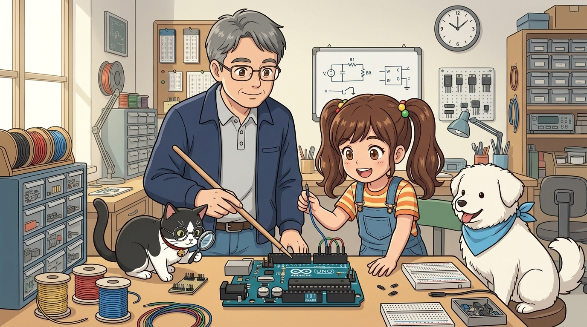
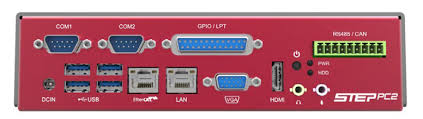
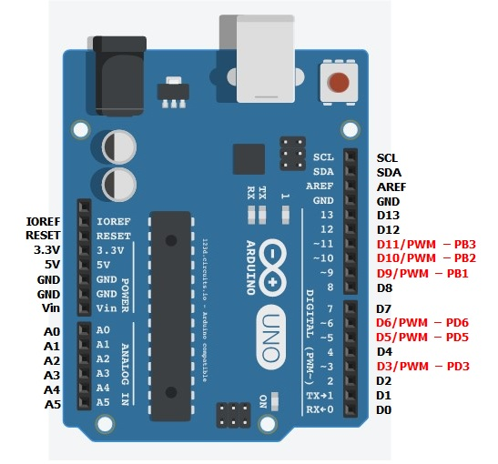
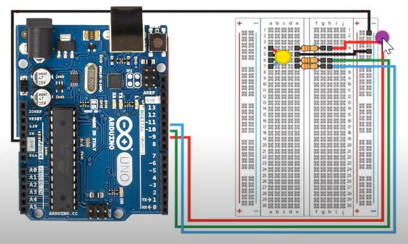
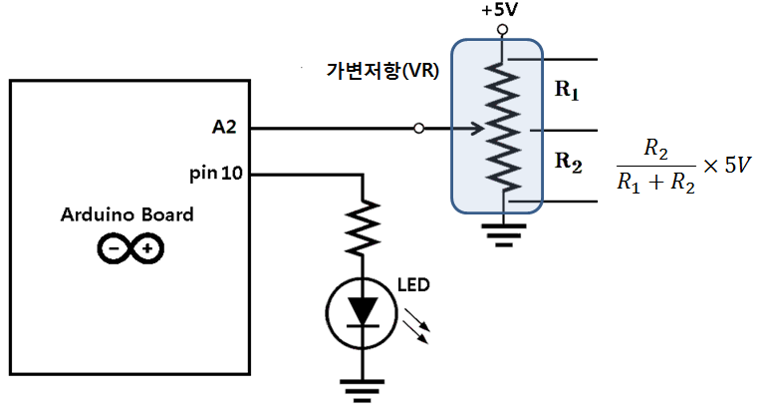
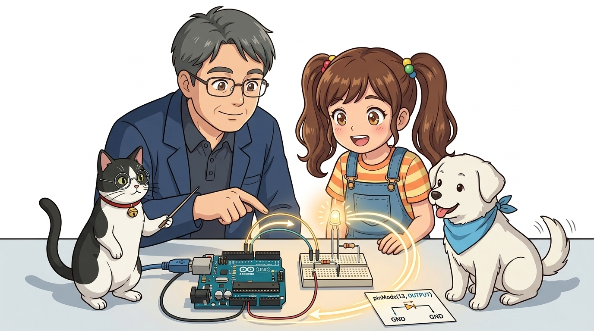

# 025_세상과연결되는문_아두이노포트 🚪

> **피지컬 컴퓨팅의 관문! 아두이노 소켓 핀의 구조와 GPIO(범용 입출력) 동작 원리**  
> 디지털 핀, 아날로그 핀, 전원 핀(5V/GND)의 역할과 `pinMode()` 함수의 방향 설정을 학습합니다.



* 🖥️ **강의 슬라이드**: [slides.md](./slides.md)

---

## 1. 아두이노 연결 포트 살펴보기 🔍

아두이노 우노 보드의 위아래 테두리를 따라 까만색 암 소켓 핀들이 질서정연하게 늘어서 있습니다.

> **👧 도로시**: "교수님, 지니야! 아두이노 테두리에 까만 구멍들이 줄지어 있는데, 여긴 전선을 꽂는 항구 같은 곳인가요?"  
> **👨‍🏫 이호진 교수님**: "정답입니다, 도로시! 배들이 드나드는 항구(Port)처럼 신호와 전기가 오고 가는 출입문을 바로 **'포트(Port)'** 또는 **'핀(Pin)'**이라고 부릅니다."  
> **🐱 조수 지니**: "납땜 없이 점퍼 와이어를 손쉽게 꽂고 뺄 수 있는 암 소켓 헤더 구조랍니다, 냐옹!"  
> **🐶 토토**: "멍멍! (알록달록 전선을 꽂으면 신기한 마법이 통한다 멍!)"


> [!NOTE]
> **소켓 헤더(Socket Header)의 역할**  
> 납땜(Soldering)을 하지 않고도 점퍼 와이어를 손쉽게 꽂았다 뺄 수 있어 프로토타이핑(시제품 제작) 속도를 획기적으로 높여줍니다.

---

## 2. 포트(Port)란 무엇일까요? ⚓

**포트(Port)**는 라틴어 *porta*(문, 출입구)와 영어의 *Port*(항구)에서 유래된 공학 용어입니다.


* **하드웨어적 의미**: 전기 신호와 전류가 물리적으로 통과하는 단자 및 커넥터 소켓
* **소프트웨어적 의미**: 운영체제나 마이크로컨트롤러가 외부 장치와 비트 단위 데이터를 주고받는 번지 지정 레지스터
* 무역선이 항구에서 화물을 싣고 내리듯, 전자기기 내부의 두뇌(MCU)는 포트를 통해 바깥세상과 소통합니다.

---

## 3. 컴퓨터의 다양한 입출력 포트들 💻

우리가 일상에서 사용하는 PC나 스마트폰에도 다양한 목적의 전용 포트들이 존재합니다.



| 포트 명칭 | 주요 전송 매체 | 대표 연결 장치 |
| :---: | :---: | :--- |
| **USB 포트** | 직렬 데이터 + 전원 (5V) | 키보드, 마우스, USB 메모리, 아두이노 |
| **HDMI 포트** | 디지털 영상 + 음성 신호 | 고화질 모니터, 빔프로젝터, TV |
| **LAN 포트 (RJ-45)** | 이더넷 네트워크 패킷 | 유선 공유기, 인터넷 통신망 |
| **오디오 잭 (3.5mm)**| 아날로그 음향 신호 | 헤드폰, 마이크, 스피커 |

---

## 4. 아두이노 우노의 포트 지도 (Pinout Map) 🗺️

아두이노 우노의 핀들은 기능에 따라 3대 핵심 구역으로 분류됩니다.



1. **디지털 입출력 핀 (D0 ~ D13, 상단 14개)**:
   * 0V(LOW) 또는 5V(HIGH)의 2진 디지털 신호를 출력하거나 감지
   * 물결표(`~`)가 표시된 3, 5, 6, 9, 10, 11번 핀은 아날로그 흉내를 내는 **PWM 핀**
2. **아날로그 입력 핀 (A0 ~ A5, 하단 6개)**:
   * 0V부터 5V 사이의 연속적인 전압을 10비트 디지털 숫자(0~1023)로 정밀 변환(ADC)
3. **전원 공급 핀 (Power Header, 하단 좌측)**:
   * 부품 구동을 위한 `5V`, `3.3V`, `GND`(접지), 외부 전원 입력 단자 `VIN`

---

## 5. 전원 공급 핀: 5V와 GND ⚡

모든 전자 회로의 동작을 가능하게 하는 에너지 통로입니다.



* **`5V` / `3.3V` (전원 플러스, `+`)**: 펌프처럼 전자를 밀어내어 전류를 공급하는 단자
* **`GND` (Ground, 접지, `-`)**: 전기가 바닥으로 흘러 들어가 회로를 완성하는 기준 전위(0V)
* **폐회로(Closed Loop) 원칙**: 전기는 `5V`에서 출발하여 부품을 통과한 후 반드시 `GND`로 되돌아와야만 장치가 켜집니다!

---

## 6. 양방향의 문: 입력(INPUT)과 출력(OUTPUT) 🚪

아두이노의 디지털 핀은 소프트웨어 설정에 따라 입력용 문도 되고 출력용 문도 될 수 있는 **GPIO(General Purpose Input/Output)** 입니다.



* **출력 (OUTPUT)**: 아두이노가 능동적으로 5V 전압을 공급하여 LED를 켜거나 모터를 회전시킴
* **입력 (INPUT)**: 외부 스위치가 눌렸는지, 센서에서 신호가 왔는지 핀의 전압 상태를 수동적으로 감시

---

## 7. 코드에서 문의 방향 정하기: `pinMode()` 🚦

디지털 핀을 사용하기 전에는 `setup()` 함수에서 핀의 방향을 먼저 선언해야 합니다.



```cpp
void setup() {
  // 13번 핀을 전기를 내보내는 '출력(OUTPUT)' 문으로 설정
  pinMode(13, OUTPUT);
  
  // 2번 핀을 외부 신호를 받아들이는 '입력(INPUT)' 문으로 설정
  pinMode(2, INPUT);
}

void loop() {
  // 13번 핀으로 5V(HIGH) 전기를 뿜어내어 LED 점등!
  digitalWrite(13, HIGH);
}
```

> [!TIP]
> `pinMode()`를 선언하지 않고 `digitalWrite()`나 `digitalRead()`를 호출하면 내부 저항 설정이 불안정해져 회로 오작동의 원인이 됩니다.

---

## 🌟 이번 시간 핵심 정리! 🏆

축하합니다! 아두이노 하드웨어의 출입문인 포트와 핀의 기본 원리를 완벽히 파악했습니다.


### 📋 핵심 요약 체크리스트

* [x] **포트의 본질**: 데이터와 전기가 통과하는 물리적/논리적 통로입니다.
* [x] **3대 핀 구역**: D0~D13 디지털 핀, A0~A5 아날로그 핀, 전원 핀(5V/GND)을 명확히 구분했습니다.
* [x] **`pinMode(pin, mode)`**: 핀을 사용하기 전 반드시 `INPUT` 또는 `OUTPUT` 방향을 선언해야 함을 체득했습니다.

> **👧 도로시**: "포트의 원리를 확실히 배웠으니, 다음엔 전기를 받아 실제로 움직이고 빛나는 신기한 **'액추에이터'**들을 만나보고 싶어요!"  
> **👨‍🏫 이호진 교수님**: "좋습니다! 다음 시간에는 모터와 부저, LED 같은 다양한 액추에이터의 세계로 본격적으로 떠나봅시다!"  
> **🐱 조수 지니**: "저 지니와 토토도 신기한 부품들을 한가득 챙겨올게요, 냐옹!"  
> **🐶 토토**: "멍멍! (모터랑 부저 구경하러 가자 멍!)"
