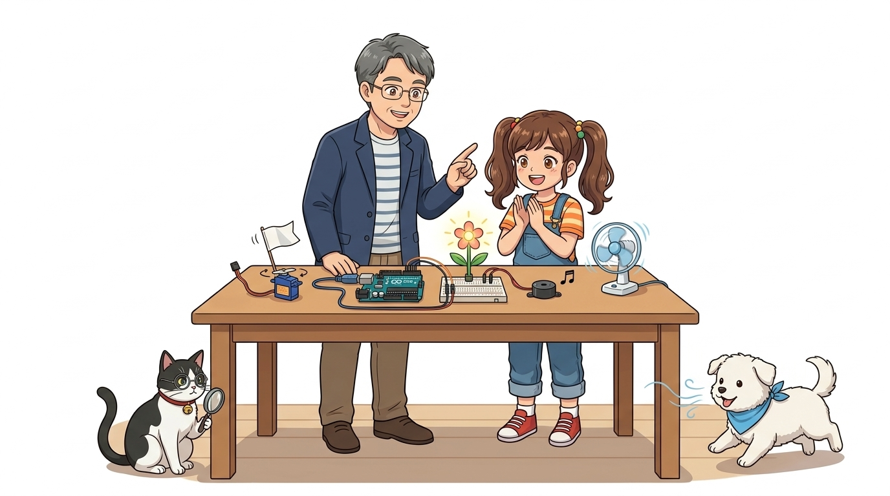
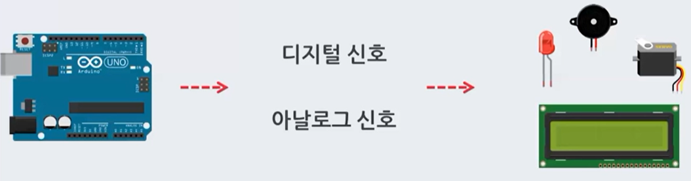
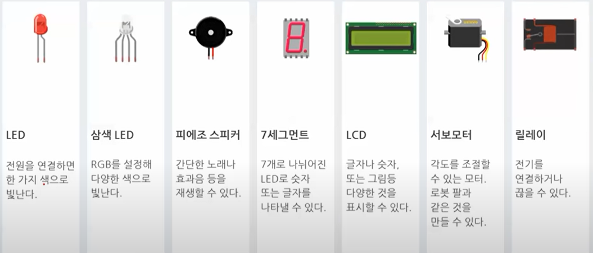
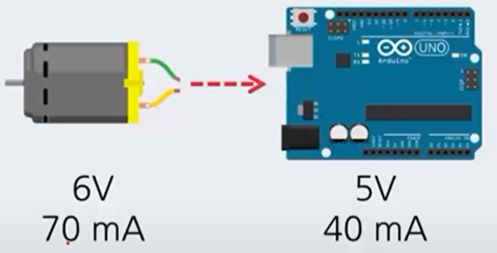
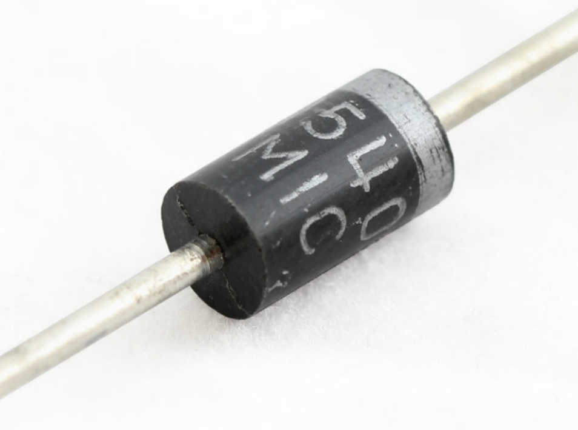
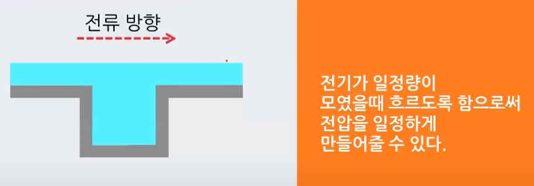

# 026_움직임과빛을만드는_액추에이터 ⚙️

* **로봇의 근육과 성대! 전기 신호를 물리적 운동, 빛, 소리로 변환하는 출력 장치들**
* 액추에이터의 분류, 아두이노 GPIO 전류 한계(20mA), 유도성 부하의 역기전력 차단(플라이백 다이오드, 바이패스 커패시터)을 심층 학습합니다.
* 📖 **상세 강의 교재**: [index.md](./index.md)

> 여러분 안녕하세요! 이번 시간에는 '026. 움직임과빛을만드는 액추에이터 ⚙️'을 주제로 함께 흥미진진한 탐험을 떠나보겠습니다. 공학 멘토 이호진 교수님과 꼼꼼한 조수 지니, 호기심 많은 탐험가 도로시, 그리고 귀여운 토토와 함께 신나는 아두이노 모험을 힘차게 시작해 봅시다. 준비되셨나요?

---

## 1. 👧 도로시의 호기심: "로봇 팔은 어떻게 움직여요?"

* **👧 도로시**: "교수님, 지니야! 우리가 C++ 코드로 명령을 내리면, 아두이노는 어떻게 로봇 팔을 움직이고 부저로 소리를 내는 건가요?"
* **👨‍🏫 이호진 교수님**: "전기 신호를 받아 힘차게 물리적 운동을 일으키거나 빛과 소리를 내는 마법의 손발, 바로 **'액추에이터(Actuator)'**가 있기 때문입니다."
* **🐱 조수 지니**: "인간의 몸에 비유하면 뇌의 신경 신호를 받아 움직이는 근육과 성대에 해당해요, 냐옹!"
* **🐶 토토**: "멍멍! (바람개비도 쌩쌩 돌고 멜로디도 나온다 멍!)"
* [!NOTE]
* **인간 신체와 로봇의 대응**
* 센서(Sensor)가 눈, 코, 귀 같은 감각 기관이라면, 액추에이터(Actuator)는 뇌(MCU)의 전기 명령을 받아 세상에 물리적 영향을 미치는 근육, 팔다리, 성대에 해당합니다.

아두이노 보드로 프로그래밍을 시작한 도로시가 로봇의 동작 원리를 궁금해합니다!

> 자, 이번 슬라이드의 질문을 함께 보시겠습니다. 바로 '1. 👧 도로시의 호기심: "로봇 팔은 어떻게 움직여요?"'라는 아주 흥미로운 질문입니다. 도로시가 궁금해하자 이호진 교수님과 조수 지니가 액추에이터의 원리를 명쾌하게 설명해 줍니다. 이 원리는 향후 센서와 모터를 다루는 모든 로봇 공학의 기초입니다.

---

## 2. 액추에이터(Actuator)란 무엇일까요? 🚀

* **운동 에너지 (동역학적 변환)**: DC 모터(연속 회전), 서보 모터(각도 제어), 스텝 모터(정밀 위치), 솔레노이드(선형 밀기/당기기)
* **광 에너지 (빛 변환)**: 발광 다이오드(LED), OLED, 네오픽셀 RGB 스트립
* **음향 에너지 (소리 변환)**: 피에조 부저(Buzzer), 소형 스피커(Speaker)
* **열 에너지 (온도 변환)**: 펠티어 소자(냉각/발열), 니크롬선 열선

액추에이터는 제어기(Controller)의 전기적 신호 에너지를 역학적 운동 에너지, 광 에너지, 음향 에너지 등으로 변환하는 모든 장치를 총칭합니다.
### 📌 변환 에너지 형태에 따른 분류

> 자, 이번 슬라이드의 질문을 함께 보시겠습니다. 바로 '2. 액추에이터(Actuator)란 무엇일까요? 🚀'라는 아주 흥미로운 질문입니다. 우리가 일상에서 흔히 접하는 운동 에너지 (동역학적 변환): DC 모터(연속 회전), 서보 모터(각도 제어), 스텝 모터(정밀 위치), 솔레노이드(선형 밀기/당기기) 현상을 떠올려보면 왜 이런 의문이 생기는지 쉽게 공감할 수 있습니다. 이 질문 속에 숨겨진 전자 회로와 컴퓨팅의 핵심 원리를 지금부터 차근차근 하나씩 파헤쳐 보겠습니다.

---

## 3. 우리 주변의 대표적인 액추에이터들 💡🔊🏎️

| 액추에이터 | 변환 형태 | 아두이노 제어 방식 | 주요 응용 분야 |
| :--- | :---: | :---: | :--- |
| **LED (발광 다이오드)** | 빛 | `digitalWrite()`, `analogWrite()` | 신호등, 상태 표시등, 무드등 |
| **피에조 부저 (Buzzer)** | 소리 | `tone()`, `noTone()` | 도어락 경보음, 전자 피아노 |
| **서보 모터 (SG90)** | 정밀 각도 (0~180°) | PWM 펄스 폭 제어 (`Servo.h`) | 로봇 관절, 스마트 쓰레기통 뚜껑 |
| **DC 모터** | 고속 연속 회전 | H-브리지 모터 드라이버 (L298N) | RC카 바퀴, 미니 선풍기 드론 |
| **릴레이 (Relay)** | 대전력 스위칭 | 디지털 On/Off 트리거 | 220V 가전제품 원격 제어 |

아두이노 피지컬 컴퓨팅 실습에서 자주 사용되는 핵심 부품들입니다.

> 이번에 살펴볼 내용은 '3. 우리 주변의 대표적인 액추에이터들 💡🔊🏎️'입니다. 슬라이드에 정리된 표를 통해 각 항목의 특징과 수치, 차이점을 한눈에 비교해 보실 수 있습니다. 이 기본 개념을 확실히 잡아두셔야 실제 부품을 브레드보드에 꽂고 코딩할 때 실수 없이 완성할 수 있습니다.

---

## 4. 아두이노 핀의 힘과 한계: 허용 전류 주의! ⚠️

* **디지털 핀 1개당 권장 전류**: 약 **20mA** (절대 최대 정격 40mA)
* **MCU 칩(ATmega328P) 전체 허용 전류**: 모든 핀 합계 **200mA**
* 작은 LED 1개(약 10~15mA)는 직결할 수 있지만, 전류 소모가 수백 mA에서 수 A에 달하는 모터나 솔레노이드를 핀에 바로 꽂으면 **MCU 내부 회로가 즉각 타버립니다!**

아두이노 UNO의 디지털 핀은 무제한으로 전기를 뿜어낼 수 없습니다.
### 🚨 하드웨어 파괴 주의보

> 이번에 살펴볼 내용은 '4. 아두이노 핀의 힘과 한계: 허용 전류 주의! ⚠️'입니다. 화면의 회로도와 부품 사진을 보면서 각 핀과 배선이 어떻게 구성되어 있는지 눈으로 직접 따라와 주시기 바랍니다. 첫째로 디지털 핀 1개당 권장 전류: 약 20mA (절대 최대 정격 40mA)에 유의해야 하며, 둘째로 MCU 칩(ATmega328P) 전체 허용 전류: 모든 핀 합계 200mA라는 점이 핵심입니다. 이 기본 개념을 확실히 잡아두셔야 실제 부품을 브레드보드에 꽂고 코딩할 때 실수 없이 완성할 수 있습니다.

---

## 5. 유도성 부하(Inductive Load)와 역기전력(Back-EMF) ⚡

* **렌츠의 법칙(Lenz's Law)**: 코일에 흐르던 전류가 갑자기 끊기면, 코일은 전류의 흐름을 유지하기 위해 원래 전압의 수 배에서 수십 배에 달하는 거대한 역전압(**역기전력, Back-EMF**)을 발생시킵니다.
* 이 고전압 스파크가 아두이노 보드로 역류하면 GPIO 트랜지스터가 파괴됩니다.

모터나 릴레이처럼 코일(인덕터)이 감긴 부품은 전원이 꺼지는 순간 강력한 스파크를 일으킵니다.

> 이번 슬라이드에서는 '5. 유도성 부하(Inductive Load)와 역기전력(Back-EMF) ⚡'에 대해 자세히 살펴보겠습니다. 화면의 다이어그램과 사진을 함께 참고해 주시기 바랍니다. 첫 번째 핵심은 렌츠의 법칙(Lenz's Law): 코일에 흐르던 전류가 갑자기 끊기면, 코일은 전류의 흐름을 유지하기 위해 원래 전압의 수 배에서 수십 배에 달하는 거대한 역전압(역기전력, Back-EMF)을 발생시킵니다.이며, 두 번째로는 이 고전압 스파크가 아두이노 보드로 역류하면 GPIO 트랜지스터가 파괴됩니다.입니다. 이 원리는 아두이노 시스템 전체를 관통하는 핵심 논리이므로 머릿속에 꼭 정리해 두시기 바랍니다.

---

## 6. 일방통행의 수호자: '플라이백 다이오드' ➡️

* **다이오드(Diode)**: 전기를 오직 애노드(`+`)에서 캐소드(`-`)의 한쪽 방향으로만 흘려보내는 일방통행 밸브
* **플라이백 다이오드(Flyback Diode) 연결법**:
* 모터 양단에 역방향으로 병렬 연결
* 전원이 꺼질 때 코일에서 발생하는 역방향 서지 전류를 다이오드 루프로 순환시켜 안전하게 소멸시킵니다.

역기전력으로부터 아두이노를 지켜주는 최고의 안전 방패입니다.

> 이번 슬라이드에서는 '6. 일방통행의 수호자: '플라이백 다이오드' ➡️'에 대해 자세히 살펴보겠습니다. 화면의 다이어그램과 사진을 함께 참고해 주시기 바랍니다. 첫 번째 핵심은 다이오드(Diode): 전기를 오직 애노드(+)에서 캐소드(-)의 한쪽 방향으로만 흘려보내는 일방통행 밸브이며, 두 번째로는 플라이백 다이오드(Flyback Diode) 연결법입니다. 여기에 덧붙여 모터 양단에 역방향으로 병렬 연결 내용까지 함께 이해해 두시면 완벽합니다. 이 원리는 아두이노 시스템 전체를 관통하는 핵심 논리이므로 머릿속에 꼭 정리해 두시기 바랍니다.

---

## 7. 전압의 출렁임을 잡는 '커패시터(Capacitor)' 💧

* **콘덴서(커패시터)**: 전기를 작은 물탱크처럼 저장해 두었다가 전압이 떨어질 때 즉각 방출하는 완충 장치
* 모터 전원선 가까이에 $100\mu\text{F}$ 이상의 전해 커패시터와 $0.1\mu\text{F}$ 세라믹 커패시터를 병렬로 달아주면 전원 노이즈가 제거되어 아두이노의 불시 재부팅 현상을 완벽히 차단합니다.

모터가 회전을 시작할 때 발생하는 순간적인 대전류(기동 전류)로 인한 시스템 전압 강하를 방지합니다.

> 이번 슬라이드에서는 '7. 전압의 출렁임을 잡는 '커패시터(Capacitor)' 💧'에 대해 자세히 살펴보겠습니다. 화면의 다이어그램과 사진을 함께 참고해 주시기 바랍니다. 첫 번째 핵심은 콘덴서(커패시터): 전기를 작은 물탱크처럼 저장해 두었다가 전압이 떨어질 때 즉각 방출하는 완충 장치이며, 두 번째로는 모터 전원선 가까이에 $100\mu\text{F}$ 이상의 전해 커패시터와 $0.1\mu\text{F}$ 세라믹 커패시터를 병렬로 달아주면 전원 노이즈가 제거되어 아두이노의 불시 재부팅 현상을 완벽히 차단합니다.입니다. 이 원리는 아두이노 시스템 전체를 관통하는 핵심 논리이므로 머릿속에 꼭 정리해 두시기 바랍니다.

---

## 🌟 도로시와 지니의 이번 시간 핵심 정리! 🏆

* **👧 도로시**: "액추에이터의 원리와 안전 수칙을 완벽히 배웠어요! 다음엔 가장 기본적이고 친근한 **'LED'**에 대해 더 깊이 알아보고 싶어요!"
* **👨‍🏫 이호진 교수님**: "아주 좋습니다! 다음 시간에는 반짝반짝 빛의 요정인 **'LED란 무엇인가'**에 대해 원리부터 차근차근 탐험해 봅시다."
* **🐱 조수 지니**: "저 지니와 토토가 알록달록 예쁜 LED들을 준비해 둘게요, 냐옹!"
* **🐶 토토**: "멍멍! (반짝반짝 LED 만나러 가자 멍!)"

* [x] **액추에이터의 정의**: 전기 신호를 물리적 힘, 빛, 소리로 변환하는 출력 장치입니다.
* [x] **전류 정격 준수**: 아두이노 핀(20mA)의 한계를 인식하고 모터는 외부 전원과 드라이버를 사용해야 함을 배웠습니다.
* [x] **보호 부품 필수**: 역기전력을 잡는 다이오드와 전원 노이즈를 거르는 커패시터의 역할을 체득했습니다.

축하합니다! 액추에이터의 개념과 안전한 하드웨어 구동을 위한 보호 회로의 원리를 마스터했습니다.
### 📋 핵심 요약 체크리스트

> 오늘 배운 액추에이터의 개념과 안전 보호 회로는 앞으로 다양한 모터와 불빛을 다룰 때 든든한 밑거름이 됩니다. 다음 강의에서는 빛의 요정 LED의 원리와 실습으로 흥미진진한 모험을 이어가겠습니다. 모두 수고 많으셨습니다!