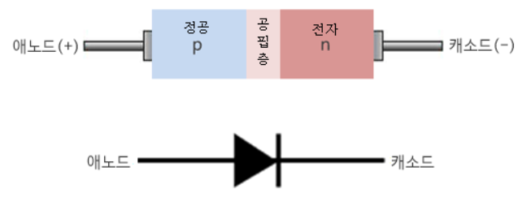
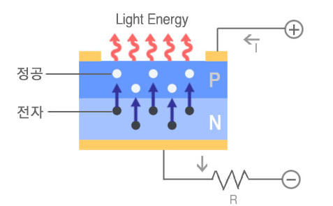
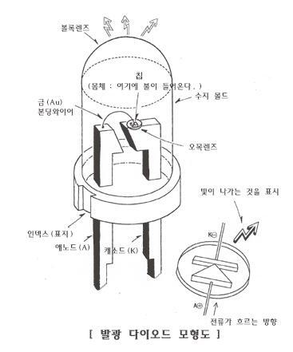
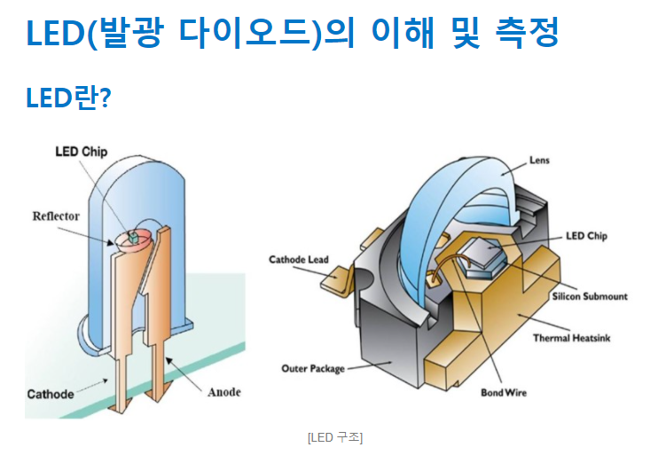
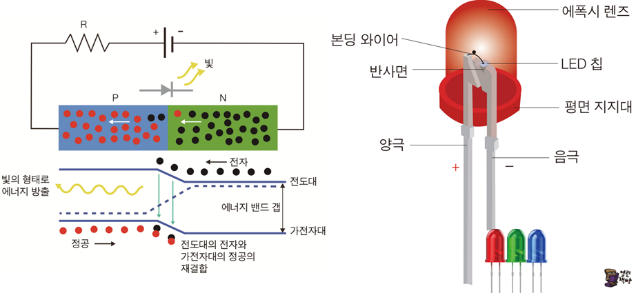
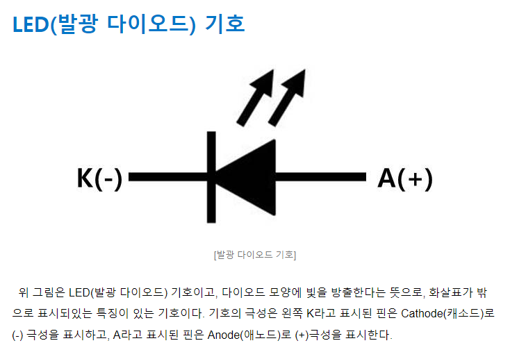
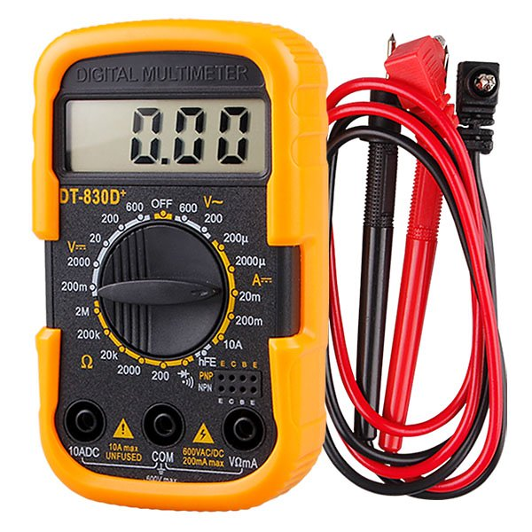
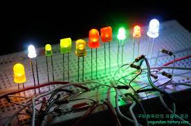
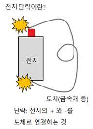
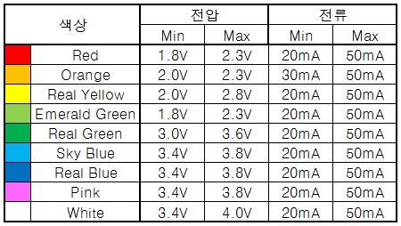

# 027_반짝반짝빛의요정_LED란 💡

* **빛을 내는 반도체! 발광 다이오드(LED)의 양자물리학적 발광 원리와 전기적 특성**
* P-N 접합 다이오드의 정류 작용, 극성(애노드/캐소드) 감별 3대 기법, 옴의 법칙을 이용한 전류 제한 저항($220\Omega$) 계산을 마스터합니다.
* 📖 **상세 강의 교재**: [index.md](./index.md)

> 여러분 안녕하세요! 이번 시간에는 '027. 반짝반짝빛의요정 LED란 💡'을 주제로 함께 흥미진진한 탐험을 떠나보겠습니다. 공학 멘토 이호진 교수님과 꼼꼼한 조수 지니, 호기심 많은 탐험가 도로시, 그리고 귀여운 토토와 함께 신나는 아두이노 모험을 힘차게 시작해 봅시다. 준비되셨나요?

---

## 1. 다이오드(Diode): 전기의 일방통행로 ➡️

* **👧 도로시**: "교수님, 지니야! 전자 부품 키트에 든 작고 투명한 빨간 알사탕 같은 부품은 뭔가요? 다리 길이가 짝짝이예요!"
* **👨‍🏫 이호진 교수님**: "그게 바로 전기를 먹으면 별빛처럼 반짝이는 **'LED(발광 다이오드)'**입니다. 다리 길이가 다른 이유도 극성을 구별하기 위한 비밀이 숨겨져 있답니다."
* **🐱 조수 지니**: "긴 다리가 플러스(애노드), 짧은 다리가 마이너스(캐소드)랍니다, 냐옹!"
* **🐶 토토**: "멍멍! (다리 길이를 척 보면 극성을 알 수 있다 멍!)"

**다이오드(Diode)**는 전기를 오직 한쪽 방향으로만 통과시키고, 반대 방향으로는 흐르지 못하게 차단하는 2단자 반도체 소자입니다 (정류 작용).
* **P형 반도체 (양공/정공 다수)** 와 **N형 반도체 (자유전자 다수)** 가 접합된 구조
* **애노드 (Anode, `+`) ➡️ 캐소드 (Cathode, `-`)**: 순방향 전압이 인가될 때만 전류 도통

> 이번 슬라이드에서는 '1. 다이오드(Diode): 전기의 일방통행로 ➡️'에 대해 자세히 살펴보겠습니다. 다이오드는 전기를 오직 한쪽 방향(애노드에서 캐소드)으로만 흘려보내는 일방통행 밸브 소자입니다. 이 기본 정류 작용 원리를 바탕으로 빛을 방출하는 특수 다이오드가 바로 LED입니다.

---

## 2. LED(Light Emitting Diode)의 정체 ✨

**LED**는 **L**ight **E**mitting **D**iode의 약자로, 우리말로는 **'발광(빛을 방출하는) 다이오드'**라고 부릅니다.
* 일반 실리콘 다이오드는 전기가 흐를 때 미세한 열만 내지만, LED는 특수 화합물 반도체(갈륨, 비소, 인, 질소 화합물)를 사용하여 에너지를 **가시광선 빛**으로 직접 변환합니다.
* 스마트폰 플래시, TV 화면, 자동차 헤드라이트, 신호등 등 현대 조명의 중심입니다.

> 이번 슬라이드에서는 '2. LED(Light Emitting Diode)의 정체 ✨'에 대해 자세히 살펴보겠습니다. 화면의 다이어그램과 사진을 함께 참고해 주시기 바랍니다. 첫 번째 핵심은 LED는 Light Emitting Diode의 약자로, 우리말로는 '발광(빛을 방출하는) 다이오드'라고 부릅니다.이며, 두 번째로는 일반 실리콘 다이오드는 전기가 흐를 때 미세한 열만 내지만, LED는 특수 화합물 반도체(갈륨, 비소, 인, 질소 화합물)를 사용하여 에너지를 가시광선 빛으로 직접 변환합니다.입니다. 여기에 덧붙여 스마트폰 플래시, TV 화면, 자동차 헤드라이트, 신호등 등 현대 조명의 중심입니다. 내용까지 함께 이해해 두시면 완벽합니다. 이 원리는 아두이노 시스템 전체를 관통하는 핵심 논리이므로 머릿속에 꼭 정리해 두시기 바랍니다.

---

## 3. 옛날 백열전구 vs 최첨단 LED 🕯️⚡

| 비교 항목 | 전통적인 에디슨 백열전구 | 현대식 고효율 LED |
| :--- | :--- | :--- |
| **발광 원리** | 텅스텐 필라멘트를 $2,000^\circ\text{C}$ 이상 가열 | 반도체 접합면에서 전자-정공 직접 재결합 |
| **에너지 효율** | 5%만 빛으로 변환, **95%는 열로 낭비** | **90% 이상이 빛으로 직접 변환 (발열 극소)** |
| **수명** | 약 1,000시간 (필라멘트 끊어짐) | **50,000시간 이상 (반영구적)** |
| **응답 속도** | 열이 오를 때까지 수백 ms 소요 | 나노초($\text{ns}$) 단위의 즉각 점등 |

백열전구의 열 발산 방식과 비교할 때 LED는 압도적인 에너지 효율을 자랑합니다.

> 이번에 살펴볼 내용은 '3. 옛날 백열전구 vs 최첨단 LED 🕯️⚡'입니다. 슬라이드에 정리된 표를 통해 각 항목의 특징과 수치, 차이점을 한눈에 비교해 보실 수 있습니다. 이 기본 개념을 확실히 잡아두셔야 실제 부품을 브레드보드에 꽂고 코딩할 때 실수 없이 완성할 수 있습니다.

---

## 4. LED가 빛을 내는 과학적 원리 (전자와 정공의 결합) 🔬

1. 순방향 전압을 걸면 N형 영역의 **전자(-)** 와 P형 영역의 **정공(+)** 이 접합면을 향해 이동합니다.
2. 높은 전도대(Conduction Band)에 있던 전자가 낮은 가전자대(Valence Band)의 정공으로 쏙 빠져들며 **재결합(Recombination)** 합니다.
3. 이때 전자와 정공의 에너지 높이 차이(**에너지 밴드갭, $E_g$**)만큼의 에너지가 **광자(Photon, 빛 알갱이)** 의 형태로 뿜어져 나옵니다! ($E = h\nu$)

LED의 빛은 반도체 내부의 양자 에너지 전이 현상에서 발생합니다.

> 이번 슬라이드에서는 '4. LED가 빛을 내는 과학적 원리 (전자와 정공의 결합) 🔬'에 대해 자세히 살펴보겠습니다. 화면의 다이어그램과 사진을 함께 참고해 주시기 바랍니다. 첫 번째 핵심은 순방향 전압을 걸면 N형 영역의 전자(-) 와 P형 영역의 정공(+) 이 접합면을 향해 이동합니다.이며, 두 번째로는 높은 전도대(Conduction Band)에 있던 전자가 낮은 가전자대(Valence Band)의 정공으로 쏙 빠져들며 재결합(Recombination) 합니다.입니다. 여기에 덧붙여 이때 전자와 정공의 에너지 높이 차이(에너지 밴드갭, $Eg$)만큼의 에너지가 광자(Photon, 빛 알갱이) 의 형태로 뿜어져 나옵니다! ($E = h\nu$) 내용까지 함께 이해해 두시면 완벽합니다. 이 원리는 아두이노 시스템 전체를 관통하는 핵심 논리이므로 머릿속에 꼭 정리해 두시기 바랍니다.

---

## 5. LED 극성 구별법 ①: 다리 길이 보기 📏

* **🐶 토토의 암기 팁**: "키가 큰 다리가 플러스 형아, 키 작은 다리가 마이너스 아우!"

* **긴 다리 (Long Leg)**: **애노드 (Anode, `+`)** ➡️ 아두이노 디지털 출력 핀 또는 5V에 연결
* **짧은 다리 (Short Leg)**: **캐소드 (Cathode, `-`)** ➡️ GND(접지)에 연결

LED는 극성이 바뀌면 절대 켜지지 않으므로, 외형을 보고 극성을 즉각 판별할 수 있어야 합니다.

> 이번 슬라이드에서는 '5. LED 극성 구별법 ①: 다리 길이 보기 📏'에 대해 자세히 살펴보겠습니다. 화면의 다이어그램과 사진을 함께 참고해 주시기 바랍니다. 첫 번째 핵심은 긴 다리 (Long Leg): 애노드 (Anode, +) ➡️ 아두이노 디지털 출력 핀 또는 5V에 연결이며, 두 번째로는 짧은 다리 (Short Leg): 캐소드 (Cathode, -) ➡️ GND(접지)에 연결입니다. 이 원리는 아두이노 시스템 전체를 관통하는 핵심 논리이므로 머릿속에 꼭 정리해 두시기 바랍니다.

---

## 6. LED 극성 구별법 ②: 깎인 테두리와 내부 전극 🔍

1. **플라스틱 림(Rim)의 평평한 단면 (Flat Edge)**:
* 동그란 캡슐 아래쪽 테두리를 만져보면 한쪽만 칼로 자른 듯 평평하게 깎여 있습니다. 이 **깎인 쪽이 바로 마이너스(캐소드, `-`)** 입니다.
2. **투명 에폭시 내부 전극 모양**:
* 빛을 비추어 안을 들여다보면, **넓적한 깃발 모양(큰 전극)이 마이너스(`-`)**, **날씬하고 가는 기둥(작은 전극)이 플러스(`+`)** 입니다.

다리를 가위로 잘라 브레드보드에 꽂았거나 길이가 같아졌을 때 사용하는 정밀 감별법입니다.

> 이번 슬라이드에서는 '6. LED 극성 구별법 ②: 깎인 테두리와 내부 전극 🔍'에 대해 자세히 살펴보겠습니다. 화면의 다이어그램과 사진을 함께 참고해 주시기 바랍니다. 첫 번째 핵심은 플라스틱 림(Rim)의 평평한 단면 (Flat Edge)이며, 두 번째로는 동그란 캡슐 아래쪽 테두리를 만져보면 한쪽만 칼로 자른 듯 평평하게 깎여 있습니다. 이 깎인 쪽이 바로 마이너스(캐소드, -) 입니다.입니다. 여기에 덧붙여 투명 에폭시 내부 전극 모양 내용까지 함께 이해해 두시면 완벽합니다. 이 원리는 아두이노 시스템 전체를 관통하는 핵심 논리이므로 머릿속에 꼭 정리해 두시기 바랍니다.

---

## 7. 테스터기(멀티미터)로 극성 검증하기 📟

1. 멀티미터 회전 다이얼을 **'다이오드 측정 모드 (▶|)'** 에 맞춥니다.
2. 빨간색 리드선(`+`)을 긴 다리에, 검은색 리드선(`-`)을 짧은 다리에 접촉합니다.
3. 순방향으로 올바르게 접촉되면 멀티미터 액정에 순방향 문턱전압(약 1.8V~2.2V)이 표시되며 **LED에 불이 은은하게 켜집니다!**

눈으로 구별하기 어려운 특수 LED는 디지털 멀티미터로 1초 만에 테스트할 수 있습니다.

> 이번 슬라이드에서는 '7. 테스터기(멀티미터)로 극성 검증하기 📟'에 대해 자세히 살펴보겠습니다. 화면의 다이어그램과 사진을 함께 참고해 주시기 바랍니다. 첫 번째 핵심은 멀티미터 회전 다이얼을 '다이오드 측정 모드 (▶|)' 에 맞춥니다.이며, 두 번째로는 빨간색 리드선(+)을 긴 다리에, 검은색 리드선(-)을 짧은 다리에 접촉합니다.입니다. 여기에 덧붙여 순방향으로 올바르게 접촉되면 멀티미터 액정에 순방향 문턱전압(약 1.8V~2.2V)이 표시되며 LED에 불이 은은하게 켜집니다! 내용까지 함께 이해해 두시면 완벽합니다. 이 원리는 아두이노 시스템 전체를 관통하는 핵심 논리이므로 머릿속에 꼭 정리해 두시기 바랍니다.

---

## 8. 알록달록 다양한 LED와 RGB LED 🌈

* **빨간색 LED**: AlGaAs 화합물 (낮은 밴드갭, 약 1.8V)
* **초록색 / 파란색 LED**: InGaN 화합물 (높은 밴드갭, 약 3.0V~3.2V)
* **RGB LED**: 빛의 3원색인 Red, Green, Blue LED 다이 3개를 단일 5mm 캡슐에 패키징하여 빛의 혼합으로 수백만 가지 풀컬러를 렌더링합니다.

반도체에 주입하는 불순물 원소의 밴드갭 크기에 따라 빛의 파장(색상)이 결정됩니다.

> 이번 슬라이드에서는 '8. 알록달록 다양한 LED와 RGB LED 🌈'에 대해 자세히 살펴보겠습니다. 화면의 다이어그램과 사진을 함께 참고해 주시기 바랍니다. 첫 번째 핵심은 빨간색 LED: AlGaAs 화합물 (낮은 밴드갭, 약 1.8V)이며, 두 번째로는 초록색 / 파란색 LED: InGaN 화합물 (높은 밴드갭, 약 3.0V~3.2V)입니다. 여기에 덧붙여 RGB LED: 빛의 3원색인 Red, Green, Blue LED 다이 3개를 단일 5mm 캡슐에 패키징하여 빛의 혼합으로 수백만 가지 풀컬러를 렌더링합니다. 내용까지 함께 이해해 두시면 완벽합니다. 이 원리는 아두이노 시스템 전체를 관통하는 핵심 논리이므로 머릿속에 꼭 정리해 두시기 바랍니다.

---

## 9. 경고! LED에 '저항(Resistor)'을 꼭 달아야 하는 이유 🛑

* 아두이노 5V 전원에 저항 없이 LED를 바로 꽂으면, 순식간에 수백 mA의 **폭주 과전류(Thermal Runaway)** 가 흘러 들어갑니다.
* 0.1초 만에 내부 와이어가 타버리거나 펑 소리와 함께 플라스틱 캡슐이 파손되며, 아두이노 보드의 GPIO 포트까지 파괴됩니다!

LED는 저항 성분이 거의 없는 순수 반도체 소자이므로 보호 저항이 필수적입니다.
### ⚠️ 전류 제한 저항(Current Limiting Resistor) 생략 시 참사!

> 이번 슬라이드에서는 '9. 경고! LED에 '저항(Resistor)'을 꼭 달아야 하는 이유 🛑'에 대해 자세히 살펴보겠습니다. 화면의 다이어그램과 사진을 함께 참고해 주시기 바랍니다. 첫 번째 핵심은 아두이노 5V 전원에 저항 없이 LED를 바로 꽂으면, 순식간에 수백 mA의 폭주 과전류(Thermal Runaway) 가 흘러 들어갑니다.이며, 두 번째로는 초 만에 내부 와이어가 타버리거나 펑 소리와 함께 플라스틱 캡슐이 파손되며, 아두이노 보드의 GPIO 포트까지 파괴됩니다!입니다. 이 원리는 아두이노 시스템 전체를 관통하는 핵심 논리이므로 머릿속에 꼭 정리해 두시기 바랍니다.

---

## 10. 옴의 법칙으로 저항값 정밀 계산하기 ($220\Omega$) 🧮

* 아두이노 공급 전압: $V_{CC} = 5.0\text{V}$
* 빨간색 LED 순방향 강하 전압: $V_F = 1.8\text{V}$
* LED 권장 순방향 정격 전류: $I_F = 20\text{mA} = 0.02\text{A}$
* 최소 $160\Omega$ 이상의 저항이 필요하므로, 주변에서 가장 표준적으로 널리 쓰이는 **$220\Omega$ (색띠: 빨강-빨강-갈색-금색)** 또는 **$330\Omega$** 저항을 장착하면 가장 안전하고 완벽합니다!

안전하고 밝은 점등을 위해 적정 저항값을 수학적으로 계산해 봅니다.
### 📐 계산 공식 유도
$$R = \frac{V_{CC} - V_F}{I_F} = \frac{5.0\text{V} - 1.8\text{V}}{0.02\text{A}} = \frac{3.2\text{V}}{0.02\text{A}} = \mathbf{160\,\Omega}$$

> 이번 슬라이드에서는 '10. 옴의 법칙으로 저항값 정밀 계산하기 ($220\Omega$) 🧮'에 대해 자세히 살펴보겠습니다. 화면의 다이어그램과 사진을 함께 참고해 주시기 바랍니다. 첫 번째 핵심은 아두이노 공급 전압: $V{CC} = 5.0\text{V}$이며, 두 번째로는 빨간색 LED 순방향 강하 전압: $VF = 1.8\text{V}$입니다. 여기에 덧붙여 LED 권장 순방향 정격 전류: $IF = 20\text{mA} = 0.02\text{A}$ 내용까지 함께 이해해 두시면 완벽합니다. 이 원리는 아두이노 시스템 전체를 관통하는 핵심 논리이므로 머릿속에 꼭 정리해 두시기 바랍니다.

---

## 🌟 이번 시간 핵심 정리! 🏆

* **👧 도로시**: "이제 LED의 원리를 완벽히 배웠으니, 아두이노 코드로 직접 껐다 켰다 깜빡여보고 싶어요!"
* **👨‍🏫 이호진 교수님**: "좋습니다! 다음 시간에는 디지털 핀으로 LED를 깜빡이는 본격적인 **'디지털 LED 점등 실습(Blink)'**으로 나아가 봅시다."
* **🐱 조수 지니**: "브레드보드와 $220\Omega$ 저항도 함께 준비해 둘게요, 냐옹!"
* **🐶 토토**: "멍멍! (반짝반짝 불빛 켜러 가자 멍!)"

* [x] **발광 다이오드의 본질**: 전자와 정공이 재결합할 때 에너지 밴드갭에 비례하는 광자(빛)를 방출합니다.
* [x] **극성 감별 3법**: 긴 다리(+), 깎인 단면(-), 멀티미터 다이오드 모드로 100% 감별합니다.
* [x] **$220\Omega$ 전류 제한 저항**: 옴의 법칙으로 유도된 적정 저항을 직렬로 연결하여 과전류 파괴를 완벽 차단했습니다.

축하합니다! 빛의 요정 LED의 양자물리학적 발광 원리부터 극성 판별법, 옴의 법칙 저항 설계까지 완벽히 마스터했습니다.
### 📋 핵심 요약 체크리스트

> 오늘 배운 LED의 발광 원리와 전류 제한 저항 계산은 모든 출력 제어 실습의 든든한 기초가 됩니다. 다음 강의에서는 아두이노의 첫걸음인 Blink 코딩 실습으로 반짝이는 빛을 직접 만들어보겠습니다. 모두 수고 많으셨습니다!