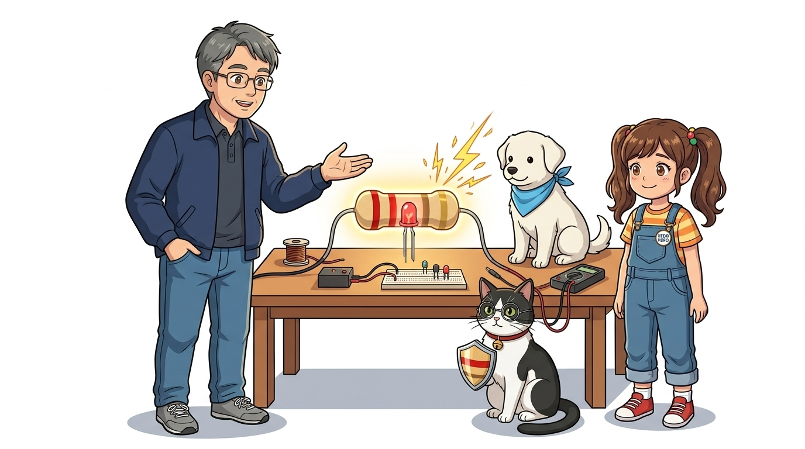
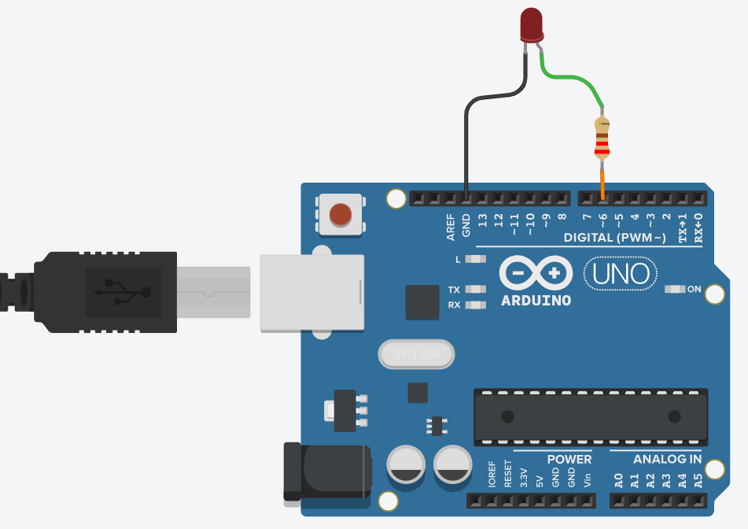
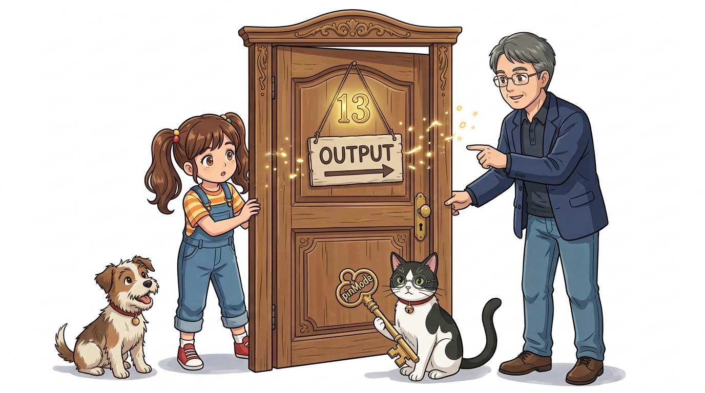
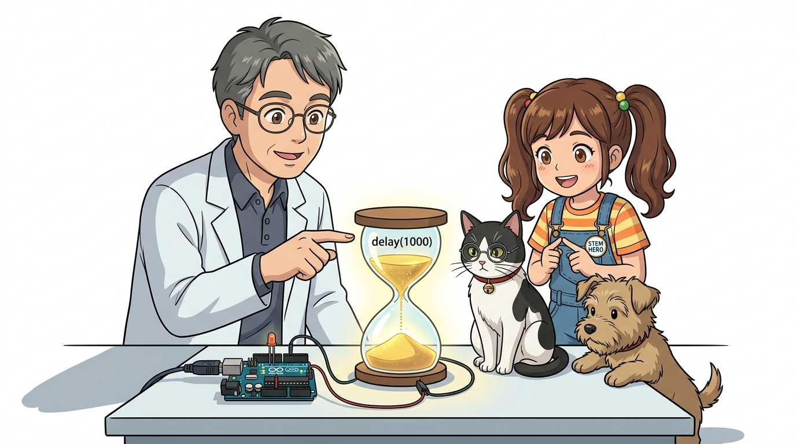
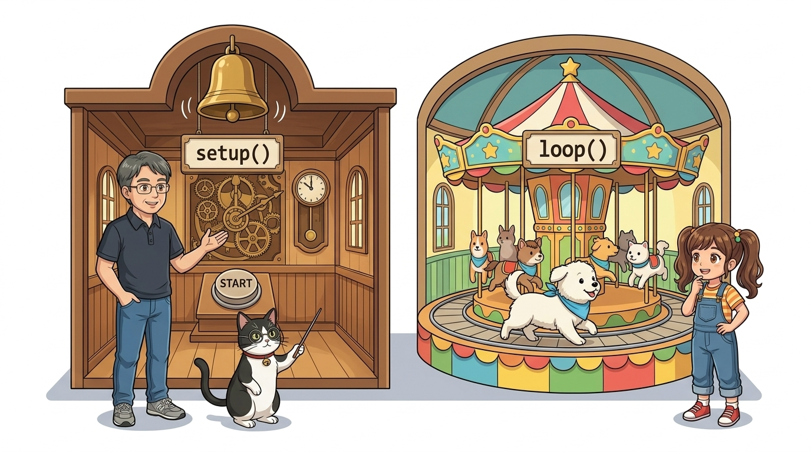
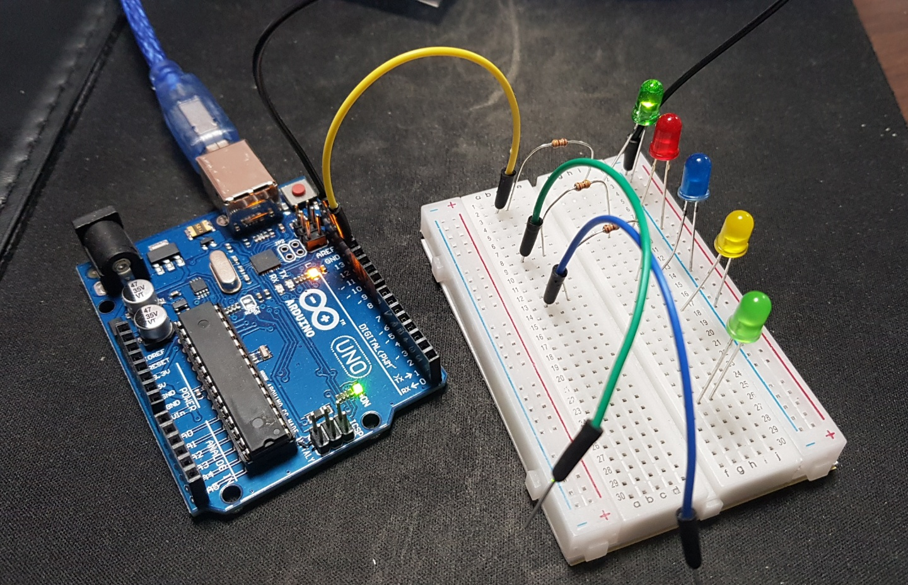

# 028_디지털LED_점등실습Blink 💡


* **아두이노 첫 번째 불빛을 밝히다! 디지털 출력의 기초와 Blink 예제 분석**
* `pinMode()`, `digitalWrite()`, `delay()`의 문법 구조와 $220\Omega$ 저항을 직렬 연결한 LED 회로 구성을 실습합니다.
* 📖 **상세 강의 교재**: [index.md](./index.md)


> 여러분 안녕하세요! 이번 시간에는 '028. 디지털LED 점등실습Blink 💡'을 주제로 함께 흥미진진한 탐험을 떠나보겠습니다. 공학 멘토 이호진 교수님과 꼼꼼한 조수 지니, 호기심 많은 탐험가 도로시, 그리고 귀여운 토토와 함께 신나는 아두이노 모험을 힘차게 시작해 봅시다. 준비되셨나요?

---

## 1. 👧 도로시의 호기심: "작은 꼬마전구에 불을 켤 수 있을까?"


* **👧 도로시**: "교수님, 지니야! 브레드보드에 꽂힌 저 작은 빨간색 꼬마전구에 내 힘으로 불을 켤 수 있을까요? 반짝반짝 크리스마스트리처럼 만들고 싶어요!"
* **👨‍🏫 이호진 교수님**: "물론입니다, 도로시! 우리가 아두이노에게 '13번 핀에 5V 전기를 뿜어내어 불을 켜줘!' 하고 코드로 명령하면 된답니다."
* **🐱 조수 지니**: "그게 바로 모든 소프트웨어의 첫인사인 'Hello, World!'이자, 아두이노의 첫걸음 Blink랍니다, 냐옹!"
* **🐶 토토**: "왈왈! (빨간 불빛 보고 싶다 멍!)"
* [!NOTE]
* **디지털 신호(Digital Signal)의 기본**
* 컴퓨터는 켜짐(`HIGH`, 5V, 참, 1)과 꺼짐(`LOW`, 0V, 거짓, 0)이라는 오직 2가지 상태만을 제어합니다. LED를 1초마다 켜고 끄는 실습은 모든 임베디드 소프트웨어의 "Hello, World!"입니다.

아두이노와 브레드보드를 앞에 둔 도로시가 눈을 반짝이며 교수님과 지니를 바라봅니다!

> 자, 이번 슬라이드의 질문을 함께 보시겠습니다. 바로 '1. 👧 도로시의 호기심: "작은 꼬마전구에 불을 켤 수 있을까?"'라는 아주 흥미로운 질문입니다. 직접 짠 코드로 전기를 켜고 끄는 물리 컴퓨팅의 첫걸음을 지금부터 함께 내디뎌 보겠습니다.

---

## 2. 🔴 1단계: LED의 극성과 아두이노 13번 핀


* **긴 다리 (애노드, `+`)**: 전기가 유입되는 입구 ➡️ 아두이노 **디지털 13번 핀**에 연결
* **짧은 다리 (캐소드, `-`)**: 전기가 빠져나가는 출구 ➡️ 아두이노 **GND 핀**에 연결
* 극성을 거꾸로 꽂으면 전류가 차단되어 불이 들어오지 않으므로 다리 길이를 반드시 확인합니다.

LED는 전류가 한쪽으로만 흐르는 다이오드이므로 극성을 정확히 맞추어야 합니다.

> 이번에 살펴볼 내용은 '2. 🔴 1단계: LED의 극성과 아두이노 13번 핀'입니다. 화면의 회로도와 부품 사진을 보면서 각 핀과 배선이 어떻게 구성되어 있는지 눈으로 직접 따라와 주시기 바랍니다. 첫째로 긴 다리 (애노드, +): 전기가 유입되는 입구 ➡️ 아두이노 디지털 13번 핀에 연결에 유의해야 하며, 둘째로 짧은 다리 (캐소드, -): 전기가 빠져나가는 출구 ➡️ 아두이노 GND 핀에 연결라는 점이 핵심입니다. 이 기본 개념을 확실히 잡아두셔야 실제 부품을 브레드보드에 꽂고 코딩할 때 실수 없이 완성할 수 있습니다.

---

## 3. 🛡️ 2단계: 저항(Resistor)은 LED를 지키는 튼튼한 방패!



* **👧 도로시**: "지니야! 저 알록달록 색띠가 그려진 작은 부품은 뭐야? 꼭 꽂아야 해?"
* **🐱 조수 지니**: "그 친구는 **'저항(Resistor)'**이란다! 전기가 폭포수처럼 너무 많이 쏟아지면 여린 LED가 '퍽!' 하고 타버려. 저항이 댐처럼 전기를 알맞게 막아주어 LED를 안전하게 보호해 주는 거란다!"

* **권장 저항값**: $220\Omega \sim 330\Omega$ (색띠: 빨강-빨강-갈색-금색)
* 저항은 극성이 없으므로 어느 방향으로 꽂아도 무방합니다.

LED를 보호하고 적정 전류를 유지하기 위해 직렬 저항을 반드시 배치합니다.

> 이번 슬라이드에서는 '3. 🛡️ 2단계: 저항(Resistor)은 LED를 지키는 튼튼한 방패!'에 대해 자세히 살펴보겠습니다. 화면의 다이어그램과 사진을 함께 참고해 주시기 바랍니다. 도로시와 지니의 대화처럼, 지니야! 저 알록달록 색띠가 그려진 작은 부품은 뭐야? 꼭 꽂아야 해?라는 상황에 대해 그 친구는 라는 원리가 작동하는 것입니다. 첫 번째 핵심은 권장 저항값: $220\Omega \sim 330\Omega$ (색띠: 빨강-빨강-갈색-금색)이며, 두 번째로는 저항은 극성이 없으므로 어느 방향으로 꽂아도 무방합니다.입니다. 이 원리는 아두이노 시스템 전체를 관통하는 핵심 논리이므로 머릿속에 꼭 정리해 두시기 바랍니다.

---

## 4. 🔌 3단계: 브레드보드 회로 결선도



1. 아두이노 **디지털 13번 핀** ➡️ 점퍼선 ➡️ 브레드보드의 **저항 한쪽 다리** 연결
2. 저항의 반대쪽 다리 ➡️ 같은 세로줄에 **LED 긴 다리(`+`)** 연결
3. **LED 짧은 다리(`-`)** ➡️ 점퍼선 ➡️ 아두이노 **GND 핀** 연결

아두이노 13번 핀과 브레드보드 부품들을 폐회로로 결선합니다.
### 📌 배선 순서

> 이번에 살펴볼 내용은 '4. 🔌 3단계: 브레드보드 회로 결선도'입니다. 화면의 회로도와 부품 사진을 보면서 각 핀과 배선이 어떻게 구성되어 있는지 눈으로 직접 따라와 주시기 바랍니다. 첫째로 아두이노 디지털 13번 핀 ➡️ 점퍼선 ➡️ 브레드보드의 저항 한쪽 다리 연결에 유의해야 하며, 둘째로 저항의 반대쪽 다리 ➡️ 같은 세로줄에 LED 긴 다리(+) 연결라는 점이 핵심입니다. 이 기본 개념을 확실히 잡아두셔야 실제 부품을 브레드보드에 꽂고 코딩할 때 실수 없이 완성할 수 있습니다.

---

## 5. 💻 4단계: Blink 전체 소스코드 분석


1초마다 불이 켜지고 꺼지는 가장 기초적인 아두이노 스케치입니다.

```cpp
// 02.2-1 디지털 LED 점등 예제
void setup() {
  // 13번 핀을 전기를 밖으로 뿜어내는 '출력(OUTPUT)' 문으로 설정!
  pinMode(13, OUTPUT);
}

void loop() {
  digitalWrite(13, HIGH); // 13번 핀에 5V 전기를 공급 (불 켜짐 💡)
  delay(1000);            // 1초(1000 밀리초) 동안 불을 켠 채 대기

  digitalWrite(13, LOW);  // 13번 핀 전기를 차단 (불 꺼짐 🌑)
  delay(1000);            // 1초 동안 어두운 채로 대기
}
```

> 이번 슬라이드에서는 '5. 💻 4단계: Blink 전체 소스코드 분석'에 대한 실제 동작 코드를 분석해 보겠습니다. 화면의 코드를 살펴보시면, 컴퓨터가 아두이노 하드웨어에 단계별로 명령을 내리는 흐름을 명확하게 확인할 수 있습니다. 각 함수의 역할과 괄호 안의 매개변수가 하드웨어 핀과 어떤 관계를 맺고 동작하는지 주의 깊게 살펴보시기 바랍니다.

---

## 6. 🚪 5단계: 출입문 방향 설정 - `pinMode()`



* **`pinMode(pin, mode)` 문법 구조**:
* `pin`: 제어하려는 핀 번호 (예: `13`)
* `mode`: 문의 성격 (`OUTPUT`: 밖으로 전압 공급 / `INPUT`: 외부 전압 감지)
* `setup()` 함수 안에서 단 한 번만 선언해 주면 프로그램이 끝날 때까지 유지됩니다.

하드웨어 핀의 동작 모드를 결정하는 핵심 함수입니다.

```cpp
pinMode(13, OUTPUT); // 13번 핀을 전기를 공급하는 출력 모드로 설정
```

> 이번 슬라이드에서는 '6. 🚪 5단계: 출입문 방향 설정 - pinMode()'에 대한 실제 동작 코드를 분석해 보겠습니다. 화면의 코드를 살펴보시면, 컴퓨터가 아두이노 하드웨어에 단계별로 명령을 내리는 흐름을 명확하게 확인할 수 있습니다. 여기서 핵심은 pinMode(pin, mode) 문법 구조입니다. 각 함수의 역할과 괄호 안의 매개변수가 하드웨어 핀과 어떤 관계를 맺고 동작하는지 주의 깊게 살펴보시기 바랍니다.

---

## 7. ⚡ 6단계: 디지털 전압 스위칭 - `digitalWrite()`


* **`digitalWrite(13, HIGH);`**: 13번 핀에 5V 전압을 공급하여 LED에 순방향 전류가 흐릅니다 (`1`, 켜짐).
* **`digitalWrite(13, LOW);`**: 13번 핀을 0V(GND 전위)로 떨어뜨려 전류를 차단합니다 (`0`, 꺼짐).

디지털 출력 핀의 전압을 0V와 5V로 즉각 전환합니다.

```cpp
digitalWrite(13, HIGH); // 13번 핀에 5V 공급 (LED 켜짐)
digitalWrite(13, LOW);  // 13번 핀 0V(GND) 차단 (LED 꺼짐)
```

> 이번 슬라이드에서는 '7. ⚡ 6단계: 디지털 전압 스위칭 - digitalWrite()'에 대한 실제 동작 코드를 분석해 보겠습니다. 화면의 코드를 살펴보시면, 컴퓨터가 아두이노 하드웨어에 단계별로 명령을 내리는 흐름을 명확하게 확인할 수 있습니다. 여기서 핵심은 digitalWrite(13, HIGH);: 13번 핀에 5V 전압을 공급하여 LED에 순방향 전류가 흐릅니다 (1, 켜짐).입니다. 각 함수의 역할과 괄호 안의 매개변수가 하드웨어 핀과 어떤 관계를 맺고 동작하는지 주의 깊게 살펴보시기 바랍니다.

---

## 8. ⏳ 7단계: 시간 지연 주문 - `delay(1000);`



* **단위**: 밀리초(ms, 1/1000초) ➡️ `1000ms = 1초`
* 아두이노는 1초에 1,600만 번 클록이 뛰므로, `delay()`가 없다면 1초에 수십만 번 깜빡여 사람 눈에는 계속 켜져 있는 것처럼 보입니다.
* `delay(200)`으로 변경하면 훨씬 박진감 넘치게 깜빡입니다.

아두이노의 초고속 연산을 잠시 멈추고 사람의 눈으로 상태 변화를 관찰할 수 있게 해줍니다.

```cpp
delay(1000); // 1초(1000ms) 동안 현재 상태를 그대로 유지하며 대기
```

> 이번 슬라이드에서는 '8. ⏳ 7단계: 시간 지연 주문 - delay(1000);'에 대한 실제 동작 코드를 분석해 보겠습니다. 화면의 코드를 살펴보시면, 컴퓨터가 아두이노 하드웨어에 단계별로 명령을 내리는 흐름을 명확하게 확인할 수 있습니다. 여기서 핵심은 단위: 밀리초(ms, 1/1000초) ➡️ 1000ms = 1초입니다. 각 함수의 역할과 괄호 안의 매개변수가 하드웨어 핀과 어떤 관계를 맺고 동작하는지 주의 깊게 살펴보시기 바랍니다.

---

## 9. 🔄 8단계: 두 개의 방 - `setup()`과 `loop()`



* **`setup()` (준비 운동 방)**:
* 전원이 켜지거나 리셋 버튼을 누를 때 **단 한 번만 실행**
* 핀 모드 설정, 시리얼 통신 시작, 라이브러리 초기화 담당
* **`loop()` (무한 반복 방)**:
* `setup()`이 끝난 후 위에서 아래로 코드를 실행하며, 끝에 도달하면 다시 첫 줄로 돌아가 **영원히 무한 반복**

모든 아두이노 프로그램의 근간이 되는 2대 메인 구조입니다.

```cpp
void setup() {
  // 시작 시 딱 1회 초기화
}

void loop() {
  // 전원이 꺼질 때까지 무한 반복
}
```

> 이번 슬라이드에서는 '9. 🔄 8단계: 두 개의 방 - setup()과 loop()'에 대한 실제 동작 코드를 분석해 보겠습니다. 화면의 코드를 살펴보시면, 컴퓨터가 아두이노 하드웨어에 단계별로 명령을 내리는 흐름을 명확하게 확인할 수 있습니다. 여기서 핵심은 setup() (준비 운동 방)입니다. 각 함수의 역할과 괄호 안의 매개변수가 하드웨어 핀과 어떤 관계를 맺고 동작하는지 주의 깊게 살펴보시기 바랍니다.

---

## 10. 🚀 9단계: 코드를 아두이노 보드로 업로드!


1. 아두이노 IDE 상단의 **[→ (업로드)]** 버튼 클릭
2. 소스코드가 컴파일(Compile)되어 기계어 바이너리로 변환됨
3. 아두이노 보드의 TX/RX LED가 빠르게 깜빡이며 USB 케이블을 통해 코드가 전송됨
4. 하단 메시지 창에 **"업로드 완료 (Done uploading)"** 가 뜨면 즉시 코드 실행 시작!

작성한 C++ 소스코드를 기계어로 번역하여 아두이노 플래시 메모리에 굽는 과정입니다.

> 이번 슬라이드에서는 '10. 🚀 9단계: 코드를 아두이노 보드로 업로드!'에 대해 자세히 살펴보겠습니다. 첫 번째 핵심은 아두이노 IDE 상단의 [→ (업로드)] 버튼 클릭이며, 두 번째로는 소스코드가 컴파일(Compile)되어 기계어 바이너리로 변환됨입니다. 여기에 덧붙여 아두이노 보드의 TX/RX LED가 빠르게 깜빡이며 USB 케이블을 통해 코드가 전송됨 내용까지 함께 이해해 두시면 완벽합니다. 이 원리는 아두이노 시스템 전체를 관통하는 핵심 논리이므로 머릿속에 꼭 정리해 두시기 바랍니다.

---

## 11. 🌟 10단계: 실물 보드 점등 확인 및 동작 테스트



* 불이 들어오지 않을 경우:
* LED의 긴 다리와 짧은 다리가 반대로 꽂히지 않았는지 점검
* 저항 다리가 브레드보드 구멍에 헐겁지 않게 꽂혔는지 확인
* 아두이노 13번 핀과 GND 핀에 정확히 꽂혔는지 확인

실제 브레드보드에서 LED가 규칙적으로 1초 주기로 깜빡이는지 확인합니다.

> 이번 슬라이드에서는 '11. 🌟 10단계: 실물 보드 점등 확인 및 동작 테스트'에 대해 자세히 살펴보겠습니다. 화면의 다이어그램과 사진을 함께 참고해 주시기 바랍니다. 첫 번째 핵심은 불이 들어오지 않을 경우이며, 두 번째로는 LED의 긴 다리와 짧은 다리가 반대로 꽂히지 않았는지 점검입니다. 여기에 덧붙여 저항 다리가 브레드보드 구멍에 헐겁지 않게 꽂혔는지 확인 내용까지 함께 이해해 두시면 완벽합니다. 이 원리는 아두이노 시스템 전체를 관통하는 핵심 논리이므로 머릿속에 꼭 정리해 두시기 바랍니다.

---

## 🌟 첫 점등 성공 축하! 🏆


* **👧 도로시**: "와아아아!! 교수님, 지니야, 토토야! 진짜 빨간 불빛이 1초마다 반짝반짝 숨을 쉬어요!"
* **👨‍🏫 이호진 교수님**: "축하합니다, 도로시! 네가 작성한 C++ 코드가 물리적 세계의 전기를 직접 제어한 위대한 첫걸음입니다."
* **🐱 조수 지니**: "다음 시간에는 LED를 여러 개 연결해서 멋진 **'알록달록 신호등 오케스트라'**를 만들어봐요, 냐옹!"
* **🐶 토토**: "멍멍! (다중 LED 신호등으로 출발하자 멍!)"

* [x] **LED 극성 연결**: 긴 다리를 13번 핀에, 짧은 다리를 GND에 결선했습니다.
* [x] **보호 저항**: $220\Omega$ 저항으로 LED 과전류 소손을 방지했습니다.
* [x] **기본 3대 함수**: `pinMode()`, `digitalWrite()`, `delay()`의 문법과 동작을 완벽히 이해했습니다.

축하합니다! 직접 작성한 코드로 물리적인 세계의 전기를 다스리는 첫 기적을 이루었습니다.
### 📋 핵심 요약 체크리스트

> 오늘 배운 Blink 실습은 모든 임베디드 프로그래밍의 기초입니다. 다음 강의에서는 빨강, 노랑, 초록 3색 LED를 조합한 신호등 오케스트라 제어로 한 단계 업그레이드해 보겠습니다! 모두 수고 많으셨습니다!