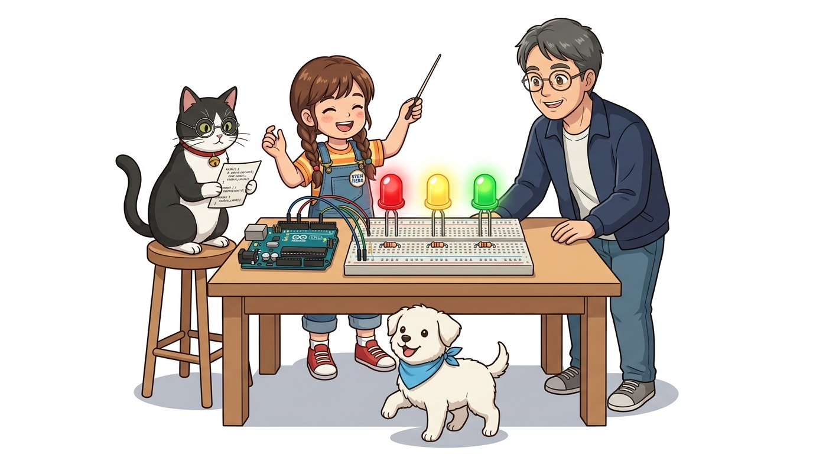
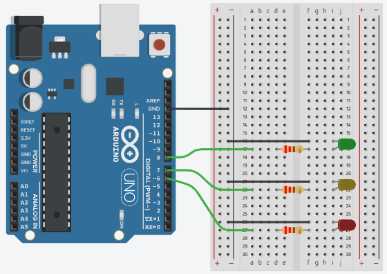
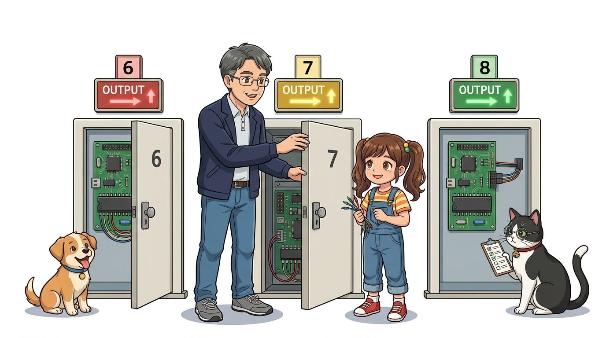
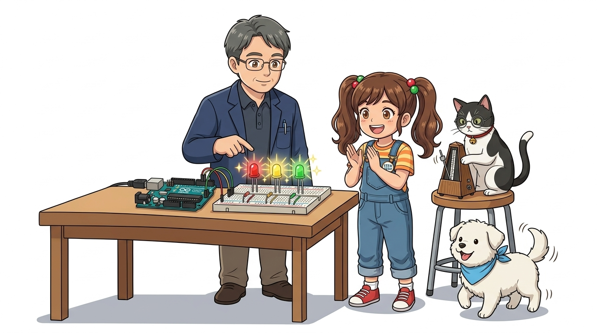
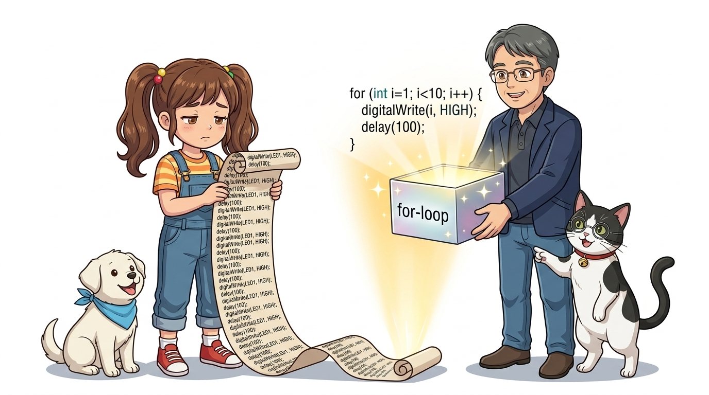

# 029_알록달록불빛오케스트라_다중LED 🚦✨



* **개별 제어에서 시스템 제어로! 빨강, 노랑, 초록 3색 LED로 구현하는 교통 신호등과 시퀀셜 파도타기**
* 다중 GPIO 핀 독립 제어, 공통 접지(Common GND) 버스 배선, 순차 점등 시퀀스 알고리즘을 실습합니다.
* 📖 **상세 강의 교재**: [index.md](./index.md)


> 여러분 안녕하세요! 이번 시간에는 '029. 알록달록불빛오케스트라 다중LED 🚦✨'을 주제로 함께 흥미진진한 탐험을 떠나보겠습니다. 공학 멘토 이호진 교수님과 꼼꼼한 조수 지니, 호기심 많은 탐험가 도로시, 그리고 귀여운 토토와 함께 신나는 아두이노 모험을 힘차게 시작해 봅시다. 준비되셨나요?

---

## 1. 👧 도로시의 제안: "신호등처럼 3개를 동시에 다룰래요!"


* **👧 도로시**: "교수님, 지니야! LED 한 개만 켜는 건 이제 너무 쉬워요! 도로의 신호등처럼 빨강, 노랑, 초록 세 개를 동시에 지휘해 볼 수는 없을까요?"
* **👨‍🏫 이호진 교수님**: "아주 훌륭한 제안입니다, 도로시! 아두이노의 6번, 7번, 8번 핀을 모아서 불빛의 멋진 오케스트라 지휘자가 되어봅시다."
* **🐱 조수 지니**: "공통 GND 레일과 $220\Omega$ 저항 3개를 완벽히 준비해 두었어요, 냐옹!"
* **🐶 토토**: "멍멍! (박자에 맞춰 발바닥 춤출 준비 완료다 멍!)"
* [!NOTE]
* **다중 제어의 가치**
* 여러 개의 LED를 프로그래밍하면 단순한 깜빡임을 넘어 러닝 라이트(Running Light), 바이트 이진수 표시기, 교통 신호등 시스템 등 실제 상용 제품 수준의 시각 UI를 제작할 수 있습니다.

단일 LED 점등을 가뿐히 성공한 도로시가 불빛의 개수를 늘려보자고 제안합니다!

> 이번 슬라이드에서는 '1. 👧 도로시의 제안: "신호등처럼 3개를 동시에 다룰래요!"'에 대해 자세히 살펴보겠습니다. 단일 LED 점등에 이어 3색 LED를 조합한 신호등 시스템을 구현하며 다중 핀 독립 제어의 원리를 정복해 봅니다.

---

## 2. 💻 틴커캐드로 회로 설계하기



* [!IMPORTANT]
* **저항은 각자 하나씩!**: 저항 1개로 LED 3개를 묶어서 연결하면, 켜지는 개수에 따라 전류가 나뉘어 불빛 밝기가 들쭉날쭉 변합니다. 각 LED마다 $220\Omega$ 저항을 1:1로 반드시 따로 달아주어야 합니다.

| LED 색상 | 아두이노 신호 핀 | 애노드(+) 연결 | 캐소드(-) 연결 |
| :---: | :---: | :---: | :---: |
| **빨간색 LED** | **디지털 6번 핀** | $220\Omega$ 저항 거쳐 연결 | 브레드보드 공통 GND 레일 |
| **노란색 LED** | **디지털 7번 핀** | $220\Omega$ 저항 거쳐 연결 | 브레드보드 공통 GND 레일 |
| **초록색 LED** | **디지털 8번 핀** | $220\Omega$ 저항 거쳐 연결 | 브레드보드 공통 GND 레일 |

브레드보드에 빨강(Red), 노랑(Yellow), 초록(Green) 3개의 LED와 보호 저항을 배치합니다.
### 📌 핀 연결 매핑표

> 이번에 살펴볼 내용은 '2. 💻 틴커캐드로 회로 설계하기'입니다. 슬라이드에 정리된 표를 통해 각 항목의 특징과 수치, 차이점을 한눈에 비교해 보실 수 있습니다. 이 기본 개념을 확실히 잡아두셔야 실제 부품을 브레드보드에 꽂고 코딩할 때 실수 없이 완성할 수 있습니다.

---

## 3. 🚦 `setup()`에서 3개 핀 모두 출력으로 선언!



제어할 핀의 개수만큼 `pinMode()`를 명시적으로 선언합니다.

```cpp
void setup() {
  // 6, 7, 8번 세 개의 문을 전기를 뿜어내는 OUTPUT 모드로 초기화!
  pinMode(6, OUTPUT); // 6번: 빨간 LED
  pinMode(7, OUTPUT); // 7번: 노란 LED
  pinMode(8, OUTPUT); // 8번: 초록 LED
}
```

> 이번 슬라이드에서는 '3. 🚦 setup()에서 3개 핀 모두 출력으로 선언!'에 대한 실제 동작 코드를 분석해 보겠습니다. 화면의 코드를 살펴보시면, 컴퓨터가 아두이노 하드웨어에 단계별로 명령을 내리는 흐름을 명확하게 확인할 수 있습니다. 각 함수의 역할과 괄호 안의 매개변수가 하드웨어 핀과 어떤 관계를 맺고 동작하는지 주의 깊게 살펴보시기 바랍니다.

---

## 4. 실습 ①: 3개의 LED를 다 함께 깜빡이기! 🌟



동시에 세 핀에 `HIGH`를 인가하여 켜고, 1초 후 동시에 `LOW`로 소등합니다.

```cpp
void loop() {
  // 1. 세 개 LED 동시 점등
  digitalWrite(6, HIGH);
  digitalWrite(7, HIGH);
  digitalWrite(8, HIGH);
  delay(1000); // 1초간 유지
  
  // 2. 세 개 LED 동시 소등
  digitalWrite(6, LOW);
  digitalWrite(7, LOW);
  digitalWrite(8, LOW);
  delay(1000); // 1초간 유지
}
```

> 이번 슬라이드에서는 '4. 실습 ①: 3개의 LED를 다 함께 깜빡이기! 🌟'에 대한 실제 동작 코드를 분석해 보겠습니다. 화면의 코드를 살펴보시면, 컴퓨터가 아두이노 하드웨어에 단계별로 명령을 내리는 흐름을 명확하게 확인할 수 있습니다. 각 함수의 역할과 괄호 안의 매개변수가 하드웨어 핀과 어떤 관계를 맺고 동작하는지 주의 깊게 살펴보시기 바랍니다.

---

## 5. 실습 ②: 차례차례 켜지는 '순차 점등' (파도타기) 🌊


* **👧 도로시**: "우와! 불빛이 빨강에서 노랑, 초록으로 스르륵 옮겨 다녀! 진짜 교차로 신호등 같아!"

1번 켜기 ➡️ 2번 켜기 ➡️ 3번 켜기 순으로 시간을 조절하여 경쾌한 파도타기 리듬을 만듭니다.

```cpp
void loop() {
  // 6번(빨강)만 켜기
  digitalWrite(6, HIGH); digitalWrite(7, LOW);  digitalWrite(8, LOW);
  delay(400);
  
  // 7번(노랑)만 켜기
  digitalWrite(6, LOW);  digitalWrite(7, HIGH); digitalWrite(8, LOW);
  delay(400);
  
  // 8번(초록)만 켜기
  digitalWrite(6, LOW);  digitalWrite(7, LOW);  digitalWrite(8, HIGH);
  delay(400);
}
```

> 이번 슬라이드에서는 '5. 실습 ②: 차례차례 켜지는 '순차 점등' (파도타기) 🌊'에 대한 실제 동작 코드를 분석해 보겠습니다. 화면의 코드를 살펴보시면, 컴퓨터가 아두이노 하드웨어에 단계별로 명령을 내리는 흐름을 명확하게 확인할 수 있습니다. 각 함수의 역할과 괄호 안의 매개변수가 하드웨어 핀과 어떤 관계를 맺고 동작하는지 주의 깊게 살펴보시기 바랍니다.

---

## 6. 잠깐! 코드가 너무 길어지지 않나요? 🤔



* `digitalWrite` 명령을 수백 줄씩 복사/붙여넣기 하면 오타가 발생하고 유지보수가 불가능해집니다.
* 프로그래머는 반복되는 작업을 컴퓨터에게 위임합니다.
* 다음 시간에 배울 **'C언어 제어문과 반복문(`for`, `while`)'** 을 활용하면 단 3줄의 코드로 100개의 LED도 순식간에 다룰 수 있습니다!

LED가 3개일 때는 손으로 쓸 수 있었지만, LED가 **10개, 50개, 100개**라면 어떻게 될까요?

> 자, 이번 슬라이드의 질문을 함께 보시겠습니다. 바로 '6. 잠깐! 코드가 너무 길어지지 않나요? 🤔'라는 아주 흥미로운 질문입니다. 우리가 일상에서 흔히 접하는 digitalWrite 명령을 수백 줄씩 복사/붙여넣기 하면 오타가 발생하고 유지보수가 불가능해집니다. 현상을 떠올려보면 왜 이런 의문이 생기는지 쉽게 공감할 수 있습니다. 이 질문 속에 숨겨진 전자 회로와 컴퓨팅의 핵심 원리를 지금부터 차근차근 하나씩 파헤쳐 보겠습니다.

---

## 🌟 이번 시간 핵심 정리! 🏆


* **👧 도로시**: "다음 시간에는 길고 번거로운 코드를 마법처럼 줄여주는 **'C언어 제어문과 반복문'**을 꼭 배울래요!"
* **👨‍🏫 이호진 교수님**: "좋습니다! 조건에 따라 스스로 판단하고 똑똑하게 반복하는 C언어 제어의 세계로 함께 들어가 봅시다."
* **🐱 조수 지니**: "if문과 switch문, 그리고 for 반복문이 기다리고 있답니다, 냐옹!"
* **🐶 토토**: "멍멍! (생각의 갈림길 제어문으로 가자 멍!)"

* [x] **독립 핀 매핑**: 각 색상별 LED에 고유 핀 번호(6, 7, 8)를 배정하고 독립적으로 제어했습니다.
* [x] **공통 접지 레일**: 복수의 부품이 하나의 GND 레일을 공유하는 배선 최적화를 실천했습니다.
* [x] **시퀀셜 타이밍**: `delay()` 간격을 조절하여 동시 점등과 순차 파도타기 애니메이션을 연출했습니다.

축하합니다! 다중 핀 독립 제어와 공통 접지(GND) 결선의 원리를 완벽히 정복했습니다.
### 📋 핵심 요약 체크리스트

> 오늘 배운 다중 LED 제어는 복합 시스템 프로젝트의 기본 바탕이 됩니다. 다음 강의에서는 스마트한 코드의 핵심인 C언어 제어문(if, switch)으로 상황에 맞춰 판단하는 법을 배워보겠습니다. 모두 수고 많으셨습니다!