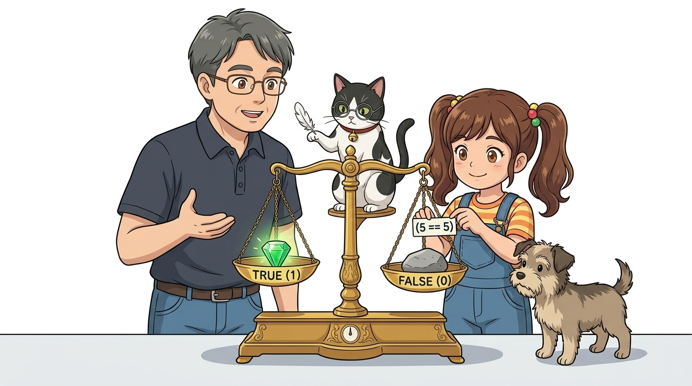
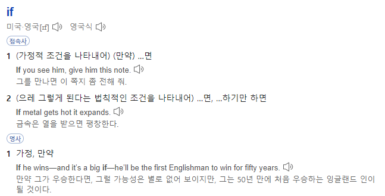
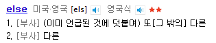
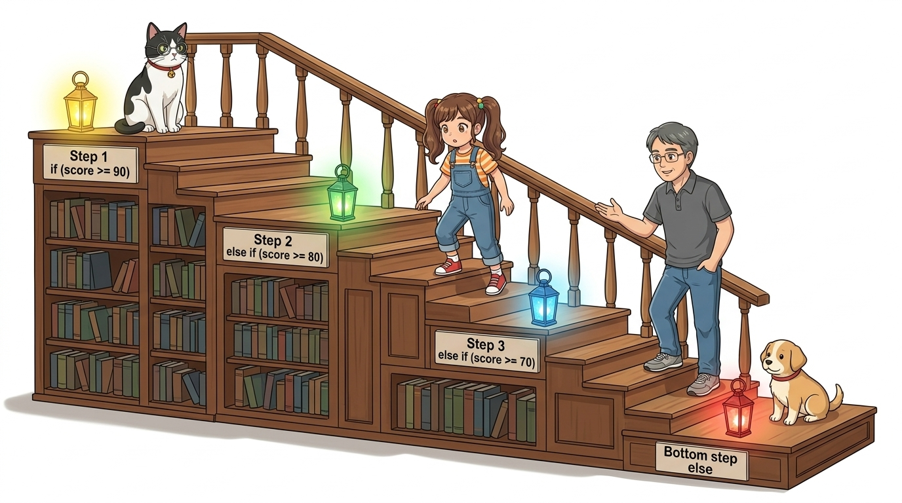
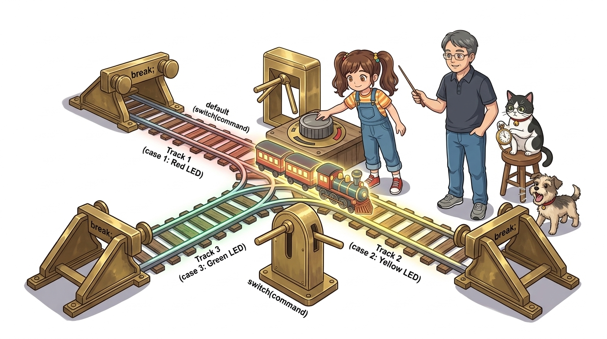

# 030_C언어제어문_생각의갈림길 🚦🤔

> **논리적 의사결정의 심장! 조건에 따라 흐름을 바꾸는 분기 제어 구조**  
> 불리언 논리(True/False), 비교 연산자, 논리 연산자(`&&`, `||`, `!`), `if`, `else`, `else if`, `switch-case` 문법을 체계적으로 마스터합니다.


* 🖥️ **강의 슬라이드**: [slides.md](./slides.md)

---

## 1. 제어문(Control Statement)이란? 🧭

컴퓨터 프로그램은 기본적으로 위에서 아래로 한 줄씩 순차적으로 명령을 실행합니다 (순차 구조).

> **👧 도로시**: "교수님, 지니야! 스위치를 눌렀을 때만 LED가 켜지고, 손을 떼면 저절로 꺼지게 하려면 아두이노는 어떻게 판단해야 하나요?"  
> **👨‍🏫 이호진 교수님**: "사람처럼 주어진 조건과 상황에 따라 다른 결정을 내리는 논리의 마법! 바로 **'조건문(if-else)'**을 사용하면 된답니다."  
> **🐱 조수 지니**: "마치 인생의 갈림길 표지판처럼 조건이 참(True)인지 거짓(False)인지에 따라 다른 길로 안내해요, 냐옹!"  
> **🐶 토토**: "멍멍! (비가 오면 우산, 맑으면 모자다 멍!)"


### 📌 현실 세계의 조건 분기 사례
* 실내 조도 센서 측정값이 어두워지면(조건) ➡️ 가로등 점등(행동)
* 버튼이 딸깍 눌리면(조건) ➡️ 현관문 도어락 해제(행동)
* 온습도 센서 측정값이 $28^\circ\text{C}$ 이상이면(조건) ➡️ 에어컨 모터 가동(행동)

---

## 2. 참(True)과 거짓(False)의 선택과 비교 연산자 ⚖️

컴퓨터의 모든 조건문은 오직 **참(1 / True)**과 **거짓(0 / False)**이라는 불리언(Boolean) 값으로 수렴합니다.



| 비교 연산자 | 수학적 의미 | C++ 문법 예시 ($a = 5$ 일 때) | 최종 결과값 |
| :---: | :--- | :--- | :---: |
| **`==`** | 두 피연산자 값이 서로 **같은가?** | `a == 5` | **참 (True / 1)** |
| **`!=`** | 두 피연산자 값이 서로 **다른가?** | `a != 5` | **거짓 (False / 0)** |
| **`>`** | 왼쪽 값이 오른쪽보다 **큰가?** | `a > 10` | **거짓 (False / 0)** |
| **`<`** | 왼쪽 값이 오른쪽보다 **작은가?** | `a < 10` | **참 (True / 1)** |
| **`>=`** | 왼쪽 값이 크거나 **같은가?** | `a >= 5` | **참 (True / 1)** |
| **`<=`** | 왼쪽 값이 작거나 **같은가?** | `a <= 3` | **거짓 (False / 0)** |

> [!WARNING]
> **대입 연산자 `=`** (값을 넣기)와 **비교 연산자 `==`** (같은지 비교)를 절대 혼동하지 마세요!  
> `if (a = 5)`는 조건문 내부에서 $a$에 5를 넣은 뒤 항상 참으로 판정되는 초보자의 가장 흔한 버그를 유발합니다.

---

## 3. "만약 ~라면?" 가장 기본이 되는 `if` 문 ❓

소괄호 `( )` 안의 조건식이 참일 때만 중괄호 `{ }` 내부의 코드 블록을 실행합니다.



```cpp
int buttonState = digitalRead(2);

// 만약 버튼이 눌려 LOW 신호가 들어왔다면?
if (buttonState == LOW) {
  // 조건이 '참'일 때만 이 방으로 들어와 실행됩니다!
  digitalWrite(13, HIGH); // 13번 LED 켜기
}
```

> **🐱 조수 지니의 꿀팁**: "만약 조건이 '거짓'이라면, 아두이노는 중괄호 안의 내용을 쳐다보지도 않고 다음 코드로 훌쩍 건너뛴단다!"

---

## 4. "그렇지 않다면?" 양자택일의 짝꿍 `else` 문 🚪

조건이 참일 때뿐만 아니라, **거짓일 때도 별도의 동작을 시키고 싶다면** `else`를 결합합니다.



```cpp
if (buttonState == LOW) {
  // [참인 경우] 버튼이 눌려있을 때
  digitalWrite(13, HIGH); // LED 켜기
} else {
  // [거짓인 경우] 버튼에서 손을 뗐을 때
  digitalWrite(13, LOW);  // LED 끄기
}
```

> **🐶 토토의 정리**: "멍멍! 버튼을 누르면 켜지고, 손을 떼면 꺼지는 완벽한 인터랙티브 스위치가 되었어!"

---

## 5. 여러 조건 순차 검사: `else if` 사다리 🪜

선택해야 할 갈림길이 3개 이상일 때는 `else if` 문을 계단식으로 연결합니다.



```cpp
int lightLevel = analogRead(A0);

if (lightLevel > 800) {
  // 아주 밝을 때: 모든 조명 소등
  digitalWrite(13, LOW);
} else if (lightLevel > 400) {
  // 보통 밝기: 절전 모드 (희미한 점등)
  analogWrite(13, 50);
} else {
  // 칠흑같이 어두울 때: 최대 밝기 점등!
  digitalWrite(13, HIGH);
}
```

> [!NOTE]
> `else if` 사다리는 위에서부터 순서대로 검사하며, **가장 먼저 만족하는 단 하나의 블록만 실행**하고 나머지 아래 조건들은 검사하지 않고 즉시 빠져나옵니다.

---

## 6. 두 개 이상의 조건 결합! C언어 논리 연산자 🔗⚡

현실의 센서 제어는 "온도가 높고 **동시에** 습도도 높을 때", 또는 "화재 센서 **혹은** 가스 센서 둘 중 하나라도 울릴 때"처럼 복합적인 조건을 다룹니다.


### 📌 C언어 3대 논리 연산자
1. **논리 AND (`&&`)**:
   - 두 조건이 **모두 참(True)**일 때만 최종 결과가 참이 됩니다.
   - `if (temp > 28 && humidity > 70)` ➡️ 에어컨 강력 제습 모드 가동!
2. **논리 OR (`||`)**:
   - 두 조건 중 **하나라도 참(True)**이면 최종 결과가 참이 됩니다.
   - `if (flameDetected || gasAlert)` ➡️ 비상 사이렌 즉각 경보!
3. **논리 NOT (`!`)**:
   - 조건의 참과 거짓을 **반대로 뒤집습니다** (`!True = False`, `!False = True`).
   - `if (!digitalRead(BUTTON_PIN))` ➡️ 풀업 저항 버튼이 눌렸을 때(LOW일 때) 깔끔하게 참으로 판별!

```cpp
// 풀업 스위치가 눌렸고(LOW) 동시에 온도가 30도 이상일 때만 팬 가동
if (digitalRead(2) == LOW && analogRead(A0) >= 600) {
    digitalWrite(8, HIGH); // 팬 모터 작동
}
```

---

## 7. 정수형 다중 메뉴 선택기: `switch - case` 🎛️

비교 대상이 특정 정수나 문자 하나로 명확히 떨어질 때는 가독성이 뛰어난 `switch` 문을 사용합니다.



```cpp
int mode = 2;

switch (mode) {
  case 1:
    turnOnRedLED();
    break; // switch 문 탈출!
    
  case 2:
    turnOnYellowLED();
    break; // 필수! 빠뜨리면 아래 case 3까지 계속 실행됨!
    
  case 3:
    turnOnGreenLED();
    break;
    
  default:
    turnOffAll(); // 일치하는 case가 없을 때의 기본 안전 동작
    break;
}
```

> [!IMPORTANT]
> 각 `case` 끝에 **`break;`** 문을 빠뜨리면, 일치하는 곳 아래에 있는 다른 case들까지 연달아 실행되는 **폴스루(Fall-through)** 현상이 발생하므로 각별히 주의해야 합니다.

---

## 8. 실전 응용! 버튼 상태 토글(Toggle) 알고리즘 💡🔄

C언어의 논리 부정 연산자(`!`)를 활용하면, 버튼을 한 번 누를 때마다 전등이 켜지고 꺼지는 **토글(Toggle) 스위치**를 단 한 줄로 구현할 수 있습니다!


```cpp
const byte BUTTON_PIN = 2;
const byte LED_PIN = 13;

bool ledState = false; // 전역 변수: LED 켜짐/꺼짐 상태 기억

void setup() {
  pinMode(BUTTON_PIN, INPUT_PULLUP); // 풀업 버튼
  pinMode(LED_PIN, OUTPUT);
}

void loop() {
  // 버튼이 눌렸을 때 (PULLUP이므로 눌리면 LOW)
  if (digitalRead(BUTTON_PIN) == LOW) {
    ledState = !ledState;               // 상태 반전: false -> true -> false!
    digitalWrite(LED_PIN, ledState);    // 변경된 상태 출력
    delay(200);                         // 채터링(바운싱) 방지 딜레이
  }
}
```

> **👧 도로시**: "`ledState = !ledState;` 단 한 줄로 불을 켰다 껐다 할 수 있다니, 논리 연산자 `!`가 정말 마법 같아!"

---

## 🌟 이번 시간 핵심 정리! 🏆

축하합니다! 조건에 따라 스스로 판단하는 똑똑한 아두이노의 C언어 의사결정 회로를 완성했습니다.


### 📋 핵심 요약 체크리스트
* [x] **불리언 참과 거짓**: 비교 연산자(`==`, `!=`, `<`, `>`)를 통해 조건식의 결과를 도출했습니다.
* [x] **대입과 비교 구분**: 값을 넣는 `=`와 같은지 비교하는 `==`를 확실히 구분합니다.
* [x] **복합 조건은 논리 연산자**: `&&`(AND), `||`(OR), `!`(NOT)을 적재적소에 결합했습니다.
* [x] **`if - else` 사다리**: 여러 단계의 센서 임계치를 계단식으로 판별했습니다.
* [x] **`switch - case` 와 `break`**: 메뉴 선택기를 만들고 폴스루 방지 `break`를 명시했습니다.

> **👧 도로시**: "이제 센서 값에 맞춰 똑똑하게 판단할 수 있어요! 그런데 교수님, 지니야! 아까 말했던 LED 100개도 순식간에 켜는 반복문은 언제 배우나요?"  
> **👨‍🏫 이호진 교수님**: "바로 다음 시간입니다, 도로시! 단 3줄로 수천 번의 작업을 마법처럼 반복하는 **'C언어 반복문(for, while)'**으로 힘차게 달려가 봅시다!"  
> **🐱 조수 지니**: "지치지 않는 회전목마의 세계가 우리를 기다리고 있어요, 냐옹!"  
> **🐶 토토**: "멍멍! (회전목마 반복문 타러 가자 멍!)"
