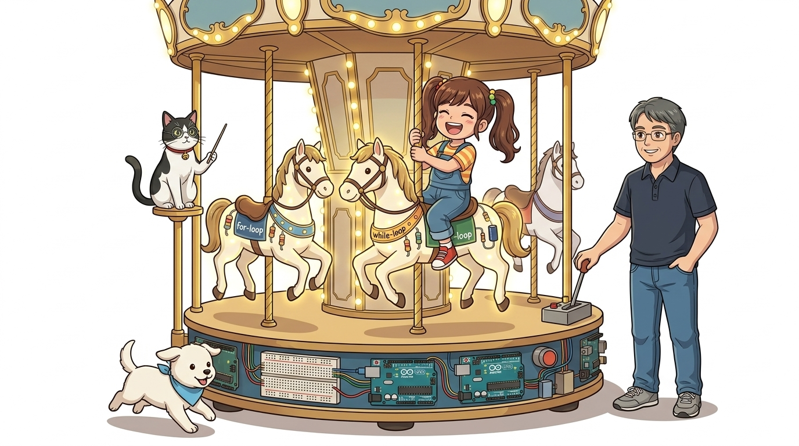
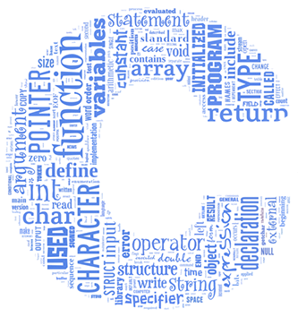
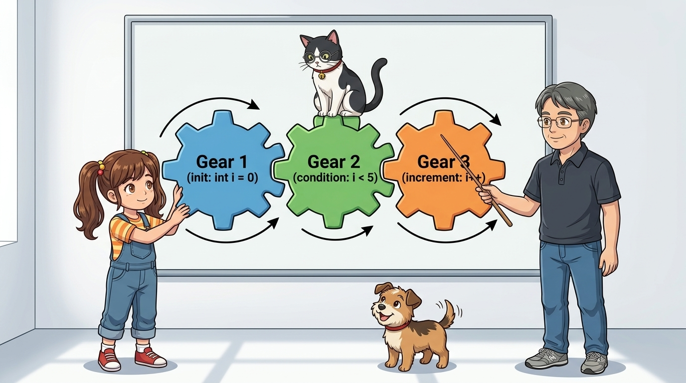
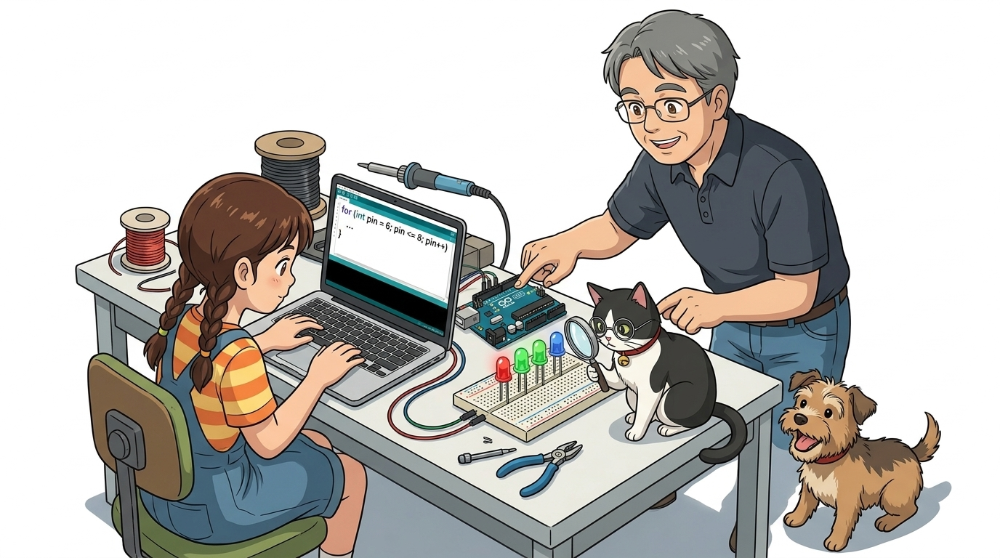
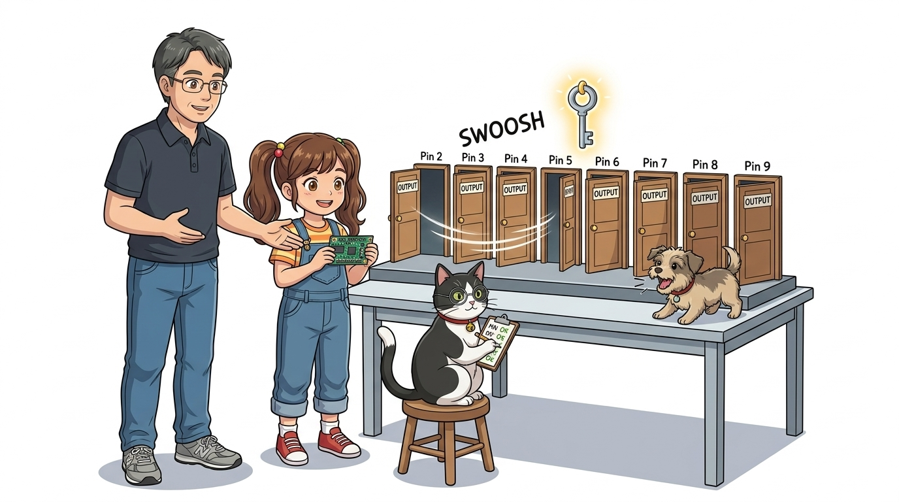
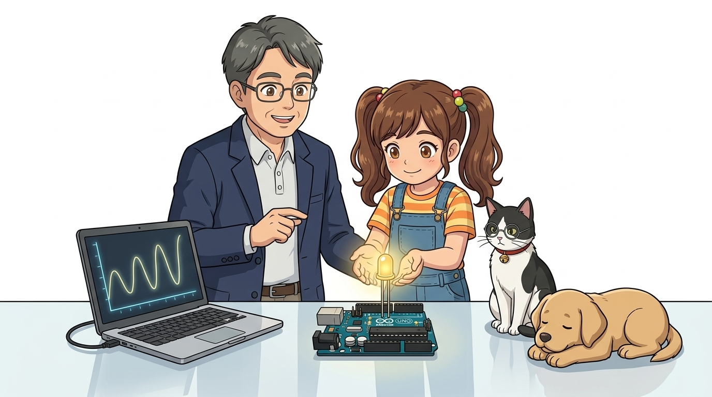
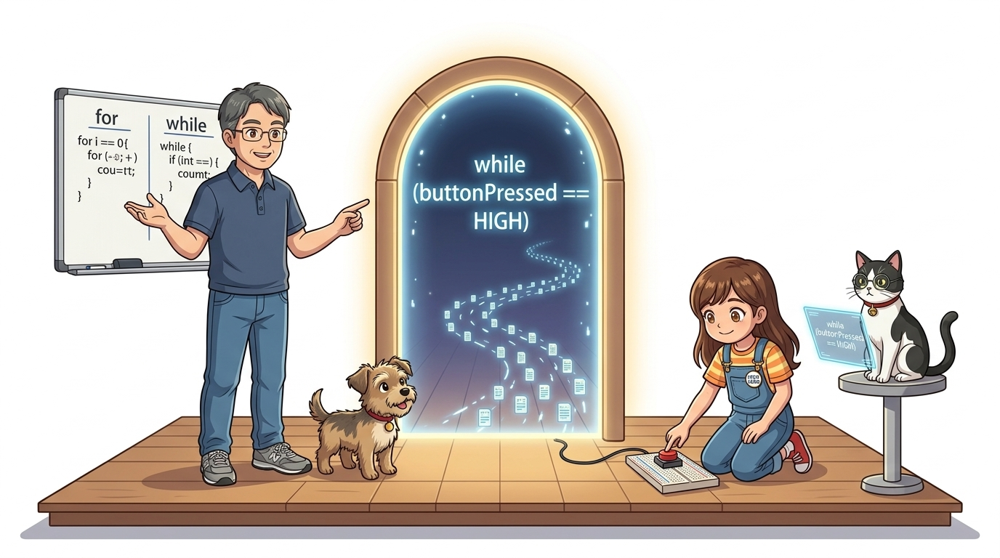
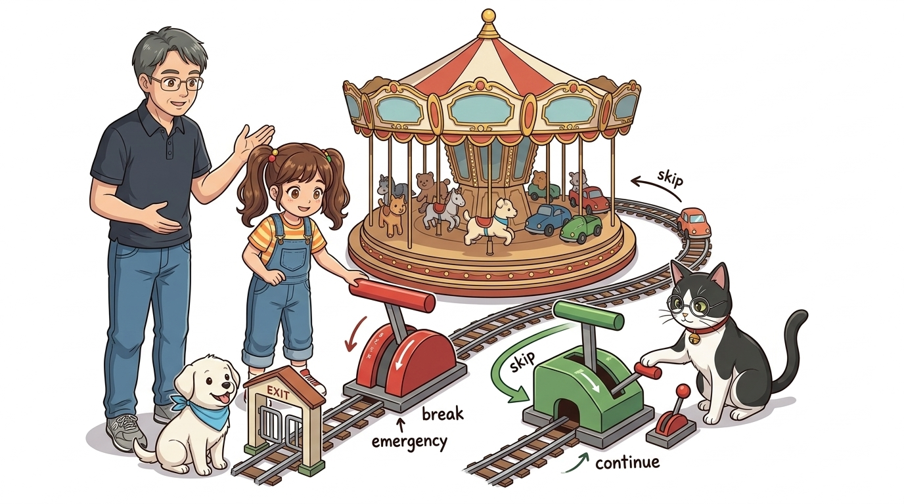
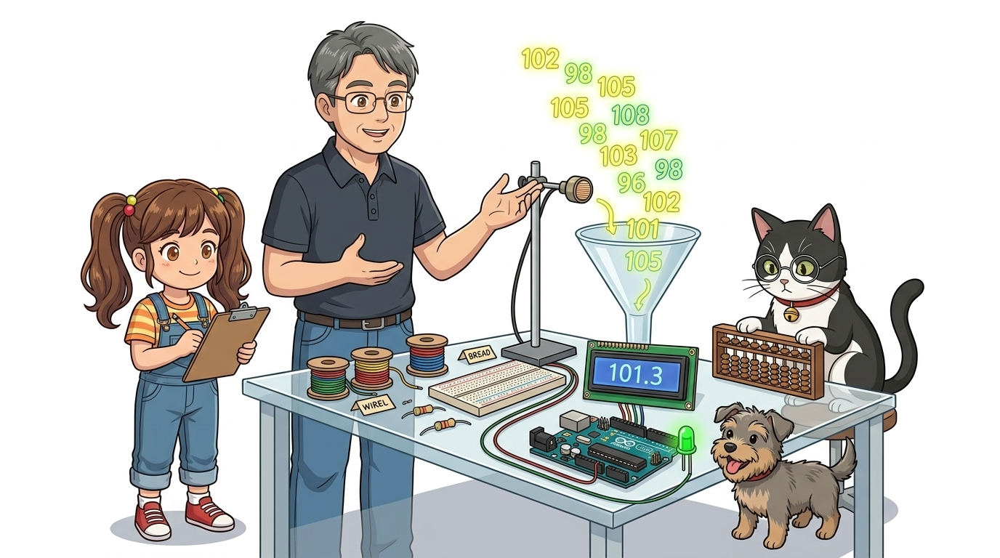

# 031_C언어반복문_지치지않는회전목마 🎠🔄



* **자동화와 대규모 반복의 열쇠! C/C++ 루프 제어 메커니즘**
* `for` 문의 카운터 증감 원리, PWM 페이딩 루프, `while` 조건 반복, `break`와 `continue`, 실전 센서 평균 필터링을 학습합니다.
* 📖 **상세 강의 교재**: [index.md](./index.md)


> 여러분 안녕하세요! 이번 시간에는 '031. C언어반복문 지치지않는회전목마 🎠🔄'을 주제로 함께 흥미진진한 탐험을 떠나보겠습니다. 공학 멘토 이호진 교수님과 꼼꼼한 조수 지니, 호기심 많은 탐험가 도로시, 그리고 귀여운 토토와 함께 신나는 아두이노 모험을 힘차게 시작해 봅시다. 준비되셨나요?

---

## 1. 반복문(Loop)이란 무엇일까요? 🔄



* **👧 도로시**: "교수님, 지니야! 똑같은 코드를 100번 복사/붙여넣기 하지 않고, 컴퓨터한테 '100번 반복해서 실행해!'라고 명령할 순 없나요?"
* **👨‍🏫 이호진 교수님**: "컴퓨터가 사람보다 압도적으로 잘하는 능력이 바로 지치지 않는 반복 작업입니다. 마법의 회전목마인 **'반복문(Loop)'**을 함께 타봅시다!"
* **🐱 조수 지니**: "for 문과 while 문이라는 든든한 날개가 도로시의 코드를 100배 더 강력하게 만들어줄 거예요, 냐옹!"
* **🐶 토토**: "멍멍! (꼬리 흔들기 100번 무한 반복이다 멍!)"

| 반복문 종류 | 실행 조건 및 제어 방식 | 대표 비유 및 적합한 상황 |
| :--- | :--- | :--- |
| **`for` 문** | 몇 번 반복할지 **정확한 반복 횟수**가 정해져 있을 때 | "운동장 10바퀴 딱 완주하기!" (LED 핀 순회, PWM 밝기 제어) |
| **`while` 문** | 횟수는 모르지만 **특정 조건이 유지되는 동안** 계속 | "배터리가 0%가 될 때까지 주행하기!" (센서 감시, 통신 수신) |

컴퓨터가 인간보다 압도적으로 뛰어난 단 하나의 능력은 **"지치거나 실수하지 않고 똑같은 작업을 수억 번 반복하는 것"**입니다.
### 📌 C언어 2대 반복문의 특징 비교

> 자, 이번 슬라이드의 질문을 함께 보시겠습니다. 바로 '1. 반복문(Loop)이란 무엇일까요? 🔄'라는 아주 흥미로운 질문입니다. 반복문은 번거롭고 방대한 작업을 단 몇 줄로 자동화하는 프로그래밍의 정수입니다.

---

## 2. 횟수를 세며 도는 `for` 반복문의 3대 요소 🔢



1. **초기식 (`int i = 0`)**: 루프가 시작될 때 최초 1회 실행되는 카운터 변수 선언 ("0번째 바퀴부터 출발!")
2. **조건식 (`i < 5`)**: 매 바퀴마다 검사하여 참이면 루프 실행, 거짓이면 즉시 탈출 ("5바퀴 미만일 때만 계속!")
3. **증감식 (`i++`)**: 한 바퀴를 돌고 난 직후 카운터 변수를 1씩 증가시킴 (`i = i + 1`)

`for` 문의 소괄호 `( )` 안에는 세미콜론(`;`)으로 구분된 3가지 핵심 약속이 들어갑니다.

```cpp
for (int i = 0; i < 5; i++) {
  // 5번 반복 실행할 C언어 명령 블록!
}
```

> 이번 슬라이드에서는 '2. 횟수를 세며 도는 for 반복문의 3대 요소 🔢'에 대한 실제 동작 코드를 분석해 보겠습니다. 화면의 코드를 살펴보시면, 컴퓨터가 아두이노 하드웨어에 단계별로 명령을 내리는 흐름을 명확하게 확인할 수 있습니다. 여기서 핵심은 초기식 (int i = 0): 루프가 시작될 때 최초 1회 실행되는 카운터 변수 선언 ("0번째 바퀴부터 출발!")입니다. 각 함수의 역할과 괄호 안의 매개변수가 하드웨어 핀과 어떤 관계를 맺고 동작하는지 주의 깊게 살펴보시기 바랍니다.

---

## 3. 다중 LED를 `for` 문으로 마법처럼 순차 점등하기! ✨



* **🐱 조수 지니**: "핀 번호 변수 `pin`이 6 ➡️ 7 ➡️ 8로 1씩 증가하면서 세 개의 LED를 순식간에 차례대로 켜준단다! 만약 2번부터 13번까지 12개 핀이라도 코드 줄 수는 똑같이 4줄이야!"

이전 시간에 6, 7, 8번 핀을 하나씩 손으로 쓰던 코드를 단 4줄의 `for` 문으로 완벽히 압축합니다.

```cpp
void loop() {
  // pin 변수가 6 -> 7 -> 8 로 1씩 커지며 순서대로 점등
  for (int pin = 6; pin <= 8; pin++) {
    digitalWrite(pin, HIGH);
    delay(250);
    digitalWrite(pin, LOW);
  }
}
```

> 이번 슬라이드에서는 '3. 다중 LED를 for 문으로 마법처럼 순차 점등하기! ✨'에 대한 실제 동작 코드를 분석해 보겠습니다. 화면의 코드를 살펴보시면, 컴퓨터가 아두이노 하드웨어에 단계별로 명령을 내리는 흐름을 명확하게 확인할 수 있습니다. 각 함수의 역할과 괄호 안의 매개변수가 하드웨어 핀과 어떤 관계를 맺고 동작하는지 주의 깊게 살펴보시기 바랍니다.

---

## 4. `setup()`의 핀 모드 초기화도 `for` 문으로 단칼에! 🛠️



* **🐶 토토**: "멍멍! 10줄짜리 귀찮은 코드가 단 3줄로 끝났다 멍!"

제어할 핀이 10개, 20개로 늘어나도 단 3줄이면 모든 핀을 `OUTPUT`으로 설정할 수 있습니다.

```cpp
void setup() {
  // 2번부터 11번 핀까지 총 10개의 핀을 단 3줄로 일괄 OUTPUT 설정!
  for (int pin = 2; pin <= 11; pin++) {
    pinMode(pin, OUTPUT);
  }
}
```

> 이번 슬라이드에서는 '4. setup()의 핀 모드 초기화도 for 문으로 단칼에! 🛠️'에 대한 실제 동작 코드를 분석해 보겠습니다. 화면의 코드를 살펴보시면, 컴퓨터가 아두이노 하드웨어에 단계별로 명령을 내리는 흐름을 명확하게 확인할 수 있습니다. 각 함수의 역할과 괄호 안의 매개변수가 하드웨어 핀과 어떤 관계를 맺고 동작하는지 주의 깊게 살펴보시기 바랍니다.

---

## 5. 증감식 변형! 서서히 밝아지고 어두워지는 Fading LED 💡✨



* **👧 도로시**: "`b += 5`는 5씩 건너뛰며 밝아지고, `b -= 5`는 5씩 줄어들며 숨쉬듯 은은하게 켜지네!"

증감식을 `i++` 대신 `b += 5`나 `b -= 5`로 바꾸면 감성적인 조명 연출이 가능합니다.

```cpp
const byte LED_PIN = 9; // PWM 지원 핀 (~ 표시)

void loop() {
  // 1. 서서히 밝아지기 (0 -> 255)
  for (int b = 0; b <= 255; b += 5) {
    analogWrite(LED_PIN, b);
    delay(30);
  }
  
  // 2. 서서히 어두워지기 (255 -> 0)
  for (int b = 255; b >= 0; b -= 5) {
    analogWrite(LED_PIN, b);
    delay(30);
  }
}
```

> 이번 슬라이드에서는 '5. 증감식 변형! 서서히 밝아지고 어두워지는 Fading LED 💡✨'에 대한 실제 동작 코드를 분석해 보겠습니다. 화면의 코드를 살펴보시면, 컴퓨터가 아두이노 하드웨어에 단계별로 명령을 내리는 흐름을 명확하게 확인할 수 있습니다. 각 함수의 역할과 괄호 안의 매개변수가 하드웨어 핀과 어떤 관계를 맺고 동작하는지 주의 깊게 살펴보시기 바랍니다.

---

## 6. 조건이 참인 동안 질주하는 `while` 반복문 🏃



* [!WARNING]
* **무한 루프(Infinite Loop) 주의!**
* `while` 문 블록 내부에서 조건식을 거짓으로 바꿔주는 갱신 코드가 없다면 아두이노는 루프에 영원히 갇혀 다른 센서를 읽지 못하고 동결(벽돌) 상태가 됩니다.

반복 횟수가 아니라 특정 상태나 센서 플래그가 유지될 때까지 반복합니다.

```cpp
int waterLevel = 100;

// 수위가 10 이상인 동안 계속 펌프로 물을 퍼냅니다.
while (waterLevel > 10) {
  drainPumpRun();
  waterLevel = readWaterSensor(); // 매 바퀴마다 조건을 갱신!
}
```

> 이번 슬라이드에서는 '6. 조건이 참인 동안 질주하는 while 반복문 🏃'에 대한 실제 동작 코드를 분석해 보겠습니다. 화면의 코드를 살펴보시면, 컴퓨터가 아두이노 하드웨어에 단계별로 명령을 내리는 흐름을 명확하게 확인할 수 있습니다. 각 함수의 역할과 괄호 안의 매개변수가 하드웨어 핀과 어떤 관계를 맺고 동작하는지 주의 깊게 살펴보시기 바랍니다.

---

## 7. 비상탈출 `break`와 이번 바퀴 건너뛰기 `continue` 🛑🦘



* **`break;` (비상 정지 버튼)**:
* 반복 횟수가 남아있더라도 루프를 **즉각 파괴하고 밖으로 완전 탈출**합니다.
* 예: 긴급 정지 버튼이 눌리거나 장애물 충돌 감지 시 즉각 모터 정지!
* **`continue;` (이번 바퀴 건너뛰기)**:
* 아래 남은 코드를 실행하지 않고, **즉시 다음 바퀴의 증감식으로 점프**합니다.

반복의 흐름을 능동적으로 통제하는 특수 제어 키워드입니다.
### 📌 키워드 동작 차이

```cpp
for (int i = 1; i <= 5; i++) {
  if (i == 3) continue; // 3번째 바퀴는 출력하지 않고 건너뜀!
  Serial.println(i);    // 1, 2, 4, 5 만 출력됨
}
```

> 이번 슬라이드에서는 '7. 비상탈출 break와 이번 바퀴 건너뛰기 continue 🛑🦘'에 대한 실제 동작 코드를 분석해 보겠습니다. 화면의 코드를 살펴보시면, 컴퓨터가 아두이노 하드웨어에 단계별로 명령을 내리는 흐름을 명확하게 확인할 수 있습니다. 여기서 핵심은 break; (비상 정지 버튼)입니다. 각 함수의 역할과 괄호 안의 매개변수가 하드웨어 핀과 어떤 관계를 맺고 동작하는지 주의 깊게 살펴보시기 바랍니다.

---

## 8. 실전 센서 응용! 센서 10회 평균 측정 (노이즈 필터링) 📈🛡️



* **🐶 토토**: "멍멍! 출렁거리던 센서 그래프가 `for` 루프 덕분에 반듯하고 얌전해졌다 멍!"

아날로그 센서는 미세한 전기적 잡음(노이즈)으로 인해 측정값이 출렁거립니다.
이때 C언어 `for` 문으로 10번 연속 측정하여 평균값을 내면 마법처럼 안정적인 신호를 얻을 수 있습니다!

```cpp
int getSmoothedSensorValue(byte pin) {
  int sum = 0; // 누적합 저장 변수
  
  // 10회 연속 측정하여 합산
  for (int i = 0; i < 10; i++) {
    sum += analogRead(pin);
    delay(5); // 짧은 안정화 대기
  }
  
  int average = sum / 10; // 10으로 나누어 정밀한 평균값 도출!
  return average;
}

void loop() {
  int cleanValue = getSmoothedSensorValue(A0);
  Serial.print("노이즈 제거된 센서 값: ");
  Serial.println(cleanValue);
  delay(500);
}
```

> 이번 슬라이드에서는 '8. 실전 센서 응용! 센서 10회 평균 측정 (노이즈 필터링) 📈🛡️'에 대한 실제 동작 코드를 분석해 보겠습니다. 화면의 코드를 살펴보시면, 컴퓨터가 아두이노 하드웨어에 단계별로 명령을 내리는 흐름을 명확하게 확인할 수 있습니다. 각 함수의 역할과 괄호 안의 매개변수가 하드웨어 핀과 어떤 관계를 맺고 동작하는지 주의 깊게 살펴보시기 바랍니다.

---

## 🌟 이번 시간 핵심 정리! 🏆


* **👧 도로시**: "반복문까지 배우고 나니 파트1 기초가 완벽하게 다져진 것 같아요! 코딩이 100배는 더 강력해졌어요!"
* **👨‍🏫 이호진 교수님**: "정말 대단합니다, 도로시! 이제 아두이노 우노의 하드웨어와 C++ 기초 문법이라는 단단한 기초를 완벽히 정복했습니다."
* **🐱 조수 지니**: "다음 파트에서는 단순한 온/오프를 넘어 부드러운 아날로그와 PWM, 센서와 인터럽트 등 더 넓은 모험이 펼쳐진답니다, 냐옹!"
* **🐶 토토**: "멍멍! (파트1 완벽 졸업 축하해! 다음 모험으로 가자 멍!)"

* [x] **`for (초기; 조건; 증감)`**: 정해진 횟수와 핀 번호 제어에 최적화된 3단 구조를 숙지했습니다.
* [x] **증감식 변형**: `b += 5`, `b -= 5`를 통해 감성적인 PWM 호흡 조명을 구현했습니다.
* [x] **`while (조건)`**: 센서 플래그와 실시간 이벤트 감시에 최적화된 조건 반복을 이해했습니다.
* [x] **흐름 제어**: 비상 탈출 `break`와 건너뛰기 `continue`를 적재적소에 배치했습니다.
* [x] **실전 노이즈 필터링**: `for` 문을 활용한 10회 평균값 측정으로 데이터 신뢰도를 극대화했습니다.

축하합니다! 프로그래밍의 가장 강력한 자동화 엔진인 `for`와 `while` 반복 제어를 완벽히 정복했습니다.
### 📋 핵심 요약 체크리스트

> 오늘 배운 C언어 반복문은 파트1 아두이노 우노와 기초의 빛나는 피날레입니다. 도로시, 교수님, 지니, 토토와 함께한 파트1 000강부터 031강까지의 탄탄한 기본기를 바탕으로, 다음 파트에서도 더욱 신나고 깊이 있는 피지컬 컴퓨팅 모험을 이어가겠습니다. 모두 수고 많으셨습니다!