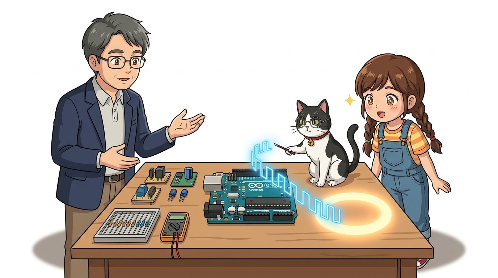
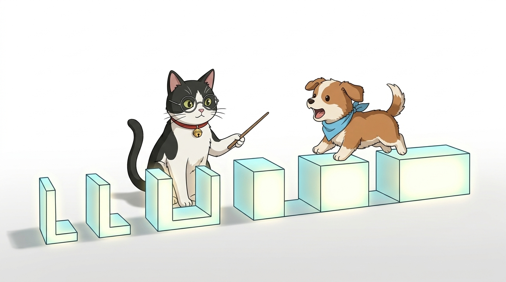
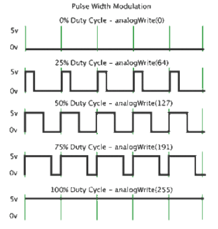
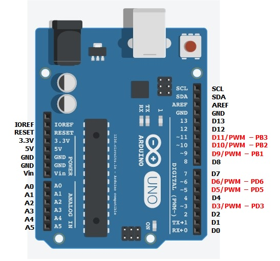

# 032_PWM원리_눈속임깜빡임마법 🪄⚡

> **디지털 하드웨어로 가상 아날로그를 만드는 핵심 원리! Pulse Width Modulation의 비밀**  
> 듀티비(Duty Cycle)에 따른 평균 전압 계산, 490Hz 고속 스위칭과 잔상 효과(POV), 아두이노 PWM 핀 구조를 학습합니다.

* 🖥️ **강의 슬라이드**: [slides.md](./slides.md)

---

## 1. 아날로그 출력의 놀라운 비밀 🕵️‍♀️

아두이노의 `analogWrite()`는 사실 전압 자체를 2.5V나 1.25V로 부드럽게 깎아서 내보내는 것이 아닙니다!

> **👧 도로시**: "교수님! 지니야! 아두이노는 0V 아니면 5V만 낼 수 있는 디지털 컴퓨터라면서, DAC(디지털-아날로그 컨버터) 부품도 없이 어떻게 중간 밝기를 만드는 거야?"  
> **👨‍🏫 이호진 교수님**: "후후, 도로시! 사실 진짜 전압을 낮춘 게 아니라, 1초에 수백 번 껐다 켰다 하는 초고속 눈속임 마법 **'PWM(펄스 폭 변조)'** 을 쓴 거란다!"  
> **🐶 토토**: "멍멍! (눈 깜짝할 사이에 번쩍인다 멍!)"

> [!NOTE]
> **디지털 핀의 전압 한계**  
> ATmega328P 마이크로컨트롤러의 GPIO 핀은 물리적으로 전원 전압인 5V(`HIGH`)와 0V(`LOW`)의 두 가지 전위만 가질 수 있습니다. 하지만 전기를 켜두는 시간의 비율을 극도로 미세하게 조절하면 인간의 감각 기관은 이를 평균 전압으로 인식합니다.

---

## 2. 펄스 폭 변조: PWM (Pulse Width Modulation) 🌊

고정된 주파수의 사각파(Square Wave)에서 신호가 `HIGH`인 시간의 폭(Width)을 능동적으로 변조(Modulation)하는 기법입니다.

* **펄스 (Pulse)**: 5V 전압이 사각형 모양으로 솟아올라 있는 전기 덩어리
* **폭 (Width)**: 한 주기(Period, $T$) 안에서 전기가 켜져 있는 시간($T_{on}$)의 길이
* **변조 (Modulation)**: 켜져 있는 시간의 길이를 0%에서 100%까지 자유롭게 늘리고 줄이는 기술
* 결론적으로 **디지털 펄스의 폭을 제어하여 아날로그 전압의 효과를 완벽하게 모사**합니다.

---

## 3. 켜짐의 비율: 듀티 사이클(Duty Cycle)과 유효 전압 ⏱️

한 주기($T$) 동안 전기가 켜져 있는 시간의 백분율을 **듀티 사이클(Duty Cycle, 듀티비)** 이라고 부릅니다.

### 📌 듀티비별 유효 평균 전압 및 `analogWrite` 매핑

| 듀티비 (Duty Cycle) | 파형 비율 ($T_{on} / T$) | 유효 평균 전압 ($V_{avg}$) | `analogWrite()` 값 (8비트) | 체감 밝기 / 속도 |
| :---: | :---: | :---: | :---: | :--- |
| **0%** | 계속 꺼짐 | $5\text{V} \times 0 = \mathbf{0.0V}$ | `0` | 완전 꺼짐 (OFF) |
| **25%** | 1/4 켜짐, 3/4 꺼짐 | $5\text{V} \times 0.25 = \mathbf{1.25V}$ | `64` | 어두운 미등 (1/4 파워) |
| **50%** | 반반씩 켜고 끔 | $5\text{V} \times 0.50 = \mathbf{2.50V}$ | `127` | 절반 밝기 (하프 파워) |
| **75%** | 3/4 켜짐, 1/4 꺼짐 | $5\text{V} \times 0.75 = \mathbf{3.75V}$ | `191` | 밝은 점등 (3/4 파워) |
| **100%** | 계속 켜짐 | $5\text{V} \times 1.00 = \mathbf{5.0V}$ | `255` | 최대 밝기 (Full Power) |

$$V_{avg} = V_{CC} \times \text{Duty Cycle} = 5\text{V} \times \left(\frac{\text{value}}{255}\right)$$

---

## 4. 우리 눈의 착각: 잔상 효과(POV)와 주파수(Hz) 👀✨

왜 사람의 눈에는 깜빡임이 보이지 않고 부드러운 밝기로 느껴질까요?

* **아두이노 UNO의 PWM 주파수**:
  * 5번, 6번 핀: **약 980Hz** (1초에 980번 깜빡임)
  * 3, 9, 10, 11번 핀: **약 490Hz** (1초에 490번 깜빡임)
* **인간 망막의 한계**: 인간의 시신경은 1초에 약 60회(60Hz) 이상의 빠른 점멸을 분리해 내지 못하고 평균적인 광량으로 융합하여 인식합니다 (망막 잔상 효과).
* 켜져 있는 시간이 길어질수록 눈에 들어오는 광자의 총량이 늘어나 뇌에서는 **"전압이 높아져 더 밝아졌다!"** 고 완벽하게 착각하게 됩니다.

---

## 5. 아두이노 우노의 PWM 전용 핀 6형제 🏷️

보드 기판의 실크스크린 인쇄에서 물결표(`~`)가 새겨진 핀들만 내부 하드웨어 타이머(Timer 0, 1, 2)와 연결되어 있습니다.

* **PWM 지원 핀**: **`~3, ~5, ~6, ~9, ~10, ~11번`**
* **주의**: 물결표가 없는 2번, 4번, 7번, 8번, 12번, 13번 핀에 `analogWrite()`를 호출하면, 값이 128 이상일 땐 그냥 5V(`HIGH`), 127 이하일 땐 0V(`LOW`)로만 거칠게 동작합니다!
* 모터 드라이버 속도 제어, LED 디밍, 서보 모터 각도 제어 시 반드시 물결표 핀을 선택해야 합니다.

---

## 🌟 도로시와 지니의 이번 시간 핵심 정리! 🏆

축하합니다! 디지털 제어의 최고급 기법인 펄스 폭 변조(PWM)의 전자공학적 원리를 완벽히 꿰뚫었습니다.

### 📋 핵심 요약 체크리스트

* [x] **PWM의 본질**: 디지털 고속 스위칭의 온-타임(On-time) 비율을 변조하여 평균 전압을 모사합니다.
* [x] **듀티 사이클 공식**: $V_{avg} = 5\text{V} \times (\text{value} / 255)$ 로 유효 전압을 유도했습니다.
* [x] **하드웨어 핀 제약**: 490Hz/980Hz 타이머가 내장된 물결표(`~`) 6개 핀의 역할을 명확히 확인했습니다.

> **👧 도로시**: "PWM의 마법을 알고 나니 이제 빛과 모터 출력을 자유자재로 다룰 수 있을 것 같아!"  
> **👨‍🏫 이호진 교수님**: "그렇다면 다음 시간에는 빨강, 초록, 파랑 3개의 PWM을 섞어서 수백만 가지 무지개 빛을 빚어내는 **'RGB LED'** 를 정복해보자!"
