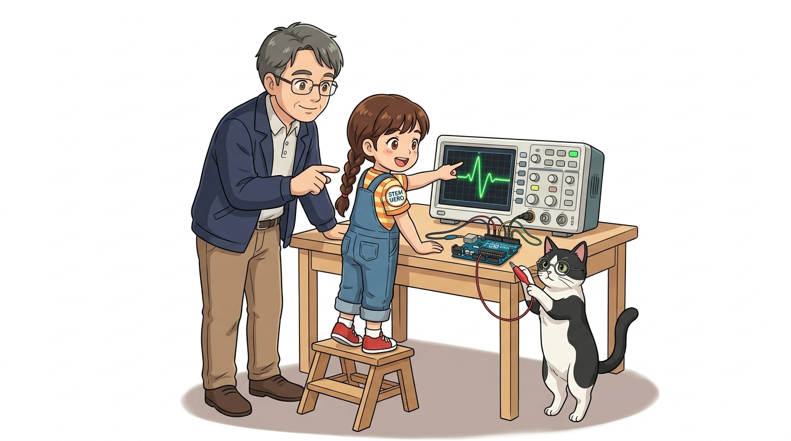
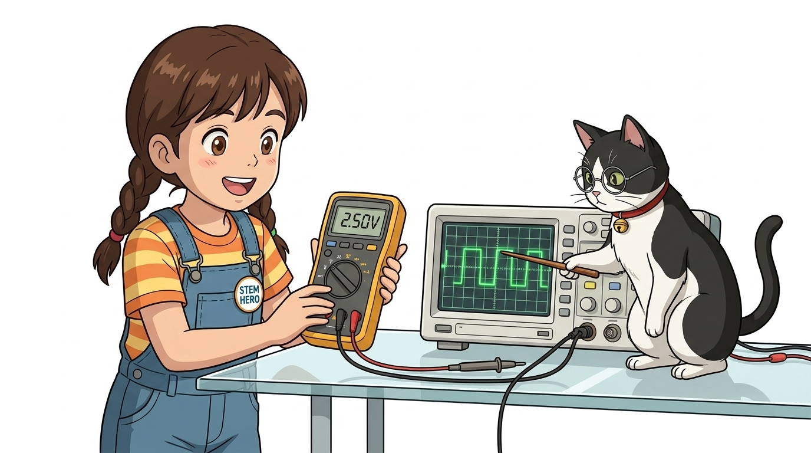
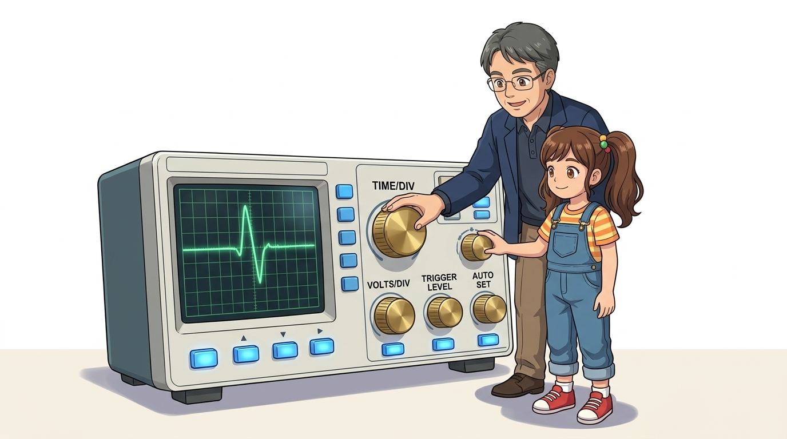
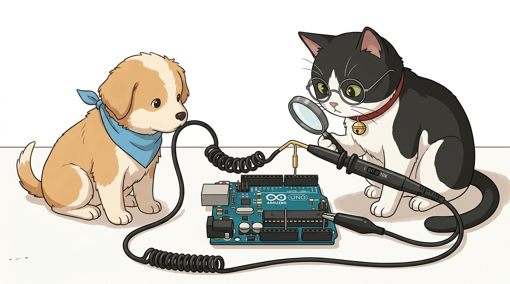
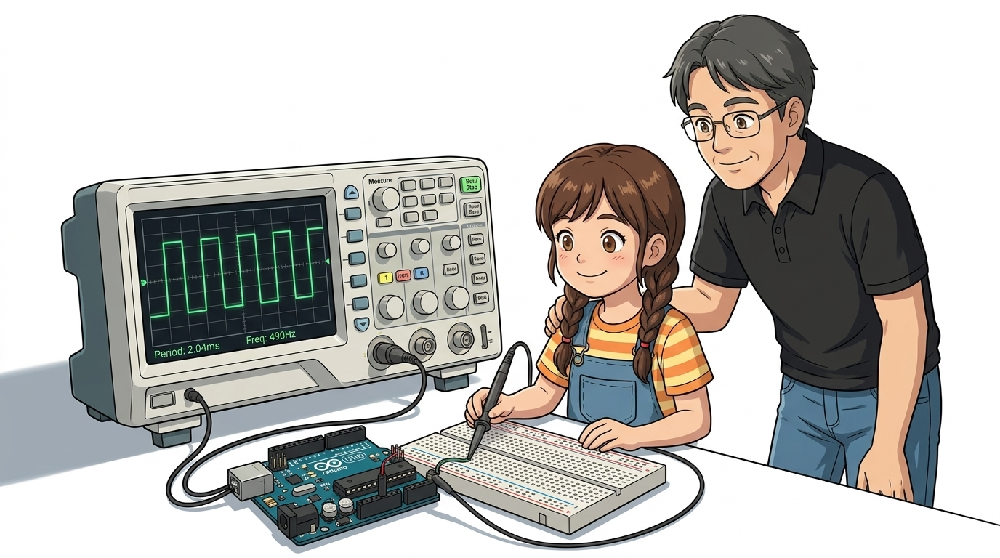
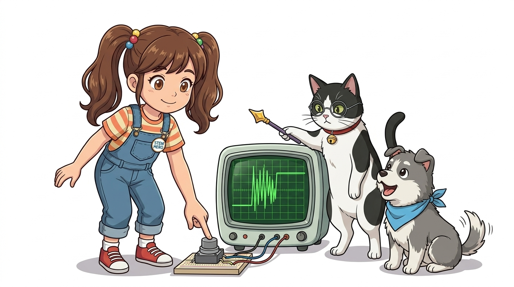

# 033_오실로스코프_눈으로보는_신호파형과_PWM계측 📊🌊



**도로시와 지니가 함께하는 전자 회로의 눈! 오실로스코프 조작법과 아두이노 PWM 파형 정밀 분석**
* 👧 **도로시**: "교수님! 지니야! `analogWrite(9, 127)`로 모터 속도를 절반으로 줄였는데, 멀티미터로 찍으면 왜 2.5V가 나와? 진짜 2.5V 전기가 나오는 거야?"
* **👨‍🏫 이호진 교수님**: "후후, 멀티미터는 평균값만 보여주어 우리 눈을 속이지만, **오실로스코프(Oscilloscope)** 로 들여다보면 0V와 5V가 1초에 490번 깜빡이는 사각파 파형의 진실이 눈앞에 펼쳐진단다!"
* 🐶 **토토**: "바우! 전기의 물결이 화면에 영화처럼 보인다 멍!"
* 📖 **상세 강의 교재**: [index.md](./index.md)


> 여러분 안녕하세요! 이번 시간에는 '033. 오실로스코프 눈으로보는 신호파형과 PWM계측 📊🌊'을 주제로 함께 흥미진진한 탐험을 떠나보겠습니다. 오늘 강의에서는 특히 도로시와 지니가 함께하는 전자 회로의 눈! 오실로스코프 조작법과 아두이노 PWM 파형 정밀 분석, 👧 도로시: "교수님! 지니야! analogWrite(9, 127)로 모터 속도를 절반으로 줄였는데, 멀티미터로 찍으면 왜 2.5V가 나와? 진짜 2.5V 전기가 나오는 거야?"를 중심으로 핵심 원리와 응용 방법을 차근차근 배워보겠습니다. 이호진 교수님과 똑똑한 조수 지니, 호기심 많은 도로시와 토토와 함께 신나는 아두이노 모험을 힘차게 시작해 봅시다. 준비되셨나요?

---

## 1. 오실로스코프(Oscilloscope)란 무엇인가?



멀티미터가 숫자로 된 체온계라면, 오실로스코프는 심장 박동의 파동을 실시간으로 그려주는 **심전도 모니터**와 같습니다.

```
       [ 멀티미터 화면 ]                [ 오실로스코프 화면 ]
      ┌────────────────┐               ┌────────────────────────────────────┐
      │                │               │      ┌──┐    ┌──┐    ┌──┐          │ (Y축: 전압 Volts)
      │     2.50 V     │               │  ────┘  └───┘  └───┘  └───┘  ────  │
      │                │               │        (X축: 시간 Time)            │
      └────────────────┘               └────────────────────────────────────┘
       "평균 숫자 1개만 표시"           "마이크로초 단위의 전압 변화 그래프를 표시"
```

> 자, 이번 슬라이드의 질문을 함께 보시겠습니다. 바로 '1. 오실로스코프(Oscilloscope)란 무엇인가?'라는 아주 흥미로운 질문입니다. 이 질문 속에 숨겨진 전자 회로와 컴퓨팅의 핵심 원리를 지금부터 차근차근 하나씩 파헤쳐 보겠습니다.

---
## 2. 오실로스코프 핵심 조작 4대 다이얼




1. **`VOLTS/DIV` (수직 감도)**: 세로 1칸의 전압을 조절합니다. 예컨대 `1V/Div`로 맞추면 아두이노의 5V 신호는 위로 정확히 5칸 높이로 솟아오릅니다.
2. **`TIME/DIV` (수평 시간축)**: 가로 1칸의 시간을 조절합니다. `500µs/Div`로 맞추면 빠른 펄스도 돋보기로 보듯 넓게 펼쳐집니다.
3. **`TRIGGER` (트리거 레벨)**: 파형이 화면 위에서 번개처럼 흘러가지 않고 정지 화면처럼 딱 고정되도록 기준 전압 높이를 잡아줍니다.
4. **`AUTO SET`**: 초보자를 위한 치트키! 버튼을 누르면 기계가 신호의 크기와 주기를 알아서 감지하여 최적의 화면으로 세팅합니다.

화면의 바둑판 격자(Grid)는 **디비전(Div: Division, 1칸)** 단위로 나뉘어 있습니다.

```
 ┌────────────────────────────────────────────────────────┐
 │   [ 수직 축 (Vertical) ]       [ 수평 축 (Horizontal) ]│
 │   * VOLTS / DIV 다이얼         * TIME / DIV 다이얼     │
 │     ➔ 세로 1칸당 전압 크기       ➔ 가로 1칸당 시간 크기│
 ├────────────────────────────────────────────────────────┤
 │   [ 트리거 (Trigger) ]         [ 마법의 버튼 (AUTO) ]  │
 │   * LEVEL 다이얼               * [AUTO SET] 버튼       │
 │     ➔ 파형을 멈춰 세우는 방아쇠  ➔ 신호를 알아서 자동 정렬│
 └────────────────────────────────────────────────────────┘
```

> 이번 슬라이드에서는 '2. 오실로스코프 핵심 조작 4대 다이얼'에 대한 실제 동작 코드를 분석해 보겠습니다. 화면의 코드를 살펴보시면, 컴퓨터가 아두이노 하드웨어에 단계별로 명령을 내리는 흐름을 명확하게 확인할 수 있습니다. 여기서 핵심은 VOLTS/DIV (수직 감도): 세로 1칸의 전압을 조절합니다. 예컨대 1V/Div로 맞추면 아두이노의 5V 신호는 위로 정확히 5칸 높이로 솟아오릅니다.입니다. 각 함수의 역할과 괄호 안의 매개변수가 하드웨어 핀과 어떤 관계를 맺고 동작하는지 주의 깊게 살펴보시기 바랍니다.
---

## 3. 프로브(Probe) 연결과 10X 감쇠비 스위치



* **검정색 악어 클립**: 회로의 **GND(접지)** 에 단단히 물립니다.
* **갈고리(Hook) 팁**: 측정하려는 아두이노 핀(예: 디지털 9번 핀)에 걸어줍니다.
* **1X vs 10X 스위치**:
* 프로브 몸통의 작은 스위치를 **`10X`** 로 두는 것이 정석입니다.
* 회로에 주는 부하 영향을 1/10으로 줄여주어, 고주파 신호가 일그러지지 않고 본래 모양 그대로 오실로스코프에 전달됩니다. *(오실로스코프 기기 채널 설정도 10X로 일치시켜야 1배수 전압이 정확히 표시됩니다!)*

오실로스코프에 연결된 탐침 선을 **프로브(Probe)** 라고 부릅니다.

> 이번 슬라이드에서는 '3. 프로브(Probe) 연결과 10X 감쇠비 스위치'에 대해 자세히 살펴보겠습니다. 화면의 다이어그램과 사진을 함께 참고해 주시기 바랍니다. 첫 번째 핵심은 검정색 악어 클립: 회로의 GND(접지) 에 단단히 물립니다.이며, 두 번째로는 갈고리(Hook) 팁: 측정하려는 아두이노 핀(예: 디지털 9번 핀)에 걸어줍니다.입니다. 여기에 덧붙여 X vs 10X 스위치 내용까지 함께 이해해 두시면 완벽합니다. 이 원리는 아두이노 시스템 전체를 관통하는 핵심 논리이므로 머릿속에 꼭 정리해 두시기 바랍니다.

---
## 4. 실습 1: 아두이노 PWM(펄스 폭 변조) 파형 직접 보기




* **화면의 계측값**: 파형의 주기(Period)가 약 **`2.04 ms`**, 주파수(Frequency)가 약 **`490 Hz`** 로 선명하게 표시됩니다!

아두이노의 디지털 9번 핀에 아날로그 출력 스케치를 넣고 오실로스코프 프로브를 찍어봅니다.

```cpp
void setup() {
  pinMode(9, OUTPUT);
  analogWrite(9, 64); // 25% Duty Cycle
}
void loop() {}
```
```
[ analogWrite(9, 64) : 듀티비 25% ] ➔ 모터 저속 회전
     ┌─┐           ┌─┐           ┌─┐
 ────┘ └───────────┘ └───────────┘ └─────────── (HIGH 25%, LOW 75%)

[ analogWrite(9, 127) : 듀티비 50% ] ➔ 모터 중속 회전
     ┌─────┐       ┌─────┐       ┌─────┐
 ────┘     └───────┘     └───────┘     └─────── (HIGH 50%, LOW 50%, 완벽한 대칭 사각파!)

[ analogWrite(9, 191) : 듀티비 75% ] ➔ 모터 고속 회전
     ┌─────────┐   ┌─────────┐   ┌─────────┐
 ────┘         └───┘         └───┘         └─── (HIGH 75%, LOW 25%)
```

> 이번 슬라이드에서는 '4. 실습 1: 아두이노 PWM(펄스 폭 변조) 파형 직접 보기'에 대한 실제 동작 코드를 분석해 보겠습니다. 화면의 코드를 살펴보시면, 컴퓨터가 아두이노 하드웨어에 단계별로 명령을 내리는 흐름을 명확하게 확인할 수 있습니다. 여기서 핵심은 화면의 계측값: 파형의 주기(Period)가 약 2.04 ms, 주파수(Frequency)가 약 490 Hz 로 선명하게 표시됩니다!입니다. 각 함수의 역할과 괄호 안의 매개변수가 하드웨어 핀과 어떤 관계를 맺고 동작하는지 주의 깊게 살펴보시기 바랍니다.
---
## 5. 실습 2: 푸시 버튼 채터링(Bouncing) 노이즈 확인




버튼을 누를 때 0V에서 5V로 부드럽게 올라가는 것이 아니라, 미세한 금속 스프링의 탄성 때문에 **5밀리초(0.005초) 동안 수십 번 덜덜 떨리며 스위칭되는 바운싱 파형**을 오실로스코프 싱글 트리거(Single Trigger)로 직접 목격할 수 있습니다!
이 파형을 직접 눈으로 보면 "아! 그래서 아두이노 코딩할 때 `delay(50)` 디바운싱(Debouncing) 코드를 넣어야 버튼이 2번 눌리지 않는구나!" 하고 단번에 깨닫게 됩니다.

```
[ 이상적인 버튼 누름 ]          [ 실제 오실로스코프가 포착한 채터링 ]
        ┌───────────────               ┌─┐ ┌─┐┌──┐┌──────────
 ───────┘                       ───────┘ └─┘ └┘  └┘
```

> 이번 슬라이드에서는 '5. 실습 2: 푸시 버튼 채터링(Bouncing) 노이즈 확인'에 대한 실제 동작 코드를 분석해 보겠습니다. 화면의 코드를 살펴보시면, 컴퓨터가 아두이노 하드웨어에 단계별로 명령을 내리는 흐름을 명확하게 확인할 수 있습니다. 각 함수의 역할과 괄호 안의 매개변수가 하드웨어 핀과 어떤 관계를 맺고 동작하는지 주의 깊게 살펴보시기 바랍니다.
---

## 🌟 도로시와 지니의 핵심 요약 노트!


* 👧 **도로시**: "오실로스코프로 보니까 아두이노 PWM이 2.5V 아날로그가 아니라 초고속으로 깜빡이는 5V 디지털 사각파라는 게 진짜 눈으로 보여!"
* **👨‍🏫 이호진 교수님**: "그렇단다! 멀티미터(청진기), 파워서플라이(에너지 발전소), 오실로스코프(현미경)는 모든 하드웨어 엔지니어가 평생 함께하는 가장 위대한 3대 보물 장비란다."
* 🐶 **토토**: "바우! 이제 모든 전자 계측 장비 사용법까지 완벽하게 정복했다 멍!"

> 오늘 배운 '🌟 도로시와 지니의 핵심 요약 노트!'의 핵심 내용을 모두 정리해 보았습니다. 오늘 다룬 내용 중에서도 👧 도로시: "오실로스코프로 보니까 아두이노 PWM이 2.5V 아날로그가 아니라 초고속으로 깜빡이는 5V 디지털 사각파라는 게 진짜 눈으로 보여!" 부분은 앞으로의 아두이노 실습과 프로젝트에서 계속 사용되는 매우 중요한 기초 지식입니다. 오늘 배운 내용을 꼭 다시 한번 복습해 보시고, 다음 강의에서 더욱 신나고 유익한 모험으로 다시 만나겠습니다. 모두 수고 많으셨습니다!