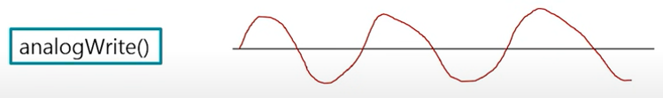
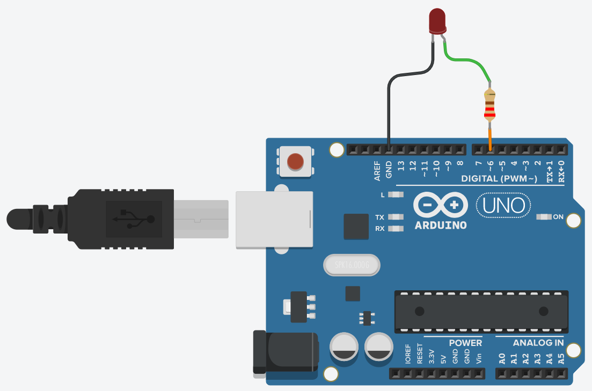
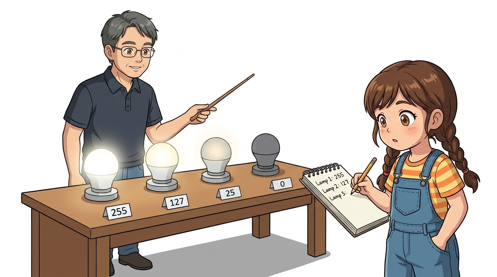
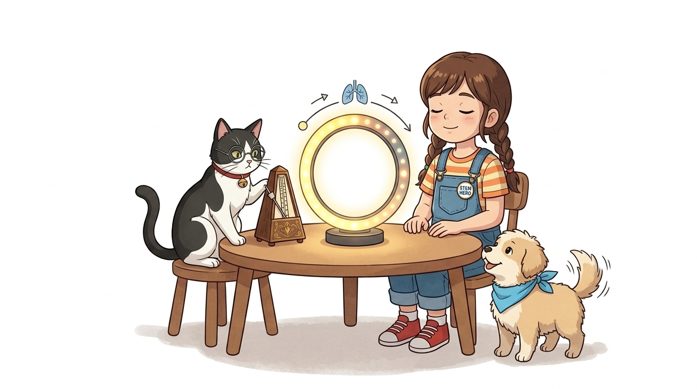

# 034_아날로그LED_감성밝기조절 💡🌙

> **0과 1 사이의 256단계 무한한 그라데이션! `analogWrite()`를 이용한 LED 밝기 정밀 제어**  
> 아두이노 PWM 물결표(`~`) 전용 핀, 8비트 해상도(0~255), 부드럽게 숨 쉬는 호흡(Breathing) 무드등 알고리즘을 실습합니다.


* 🖥️ **강의 슬라이드**: [slides.md](./slides.md)

---

## 1. 켜고 끄는 것을 넘어서: 연속적인 빛의 세계 🌈

지금까지 배운 디지털 제어는 오직 0%(꺼짐)와 100%(켜짐)의 극단적인 두 가지 상태뿐이었습니다.

> **👧 도로시**: "교수님! 지니야! LED가 딱 켜지고 딱 꺼지는 것 말고, 밤하늘 반딧불이처럼 은은하게 밝아졌다 어두워지게 할 수는 없을까?"  
> **👨‍🏫 이호진 교수님**: "후후, 도로시! 0과 1 사이의 섬세한 밝기를 256단계로 쪼개는 **'아날로그 출력(`analogWrite`)'** 의 마법을 부리면 가능해!"  
> **🐶 토토**: "멍멍! (따뜻한 불빛 아래서 잠이 솔솔 온다 멍!)"


> [!NOTE]
> **아날로그(Analog)의 미학**  
> 자연계의 물리량(햇빛의 밝기, 실내 온도, 음악 소리)은 모두 끊김 없이 부드럽게 이어지는 연속량(Continuous value)입니다. 아두이노는 이러한 현실의 감성을 전자 회로로 완벽히 재현할 수 있습니다.

---

## 2. 디지털 신호 vs 아날로그 신호 〰️📊

사각파처럼 각진 디지털과 파도처럼 매끄러운 아날로그의 신호적 특성을 비교합니다.



* **디지털 신호 (Digital)**: 벽면의 전등 스위치처럼 `0` 아니면 `1`로만 존재하는 이산적(Discrete) 신호
* **아날로그 신호 (Analog)**: 음량을 서서히 키우는 회전형 볼륨 다이얼처럼 무수히 많은 중간 단계를 가진 연속적 신호
* 아두이노는 내부 타이머를 통해 0부터 255까지 **총 256단계**의 미세한 가상 아날로그 출력을 생성합니다.

---

## 3. 마법의 물결표(`~`) 핀을 찾아라! (PWM 지원 핀) 🌊

아두이노 우노의 모든 디지털 핀이 아날로그 출력을 지원하는 것은 아닙니다.



### 📌 아두이노 UNO의 6대 PWM 핀
* 보드 실크스크린의 핀 번호 옆에 **물결표(`~`, Tilde)** 가 인쇄된 핀만 가능합니다.
* **지원 핀**: **`~3, ~5, ~6, ~9, ~10, ~11번 핀`** (총 6개)
* 우리는 오늘 물결표가 선명하게 새겨진 **디지털 6번 핀**에 LED를 결선합니다!

---

## 4. 아날로그 출력 전용 함수: `analogWrite(핀, 밝기)` 🎛️

8비트 해상도로 전압의 평균 공급 비율을 설정하는 핵심 함수입니다.

```cpp
// 0~255 단계로 펄스 폭을 조절하여 아날로그 전압 출력
analogWrite(ledPin, brightness); // brightness: 0(완전 꺼짐) ~ 255(최대 밝기)
```

* **문법**: `analogWrite(pin, value);`
* **출력 값 범위**: `0` 부터 `255` 까지의 정수 (총 256단계)
  * `0`: 0% 출력 (완전 소등, `digitalWrite(pin, LOW)`와 동일)
  * `64`: 약 25% 밝기 (은은한 미등)
  * `127`: 약 50% 밝기 (하프 파워)
  * `255`: 100% 최대 밝기 (`digitalWrite(pin, HIGH)`와 동일)

---

## 5. 실습 ①: `analogWrite` 기본 점등 테스트

6번 핀에 연결된 LED의 밝기 단계를 코드로 확인합니다.



```cpp
const int LED_PIN = 6; // 물결표(~)가 있는 6번 PWM 핀!

void setup() {
  pinMode(LED_PIN, OUTPUT);
}

void loop() {
  // 1. 최대 밝기 (100%)
  analogWrite(LED_PIN, 255);
  delay(1000);
  
  // 2. 절반 밝기 (50%)
  analogWrite(LED_PIN, 127);
  delay(1000);
  
  // 3. 은은한 어둠 (10%)
  analogWrite(LED_PIN, 25);
  delay(1000);
  
  // 4. 완전 소등 (0%)
  analogWrite(LED_PIN, 0);
  delay(1000);
}
```

---

## 6. 실습 ②: `for` 문으로 서서히 밝아지는 페이드 인(Fade-in) 🌅

반복문을 결합하여 아침 햇살이 떠오르듯 부드럽게 밝아지는 조명을 구현합니다.


```cpp
void loop() {
  // 밝기 i가 0부터 255까지 1씩 증가
  for (int i = 0; i <= 255; i++) {
    analogWrite(6, i); // 현재 밝기 출력
    delay(10);         // 10ms 대기 (총 2.55초 동안 서서히 밝아짐)
  }
  
  delay(500);
}
```

> **👧 도로시**: "우와! 계단을 사뿐사뿐 밟고 올라가듯 불빛이 부드럽게 번져 나가!"

---

## 7. 실습 ③: 살아 숨 쉬는 감성 호흡(Breathing) 무드등 🌙💖

서서히 밝아졌다가(Fade-in) 다시 서서히 어두워지는(Fade-out) 감성적인 호흡 조명입니다.



```cpp
void loop() {
  // 1. 숨 들이쉬기: 서서히 밝아짐 (0 -> 255)
  for (int i = 0; i <= 255; i++) {
    analogWrite(6, i);
    delay(10); // 호흡 속도 조절
  }
  
  delay(200); // 숨 참기 (최대 밝기 유지)

  // 2. 숨 내쉬기: 서서히 어두워짐 (255 -> 0)
  for (int i = 255; i >= 0; i--) {
    analogWrite(6, i);
    delay(10);
  }
  
  delay(500); // 안정 대기
}
```

---

## 🌟 도로시와 지니의 이번 시간 핵심 정리! 🏆

축하합니다! 아날로그 출력과 256단계 조광 제어를 완벽히 정복했습니다.


### 📋 핵심 요약 체크리스트

* [x] **`analogWrite(pin, 0~255)`**: 8비트 해상도로 미세한 밝기를 단계별로 출력했습니다.
* [x] **PWM 물결표(`~`) 핀**: 우노 보드의 3, 5, 6, 9, 10, 11번 핀에서만 구동됨을 숙지했습니다.
* [x] **호흡 루프 알고리즘**: 증가 `for` 루프와 감소 `for` 루프를 조합하여 감성 무드등을 제작했습니다.

> **👧 도로시**: "그런데 지니야, 아두이노는 디지털 컴퓨터인데 어떻게 전압을 쪼개서 부드러운 빛을 내는 거야?"  
> **👨‍🏫 이호진 교수님**: "엄청난 착시와 고속 스위칭의 비밀이 숨어있지! 바로 다음 시간에 그 주인공인 **'PWM(펄스 폭 변조)'** 의 신비를 파헤쳐보자!"
