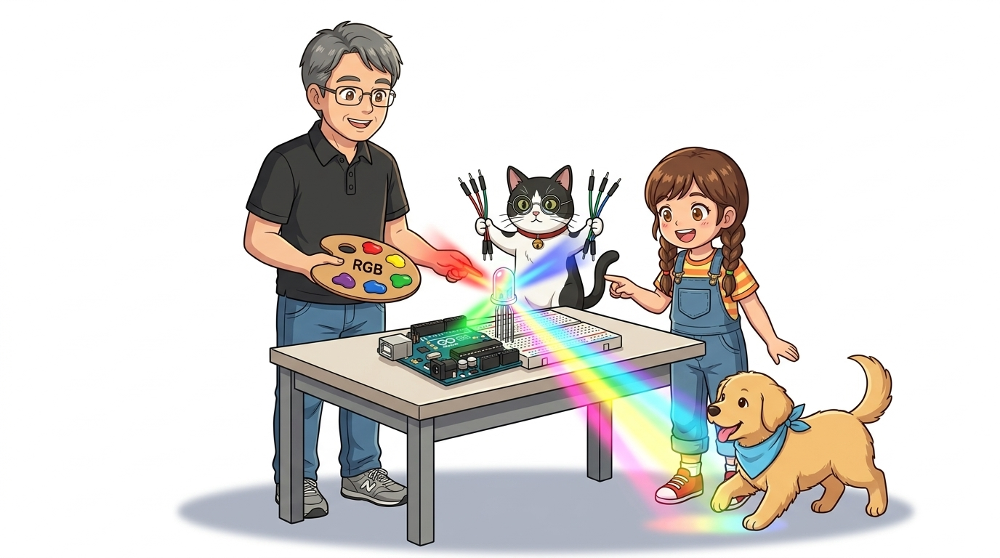
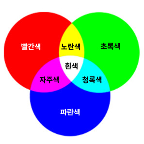
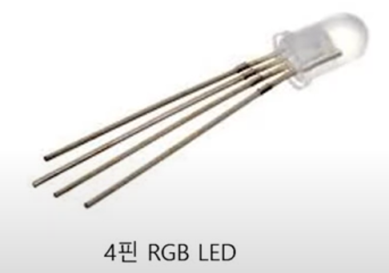
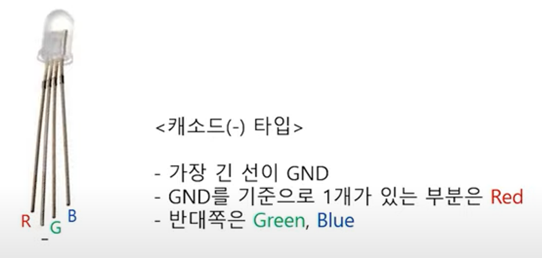
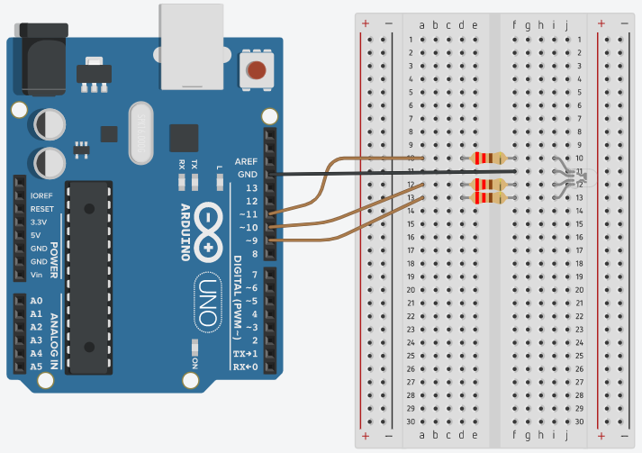
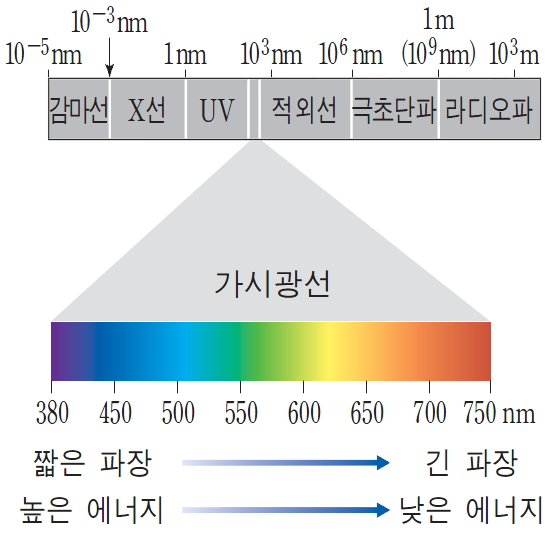
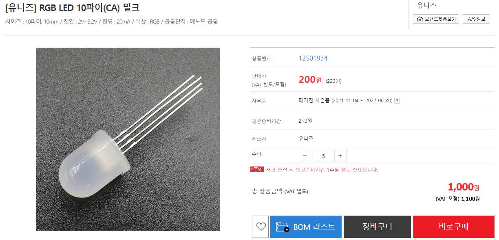

# 035_RGB_LED_무지개빛혼합 🌈✨



* **빛의 3원색으로 1,600만 가지 풀컬러를 조색하다! 4핀 RGB LED 제어 프로젝트**
* 가산 혼합(Additive Color Mixing) 원리, 공통 캐소드(Common Cathode) 결선, 3채널 PWM을 활용한 풀컬러 스펙트럼 연출을 실습합니다.
* 📖 **상세 강의 교재**: [index.md](./index.md)


> 여러분 안녕하세요! 이번 시간에는 '035. RGB LED 무지개빛혼합 🌈✨'을 주제로 함께 흥미진진한 탐험을 떠나보겠습니다. 이호진 교수님과 똑똑한 조수 지니, 호기심 많은 도로시와 토토와 함께 신나는 아두이노 모험을 힘차게 시작해 봅시다. 준비되셨나요?

---

## 1. 3색 RGB LED의 정체 💡


* **👧 도로시**: "교수님! 지니야! LED 하나에서 빨간색, 노란색, 보라색, 하늘색까지 무지개색이 다 나오게 만들 수는 없을까?"
* **👨‍🏫 이호진 교수님**: "당연하지 도로시! 빛의 3원색인 빨강(R), 초록(G), 파랑(B) 칩을 한 몸에 품은 **'RGB LED'** 가 있으면 물감을 섞듯 1,600만 가지 색깔을 자유자재로 빚어낼 수 있어!"
* **🐶 토토**: "멍멍! (알록달록 무지개 파티다 멍!)"
* [!NOTE]
* **RGB LED 패키징**
* 직경 5mm 에폭시 렌즈 안에 초소형 Red, Green, Blue LED 다이(Die) 3개가 내장되어 있으며, 각각 독립된 PWM 채널로 전류를 인가하여 색을 합성합니다.

단색 LED의 한계를 넘어 하나의 캡슐 안에서 수만 가지 무지개 빛을 뿜어내는 특별한 발광 소자입니다.

> 이번 슬라이드에서는 '1. 3색 RGB LED의 정체 💡'에 대해 자세히 살펴보겠습니다. 화면의 다이어그램과 사진을 함께 참고해 주시기 바랍니다. 이 원리는 아두이노 시스템 전체를 관통하는 핵심 논리이므로 머릿속에 꼭 정리해 두시기 바랍니다.

---

## 2. 빛의 3원색과 가산 혼합 (빛의 덧셈) 🎨



* **빨강(Red, R) + 초록(Green, G)** = **노란색 (Yellow, `#FFFF00`)** 💛
* **초록(Green, G) + 파랑(Blue, B)** = **청록색 (Cyan, `#00FFFF`)** 🩵
* **빨강(Red, R) + 파랑(Blue, B)** = **자홍/보라 (Magenta, `#FF00FF`)** 💜
* **빨강(R) + 초록(G) + 파랑(B)** 3가지를 모두 최대로 켜면 = **새하얀 백색광 (White, `#FFFFFF`)** 🤍

물감은 섞을수록 어두워지는 감산 혼합이지만, **빛은 섞을수록 점점 더 밝아지는 가산 혼합(Additive Mixing)** 특성을 지닙니다.

> 이번 슬라이드에서는 '2. 빛의 3원색과 가산 혼합 (빛의 덧셈) 🎨'에 대해 자세히 살펴보겠습니다. 화면의 다이어그램과 사진을 함께 참고해 주시기 바랍니다. 첫 번째 핵심은 빨강(Red, R) + 초록(Green, G) = 노란색 (Yellow, #FFFF00) 💛이며, 두 번째로는 초록(Green, G) + 파랑(Blue, B) = 청록색 (Cyan, #00FFFF) 🩵입니다. 여기에 덧붙여 빨강(Red, R) + 파랑(Blue, B) = 자홍/보라 (Magenta, #FF00FF) 💜 내용까지 함께 이해해 두시면 완벽합니다. 이 원리는 아두이노 시스템 전체를 관통하는 핵심 논리이므로 머릿속에 꼭 정리해 두시기 바랍니다.

---

## 3. 다리가 4개 달린 RGB LED의 핀 구조 🔍



* **🐶 토토의 암기 팁**: "네 개 다리 중 가장 키가 훌쩍 큰 다리가 바로 2번 공통(Common) 다리다 멍!"

1. **1번 다리 (R, 빨강)**: 빨간색 LED 애노드 단자
2. **2번 다리 (Common, 가장 긴 다리!)**: 세 LED 칩이 공유하는 공통 전원/접지 단자
3. **3번 다리 (G, 초록)**: 초록색 LED 애노드 단자
4. **4번 다리 (B, 파랑)**: 파란색 LED 애노드 단자

일반 LED와 달리 RGB LED는 4개의 리드 프레임 핀을 가지고 있습니다.
### 📌 4개 다리 식별법

> 이번에 살펴볼 내용은 '3. 다리가 4개 달린 RGB LED의 핀 구조 🔍'입니다. 화면의 회로도와 부품 사진을 보면서 각 핀과 배선이 어떻게 구성되어 있는지 눈으로 직접 따라와 주시기 바랍니다. 첫째로 번 다리 (R, 빨강): 빨간색 LED 애노드 단자에 유의해야 하며, 둘째로 번 다리 (Common, 가장 긴 다리!): 세 LED 칩이 공유하는 공통 전원/접지 단자라는 점이 핵심입니다. 이 기본 개념을 확실히 잡아두셔야 실제 부품을 브레드보드에 꽂고 코딩할 때 실수 없이 완성할 수 있습니다.

---

## 4. 공통 캐소드(-) vs 공통 애노드(+) ⚖️



| 구분 | 공통 핀 연결 | 핀 점등 신호 | 특징 및 교육용 표준 |
| :---: | :---: | :---: | :--- |
| **공통 캐소드 (Common Cathode, CC)** | **GND (0V, `-`)** | **`HIGH` 또는 PWM (0~255)** | 숫자가 클수록 밝아지는 직관적 제어 (교육용 키트 90% 이상 표준) |
| **공통 애노드 (Common Anode, CA)** | **5V (`+`)** | **`LOW` 또는 PWM 반전 (255-val)** | 숫자가 작을수록 밝아지는 반전 논리 |

공통 다리의 내부 연결 극성에 따라 제어 논리가 정반대로 바뀝니다.

> 이번에 살펴볼 내용은 '4. 공통 캐소드(-) vs 공통 애노드(+) ⚖️'입니다. 슬라이드에 정리된 표를 통해 각 항목의 특징과 수치, 차이점을 한눈에 비교해 보실 수 있습니다. 이 기본 개념을 확실히 잡아두셔야 실제 부품을 브레드보드에 꽂고 코딩할 때 실수 없이 완성할 수 있습니다.

---

## 5. 회로 구성: 3개의 PWM 핀과 보호 저항 🛠️



* **빨강 핀 (1번)** ➡️ $220\Omega$ 저항 ➡️ 아두이노 **디지털 9번 PWM 핀 (`~9`)**
* **공통 핀 (2번, 가장 긺)** ➡️ 아두이노 **GND 핀**
* **초록 핀 (3번)** ➡️ $220\Omega$ 저항 ➡️ 아두이노 **디지털 10번 PWM 핀 (`~10`)**
* **파랑 핀 (4번)** ➡️ $220\Omega$ 저항 ➡️ 아두이노 **디지털 11번 PWM 핀 (`~11`)**

빛의 색을 256단계로 정밀하게 섞기 위해 아두이노의 물결표(`~`) PWM 핀 3개를 사용합니다.
### 📌 배선 가이드 (공통 캐소드 기준)

> 이번에 살펴볼 내용은 '5. 회로 구성: 3개의 PWM 핀과 보호 저항 🛠️'입니다. 화면의 회로도와 부품 사진을 보면서 각 핀과 배선이 어떻게 구성되어 있는지 눈으로 직접 따라와 주시기 바랍니다. 첫째로 빨강 핀 (1번) ➡️ $220\Omega$ 저항 ➡️ 아두이노 디지털 9번 PWM 핀 (~9)에 유의해야 하며, 둘째로 공통 핀 (2번, 가장 긺) ➡️ 아두이노 GND 핀라는 점이 핵심입니다. 이 기본 개념을 확실히 잡아두셔야 실제 부품을 브레드보드에 꽂고 코딩할 때 실수 없이 완성할 수 있습니다.

---

## 6. 실습 ①: R, G, B 기본 3원색 순차 점등 🔴🟢🔵



세 가지 단색을 차례대로 점등하여 각 핀의 배선과 동작을 검증합니다.

```cpp
const int RED_PIN   = 9;
const int GREEN_PIN = 10;
const int BLUE_PIN  = 11;

void setup() {
  pinMode(RED_PIN, OUTPUT);
  pinMode(GREEN_PIN, OUTPUT);
  pinMode(BLUE_PIN, OUTPUT);
}

void loop() {
  // 1. 빨간색 단독 점등
  analogWrite(RED_PIN, 255); analogWrite(GREEN_PIN, 0); analogWrite(BLUE_PIN, 0);
  delay(1000);
  
  // 2. 초록색 단독 점등
  analogWrite(RED_PIN, 0); analogWrite(GREEN_PIN, 255); analogWrite(BLUE_PIN, 0);
  delay(1000);
  
  // 3. 파란색 단독 점등
  analogWrite(RED_PIN, 0); analogWrite(GREEN_PIN, 0); analogWrite(BLUE_PIN, 255);
  delay(1000);
}
```

> 이번 슬라이드에서는 '6. 실습 ①: R, G, B 기본 3원색 순차 점등 🔴🟢🔵'에 대한 실제 동작 코드를 분석해 보겠습니다. 화면의 코드를 살펴보시면, 컴퓨터가 아두이노 하드웨어에 단계별로 명령을 내리는 흐름을 명확하게 확인할 수 있습니다. 각 함수의 역할과 괄호 안의 매개변수가 하드웨어 핀과 어떤 관계를 맺고 동작하는지 주의 깊게 살펴보시기 바랍니다.

---

## 7. 실습 ②: 환상적인 무지개 스펙트럼 쇼! 🌈



전용 조색 함수 `setColor(r, g, b)`를 작성하여 2차 혼합색과 순백색을 연출합니다.

```cpp
// RGB 조색 헬퍼 함수
void setColor(int red, int green, int blue) {
  analogWrite(RED_PIN, red);
  analogWrite(GREEN_PIN, green);
  analogWrite(BLUE_PIN, blue);
}

void loop() {
  setColor(255, 255, 0);   // 노란색 (Yellow, R+G)
  delay(800);
  setColor(0, 255, 255);   // 하늘색 (Cyan, G+B)
  delay(800);
  setColor(255, 0, 255);   // 보라색 (Magenta, R+B)
  delay(800);
  setColor(255, 128, 0);   // 주황색 (Orange)
  delay(800);
  setColor(255, 255, 255); // 순백색 (White, R+G+B)
  delay(1200);
}
```

> 이번 슬라이드에서는 '7. 실습 ②: 환상적인 무지개 스펙트럼 쇼! 🌈'에 대한 실제 동작 코드를 분석해 보겠습니다. 화면의 코드를 살펴보시면, 컴퓨터가 아두이노 하드웨어에 단계별로 명령을 내리는 흐름을 명확하게 확인할 수 있습니다. 각 함수의 역할과 괄호 안의 매개변수가 하드웨어 핀과 어떤 관계를 맺고 동작하는지 주의 깊게 살펴보시기 바랍니다.

---

## 🌟 도로시와 지니의 이번 시간 핵심 정리! 🏆


* **👧 도로시**: "빛을 섞어서 무지개를 만드니 내가 진짜 조명 디자이너가 된 기분이야!"
* **👨‍🏫 이호진 교수님**: "훌륭해! 다음 시간에는 컴퓨터 키보드로 글자를 쳐서 이 LED 불빛들을 원격으로 켜고 끄는 **'시리얼 통신(UART)'** 의 세계로 들어가 보자!"

* [x] **가산 혼합의 원리**: R, G, B 빛의 합성을 통해 수천만 가지 풀컬러와 백색광을 구현했습니다.
* [x] **4핀 패키지 배선**: 가장 긴 2번 다리를 GND에 결선하고 각 색상 단자에 개별 보호 저항을 장착했습니다.
* [x] **`setColor(r, g, b)` 조색 함수**: 3개의 PWM 신호(`9, 10, 11`)를 일괄 통제하는 재사용 가능한 함수를 설계했습니다.

축하합니다! 3채널 PWM과 광학 가산 혼합을 응용하여 나만의 스마트 무드등 시스템을 완성했습니다.
### 📋 핵심 요약 체크리스트

> 오늘 배운 '🌟 도로시와 지니의 이번 시간 핵심 정리! 🏆'의 핵심 내용을 모두 정리해 보았습니다. 오늘 다룬 내용 중에서도 [x] 가산 혼합의 원리: R, G, B 빛의 합성을 통해 수천만 가지 풀컬러와 백색광을 구현했습니다. 부분은 앞으로의 아두이노 실습과 프로젝트에서 계속 사용되는 매우 중요한 기초 지식입니다. 지니 멘토가 강조했듯이 훌륭해! 다음 시간에는 컴퓨터 키보드로 글자를 쳐서 이 LED 불빛들을 원격으로 켜고 끄는 라는 점을 꼭 마음에 새겨두시길 바랍니다. 오늘 배운 내용을 꼭 다시 한번 복습해 보시고, 다음 강의에서 더욱 신나고 유익한 모험으로 다시 만나겠습니다. 모두 수고 많으셨습니다!