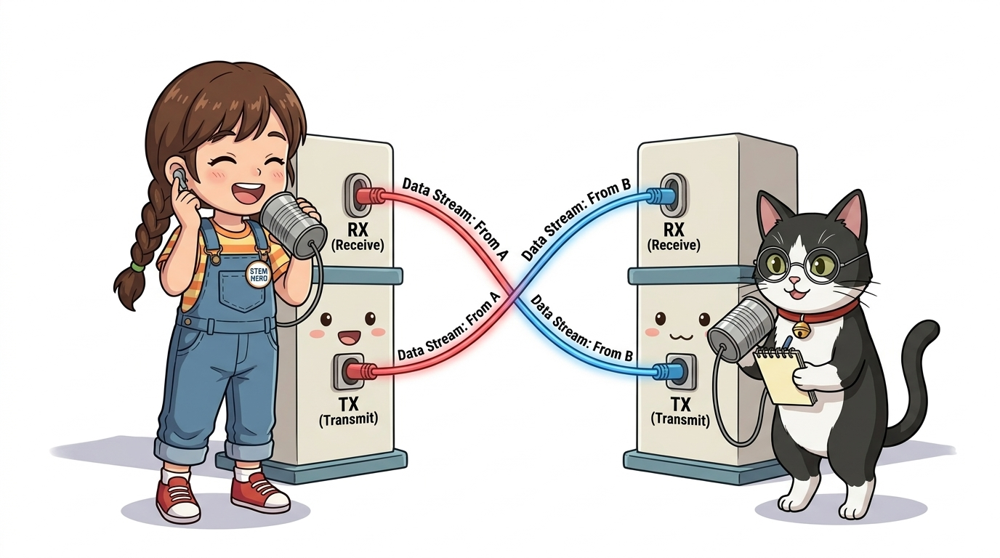
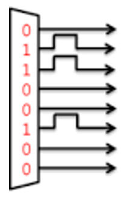
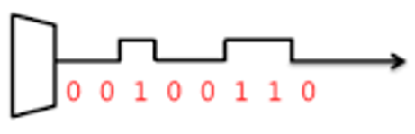
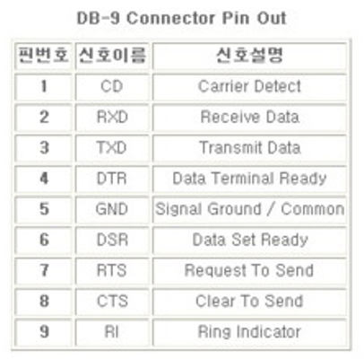
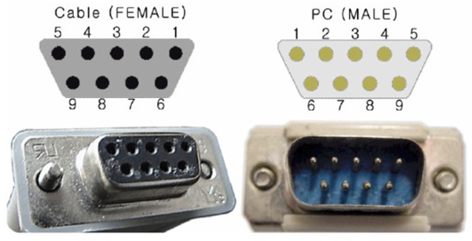
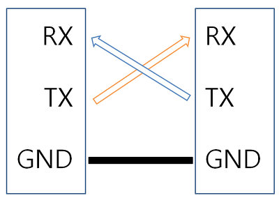
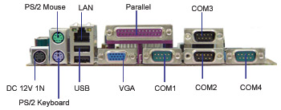

# 036_시리얼통신이론_데이터전송 📡📜

> **컴퓨터와 마이크로컨트롤러를 잇는 생명선! UART 직렬 통신의 기초와 물리 계층 원리**  
> 직렬(Serial) vs 병렬(Parallel) 비교, TX/RX 교차(Cross) 결선 법칙, RS-232 역사, USB-to-Serial 브릿지 칩의 역할을 학습합니다.

* 🖥️ **강의 슬라이드**: [slides.md](./slides.md)

---

## 1. 👧 도로시의 질문: "USB 선 하나로 어떻게 수다를 떨어요?"

컴퓨터 모니터와 아두이노가 USB 케이블 하나로 데이터를 실시간으로 주고받는 광경을 본 도로시가 놀라워합니다!

> **👧 도로시**: "교수님! 지니야! 컴퓨터랑 아두이노는 USB 전선 딱 하나로 어떻게 수많은 대화를 나누는 거야? 전선 속에 글자가 어떻게 지나가?"  
> **👨‍🏫 이호진 교수님**: "후후, 도로시! 0과 1의 전기 신호를 칙칙폭폭 기차처럼 한 줄로 세워 초고속으로 전송하는 **'시리얼(직렬) 통신'** 덕분이야!"  
> **🐶 토토**: "멍멍! (실 전화기로 소곤소곤 이야기하는 것과 같다 멍!)"

> [!NOTE]
> **통신의 핵심: 비트의 직렬화(Serialization)**  
> 컴퓨터 내부의 바이트 데이터(8비트)를 전선 한 가닥을 통해 시간 축을 따라 1비트씩 순차적으로 흘려보내는 변환 과정을 직렬화라고 합니다.

---

## 2. 통신의 두 가지 고속도로: 병렬 vs 직렬 🛣️

데이터를 한꺼번에 보낼 것인가, 한 줄로 차례차례 보낼 것인가에 따른 통신 방식의 양대 산맥입니다.

| 비교 항목 | 병렬 통신 (Parallel Bus) | 직렬 통신 (Serial Bus) |
| :--- | :--- | :--- |
| **물리적 전선 수** | 데이터 비트 수만큼 다수 필요 (8선, 16선, 32선) | **단 1~2선 (TX 송신선, RX 수신선)** |
| **전송 방식** | 8개 비트가 8개 선을 타고 동시에 전진 | 8개 비트가 1개 선을 타고 1열 종대로 순차 전진 |
| **장점** | 한 클록당 전송량이 많음 (초기 단거리 내부 버스) | **케이블이 얇고 저렴하며 장거리 전송에 탁월** |
| **한계 및 단점** | 선 간의 전자기 간섭(클록 스큐)으로 고속/장거리 불가 | 시간당 클록 주파수를 높여 병렬의 속도를 추월 |
| **대표 기술** | 옛날 패러렐 프린터 포트, IDE 하드디스크 | **USB, PCIe, SATA, 블루투스, UART** |

---

## 3. 시리얼 버스(Serial Bus)란? 🚌

**시리얼(Serial)**은 영어로 **"연속적인, 순차적인, 직렬의"**라는 뜻입니다.

* 8비트(1바이트) 덩어리를 보낼 때, 8개의 비트를 시간 간격에 맞춰 **비트 0 ➡️ 비트 1 ➡️ 비트 2...** 순서대로 전기 펄스로 쏘아 보냅니다.
* 선의 개수가 획기적으로 줄어들어 배선 공간이 절약되고, 외부 노이즈 차폐가 용이해져 현대 전자 통신의 표준이 되었습니다.

---

## 4. 추억의 9핀 커넥터: RS-232 시리얼 포트의 역사 🖥️

과거 데스크톱 컴퓨터 본체 뒷면을 지키던 대표적인 산업용 시리얼 표준 규격입니다.

* **RS-232 (Recommended Standard 232)**: 모뎀, 프린터, 산업용 계측기를 연결하던 9핀 D-SUB 커넥터 규격
* 신호 전압 레벨이 $-12\text{V} \sim +12\text{V}$로 높아 노이즈에 강하지만, 아두이노(0V~5V TTL 레벨)와 직접 연결하면 보드가 파괴되므로 MAX232 같은 레벨 시프터가 필요했습니다.
* 아두이노는 이 RS-232의 소프트웨어 프로토콜(UART)을 5V TTL 로직으로 계승했습니다.

---

## 5. 시리얼 통신의 황금 규칙: TX와 RX의 교차(Cross) 연결 🔄

시리얼 통신을 성공시키는 가장 중요한 하드웨어 결선 법칙입니다.

### 📌 신호선의 정의와 결선 공식

* **`TX` (Transmit, 송신)**: 내 입 (데이터 신호를 밖으로 내뿜는 출력선 🗣️)
* **`RX` (Receive, 수신)**: 내 귀 (외부에서 오는 데이터 신호를 듣는 입력선 👂)

> [!IMPORTANT]
> **대화의 절대 원칙: TX는 상대방의 RX로!**  
> 내가 말한 내용(TX)은 상대방의 귀(RX)로 들어가야 하고, 상대방이 말한 내용(TX)은 내 귀(RX)로 들어와야 합니다!  
> **`내 보드 TX ➡️ 상대 보드 RX`**, **`내 보드 RX ⬅️ 상대 보드 TX`** 로 엇갈려(Cross) 연결해야만 통신이 성립합니다!

---

## 6. 아두이노 보드의 0번(RX)과 1번(TX) 핀 🏷️

아두이노 우노 보드의 맨 오른쪽 상단에 위치한 하드웨어 시리얼 전용 포트입니다.

* **디지털 0번 핀**: **`RX`** (컴퓨터로부터 명령을 수신)
* **디지털 1번 핀**: **`TX`** (컴퓨터 시리얼 모니터로 센서 값을 송신)
* **통신 표시 LED**: 아두이노 보드 중앙에 위치한 **TX, RX 소형 LED**는 실제로 데이터 바이트가 오갈 때마다 눈부시게 깜빡입니다.
* ⚠️ **주의**: 0번과 1번 핀에 센서나 버튼을 연결해 두면, PC에서 스케치 코드를 업로드할 때 데이터 충돌로 업로드 오류가 발생하므로 일반 실습 시에는 비워두어야 합니다.

---

## 7. 현대 컴퓨터와 USB-to-Serial 브릿지 칩 🔌

최신 노트북에는 9핀 시리얼 포트가 없지만 USB를 통해 완벽한 가상 시리얼 통신을 수행합니다.

* **USB-to-UART 브릿지 IC (CH340 / ATmega16U2 / FT232R)**:
  * PC의 고속 USB 패킷을 아두이노 MCU(ATmega328P)가 이해할 수 있는 5V TTL 시리얼 신호로 실시간 번역해 주는 전용 통역사 칩입니다.
* 덕분에 우리는 단 하나의 표준 USB 케이블로 **전원 공급, 소스코드 업로드, 실시간 시리얼 디버깅**을 동시에 누릴 수 있습니다.

---

## 🌟 도로시와 지니의 이번 시간 핵심 정리! 🏆

축하합니다! 임베디드 세계에서 컴퓨터와 대화하는 가장 중요한 통신 규격인 시리얼 통신의 물리적 원리를 마스터했습니다.

### 📋 핵심 요약 체크리스트

* [x] **직렬 통신의 경제성**: 전선 수를 최소화하여 배선 복잡성을 줄이고 원거리 전송을 달성했습니다.
* [x] **TX-RX 크로스 법칙**: 송신(TX)과 수신(RX)을 교차 결선해야 통신이 성립함을 체득했습니다.
* [x] **USB 브릿지 칩**: 내장 변환 칩 덕분에 현대 PC의 USB 단자로 완벽한 UART 통신이 가능함을 확인했습니다.

> **👧 도로시**: "TX와 RX의 원리를 알고 나니 통신선 연결이 머릿속에 쏙쏙 들어와!"  
> **👨‍🏫 이호진 교수님**: "훌륭해! 다음 시간에는 `Serial.begin()`과 `Serial.print()` 함수로 아두이노와 진짜 대화를 시작해 보자!"
