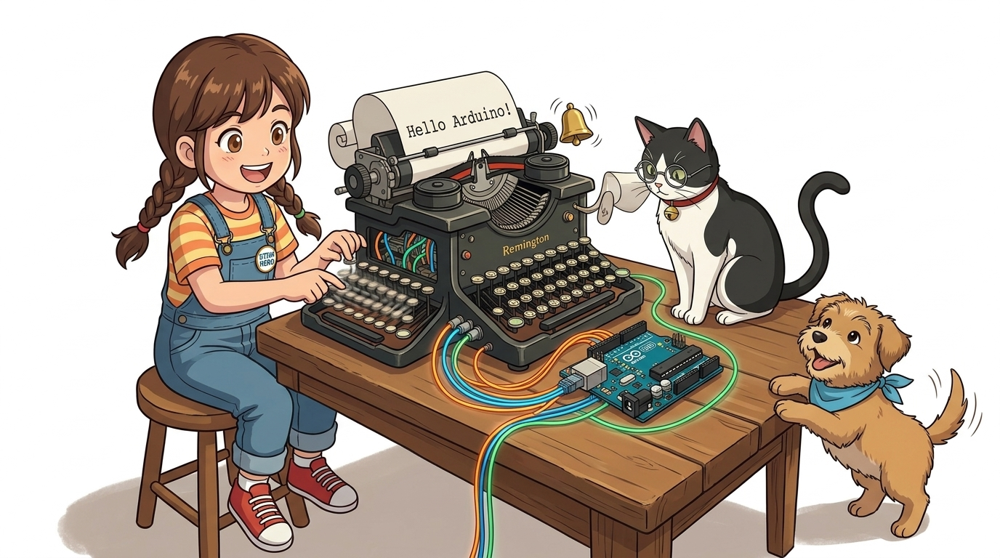
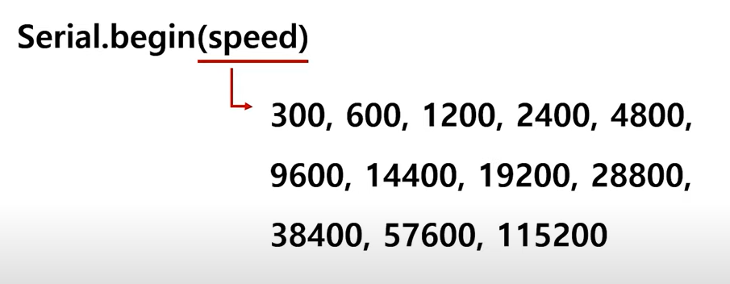
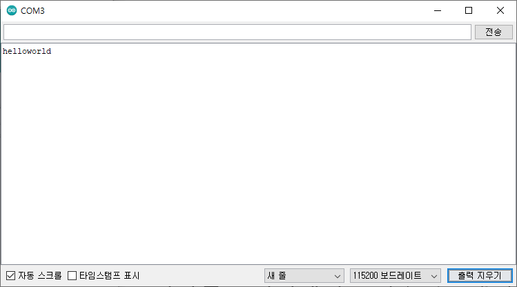
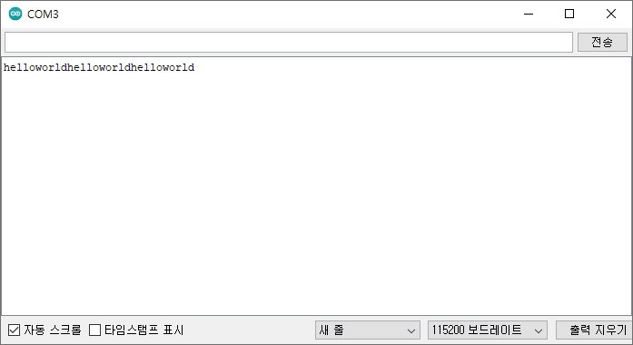
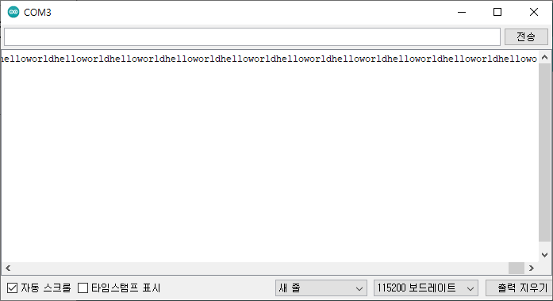

# 037_시리얼문자대화_송수신 💬🖨️

> **컴퓨터 화면에 아두이노의 생각을 찍어내다! Serial 라이브러리의 기초와 텍스트 입출력**  
> `Serial.begin(9600)` 보드레이트 동기화, `print()`와 `println()`의 줄바꿈 차이, 타자기 제어 문자(`\r\n`), 진법 변환 출력을 실습합니다.



* 🖥️ **강의 슬라이드**: [slides.md](./slides.md)

---

## 1. 아두이노의 전용 대화창: '시리얼 모니터' 🖥️

아두이노 IDE에 내장된 가장 강력한 실시간 디버깅 윈도우입니다.

> **👧 도로시**: "교수님! 지니야! 아두이노가 '안녕 도로시!' 하고 모니터에 예쁘게 글자를 찍어주게 하려면 어떤 마법을 부려야 해?"  
> **👨‍🏫 이호진 교수님**: "아두이노 IDE에 내장된 마법의 대화창 **'시리얼 모니터'** 를 켜고, 옛날 타자기처럼 엔터를 치는 법을 배워보자!"  
> **🐶 토토**: "멍멍! (타자기 치듯이 찰칵찰칵 띵! 이다 멍!)"

* **실행 방법**: 아두이노 IDE 우측 상단의 **돋보기 아이콘** 클릭 (또는 단축키 `Ctrl + Shift + M`)
* **역할**: 아두이노가 보낸 센서 값과 메시지를 PC 화면에 텍스트로 표시하고, 반대로 사용자가 키보드로 명령어를 아두이노에 전송하는 양방향 콘솔 창입니다.

---

## 2. 통신 속도의 약속: BPS (초당 전송 비트 수) ⏱️

직렬 통신에서는 송신자와 수신자가 동일한 박자(전송 속도)를 맞춰야 글자가 깨지지 않습니다.



* **BPS (Bits Per Second, 보드레이트)**: 1초 동안 전송하는 2진 비트의 개수
* **황금률**: 코드의 `Serial.begin(9600);` 과 시리얼 모니터 창 우측 하단의 **Baud Rate 설정값**이 반드시 **`9600 baud`** 로 일치해야 합니다.
* 속도가 어긋나면 화면에 `⸮⸮⸮` 같은 외계어 쓰레기 문자가 출력됩니다.

---

## 3. `setup()`에서 딱 1번만 인사하기 ☝️

보드가 부팅될 때 최초 1회만 환영 인사를 건네는 기본 코드입니다.



```cpp
void setup() {
  // 9600 bps 속도로 시리얼 통신 포트 개방
  Serial.begin(9600);
  
  // 부팅 시 딱 한 번만 화면에 출력
  Serial.println("hello world");
}

void loop() {
  // 아무 작업도 하지 않고 대기
}
```

---

## 4. 다시 듣고 싶다면? 빨간 '리셋(Reset)' 버튼! 🔄

아두이노 하드웨어 재부팅 시 코드의 실행 흐름을 관찰합니다.



* 아두이노 보드 구석의 **빨간색 리셋(RESET) 버튼**을 누르면 마이크로컨트롤러가 초기화됩니다.
* 전원을 껐다 켠 것과 동일하게 `setup()` 함수가 맨 처음부터 재실행되면서 시리얼 모니터에 또 한 줄의 `"hello world"`가 출력됩니다.

---

## 5. `loop()`로 옮겨서 무한히 반복 인사하기! ♾️

1초 간격으로 끝없이 텍스트를 스트리밍하는 반복 출력 코드입니다.



```cpp
void setup() {
  Serial.begin(9600);
}

void loop() {
  // 1초(1000ms)마다 계속해서 hello world 출력
  Serial.println("hello world");
  delay(1000);
}
```

---

## 6. `Serial.print()` vs `Serial.println()` 🖨️

가장 빈번하게 사용하는 두 함수의 결정적 차이는 **'줄바꿈(Enter)'** 의 유무입니다.

```cpp
Serial.print("hello");   // 줄바꿈 없이 hello 출력
Serial.println("world"); // world 출력 후 다음 줄로 커서 이동!
```

* **`Serial.print()`**: 문자를 출력한 뒤 **커서가 글자 바로 오른쪽에 멈춤** (이어서 가로 쓰기)
* **`Serial.println()`**: 문자를 출력한 뒤 **커서를 다음 줄의 맨 앞으로 자동 개행(줄바꿈)**

```cpp
Serial.print("온도: ");
Serial.print(25.4);
Serial.println(" C"); // '온도: 25.4 C' 한 줄 완성 후 엔터!
```

---

## 7. 타자기의 추억: 캐리지 리턴(`\r`)과 라인 피드(`\n`) 📜

`println()`의 `ln`은 기계식 수동 타자기의 물리적 동작에서 유래했습니다.


* **캐리지 리턴 (`\r`, Carriage Return, ASCII 13)**: 종이를 물고 있는 원통 롤러(Carriage)를 맨 왼쪽 첫 칸으로 찰칵 밀어 되돌림
* **라인 피드 (`\n`, Line Feed, ASCII 10)**: 종이를 위로 한 칸 찌익 밀어 올려 다음 줄로 넘김
* 아두이노의 `Serial.println()`은 글자 뒤에 보이지 않는 **`\r\n`** 2바이트를 자동으로 덧붙여 전송합니다.

---

## 8. 다양한 진법으로 숫자 변환 출력하기 🔢

동일한 정수 데이터를 2진수, 8진수, 16진수로 즉각 서식화하여 모니터링합니다.

```cpp
Serial.println(23, DEC); // 10진수 출력: 23
Serial.println(23, HEX); // 16진수 출력: 17
Serial.println(23, BIN); // 2진수 출력: 10111
```

```cpp
int number = 78;

Serial.println(number);       // 10진수(DEC): 78
Serial.println(number, BIN);  // 2진수(BIN):  1001110
Serial.println(number, OCT);  // 8진수(OCT):  116
Serial.println(number, HEX);  // 16진수(HEX): 4E
```

> **👧 도로시**: "수학 시간에 배운 2진수와 16진수 변환을 아두이노가 단 한 줄로 완벽히 바꿔서 보여주네!"

---

## 🌟 도로시와 지니의 이번 시간 핵심 정리! 🏆

축하합니다! 시리얼 모니터를 통해 아두이노의 내부 상태를 완벽히 모니터링하는 통신 제어 기초를 정복했습니다.


### 📋 핵심 요약 체크리스트

* [x] **`Serial.begin(9600)`**: PC와 아두이노의 통신 속도(Baud rate)를 정확히 일치시켰습니다.
* [x] **`print()` vs `println()`**: 가로 연속 출력과 라인피드(`\r\n`) 줄바꿈의 차이를 체득했습니다.
* [x] **진법 포맷터**: `BIN`, `HEX` 옵션으로 8비트 레지스터 값을 손쉽게 덤프했습니다.

> **👧 도로시**: "이제 시리얼 모니터로 글자를 자유롭게 주고받을 수 있어! 다음엔 키보드로 친 글자로 직접 **'LED 불빛'** 을 조종해보고 싶어!"  
> **👨‍🏫 이호진 교수님**: "훌륭해 도로시! 다음 시간에는 컴퓨터 키보드로 '1'을 치면 불이 켜지는 **원격 시리얼 LED 제어 실습**으로 신나게 나아가 보자!"
