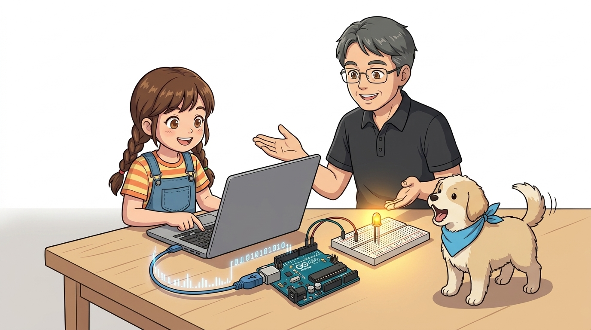
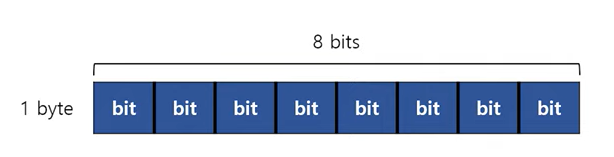
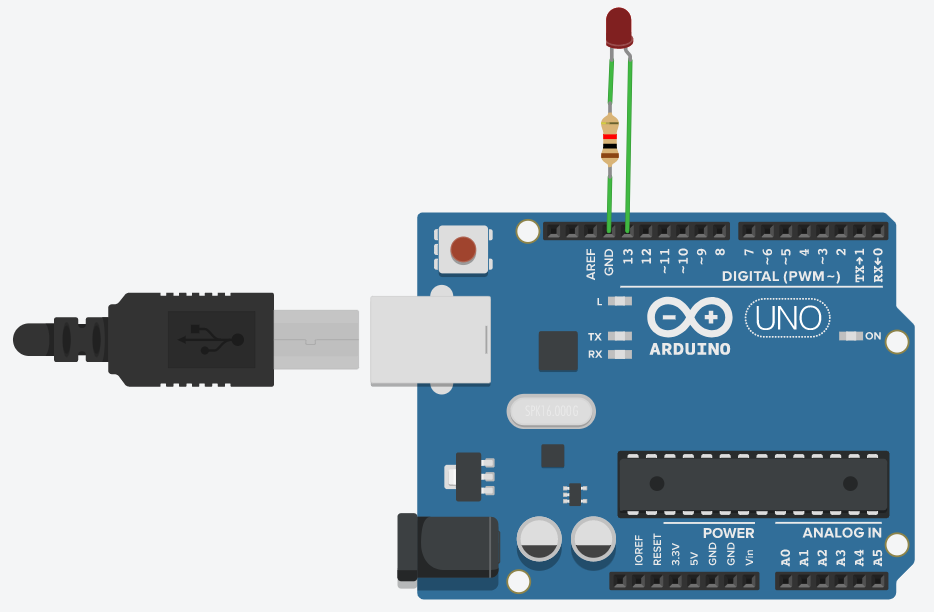
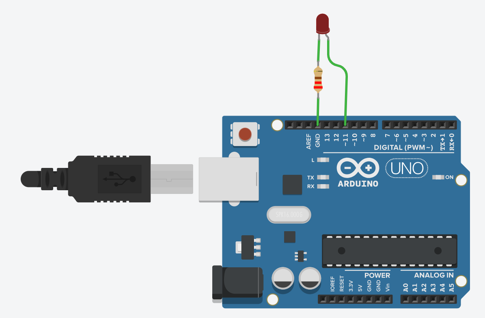

# 038_시리얼LED제어_키보드원격명령 ⌨️💡

> **👧 도로시**: "교수님! 지니야! 내가 키보드로 'o'를 치면 LED가 켜지고, 'f'를 치면 꺼지게 리모컨처럼 조종할 수 있어?"  
> **👨‍🏫 이호진 교수님**: "물론이지 도로시! 시리얼 모니터로 보낸 한 글자 명령어를 아두이노가 읽고 즉시 불을 켜는 원격 제어 실습을 시작해보자!"  
> **🐶 토토**: "멍멍! (키보드가 스마트 마법 지팡이가 되었다 멍!)"



* 🖥️ **강의 슬라이드**: [slides.md](./slides.md)

---

## 1. 스마트홈의 시작: 원격 제어(Remote Control) 🏠

우리가 스마트폰 앱이나 컴퓨터 키보드로 버튼을 누르면 집 안의 조명이 켜지는 사물인터넷(IoT) 기술!  
그 핵심 원리가 바로 **"문자 명령어를 통신으로 전달하여 액추에이터를 제어하는 것"**이에요.

- **송신측 (PC 시리얼 모니터)**: 사용자가 입력한 문자('o', 'f', '0'~'5')를 USB 시리얼 패킷으로 변환하여 전송합니다.
- **수신측 (아두이노 UNO)**: RX 버퍼에 수신된 1바이트 문자를 읽어 핀 전압(디지털 HIGH/LOW 또는 PWM)을 제어합니다.


---

## 2. 시리얼 수신의 핵심 2단계 메커니즘 📬

시리얼 통신으로 외부 장치를 제어할 때는 항상 다음 2단계를 지켜야 데이터 오류를 방지할 수 있습니다.

1. **`Serial.available()`**: 컴퓨터에서 새 글자가 우편함(수신 버퍼)에 도착했는지 확인합니다 (`> 0`).
2. **`Serial.read()`**: 도착한 글자 중 맨 앞의 1바이트 문자 하나를 쏙 꺼내와 변수에 저장합니다.

```cpp
if (Serial.available() > 0) {
  char cmd = Serial.read(); // 방금 도착한 문자 1개 꺼내기!
}
```

```cpp
void setup() {
  Serial.begin(115200);
  pinMode(13, OUTPUT);
}

void loop() {
  if (Serial.available()) {
    char cmd = Serial.read();
    if (cmd == '1') {
      digitalWrite(13, HIGH); // '1' 수신 시 LED ON
    } else if (cmd == '0') {
      digitalWrite(13, LOW);  // '0' 수신 시 LED OFF
    }
  }
}
```

---

## 3. 디지털 ON/OFF 제어 회로 구성 🔌

13번 핀에 내장된 LED 또는 브레드보드에 외장 LED와 220Ω~330Ω 저항을 연결합니다.

- **LED 애노드(+) (긴 다리)**: 아두이노 디지털 13번 핀 (또는 PWM 11번 핀)
- **LED 캐소드(-) (짧은 다리)**: 220Ω 저항을 거쳐 GND 연결

```
[아두이노 D13 핀] ---> [LED (+)] [LED (-)] ---> [220Ω 저항] ---> [GND]
```

> **👨‍🏫 이호진 교수님**: "13번 핀에는 아두이노 보드 자체의 'L' LED가 이미 붙어 있어서 외장 회로 없이도 바로 테스트할 수 있단다!"


---

## 4. 실습 ①: 디지털 켜기/끄기 ('o' / 'f') 스케치 💡

키보드로 소문자 `'o'`(On)를 전송하면 13번 LED를 켜고, `'f'`(Off)를 전송하면 끕니다.

```cpp
/*
 * 시리얼 통신을 이용한 디지털 LED 켜기/끄기
 */
const int LED = 13;

void setup() {
  pinMode(LED, OUTPUT); // 13번 핀을 출력으로 설정
  Serial.begin(9600);   // 9600 bps 속도로 시리얼 통신 시작
  Serial.println("Send 'o' to Turn ON, 'f' to Turn OFF");
}

void loop() {
  // 수신 버퍼에 도착한 문자가 있는지 확인
  if (Serial.available() > 0) {
    char cmd = Serial.read(); // 문자 1바이트 읽기
    
    if (cmd == 'o') {
      digitalWrite(LED, HIGH);
      Serial.println("[LED ON] 불이 켜졌습니다!");
    } else if (cmd == 'f') {
      digitalWrite(LED, LOW);
      Serial.println("[LED OFF] 불이 꺼졌습니다!");
    }
  }
}
```


---

## 5. `switch - case` 문으로 깔끔하게 분기하기 🎛️

여러 개의 문자 명령어가 늘어날 때는 `if - else`보다 `switch - case` 문을 사용하면 코드가 훨씬 간결하고 가독성이 높아집니다.

```cpp
switch (cmd) {
  case 'o': // 'o'가 입력되었을 때
    digitalWrite(LED, HIGH);
    Serial.println("Command: LED ON");
    break;  // 스위치 블록을 빠져나감 (필수!)

  case 'f': // 'f'가 입력되었을 때
    digitalWrite(LED, LOW);
    Serial.println("Command: LED OFF");
    break;

  default:  // 정의되지 않은 키가 입력되었을 때
    Serial.println("Unknown command! Use 'o' or 'f'.");
    break;
}
```

> **🐶 토토**: "멍멍! (`break;` 문을 빼먹으면 다음 서랍까지 줄줄이 실행되어 버린다 멍!)"



---

## 6. 실습 ②: 숫자 키로 밝기 조절하기 (PWM 11번 핀) 🔢✨

단순히 켜고 끄는 것을 넘어, 숫자 `'0'`부터 `'5'`를 전송하여 LED의 밝기를 6단계로 부드럽게 조절해 봅니다.  
PWM 신호를 출력할 수 있는 **11번 핀**에 LED를 연결합니다.

| 입력 키 | 내부 계산식 | PWM 듀티비 | 밝기 상태 |
| :---: | :---: | :---: | :---: |
| `'0'` | $50 \times 0$ | **0** | 완전 꺼짐 (0%) |
| `'1'` | $50 \times 1$ | **50** | 아주 은은한 밝기 (~20%) |
| `'2'` | $50 \times 2$ | **100** | 은은한 밝기 (~40%) |
| `'3'` | $50 \times 3$ | **150** | 중간 밝기 (~60%) |
| `'4'` | $50 \times 4$ | **200** | 밝은 밝기 (~80%) |
| `'5'` | $50 \times 5$ | **250** | 최대 밝기 (~98%) |


---

## 7. 아날로그 밝기 제어 완성 코드 📝

아두이노 C++에서 수신된 ASCII 문자를 PWM 값으로 변환하여 `analogWrite()`를 실행합니다.

```cpp
/*
 * 시리얼 통신으로 6단계 LED 밝기 조절 (PWM 11번 핀)
 */
const int LED = 11; // PWM 지원 핀

void setup() {
  pinMode(LED, OUTPUT);
  Serial.begin(9600);
  Serial.println("Enter '0' ~ '5' to control LED brightness:");
}

void loop() {
  if (Serial.available() > 0) {
    char key = Serial.read();
    
    switch (key) {
      case '0': analogWrite(LED, 0);   Serial.println("Brightness: 0%");   break;
      case '1': analogWrite(LED, 50);  Serial.println("Brightness: 20%");  break;
      case '2': analogWrite(LED, 100); Serial.println("Brightness: 40%");  break;
      case '3': analogWrite(LED, 150); Serial.println("Brightness: 60%");  break;
      case '4': analogWrite(LED, 200); Serial.println("Brightness: 80%");  break;
      case '5': analogWrite(LED, 250); Serial.println("Brightness: 100%"); break;
      default:
        // 줄바꿈 문자('\r', '\n')는 무시
        if (key != '\r' && key != '\n') {
          Serial.println("Invalid key! Please enter 0, 1, 2, 3, 4, or 5.");
        }
        break;
    }
  }
}
```



---

## 8. 시리얼 모니터 설정 주의점: 줄바꿈(Line Ending) ⚙️

- 시리얼 모니터 우측 하단의 전송 옵션이 **`Both NL & CR`**이나 **`Newline`**으로 되어 있으면 엔터를 칠 때 보이지 않는 줄바꿈 문자(`\r`, `\n`)가 함께 전송됩니다.
- 첫 글자 처리 후 줄바꿈 문자가 버퍼에 남아 의도치 않은 `default` 케이스가 실행될 수 있으므로, 코드에서 필터링하거나 전송 옵션을 **`No line ending`**으로 맞춰주세요.



---

## 🌟 도로시와 지니의 이번 시간 핵심 정리!

1. **원격 제어의 원리**: 키보드로 입력한 문자 코드(ASCII)를 시리얼 통신으로 수신하여 하드웨어를 직접 제어해요.
2. **`switch - case` 문**: 여러 조건의 명령어를 직관적이고 깔끔하게 분기할 수 있어요.
3. **PWM과 통신의 결합**: 통신으로 받은 값에 비례하여 `analogWrite()` 값을 부여하면 다단계 밝기 제어가 완성돼요!

> **👧 도로시**: "키보드로 불빛 밝기까지 단계별로 조종하니까 진짜 마술사가 된 것 같아!"  
> **👨‍🏫 이호진 교수님**: "다음 시간에는 빨강, 초록, 파랑 3색을 키보드로 섞는 **'RGB 시리얼 통신 제어'**를 완성해보자!"


