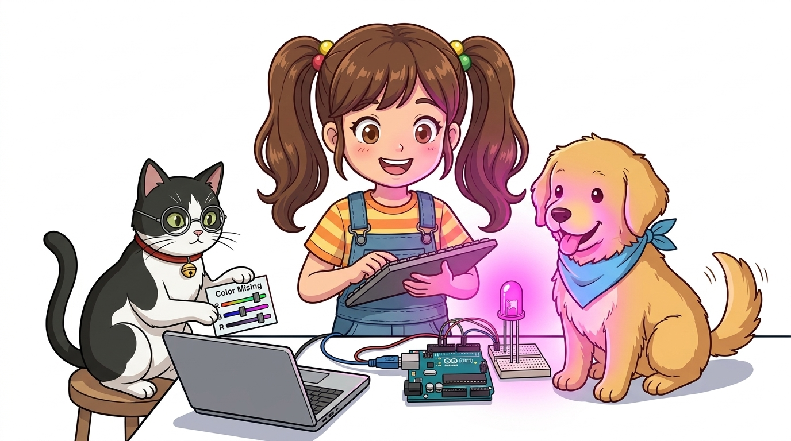
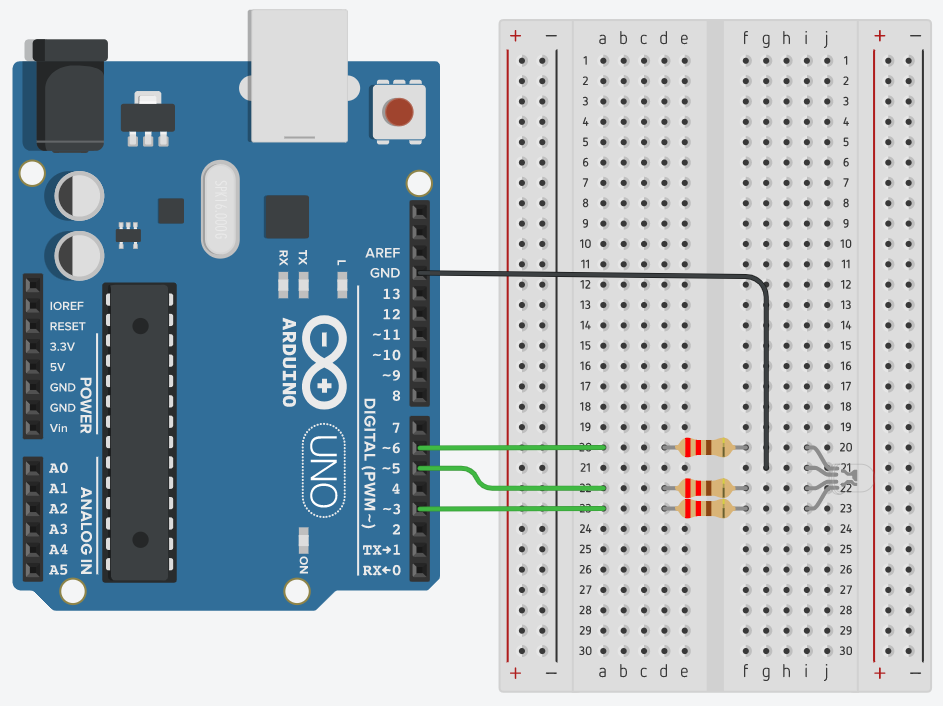

# 039_RGB시리얼_키보드컬러믹싱 🎨💬



* **👧 도로시**: "교수님! 지니야! 시리얼 모니터로 내가 원하는 빨강, 초록, 파랑 숫자를 직접 쳐서 마법의 조명 색을 만들 수는 없을까?"
* **👨‍🏫 이호진 교수님**: "좋은 아이디어야! 쉼표로 구분된 세 숫자를 쏙쏙 읽어내는 **`Serial.parseInt()`** 함수를 쓰면 나만의 감성 조명 스탠드를 만들 수 있어!"
* **🐶 토토**: "멍멍! (핑크색 무드등 불빛 만들어 달라 멍!)"
* 📖 **상세 강의 교재**: [index.md](./index.md)


> 여러분 안녕하세요! 이번 시간에는 '039. RGB시리얼 키보드컬러믹싱 🎨💬'을 주제로 함께 흥미진진한 탐험을 떠나보겠습니다. 이호진 교수님과 똑똑한 조수 지니, 호기심 많은 도로시와 토토와 함께 신나는 아두이노 모험을 힘차게 시작해 봅시다. 준비되셨나요?

---

## 1. 스마트 무드등의 핵심: 컬러 원격 조색 🎛️💡


- **컴퓨터 (시리얼 모니터)**: `255, 0, 200` 형태로 세 숫자를 입력하고 엔터를 누릅니다.
- **아두이노 UNO**: 시리얼 버퍼에서 정수 세 개를 연속으로 읽어와 각 PWM 핀의 듀티비를 즉시 갱신합니다.

최신 IoT 스마트 무드등은 스마트폰 앱이나 웹에서 색상 번호(RGB)를 보내면 방 안의 전등 색이 실시간으로 바뀝니다.

> 이번 슬라이드에서는 '1. 스마트 무드등의 핵심: 컬러 원격 조색 🎛️💡'에 대해 자세히 살펴보겠습니다. 화면의 다이어그램과 사진을 함께 참고해 주시기 바랍니다. 첫 번째 핵심은 컴퓨터 (시리얼 모니터): 255, 0, 200 형태로 세 숫자를 입력하고 엔터를 누릅니다.이며, 두 번째로는 아두이노 UNO: 시리얼 버퍼에서 정수 세 개를 연속으로 읽어와 각 PWM 핀의 듀티비를 즉시 갱신합니다.입니다. 이 원리는 아두이노 시스템 전체를 관통하는 핵심 논리이므로 머릿속에 꼭 정리해 두시기 바랍니다.

---

## 2. RGB LED 하드웨어 핀맵 복습 🛠️



* **💡 안전 가이드**: 각 색상 다리마다 $220\Omega$ 저항을 직렬로 연결하여 과전류로 인한 LED 소손을 방지합니다.

- **빨강 (RED)** $\rightarrow$ **6번 핀 (`~6`)**
- **초록 (GREEN)** $\rightarrow$ **3번 핀 (`~3`)**
- **파랑 (BLUE)** $\rightarrow$ **5번 핀 (`~5`)**
- **공통 캐소드 긴 다리 (GND)** $\rightarrow$ **아두이노 GND**

RGB LED의 각 색상 채널을 독립적으로 0~255단계 밝기로 제어하기 위해 아두이노의 **PWM 지원 핀(`~`)**에 연결합니다.

> 이번에 살펴볼 내용은 '2. RGB LED 하드웨어 핀맵 복습 🛠️'입니다. 화면의 회로도와 부품 사진을 보면서 각 핀과 배선이 어떻게 구성되어 있는지 눈으로 직접 따라와 주시기 바랍니다. 첫째로 빨강 (RED) $\rightarrow$ 6번 핀 (~6)에 유의해야 하며, 둘째로 초록 (GREEN) $\rightarrow$ 3번 핀 (~3)라는 점이 핵심입니다. 이 기본 개념을 확실히 잡아두셔야 실제 부품을 브레드보드에 꽂고 코딩할 때 실수 없이 완성할 수 있습니다.

---

## 3. 브레드보드 실물 배선도 📐


브레드보드에 4핀 RGB LED와 $220\Omega$ 저항 3개를 배치하고 점퍼선으로 결선합니다.

```
[아두이노 D6 (~PWM)] ---> [220Ω] ---> [RED 핀]
[아두이노 D3 (~PWM)] ---> [220Ω] ---> [GREEN 핀]
[아두이노 D5 (~PWM)] ---> [220Ω] ---> [BLUE 핀]
[아두이노 GND]       ----------------> [공통 GND 긴 다리]
```

> 이번 슬라이드에서는 '3. 브레드보드 실물 배선도 📐'에 대한 실제 동작 코드를 분석해 보겠습니다. 화면의 코드를 살펴보시면, 컴퓨터가 아두이노 하드웨어에 단계별로 명령을 내리는 흐름을 명확하게 확인할 수 있습니다. 각 함수의 역할과 괄호 안의 매개변수가 하드웨어 핀과 어떤 관계를 맺고 동작하는지 주의 깊게 살펴보시기 바랍니다.

---

## 4. 숫자만 쏙쏙 골라내는 마법: `Serial.parseInt()` 🔍


1. 첫 번째 `Serial.parseInt()` $\rightarrow$ **255** 반환!
2. 두 번째 `Serial.parseInt()` $\rightarrow$ **100** 반환!
3. 세 번째 `Serial.parseInt()` $\rightarrow$ **50** 반환!

시리얼 버퍼로 문자열이 들어올 때 쉼표나 공백 등 구분 기호를 건너뛰고 **연속된 정수 숫자만 자동으로 파싱**해 주는 고마운 내장 함수입니다.
예를 들어 사용자가 `255, 100, 50`을 입력하면:

```cpp
if (Serial.available() > 0) {
  int redVal   = Serial.parseInt(); // 첫 번째 숫자 추출
  int greenVal = Serial.parseInt(); // 두 번째 숫자 추출
  int blueVal  = Serial.parseInt(); // 세 번째 숫자 추출
}
```

> 이번 슬라이드에서는 '4. 숫자만 쏙쏙 골라내는 마법: Serial.parseInt() 🔍'에 대한 실제 동작 코드를 분석해 보겠습니다. 화면의 코드를 살펴보시면, 컴퓨터가 아두이노 하드웨어에 단계별로 명령을 내리는 흐름을 명확하게 확인할 수 있습니다. 여기서 핵심은 첫 번째 Serial.parseInt() $\rightarrow$ 255 반환!입니다. 각 함수의 역할과 괄호 안의 매개변수가 하드웨어 핀과 어떤 관계를 맺고 동작하는지 주의 깊게 살펴보시기 바랍니다.

---

## 5. 완성 스케치 코드: 3색 실시간 믹서 📝


```cpp
/*
 * 시리얼 통신으로 세 개의 숫자를 받아 RGB LED 색상 혼합하기
 * 입력 예: "255, 128, 0" + Enter
 */
const int RED_PIN   = 6;
const int GREEN_PIN = 3;
const int BLUE_PIN  = 5;

void setup() {
  pinMode(RED_PIN, OUTPUT);
  pinMode(GREEN_PIN, OUTPUT);
  pinMode(BLUE_PIN, OUTPUT);

  Serial.begin(9600);
  Serial.println("=== RGB Serial Color Mixer ===");
  Serial.println("Enter values: R, G, B (0~255 each, e.g. 255,100,50)");
}

void loop() {
  if (Serial.available() > 0) {
    int r = Serial.parseInt(); // 빨강 PWM 값 (0 ~ 255)
    int g = Serial.parseInt(); // 초록 PWM 값 (0 ~ 255)
    int b = Serial.parseInt(); // 파랑 PWM 값 (0 ~ 255)

    // 범위를 0~255로 안전하게 제한
    r = constrain(r, 0, 255);
    g = constrain(g, 0, 255);
    b = constrain(b, 0, 255);

    // PWM 신호 출력
    analogWrite(RED_PIN, r);
    analogWrite(GREEN_PIN, g);
    analogWrite(BLUE_PIN, b);

    // 현재 설정된 색상 값 피드백 출력
    Serial.print("Applied RGB: (");
    Serial.print(r); Serial.print(", ");
    Serial.print(g); Serial.print(", ");
    Serial.print(b); Serial.println(")");
  }
}
```

> 이번 슬라이드에서는 '5. 완성 스케치 코드: 3색 실시간 믹서 📝'에 대한 실제 동작 코드를 분석해 보겠습니다. 화면의 코드를 살펴보시면, 컴퓨터가 아두이노 하드웨어에 단계별로 명령을 내리는 흐름을 명확하게 확인할 수 있습니다. 각 함수의 역할과 괄호 안의 매개변수가 하드웨어 핀과 어떤 관계를 맺고 동작하는지 주의 깊게 살펴보시기 바랍니다.

---
## 6. 시리얼 모니터 전송 꿀팁 & 컬러 레시피북 📖✨


- 시리얼 모니터 창 하단의 줄바꿈 설정을 **'새 줄(Newline)'** 또는 **'Both NL & CR'**로 선택합니다.
- 숫자를 입력하고 엔터를 치는 순간 `parseInt()`가 지체 없이 입력을 완료하고 불빛을 바꿉니다.
- **따뜻한 핑크빛 (Warm Pink)**: `255, 20, 100` 💖
- **상큼한 오렌지빛 (Vivid Orange)**: `255, 80, 0` 🍊
- **시원한 민트 하늘색 (Mint Cyan)**: `0, 255, 200` 🩵
- **신비로운 보랏빛 (Deep Violet)**: `180, 0, 255` 💜
- **포근한 백색 전등 (Warm White)**: `255, 255, 255` 🤍

### 시리얼 모니터 설정
### 나만의 감성 컬러 레시피

> 이번 슬라이드에서는 '6. 시리얼 모니터 전송 꿀팁 & 컬러 레시피북 📖✨'에 대해 자세히 살펴보겠습니다. 첫 번째 핵심은 시리얼 모니터 창 하단의 줄바꿈 설정을 '새 줄(Newline)' 또는 'Both NL & CR'로 선택합니다.이며, 두 번째로는 숫자를 입력하고 엔터를 치는 순간 parseInt()가 지체 없이 입력을 완료하고 불빛을 바꿉니다.입니다. 여기에 덧붙여 따뜻한 핑크빛 (Warm Pink): 255, 20, 100 💖 내용까지 함께 이해해 두시면 완벽합니다. 이 원리는 아두이노 시스템 전체를 관통하는 핵심 논리이므로 머릿속에 꼭 정리해 두시기 바랍니다.
---

## 🌟 도로시와 지니의 이번 시간 핵심 정리!


* **👧 도로시**: "눈으로 보는 빛은 이제 자유자재로 다룰 수 있게 되었어! 지니야, 다음엔 귀로 듣는 **'소리와 음악'**을 아두이노로 만들어볼래!"
* **👨‍🏫 이호진 교수님**: "훌륭해 도로시! 다음 시간에는 삐- 소리와 신나는 멜로디를 연주하는 **'부저(Buzzer)'**의 세계로 떠나보자!"

1. **`Serial.parseInt()`**: 복잡한 문자열 처리 없이 쉼표로 구분된 정수값 3개를 순서대로 추출해요.
2. **다채널 PWM 매핑**: 추출된 각 값을 PWM 핀에 인가하여 1600만 가지 이상의 빛깔을 자유롭게 표현해요.
3. **인터랙티브 IoT 조명**: 사용자의 입력을 받아 즉각 물리 세계의 빛으로 반응하는 스마트 조명 시스템을 완성했어요!

> 오늘 배운 '🌟 도로시와 지니의 이번 시간 핵심 정리!'의 핵심 내용을 모두 정리해 보았습니다. 오늘 다룬 내용 중에서도 Serial.parseInt(): 복잡한 문자열 처리 없이 쉼표로 구분된 정수값 3개를 순서대로 추출해요. 부분은 앞으로의 아두이노 실습과 프로젝트에서 계속 사용되는 매우 중요한 기초 지식입니다. 오늘 배운 내용을 꼭 다시 한번 복습해 보시고, 다음 강의에서 더욱 신나고 유익한 모험으로 다시 만나겠습니다. 모두 수고 많으셨습니다!