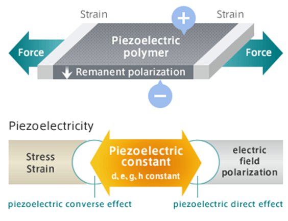
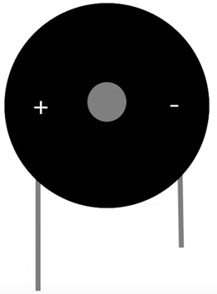
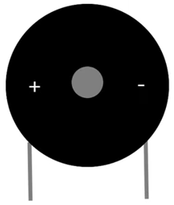
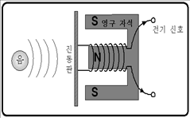
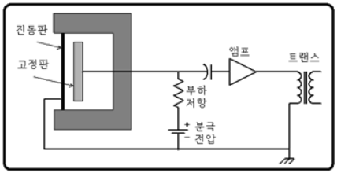

# 040_부저란_마법의소리떨림판 🎵🔊

> **👧 도로시**: "교수님! 지니야! 아두이노 키트에 든 까맣고 둥근 동전 같은 부품은 뭐야? 전기를 주면 소리를 낼 수 있어?"  
> **👨‍🏫 이호진 교수님**: "그게 바로 전기를 진동으로 바꿔 삐- 소리를 내거나 멋진 멜로디를 부르는 **'피에조 부저(Piezo Buzzer)'**야!"  
> **🐶 토토**: "멍멍! (노래하는 전자 피아노다 멍!)"

* 🖥️ **강의 슬라이드**: [slides.md](./slides.md)

---

## 1. 부저(Buzzer)란 무엇일까요? 🛎️

- **부저**: 전기 신호를 받아 공기를 진동시켜 **'삐-', '삑-'** 하는 경보음이나 음악 소리를 만들어내는 음향 액추에이터예요.
- 전자레인지 조리 완료음, 현관 도어록 번호 누르는 소리, 자동차 후진 경고음, 엘리베이터 층 도착음 등이 모두 부저의 소리입니다.
- 구조가 단순하고 크기가 작아 임베디드 기기의 상태 알림용으로 가장 널리 쓰입니다.

---

## 2. 퀴리 형제가 발견한 '압전(Piezo) 효과' ⚡🪨

- **압전(Piezo-Electric)**: 그리스어로 "누른다"는 뜻의 *piezein*에서 유래했습니다.
- 1880년 프랑스의 과학자 자크 퀴리와 피에르 퀴리 형제가 특별한 광물(수정, 티탄산바륨 등)에서 발견했습니다:
  - **압전 직접 효과 (Direct Effect)**: 결정체를 꾹 누르면 전압(전기)이 찌릿 발생해요! (가스 라이터 점화기, 전자 체중계의 원리)
  - **압전 역효과 (Converse Effect)**: 반대로 결정체에 전압을 걸어주면 모양이 수축/팽창하며 파르르 떨려요!

---

## 3. 피에조 부저가 소리를 내는 물리적 메커니즘 🔬

- 부저 내부에는 얇은 원형 황동판(Brass Plate) 위에 압전 세라믹(Piezo Ceramic) 소자가 부착되어 있습니다.
- 교류(AC) 또는 고속 펄스 전압을 인가하면 세라믹 판이 주기적으로 팽창과 수축을 반복합니다.
- 황동판이 상하로 진동하면서 **주변 공기 분자를 밀고 당겨 음파(Sound Wave)**를 발생시킵니다!

> **👧 도로시**: "전기를 주면 얇은 쇠판이 실로폰처럼 초고속으로 떨리면서 공기를 울리는 거구나!"

---

## 4. 부저의 두 가족: 능동부저 vs 수동부저 ⚖️

아두이노 실습에 사용되는 피에조 부저는 내부 회로에 따라 **능동(Active)**과 **수동(Passive)**으로 구분됩니다.

| 구분 | 능동 부저 (Active Buzzer) | 수동 부저 (Passive Buzzer) |
| :--- | :--- | :--- |
| **발진 회로 (Oscillator)** | **내부에 오실레이터 회로가 내장됨** | 내부에 발진기가 없음 (순수 진동판) |
| **구동 방식** | 직류 DC 5V 전원만 인가하면 즉시 **"삐-"** | 아두이노가 주파수 신호(`tone()`) 공급 |
| **음계 연주 (Pitch)** | 단일 주파수(고정음) 경보용 | **도-레-미-파-솔 멜로디 연주 가능** |
| **식별 방법** | 밑면에 방수 스티커가 붙어 있거나 녹색 회로판 | 밑면에 기판이 노출되어 검은색 충진재 보임 |

---

## 5. 능동/수동 부저의 외형 및 극성 확인법 🔍

- **긴 다리 / 스티커 표기 (`+`)**: VCC 또는 아두이노 디지털 출력 핀에 연결
- **짧은 다리 (`-`)**: GND에 연결
- 상단 보호 스티커(Remove after washing)는 제품 제작 시 세척액 유입을 막기 위한 것이며, 사용 시 스티커를 떼면 소리가 훨씬 크고 명확해집니다.

---

## 6. 소리를 전기로 바꾸는 마이크: 다이나믹 마이크 🎤

- 소리 액추에이터인 부저/스피커와 정반대의 역할을 하는 대표적 입력 센서가 바로 **마이크(Microphone)**입니다.
- **다이나믹 마이크 (Dynamic Microphone)**:
  - 진동판에 부착된 보이스 코일이 영구 자석 사이를 진동하면서 **패러데이 전자기 유도 현상**에 의해 소리를 전기 신호로 변환합니다.
  - 전원이 필요 없고 튼튼하여 공연용 보컬 마이크로 널리 사용됩니다.

---

## 7. 숨소리까지 정밀하게 포착하는 '콘덴서 마이크' 🎙️✨

- 두 개의 얇은 금속판(고정 전극과 진동판) 사이의 정전용량(Capacitance) 변화를 감지합니다.
- 아주 미세하고 섬세한 고주파 음향까지 왜곡 없이 전기 신호로 바꿀 수 있어 스마트폰 통화 마이크, 방송용 레코딩, 아두이노 사운드 센서(ECM 모듈)에 사용됩니다.

---

## 🌟 도로시와 지니의 이번 시간 핵심 정리!

1. **피에조 압전 효과**: 전압을 인가하면 세라믹 소자가 물리적으로 변형되며 공기 파동을 일으켜요.
2. **능동 부저**: 내부 발진기가 있어 5V 직류 전원만 주면 간편하게 단일 경보음을 출력해요.
3. **수동 부저**: 외부에서 공급하는 펄스 주파수에 따라 다양한 높낮이(도레미)의 멜로디를 연주할 수 있어요!

> **👧 도로시**: "다음 시간에는 전원만 주면 바로 우렁찬 경보를 울리는 **'능동부저'**부터 직접 소리 내볼래!"  
> **👨‍🏫 이호진 교수님**: "좋아! 다음 시간에는 모스 부호 SOS와 도난 경보기를 만들어보는 능동부저 실습으로 떠나보자!"

