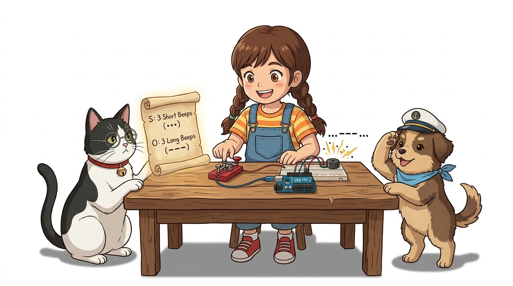
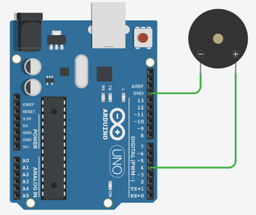
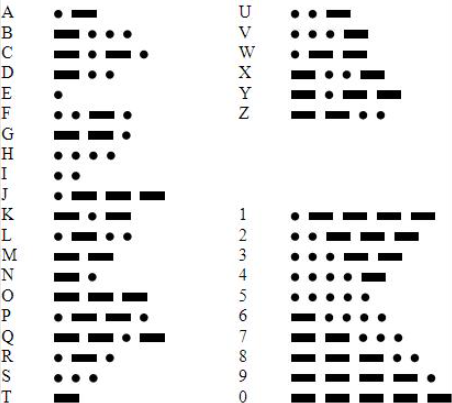
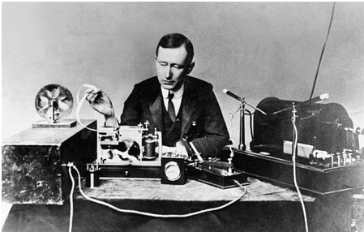

# 041_능동부저_경보음과비밀암호 🚨📻

> **👧 도로시**: "교수님! 지니야! 능동부저는 전원만 꽂아도 삐- 소리가 난다고 했지? 이걸로 영화에 나오는 조난 구조 신호 'SOS'를 칠 수 있을까?"  
> **👨‍🏫 이호진 교수님**: "멋진 발상이야 도로시! 짧은 신호와 긴 신호의 시간 간격을 조절하면 전 세계를 구하는 **'모스 부호(Morse Code)'**를 보낼 수 있단다!"  
> **🐶 토토**: "멍멍! (토토 구조대 선장 출동이다 멍!)"



* 🖥️ **강의 슬라이드**: [slides.md](./slides.md)

---

## 1. 혼자서도 소리를 내는 '능동 부저(Active Buzzer)' 🔔

능동 부저는 내부에 자체 **고정 주파수 발진 회로**를 포함하고 있어, 직류 전원(DC 5V)만 공급되면 스스로 진동판을 울려 소리를 냅니다.

- 복잡한 오디오 라이브러리 없이 디지털 핀의 `HIGH`와 `LOW`만으로 쉽게 소리를 켜고 끌 수 있습니다.
- `digitalWrite(4, HIGH);` $\rightarrow$ 전원 인가, 경보음 발생!
- `digitalWrite(4, LOW);` $\rightarrow$ 전원 차단, 무음 상태!


---

## 2. 능동 부저 회로 연결 및 극성 확인 🛠️

능동 부저는 극성이 있으므로 반대로 연결하면 소리가 나지 않거나 부품에 무리가 갈 수 있습니다.

- **긴 다리 / 스티커 표기 (`+`)**: 아두이노 **디지털 4번 핀**에 연결
- **짧은 다리 (`-`)**: 아두이노 **GND**에 연결
- 부저 윗면 스티커의 `+` 표시를 확인하세요. 스티커를 떼어내면 음량이 2배 이상 커집니다.

```
[아두이노 D4 핀] ---> [능동 부저 (+) 긴 다리]
[아두이노 GND]    ---> [능동 부저 (-) 짧은 다리]
```



---

## 3. 실습 ①: 규칙적인 삐- 삐- 경보음 울리기 📢

0.5초 동안 소리를 내고, 0.5초 동안 쉬는 주기적인 전자 비프음(Beep) 경보기를 만들어 봅니다.

```cpp
/*
 * 능동 부저를 이용한 주기적 경보 비프음
 */
const int BUZZER_PIN = 4;

void setup() {
  pinMode(BUZZER_PIN, OUTPUT); // 4번 핀을 출력으로 설정
}

void loop() {
  digitalWrite(BUZZER_PIN, HIGH); // 부저 켜기 (소리 발생)
  delay(500);                     // 0.5초 동안 유지
  digitalWrite(BUZZER_PIN, LOW);  // 부저 끄기 (소리 정지)
  delay(500);                     // 0.5초 동안 대기
}
```

```cpp
// 능동 부저 삐- 경보음 On/Off 제어
digitalWrite(buzzerPin, HIGH); // 부저 울림 시작
delay(200);
digitalWrite(buzzerPin, LOW);  // 부저 멈춤
```

---

## 4. 비밀 전보의 역사: '모스 부호(Morse Code)' 📜

1830년대 새뮤얼 모스가 발명한 전기 신호 기반 통신 부호입니다.  
짧은 펄스인 **점(Dot, ·)**과 3배 길이의 **선(Dash, —)**의 조합으로 모든 알파벳과 숫자를 표현합니다.

- **점(Dot)**: 기본 단위 시간 $t$ (예: 100ms)
- **선(Dash)**: 3단위 시간 $3t$ (예: 300ms)
- **부호 간 간격**: 1단위 시간 $t$ 휴식
- **글자 간 간격**: 3단위 시간 $3t$ 휴식



---

## 5. 전 세계 공통 조난 구조 신호: S.O.S 🆘

1906년 베를린 국제 무선 전신 협약에서 제정된 전 세계 공통의 긴급 조난 신호입니다.

- **S**: 짧게 3번 (`· · ·`)
- **O**: 길게 3번 (`— — —`)
- **S**: 짧게 3번 (`· · ·`)
- 청각적 리듬: **"띡-띡-띡! 삐---삐---삐---! 띡-띡-띡!"**



---

## 6. 실습 ②: 함수(Function)로 조립하는 모듈형 SOS 코드 🧩

반복되는 점과 선, 글자 신호를 독립된 함수로 분리하면 코드의 재사용성과 가독성이 획기적으로 향상됩니다.

```cpp
/*
 * 함수 모듈화를 활용한 능동 부저 모스 부호 SOS 송신 장치
 */
const int BUZZER = 4;
const int TIME_UNIT = 100; // 기준 단위 시간 (100ms)

// 점(Dot): 짧은 100ms 비프음
void dot() {
  digitalWrite(BUZZER, HIGH);
  delay(TIME_UNIT);
  digitalWrite(BUZZER, LOW);
  delay(TIME_UNIT); // 신호 간 간격
}

// 선(Dash): 3배 긴 300ms 비프음
void dash() {
  digitalWrite(BUZZER, HIGH);
  delay(TIME_UNIT * 3);
  digitalWrite(BUZZER, LOW);
  delay(TIME_UNIT); // 신호 간 간격
}

// 모스 부호 'S' (···)
void morse_S() {
  dot();
  dot();
  dot();
  delay(TIME_UNIT * 2); // 글자 간 추가 휴식
}

// 모스 부호 'O' (———)
void morse_O() {
  dash();
  dash();
  dash();
  delay(TIME_UNIT * 2); // 글자 간 추가 휴식
}

void setup() {
  pinMode(BUZZER, OUTPUT);
}

void loop() {
  morse_S(); // S 발송
  morse_O(); // O 발송
  morse_S(); // S 발송

  delay(2000); // 1회 SOS 전송 후 2초 대기
}
```


---

## 🌟 도로시와 지니의 이번 시간 핵심 정리!

1. **디지털 제어의 간결함**: 능동 부저는 `HIGH`와 `LOW`만으로 명확한 온/오프 사운드 제어가 가능해요.
2. **모스 부호의 타이밍 규칙**: `delay()`의 길이를 수학적 비율(1:3)로 조합하여 정보 암호를 소리로 전달해요.
3. **함수 추상화(Abstraction)**: `dot()`, `dash()`, `morse_S()`처럼 복잡한 로직을 작은 블록으로 쪼개어 깨끗하고 유지보수하기 쉬운 소프트웨어를 설계했어요!

> **👧 도로시**: "능동부저는 똑똑 끊기는 경보음만 나는데, 학교 종소리나 도레미파솔 노래는 어떻게 만들어?"  
> **👨‍🏫 이호진 교수님**: "바로 다음 시간에 배울 **'수동 부저'**와 주파수의 마법! 아름다운 멜로디를 직접 연주해보자!"


