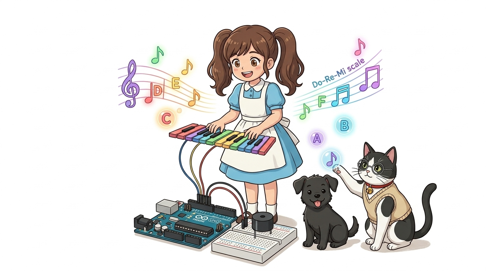
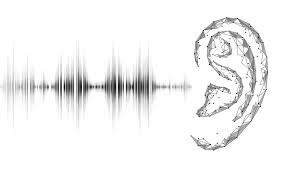
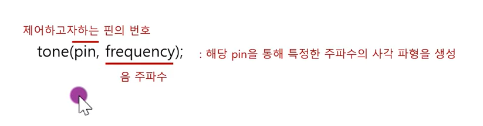
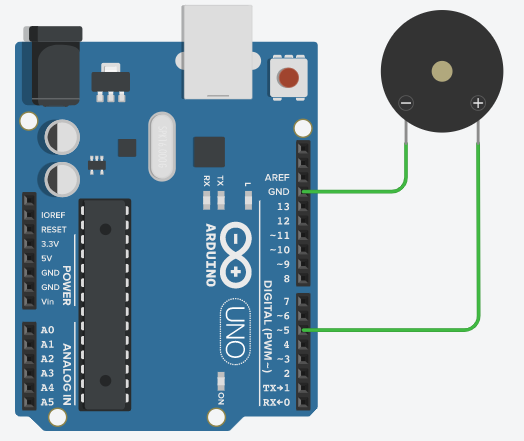
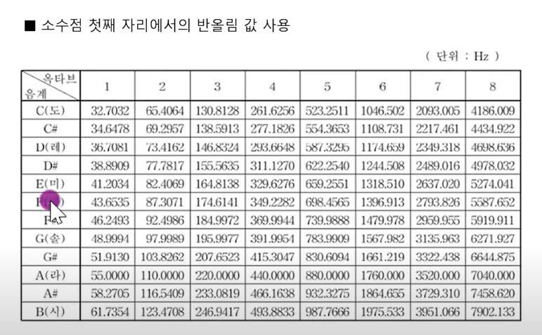
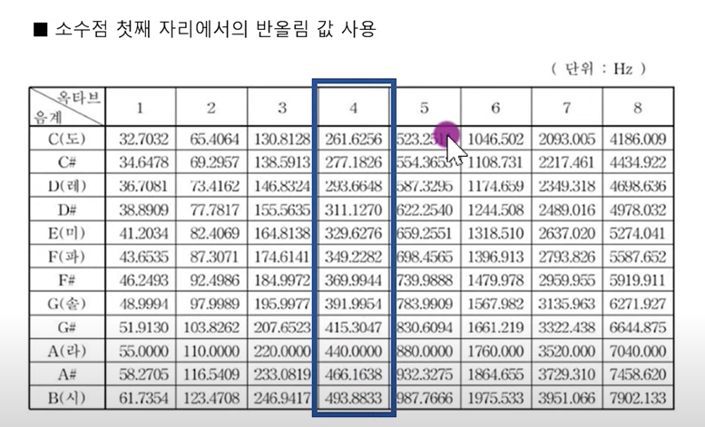
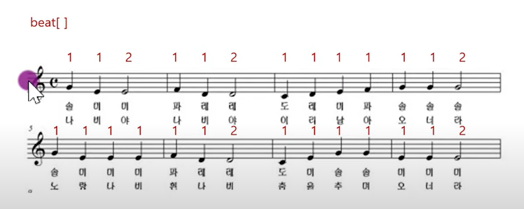
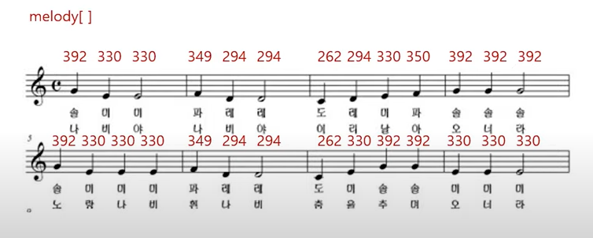
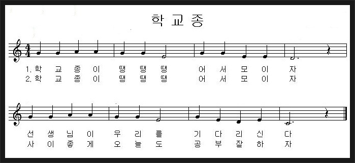

# 042_수동부저_도레미멜로디연주 🎹🎶

> **👧 도로시**: "교수님! 지니야! 능동부저는 삐- 소리만 나는데, '도레미파솔라시도' 동요를 연주할 수 있는 부저는 어떻게 만들어?"  
> **👨‍🏫 이호진 교수님**: "그럴 땐 아두이노가 주파수를 직접 쏴주는 **'수동 부저(Passive Buzzer)'**와 **`tone()`** 마법을 쓰면 돼! 멋진 전자 오르골이 탄생한단다!"  
> **🐶 토토**: "멍멍! (토토도 신나서 아우우~ 노래한다 멍!)"



* 🖥️ **강의 슬라이드**: [slides.md](./slides.md)

---

## 1. 수동 부저(Passive Buzzer)란? 🎼

- 내부에 발진 회로가 없어 5V 직류 전원만 꽂으면 아무런 소리도 나지 않습니다.
- 대신 아두이노가 원하는 주파수의 사각파(Square Wave) 펄스를 보내주면, 진동판이 그 박자에 맞춰 정확하게 떨리며 다양한 음높이(피치)를 연주합니다.
- 능동 부저보다 응용 범위가 훨씬 넓어 멜로디 연주, 효과음, 게임 오디오 등에 두루 쓰입니다.


---

## 2. 소리의 과학: 주파수(Hz)와 음계의 비밀 🔬

- **소리의 3요소**: 세기(진폭), 높낮이(주파수), 맵시(파형).
- **주파수(Frequency, Hz)**: 1초 동안 진동판이 왕복 운동하는 횟수입니다.
  - 진동이 느릴수록(낮은 Hz) $\rightarrow$ **묵직하고 웅장한 저음**
  - 진동이 빠를수록(높은 Hz) $\rightarrow$ **맑고 날카로운 고음**
- 인간의 가청 주파수 영역은 약 **20 Hz ~ 20,000 Hz (20 kHz)**입니다.



---

## 3. 수동 부저 회로 결선 및 핀맵 🔌

수동 부저는 극성이 없거나 양극(+) 표시가 있는 핀을 아두이노 디지털 핀에 연결합니다.

- **부저 (+) 다리**: 아두이노 **디지털 5번 핀** 연결
- **부저 (-) 다리**: 아두이노 **GND** 연결

```
[아두이노 D5 핀] ---> [수동 부저 (+)] ---> [수동 부저 (-)] ---> [GND]
```

> **💡 참고**: 전류를 보호하고 부드러운 음색을 내기 위해 100Ω~220Ω 저항을 직렬로 연결해 주어도 좋습니다.



---

## 4. 도레미파솔라시도의 표준 음계 주파수 테이블 🎵

서양 음악의 12평균율에서 4옥타브(가온다 영역)의 대표적 주파수 값입니다:

| 음계 (4옥타브) | 음이름 (Note) | 주파수 (Hz) | 물리적 의미 |
| :---: | :---: | :---: | :--- |
| **도** | C4 | **262 Hz** | 1초에 262회 진동 |
| **레** | D4 | **294 Hz** | 1초에 294회 진동 |
| **미** | E4 | **330 Hz** | 1초에 330회 진동 |
| **파** | F4 | **349 Hz** | 1초에 349회 진동 |
| **솔** | G4 | **392 Hz** | 1초에 392회 진동 |
| **라** | A4 | **440 Hz** | 국제 표준 오케스트라 조율 기준음 |
| **시** | B4 | **494 Hz** | 1초에 494회 진동 |
| **높은 도** | C5 | **523 Hz** | 기본 도(262Hz)의 정확히 2배 주파수 |



---

## 5. 아두이노 음향 제어 함수: `tone()` & `noTone()` 🪄

아두이노 내장 타이머를 이용해 디지털 핀에 지정한 주파수의 50% 듀티비 사각파를 출력합니다.

- **`tone(pin, frequency)`**: 지정한 핀으로 해당 주파수의 소리를 계속 출력합니다.
- **`tone(pin, frequency, duration)`**: 지정한 밀리초(`duration`) 동안 소리를 내고 자동 정지합니다.
- **`noTone(pin)`**: 현재 출력 중인 소리를 즉시 끕니다 (쉼표 역할).

```cpp
tone(5, 262); // 5번 핀에서 262Hz('도') 소리 시작
delay(500);   // 0.5초 동안 유지
noTone(5);    // 소리 끄기 (쉼표)
```



---

## 6. 실습 ①: 8음계 도레미파솔라시도 계단 오르기 🪜

배열(`array`)과 `for` 반복문을 활용하여 8개의 음계를 차례대로 연주합니다.

```cpp
/*
 * 수동 부저를 이용한 8음계 순차 연주
 */
const int BUZZER_PIN = 5;

// 도, 레, 미, 파, 솔, 라, 시, 도 주파수 배열
int scale[] = {262, 294, 330, 349, 392, 440, 494, 523};

void setup() {
  pinMode(BUZZER_PIN, OUTPUT);
}

void loop() {
  for (int i = 0; i < 8; i++) {
    tone(BUZZER_PIN, scale[i]); // 해당 주파수 소리 재생
    delay(400);                 // 음표 지속 시간 (400ms)
  }
  
  noTone(BUZZER_PIN); // 한 옥타브 완료 후 정지
  delay(1000);        // 1초 쉬고 다시 시작
}
```



---

## 7. 실습 ②: 동요 "나비야 나비야" 멜로디 오르골 🦋

음표 주파수 배열(`melody[]`)과 음표의 박자 길이 배열(`beat[]`)을 조합하여 리듬감 있는 동요를 연주합니다.

```cpp
/*
 * 동요 "나비야" 연주 스케치
 */
const int BUZZER = 5;

// 솔 미 미, 파 레 레, 도 레 미 파 솔 솔 솔
int melody[] = {
  392, 330, 330, 
  349, 294, 294, 
  262, 294, 330, 349, 392, 392, 392
};

// 음표별 박자 배수 (1박자, 2박자)
int beat[] = {
  1, 1, 2, 
  1, 1, 2, 
  1, 1, 1, 1, 1, 1, 2
};

void setup() {
  pinMode(BUZZER, OUTPUT);
}

void loop() {
  for (int i = 0; i < 13; i++) {
    tone(BUZZER, melody[i]);
    delay(300 * beat[i]); // 박자 길이에 맞게 연주
    
    noTone(BUZZER);
    delay(50); // 음과 음 사이의 짧은 스타카토 휴식
  }
  
  delay(2000); // 1곡 완료 후 2초 대기
}
```



---

## 8. 실습 ③: `#define` 매크로로 만드는 "학교종이 땡땡땡" 콘서트 🔔🎒

헤더 파일이나 상단 선언부에 `#define`으로 계이름을 지정하면 악보를 그대로 코드로 옮겨 적을 수 있습니다.

```cpp
/*
 * #define 매크로를 활용한 가독성 높은 음악 코드
 */
#define NOTE_C4 262
#define NOTE_D4 294
#define NOTE_E4 330
#define NOTE_G4 392
#define NOTE_A4 440

const int BUZZER = 5;

// "솔 솔 라 라 솔 솔 미"
int schoolSong[] = {
  NOTE_G4, NOTE_G4, NOTE_A4, NOTE_A4, NOTE_G4, NOTE_G4, NOTE_E4
};

void setup() {
  pinMode(BUZZER, OUTPUT);
}

void loop() {
  for (int i = 0; i < 7; i++) {
    tone(BUZZER, schoolSong[i]);
    delay(350);
    noTone(BUZZER);
    delay(50);
  }
  delay(3000);
}
```



---

## 9. 부저 실습 시 타이머 충돌(Timer Conflict) 주의점 ⚠️

- 아두이노 UNO의 `tone()` 함수는 **타이머 2(Timer 2)**를 사용합니다.
- 따라서 `tone()`을 사용하는 동안에는 타이머 2에 할당된 **3번과 11번 핀의 PWM(`analogWrite`) 기능이 비활성화**됩니다.
- 부저와 LED 밝기 조절을 함께 사용할 때는 3, 11번 핀 대신 **5, 6번(타이머 0)** 또는 **9, 10번(타이머 1)** 핀을 사용해야 합니다.



---

## 🌟 도로시와 지니의 이번 시간 핵심 정리!

1. **주파수와 음계**: 수동 부저는 아두이노가 공급하는 펄스 주파수(Hz)에 따라 다양한 높낮이의 음을 연주해요.
2. **`tone()` & `noTone()`**: 소리를 시작하고 멈추며, 음과 음 사이에 미세한 휴식을 주어야 자연스러운 음악이 돼요.
3. **배열과 매크로의 시너지**: 음계 테이블과 박자 데이터를 배열로 구조화하여 어떤 복잡한 악보도 완벽히 연주할 수 있어요!

> **👧 도로시**: "빛도 만들고, 통신도 하고, 노래도 연주하고! 드디어 **'02. 출력실습1'**의 17개 주제를 완벽하게 마스터했어!"  
> **👨‍🏫 이호진 교수님**: "축하해 도로시! 이제 다음 대단원인 **'03. 디스플레이'**로 넘어가서 화면에 문자, 숫자, 그래픽을 자유자재로 띄워보자!"  
> **🐶 토토**: "멍멍! (화면에 내 멋진 얼굴도 띄워달라 멍!)"


