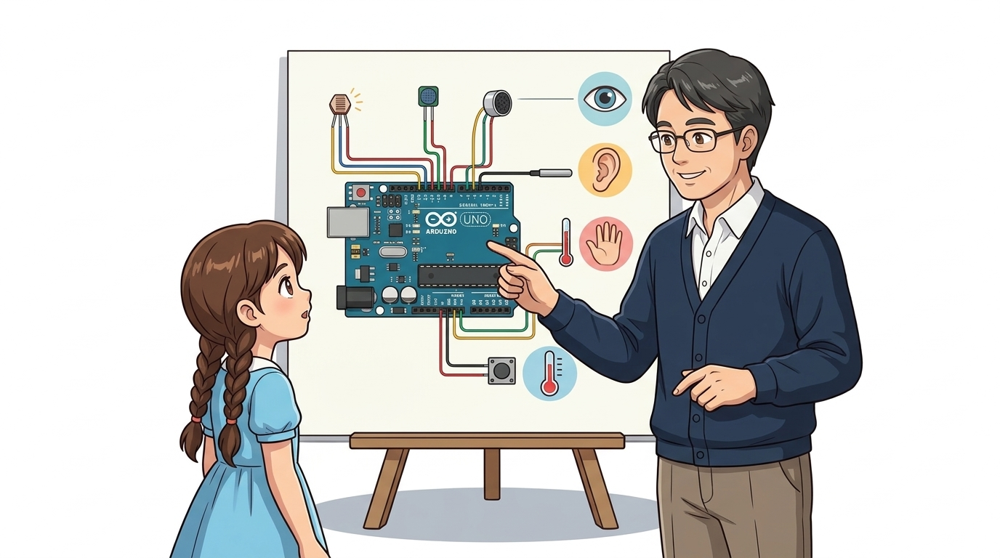
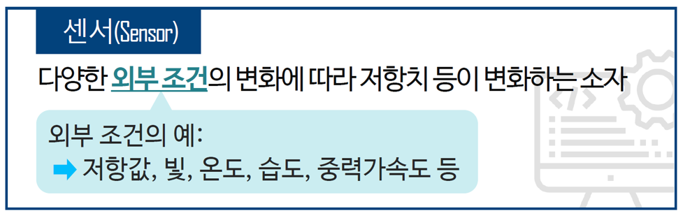
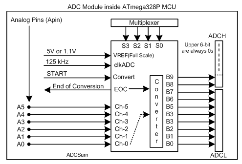
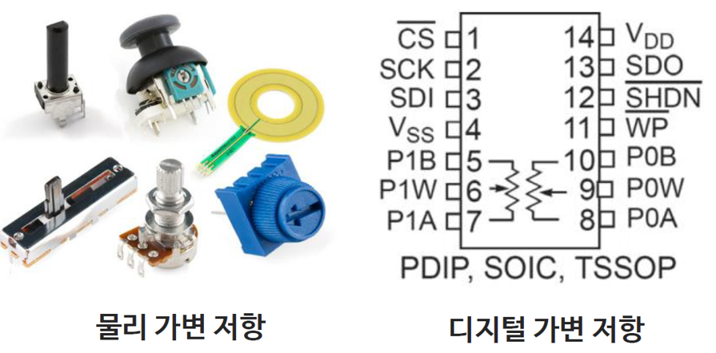
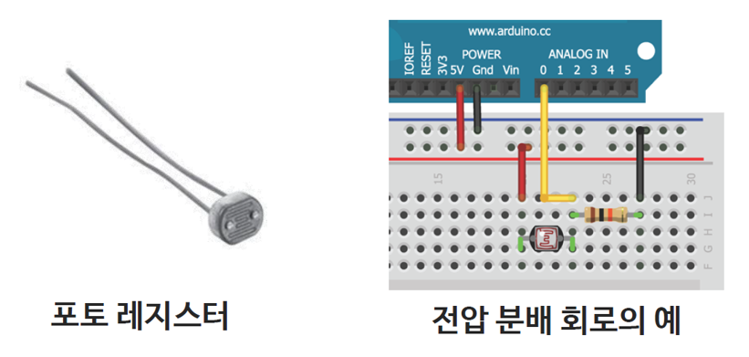
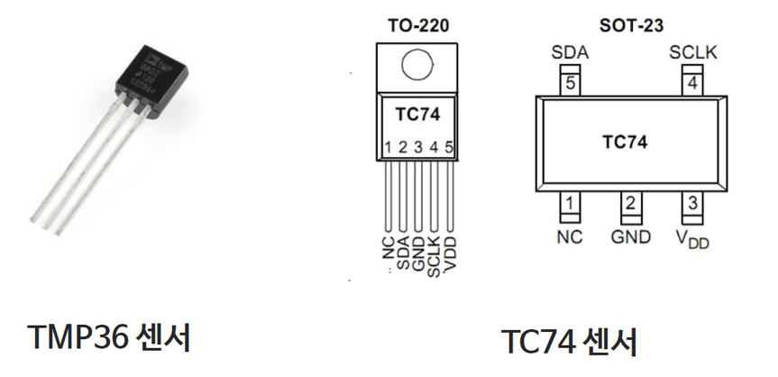
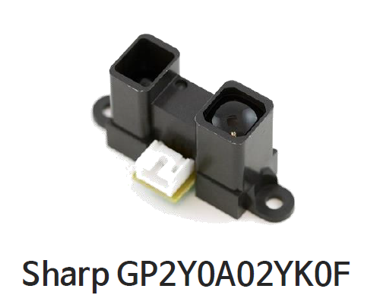

# 043_센서란_아두이노의감각기관 🎮🕹️

**도로시와 지니가 함께하는 바깥세상의 빛, 소리, 온도를 전기 신호로 느끼는 스마트 감각 기관 탐험**
* 👧 **도로시**: "교수님! 지니야! 사람은 눈으로 보고, 귀로 듣고, 피부로 만져서 주변을 알잖아! 눈도 코도 귀도 없는 초록색 아두이노 기판은 방이 어두운지, 날씨가 더운지 어떻게 알 수 있어?"
* **👨‍🏫 이호진 교수님**: "사람에게 오감(시각, 청각, 촉각, 후각, 미각)이 있듯이, 아두이노에게는 **센서(Sensor)** 라는 신비한 전자 감각 기관이 있단다! 외부 세계의 물리적인 변화를 아두이노가 읽을 수 있는 전압 신호로 변환해 주는 똑똑한 눈과 귀지!"
* 🐶 **토토**: "킁킁! 나처럼 냄새를 척척 맡는 전자 코(가스 센서)도 있다 멍!"
* 📖 **상세 강의 교재**: [index.md](./index.md)

> 여러분 안녕하세요! 이번 시간에는 '043. 센서란 아두이노의감각기관 🎮🕹️'을 주제로 함께 흥미진진한 탐험을 떠나보겠습니다. 오늘 강의에서는 특히 도로시와 지니가 함께하는 바깥세상의 빛, 소리, 온도를 전기 신호로 느끼는 스마트 감각 기관 탐험, 👧 도로시: "교수님! 지니야! 사람은 눈으로 보고, 귀로 듣고, 피부로 만져서 주변을 알잖아! 눈도 코도 귀도 없는 초록색 아두이노 기판은 방이 어두운지, 날씨가 더운지 어떻게 알 수 있어?"를 중심으로 핵심 원리와 응용 방법을 차근차근 배워보겠습니다. 이호진 교수님과 똑똑한 조수 지니, 호기심 많은 도로시와 토토와 함께 신나는 아두이노 모험을 힘차게 시작해 봅시다. 준비되셨나요?

---

## 1. 도로시의 호기심: 아두이노는 세상을 어떻게 감지할까?

| 인간의 감각 기관 | 측정 물리량 | 아두이노의 대표 센서 | 로봇 시스템의 역할 |
| :--- | :--- | :--- | :--- |
| **눈 (시각)** | 빛의 유무 및 밝기 (Lux) | **조도 센서 (CdS 포토레지스터)** | 어두워지면 조명을 켜는 자동 스위치 |
| **귀 (청각)** | 소리 크기와 주파수 (dB, Hz) | **사운드 마이크로폰 센서** | 박수 소리에 반응하는 스마트 스탠드 |
| **피부 (촉각)** | 누르는 힘, 물체 접촉 | **푸시 버튼, 터치 센서, 압력 센서(FSR)** | 충돌 감지 범퍼, 키보드 입력 |
| **체온 감각** | 차가움과 따뜻함 (°C) | **온습도 센서 (DHT11, LM35)** | 실내 온도를 지키는 스마트 에어컨 |
| **박쥐의 초음파**| 장애물과의 거리 (cm) | **초음파 거리 센서 (HC-SR04)** | 자율주행차 후방 감지기, 충돌 회피 |

### 👁️ 인체 감각 신경과 마이크로컨트롤러 시스템의 완벽 대응
센서(Sensor)란 빛, 온도, 압력, 가스 농도 등 자연계의 아날로그 물리량을 기계가 이해할 수 있는 전기적 신호(전압, 전류, 저항 변화)로 변환해 주는 소자를 총칭합니다.

> 자, 이번 슬라이드의 질문을 함께 보시겠습니다. 바로 '1. 도로시의 호기심: 아두이노는 세상을 어떻게 감지할까?'라는 아주 흥미로운 질문입니다. 이 질문 속에 숨겨진 전자 회로와 컴퓨팅의 핵심 원리를 지금부터 차근차근 하나씩 파헤쳐 보겠습니다.

---

## 2. 센서(Sensor)의 물리적 동작 메커니즘

* **입력(INPUT) 모드**: 센서 신호는 마이크로컨트롤러 안으로 흘러 들어오는 정보이므로, 아두이노 핀을 반드시 `pinMode(pin, INPUT)`으로 설정해야 합니다.

### 🔍 물리량 변화 ➡️ 저항/전압 변화 ➡️ 10비트 디지털 숫자로 변환
센서는 외부 자극을 받으면 내부 분자 구조나 반도체 접합부의 상태가 변하면서 전기적 성질이 달라집니다.

> 이번 슬라이드에서는 '2. 센서(Sensor)의 물리적 동작 메커니즘'에 대한 실제 동작 코드를 분석해 보겠습니다. 화면의 코드를 살펴보시면, 컴퓨터가 아두이노 하드웨어에 단계별로 명령을 내리는 흐름을 명확하게 확인할 수 있습니다. 여기서 핵심은 입력(INPUT) 모드: 센서 신호는 마이크로컨트롤러 안으로 흘러 들어오는 정보이므로, 아두이노 핀을 반드시 pinMode(pin, INPUT)으로 설정해야 합니다.입니다. 각 함수의 역할과 괄호 안의 매개변수가 하드웨어 핀과 어떤 관계를 맺고 동작하는지 주의 깊게 살펴보시기 바랍니다.

---

## 3. 아두이노의 강력한 무기: 아날로그 입력 핀(A0 ~ A5)

* **내장 10비트 ADC (Analog to Digital Converter)**:
* 아두이노 우노의 A0 ~ A5 핀에는 전압을 숫자로 쪼개는 10비트 계측기가 내장되어 있습니다.
* $2^{10} = 1024$ 단계로 전압을 잘게 쪼개어 읽습니다.
* **전압 분해능**: $5\text{V} / 1023 \approx \mathbf{0.0049\text{V} (4.9\text{mV})}$ 단위로 미세한 전압 변화를 감지합니다!

### ⚡ 0V와 5V 사이의 연속적인 세계를 읽어내는 10비트 ADC
디지털 핀은 오직 0V(LOW)와 5V(HIGH)의 2가지 상태만 읽을 수 있습니다. 하지만 자연계의 온도는 15.3℃, 15.4℃처럼 연속적으로 변합니다.
$$\text{아날로그 값 (0 ~ 1023)} = \text{입력 전압}(V) \times \frac{1023}{5.0\text{V}}$$

> 이번에 살펴볼 내용은 '3. 아두이노의 강력한 무기: 아날로그 입력 핀(A0 ~ A5)'입니다. 화면의 회로도와 부품 사진을 보면서 각 핀과 배선이 어떻게 구성되어 있는지 눈으로 직접 따라와 주시기 바랍니다. 첫째로 내장 10비트 ADC (Analog to Digital Converter)에 유의해야 하며, 둘째로 아두이노 우노의 A0 ~ A5 핀에는 전압을 숫자로 쪼개는 10비트 계측기가 내장되어 있습니다.라는 점이 핵심입니다. 이 기본 개념을 확실히 잡아두셔야 실제 부품을 브레드보드에 꽂고 코딩할 때 실수 없이 완성할 수 있습니다.

---

## 4. 대표 센서 1: 각도를 다루는 가변저항 (Potentiometer)

* **회전 각도 계측**: 오디오 볼륨 조절 다이얼, RC 조종기 스틱, 게임기 조이스틱의 핵심 부품입니다.
* **아두이노 읽기**: `int val = analogRead(A0);` $\to$ `val`에 0부터 1023까지의 숫자가 실시간으로 들어옵니다.

### 🎛️ 손잡이를 돌리는 물리적 각도를 전압으로 변환
내부에 둥근 탄소 저항체와 회전하는 금속 브러시가 장착되어 있어, 손잡이를 돌리면 분배 전압이 0V부터 5V까지 매끄럽게 가변됩니다.

> 이번 슬라이드에서는 '4. 대표 센서 1: 각도를 다루는 가변저항 (Potentiometer)'에 대해 자세히 살펴보겠습니다. 화면의 다이어그램과 사진을 함께 참고해 주시기 바랍니다. 첫 번째 핵심은 회전 각도 계측: 오디오 볼륨 조절 다이얼, RC 조종기 스틱, 게임기 조이스틱의 핵심 부품입니다.이며, 두 번째로는 아두이노 읽기: int val = analogRead(A0); $\to$ val에 0부터 1023까지의 숫자가 실시간으로 들어옵니다.입니다. 이 원리는 아두이노 시스템 전체를 관통하는 핵심 논리이므로 머릿속에 꼭 정리해 두시기 바랍니다.

---

## 5. 대표 센서 2: 빛을 먹는 광센서 (CdS 포토레지스터)

* **주변이 밝을 때**: 저항이 수백 옴($\Omega$) 수준으로 뚝 떨어져 전류가 콸콸 흐릅니다.
* **주변이 어두울 때**: 저항이 수 메가옴(M$\Omega$) 수준으로 치솟아 전류가 멈춥니다.
* **주요 응용**: 해가 지면 자동으로 켜지는 스마트 가로등, 스마트폰 화면 자동 밝기 제어기.

### ☀️ 빛의 양에 따라 저항이 천 배로 출렁인다!
황화카드뮴(CdS) 반도체 결정에 빛(광자)이 부딪히면 자유 전자가 대량으로 튀어나와 전기가 잘 통하게 됩니다.

> 이번 슬라이드에서는 '5. 대표 센서 2: 빛을 먹는 광센서 (CdS 포토레지스터)'에 대해 자세히 살펴보겠습니다. 화면의 다이어그램과 사진을 함께 참고해 주시기 바랍니다. 첫 번째 핵심은 주변이 밝을 때: 저항이 수백 옴($\Omega$) 수준으로 뚝 떨어져 전류가 콸콸 흐릅니다.이며, 두 번째로는 주변이 어두울 때: 저항이 수 메가옴(M$\Omega$) 수준으로 치솟아 전류가 멈춥니다.입니다. 여기에 덧붙여 주요 응용: 해가 지면 자동으로 켜지는 스마트 가로등, 스마트폰 화면 자동 밝기 제어기. 내용까지 함께 이해해 두시면 완벽합니다. 이 원리는 아두이노 시스템 전체를 관통하는 핵심 논리이므로 머릿속에 꼭 정리해 두시기 바랍니다.

---

## 6. 대표 센서 3: 온습도 센서 (DHT11 & LM35)

* **LM35 정밀 아날로그 온도 센서**:
* 섭씨 1도가 올라갈 때마다 정확히 **10mV**의 전압을 상승시킵니다 (0℃=0V, 25℃=0.25V).
* 아두이노 공식: `float temp = (analogRead(A0) * 5.0 / 1023.0) * 100.0;`
* **DHT11 디지털 온습도 센서**:
* 내부 마이크로프로세서가 온도와 습도를 1-와이어 직렬 디지털 통신으로 소수점까지 정확히 전송합니다.

### 🌡️ 차가움과 따뜻함을 밀리볼트(mV)로 보고하는 센서

> 이번 슬라이드에서는 '6. 대표 센서 3: 온습도 센서 (DHT11 & LM35)'에 대해 자세히 살펴보겠습니다. 화면의 다이어그램과 사진을 함께 참고해 주시기 바랍니다. 첫 번째 핵심은 LM35 정밀 아날로그 온도 센서이며, 두 번째로는 섭씨 1도가 올라갈 때마다 정확히 10mV의 전압을 상승시킵니다 (0℃=0V, 25℃=0.25V).입니다. 여기에 덧붙여 아두이노 공식: float temp = (analogRead(A0) 5.0 / 1023.0) 100.0; 내용까지 함께 이해해 두시면 완벽합니다. 이 원리는 아두이노 시스템 전체를 관통하는 핵심 논리이므로 머릿속에 꼭 정리해 두시기 바랍니다.

---

## 7. 초감각 센서: 초음파 거리 센서 & 인체 감지 PIR

1. **초음파 센서 (HC-SR04)**:
* 40,000Hz의 초음파 펄스를 쏘아 벽에 튕겨 돌아오는 시간($t$)을 음속($340\text{m/s}$)으로 계산하여 **물체와의 거리(2cm ~ 400cm)** 를 밀리미터 단위로 측정합니다.
2. **PIR 적외선 인체 감지 센서**:
* 사람의 체온(약 36.5℃)에서 방출되는 10µm 파장의 원적외선 열 변화를 프레넬 렌즈로 집광하여 침입자나 보행자를 감지합니다.

### 🦇 인간의 한계를 뛰어넘는 자율 로봇의 레이더

> 이번 슬라이드에서는 '7. 초감각 센서: 초음파 거리 센서 & 인체 감지 PIR'에 대해 자세히 살펴보겠습니다. 화면의 다이어그램과 사진을 함께 참고해 주시기 바랍니다. 첫 번째 핵심은 초음파 센서 (HC-SR04)이며, 두 번째로는 ,000Hz의 초음파 펄스를 쏘아 벽에 튕겨 돌아오는 시간($t$)을 음속($340\text{m/s}$)으로 계산하여 물체와의 거리(2cm ~ 400cm) 를 밀리미터 단위로 측정합니다.입니다. 여기에 덧붙여 PIR 적외선 인체 감지 센서 내용까지 함께 이해해 두시면 완벽합니다. 이 원리는 아두이노 시스템 전체를 관통하는 핵심 논리이므로 머릿속에 꼭 정리해 두시기 바랍니다.

---

## 🌟 도로시와 지니의 센서 교실 정리!

* 👧 **도로시**: "센서가 빛과 온도를 전압으로 바꾸어주고, 아두이노의 A0~A5 핀이 이를 0~1023 숫자로 읽어내어 세상을 느끼는 거였구나!"
* **👨‍🏫 이호진 교수님**: "완벽해! 센서가 세상을 느끼는 입력(Input)이라면, 모터와 LED는 반응하는 출력(Output)이란다."
* 🐶 **토토**: "바우! 다음 시간에는 센서 신호의 두 거대한 줄기인 **디지털 입력과 아날로그 입력**의 차이점을 파헤쳐 보자 멍!"

> 오늘 배운 '🌟 도로시와 지니의 센서 교실 정리!'의 핵심 내용을 모두 정리해 보았습니다. 오늘 다룬 내용 중에서도 👧 도로시: "센서가 빛과 온도를 전압으로 바꾸어주고, 아두이노의 A0~A5 핀이 이를 0~1023 숫자로 읽어내어 세상을 느끼는 거였구나!" 부분은 앞으로의 아두이노 실습과 프로젝트에서 계속 사용되는 매우 중요한 기초 지식입니다. 오늘 배운 내용을 꼭 다시 한번 복습해 보시고, 다음 강의에서 더욱 신나고 유익한 모험으로 다시 만나겠습니다. 모두 수고 많으셨습니다!