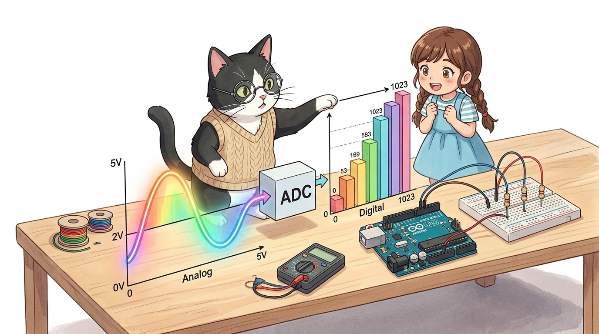
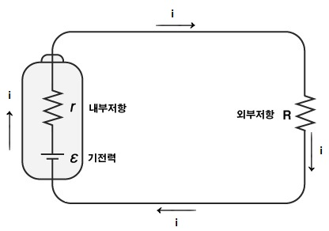
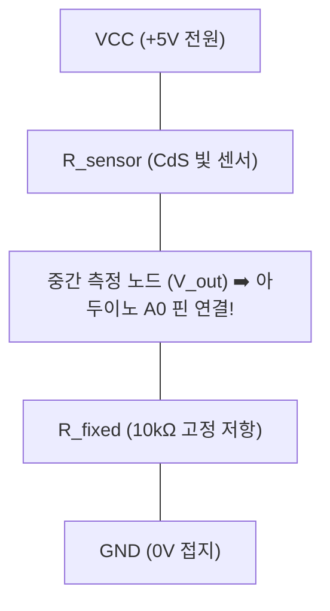
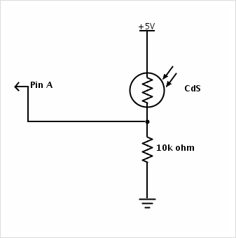
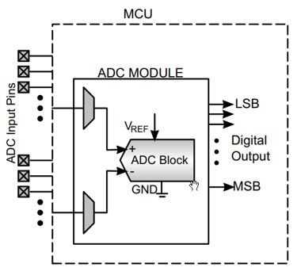
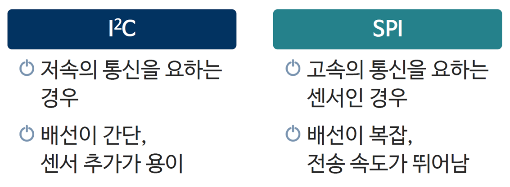
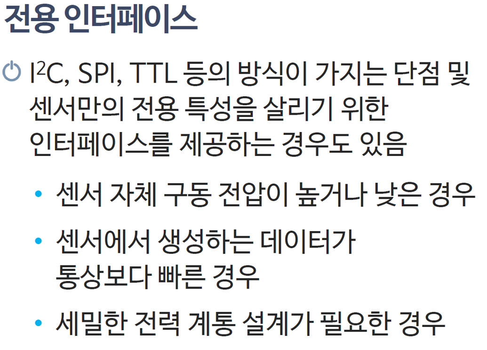
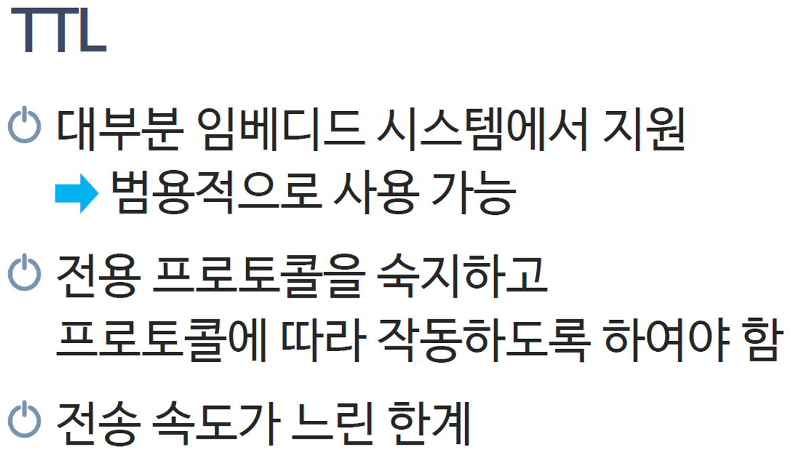

# 044_센서신호의종류와_ADC변환 🔌⚖️

**도로시와 지니가 함께하는 전압 분배 법칙(Voltage Divider)과 10비트 ADC(아날로그-디지털 변환기) 완벽 해설**

* 👧 **도로시**: "교수님! 지니야! 빛 센서(CdS)나 온도 센서는 저항값이 변한다고 했잖아. 그런데 아두이노는 저항을 직접 잴 수 있는 옴미터(Ohm-meter)가 달린 거야, 아니면 전압을 재는 거야?"
* **👨‍🏫 이호진 교수님**: "정말 날카로운 질문이야 도로시! 아두이노의 핀은 저항을 직접 잴 수 없고 오직 **전압(Volt)** 의 높낮이만 측정할 수 있단다! 그래서 센서의 저항 변화를 전압의 높낮이로 바꾸어주는 **전압 분배 회로**와 이를 숫자로 번역하는 **ADC(아날로그-디지털 변환기)** 가 필수적이지!"
* 🐶 **토토**: "바우! 저항을 전압으로 바꾸는 마법의 분배 법칙을 배워보자 멍!"

* 🖥️ **강의 슬라이드**: [slides.md](./slides.md)

---

## 1. 도로시의 물음: 저항의 변화를 컴퓨터는 어떻게 읽어낼까?

### ⚡ 마이크로컨트롤러 입력 핀의 물리적 본질

아두이노 입력 핀의 내부 임피던스는 수 메가옴(M$\Omega$)으로 매우 높아서 전류를 거의 흡수하지 않고, 핀에 걸린 **전위차(전압, 0V ~ 5V)** 만을 감지합니다.

* 센서 단독으로는 저항이 아무리 바뀌어도 전류가 흐를 전압원이 없으면 전압 변화를 만들 수 없습니다.
* 따라서 반드시 **고정 저항(보통 10k$\Omega$)과 전원(5V), 접지(GND)** 를 엮어 폐회로를 만들어주어야 합니다.

---

## 2. 저항을 전압으로! 전압 분배 법칙 (Voltage Divider)

### ⚖️ 센서 저항과 고정 저항의 직렬 직결 마법

두 개의 저항 $R_1$(센서)과 $R_2$(고정 저항)가 5V 전원 사이에 직렬로 연결되어 있을 때, 둘 사이의 중간 지점 전압($V_{out}$)은 옴의 법칙에 따라 정확히 계산됩니다.

$$V_{out} = 5.0\text{V} \times \frac{R_2}{R_1 + R_2}$$

* **빛이 강할 때 (밝음)**:
  * CdS 센서 저항($R_1$)이 $1\text{k}\Omega$로 감소 $\to$ 분모가 작아져 $V_{out} = 5\text{V} \times \frac{10}{1 + 10} \approx \mathbf{4.55\text{V}}$로 치솟음!
* **빛이 없을 때 (어두움)**:
  * CdS 센서 저항($R_1$)이 $100\text{k}\Omega$로 증가 $\to$ 분모가 커져 $V_{out} = 5\text{V} \times \frac{10}{100 + 10} \approx \mathbf{0.45\text{V}}$로 뚝 떨어짐!

---

## 3. 아날로그 신호 vs 디지털 신호의 본질적 차이

### 🌊 부드러운 곡선의 자연계 vs 딱딱 끊어지는 컴퓨터의 이진수

| 신호 구분 | 아날로그 신호 (Analog) | 디지털 신호 (Digital) |
| :--- | :--- | :--- |
| **신호의 형태** | 끊김 없이 매끄럽게 이어지는 연속적인 파형 | **0과 1 (LOW와 HIGH)로 끊어지는 이산 파형** |
| **자연계 예시** | 아침 햇살의 조도, 계절 기온, 사람 목소리 | 전등 스위치 ON/OFF, 컴퓨터 비트 메모리 |
| **정보의 정밀도** | 무한한 해상도 (소수점 무한대 가능) | 샘플링 비트 수(8비트, 10비트 등)에 의해 양자화 |
| **노이즈 취약성** | 전자기 노이즈에 약해 쉽게 왜곡됨 | 전압 기준값(문턱 전압)으로 노이즈를 걸러냄 |

---

## 4. 아날로그-디지털 변환기: ADC (Analog-to-Digital Converter)

### 🎛️ 0V부터 5V까지를 1024단계의 정수로 쪼개는 10비트 통역관

ATmega328P 마이크로컨트롤러 내부에는 연속적인 아날로그 전압을 측정하여 10비트 이진수로 변환하는 연속 근사형(SAR) ADC 회로가 내장되어 있습니다.

$$\text{ADC 카운트 값} = \left\lfloor \frac{V_{in}}{V_{ref}} \times 1024 \right\rfloor \quad (\text{단, } V_{ref} = 5.0\text{V})$$

| 입력 전압 ($V_{in}$) | 전압 비율 | `analogRead()` 반환 정수 | 실제 감지 상황 |
| :---: | :---: | :---: | :--- |
| **0.00 V** | $0 / 1023$ | **0** | 최소 전압 (완전 어두움 / 접지) |
| **1.25 V** | $1 / 4$ | **256** | 1/4 밝기 |
| **2.50 V** | $1 / 2$ | **512** | 중간 전압 (가변저항 정중앙) |
| **3.75 V** | $3 / 4$ | **768** | 3/4 밝기 |
| **5.00 V** | $1023 / 1023$ | **1023** | 최대 전압 (완전 밝음 / 5V 풀인가) |

---

## 5. 샘플링 속도와 나이퀴스트 샘플링 정리 (Nyquist Theorem)

### ⏱️ 신호를 왜곡 없이 읽어 들이기 위한 최소 계측 속도

* **아두이노 ADC 속도**:
  * 기본 16MHz 클록을 128분주하여 약 **125kHz ADC 클록**으로 변환합니다. 1회 변환에 13클록이 소요되어 **초당 약 9,600번(9.6kSPS)** 측정이 가능합니다.
* **나이퀴스트 정리**:
  * 측정하려는 신호의 최고 주파수보다 최소 **2배 이상 빠른 속도로 샘플링**해야 신호가 찌그러지는 앨리어싱(Aliasing) 현상을 방지할 수 있습니다.
  * 음성 신호(최대 4kHz)를 아두이노로 읽으려면 최소 8kHz 이상의 샘플링이 필요합니다.

---

## 6. 센서가 아두이노와 대화하는 5대 표준 인터페이스

### 🌐 센서의 데이터 복잡도에 따른 핀 연결 방식

1. **아날로그 전압형 (A0 ~ A5)**: 가변저항, 조도 센서, 아날로그 조이스틱 (`analogRead`)
2. **디지털 1비트형 (GPIO)**: 푸시버튼, 틸트 센서, 인체감지 PIR 센서 (`digitalRead`)
3. **펄스 시간 계측형 (Timing)**: 초음파 센서 HC-SR04 (`pulseIn`), 1-Wire 온습도 DHT11
4. **I2C 버스 통신형 (SDA/SCL)**: OLED 디스플레이, BMP280 기압 센서, MPU6050 자이로 센서 (`Wire.h`)
5. **SPI 버스 통신형 (MOSI/MISO/SCK)**: 고속 SD 카드 모듈, RFID 리더기, TFT LCD (`SPI.h`)

---

## 🌟 도로시와 지니의 핵심 요약 노트!

* 👧 **도로시**: "센서의 저항 변화를 전압 분배 회로로 0~5V 전압으로 바꾸고, 아두이노 10비트 ADC가 이를 0~1023 정수 숫자로 번역해서 읽는 거였구나!"
* **👨‍🏫 이호진 교수님**: "정답이야! `analogRead(A0)`가 반환하는 0~1023은 바로 $0\text{V} \sim 5\text{V}$ 전압을 1024등분한 눈금이라는 점을 완벽하게 기억하렴."
* 🐶 **토토**: "바우! 이제 디지털 0과 1의 세계를 다루는 **입력의 기초**로 들어가 보자 멍!"
