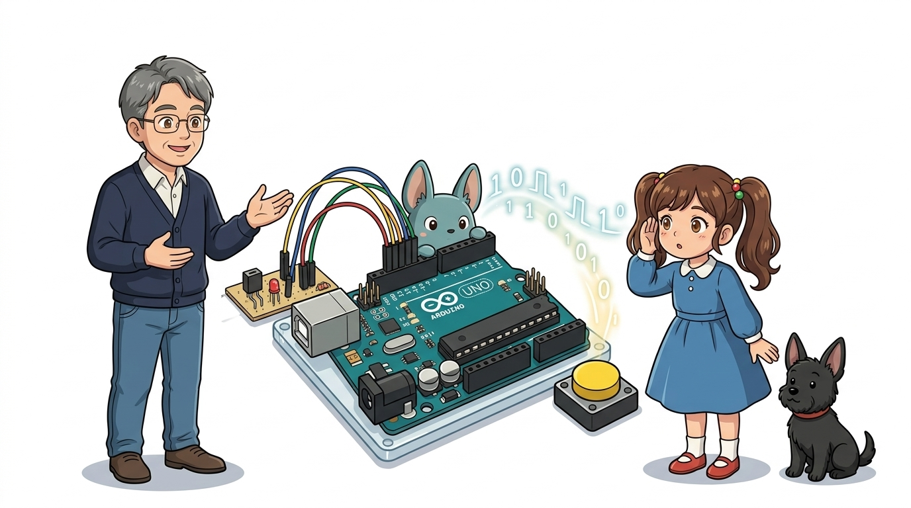
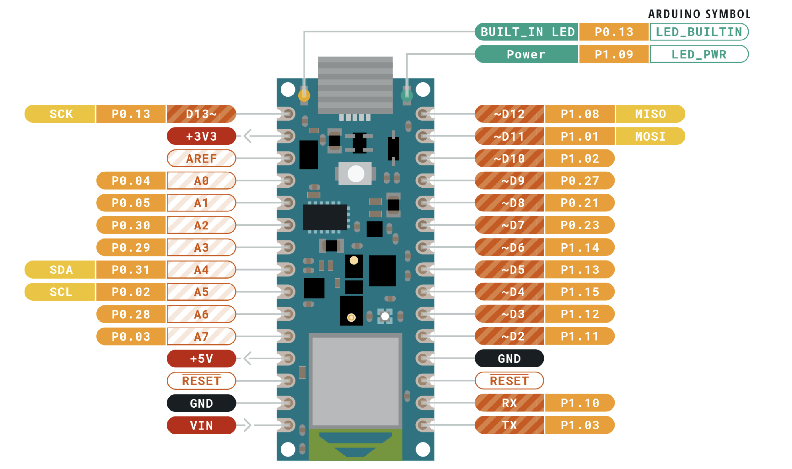
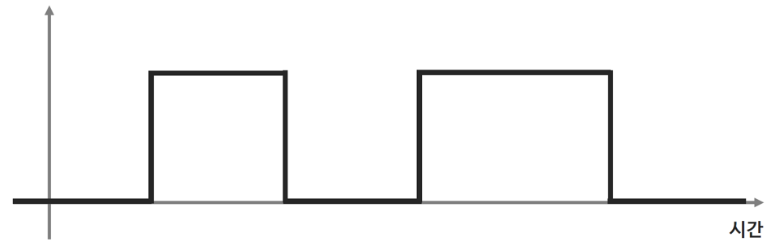
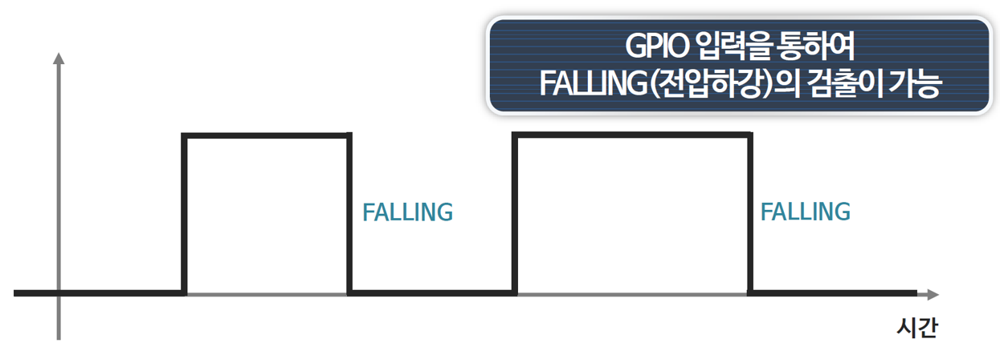
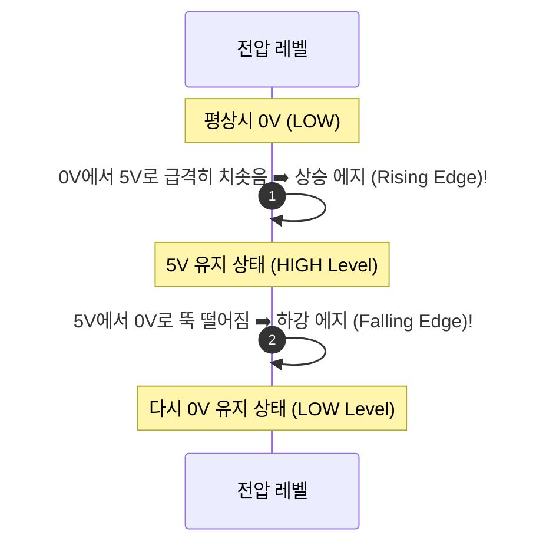
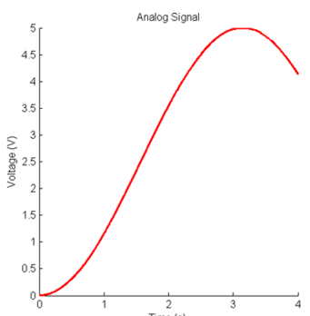
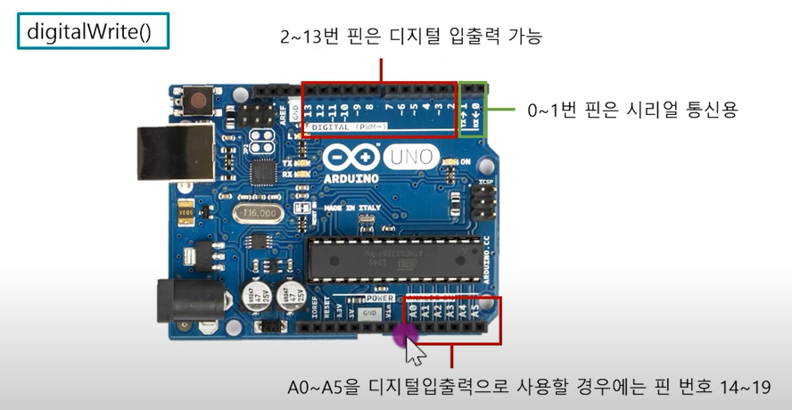
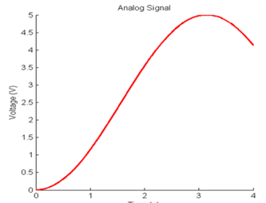

# 045_입력이란_아두이노귀기울이기 🔔🔘



**도로시와 지니가 함께하는 디지털 신호의 0과 1, 그리고 아날로그 전압의 연속적인 세계 완벽 해설**

* 👧 **도로시**: "교수님! 지니야! 지금까지는 `digitalWrite()`로 LED 불을 켜거나 부저 소리를 내는 **출력(OUTPUT)** 만 해봤잖아! **입력(INPUT)** 은 도대체 어떤 차이가 있는 거야?"
* **👨‍🏫 이호진 교수님**: "출력이 아두이노가 바깥세상을 향해 **'말하는 입(Mouth)'** 이라면, 입력은 세상의 소리와 사람의 손짓을 **'귀 기울여 듣는 귀(Ear)'** 란다! 센서와 버튼이 보내는 신호를 읽어 들여 스스로 판단하는 지능형 로봇의 첫걸음이지!"
* 🐶 **토토**: "바우! 아두이노가 내 멍멍 짖는 소리도 경청할 준비가 되었다 멍!"

* 🖥️ **강의 슬라이드**: [slides.md](./slides.md)

---

## 1. 도로시의 궁금증: 출력(OUTPUT)과 입력(INPUT)의 근본적 차이


### 🗣️ 행동하는 액추에이터 vs 인지하는 센서

마이크로컨트롤러 시스템은 정보의 흐름 방향에 따라 명확히 두 갈래로 나뉩니다.

```mermaid
graph LR
    subgraph 입력 영역 (Sensing)
        Sensor["버튼 / 조도 / 온도 센서"] -->|"전압 신호 전달 (INPUT)"| Arduino["아두이노 UNO (두뇌)"]
    end
    subgraph 출력 영역 (Acting)
        Arduino -->|"전류/전압 인가 (OUTPUT)"| Actuator["LED / 모터 / 부저"]
    end
```

* **출력 (OUTPUT)**: 아두이노가 5V나 0V를 스스로 만들어내어 외부에 에너지를 공급합니다.
* **입력 (INPUT)**: 아두이노는 전압을 만들지 않고 고임피던스 상태로 대기하며, 외부 장치가 넣어주는 전압 레벨을 조용히 관찰합니다.

---

## 2. GPIO(General Purpose Input / Output) 핀의 마법



### 🔌 백지상태의 핀에 역할을 부여하는 `pinMode()` 함수

아두이노 보드의 모든 디지털 핀은 태어날 때 용도가 정해져 있지 않은 **GPIO(다목적 입출력) 핀**입니다.

* **`pinMode(pin, OUTPUT);`**:
  * 내부 회로의 출력 버퍼(트랜지스터)를 활성화하여 전류를 뿜거나 빨아들이는 출력 핀으로 변신합니다.
* **`pinMode(pin, INPUT);`**:
  * 내부 출력 버퍼를 차단하고 전압 계측기 모드로 전환하여 외부 전압을 읽습니다.
* **`pinMode(pin, INPUT_PULLUP);`**:
  * 칩 내부의 20k$\Omega$~50k$\Omega$ 풀업 저항을 5V에 연결하여 스위치 연결을 획기적으로 단순화합니다.

---

## 3. 디지털 입력: 전압의 문턱(Threshold)과 2진수 판별



### 💡 0V 근처는 LOW(0), 5V 근처는 HIGH(1)

디지털 입력 함수인 `digitalRead(pin)`은 아날로그 전압을 엄격한 문턱 기준에 따라 0과 1로 판별합니다.

$$\text{ATmega328P 기준 (5V 전원 시)}$$

* **`LOW` (이진수 0)**:
  * 입력 전압이 **$0\text{V} \sim 1.5\text{V}$ (약 $0.3 \times V_{CC}$ 이하)** 일 때 인식
* **`HIGH` (이진수 1)**:
  * 입력 전압이 **$3.0\text{V} \sim 5.0\text{V}$ (약 $0.6 \times V_{CC}$ 이상)** 일 때 인식
* **전압 불확정 영역 ($1.5\text{V} \sim 3.0\text{V}$)**:
  * 신호가 애매하게 걸치면 0인지 1인지 요동치므로, 반드시 풀업/풀다운 저항으로 전압을 확실히 고정해야 합니다.

---

## 4. 신호가 전환되는 결정적 찰나: 상승 에지와 하강 에지



### ⚡ 상태(State) 검사와 에지(Edge) 검사의 차이

버튼을 다룰 때는 "지금 눌려있는가?"뿐만 아니라 "누르는 바로 그 순간!"을 감지하는 것이 중요합니다.



* **상승 에지 (Rising Edge)**: 스위치를 누르는 순간 또는 센서가 활성화되는 기동 순간.
* **하강 에지 (Falling Edge)**: 스위치에서 손을 떼는 순간 또는 비상 신호가 인가되는 순간.

---

## 5. 아날로그 입력: 0부터 1023까지 섬세한 그라데이션



### 🌊 연속적인 자연계의 변화를 정밀 숫자로 계측

* 아두이노 우노 하단의 **A0 ~ A5 핀**에 센서를 연결하고 `analogRead(A0)`를 호출합니다.
* 0V(완전 어두움)는 **0**, 2.5V(중간)는 **512**, 5V(최대 밝기)는 **1023**으로 변환되어 조도, 수온, 볼륨 등의 미세한 변화를 부드럽게 감지합니다.

---

## 6. 아두이노의 숨겨진 보물: 아날로그 핀도 디지털 핀이다!



### 🎁 디지털 핀(0~13번)이 부족할 때 펼치는 구원투수

많은 초보자가 A0~A5 핀은 오직 센서 아날로그 입력 전용인 줄로만 알고 있습니다. 하지만 이 핀들은 **완벽한 일반 디지털 입출력 핀(D14 ~ D19)** 으로 작동합니다!

| 아날로그 핀 표기 | 내부 디지털 핀 번호 | 디지털 출력 예시 | 디지털 입력 예시 |
| :---: | :---: | :--- | :--- |
| **A0** | **디지털 14번** | `pinMode(A0, OUTPUT); digitalWrite(A0, HIGH);` | `digitalRead(A0);` |
| **A1** | **디지털 15번** | `pinMode(A1, OUTPUT); digitalWrite(A1, HIGH);` | `digitalRead(A1);` |
| **A2** | **디지털 16번** | `pinMode(A2, OUTPUT); digitalWrite(A2, HIGH);` | `digitalRead(A2);` |
| **A3** | **디지털 17번** | `pinMode(A3, OUTPUT); digitalWrite(A3, HIGH);` | `digitalRead(A3);` |
| **A4** | **디지털 18번** | (I2C SDA 겸용) | `digitalRead(A4);` |
| **A5** | **디지털 19번** | (I2C SCL 겸용) | `digitalRead(A5);` |

---

## 🌟 도로시와 지니의 핵심 요약 노트!



* 👧 **도로시**: "`pinMode(pin, INPUT)`으로 귀를 열어주고, 스위치 2가지 상태는 `digitalRead()`, 연속적인 센서 전압은 `analogRead()`로 읽는 거였구나!"
* **👨‍🏫 이호진 교수님**: "완벽해! 그리고 디지털 핀이 부족할 때는 A0부터 A5까지도 일반 디지털 핀으로 마음껏 쓸 수 있다는 비법도 꼭 기억하렴."
* 🐶 **토토**: "바우! 이제 가장 대표적인 입력 소자인 **버튼 스위치**를 직접 눌러보러 가자 멍!"
